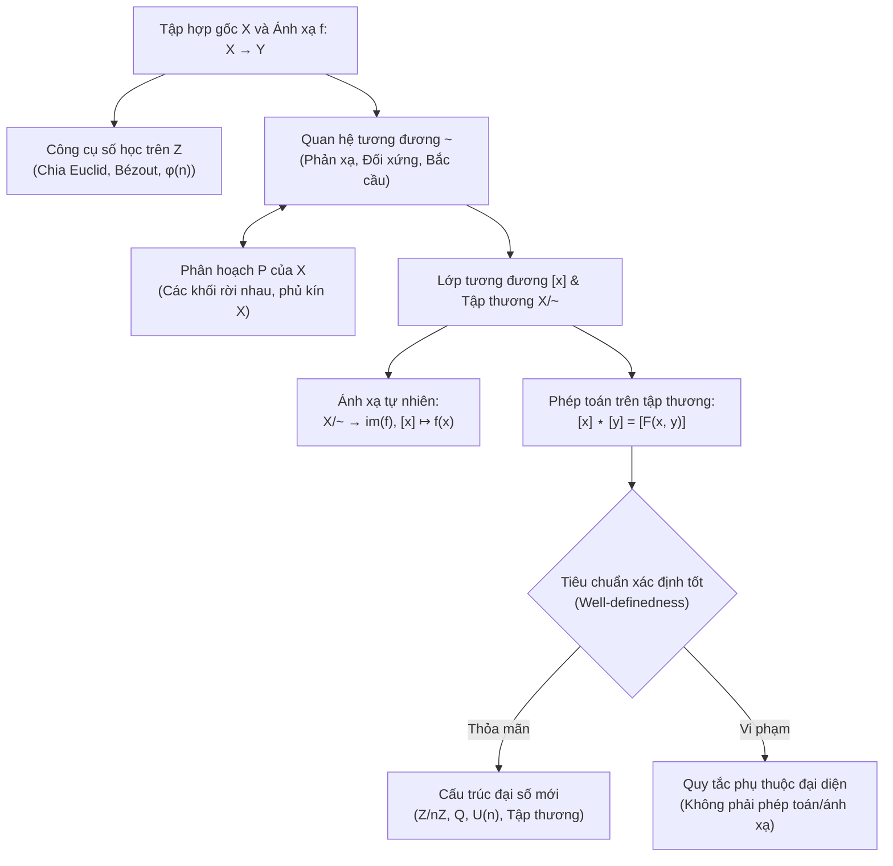

<Note title="Mục tiêu bài học">
Sau khi hoàn thành bài học này, bạn có thể:

1. **Tổng hợp mạng lưới kiến thức Chương 0:** Nắm vững mối liên kết hữu cơ giữa ngôn ngữ ánh xạ (ảnh, nghịch ảnh, thớ), công cụ số học trên $\Z$ (Euclid, Bézout, Euler), quan hệ tương đương, phân hoạch, tập thương và tiêu chuẩn xác định tốt.
2. **Làm chủ 4 nhóm bài tập cốt lõi:**
   - **Nhóm A:** Thực hiện chuẩn xác thuật toán Euclid, tìm hệ số Bézout, giải phương trình đồng dư bậc nhất và tính giá trị hàm phi Euler $\varphi(n)$.
   - **Nhóm B:** Vận dụng Định lý tương ứng giữa quan hệ tương đương và phân hoạch để mô tả cấu trúc hình học của tập thương và xây dựng song ánh tự nhiên.
   - **Nhóm C:** Thiết lập chứng minh chặt chẽ tính chất của ánh xạ đối với phép giao, hợp của các tập con và xây dựng phản ví dụ tối tiểu khi các điều kiện bị vi phạm.
   - **Nhóm D:** Tổng hợp quy trình xây dựng tập số nguyên $\Z$ từ $\N \times \N$ qua quan hệ tương đương và kiểm tra tính xác định tốt của các phép toán trên tập thương.
3. **Sẵn sàng bước vào Lý thuyết Nhóm (Chương 1):** Vận dụng thành thạo bốn mẫu lập luận chuẩn để giải thích và tiếp cận hệ tiên đề của nhóm, vị nhóm, nửa nhóm.
</Note>

**Kiến thức tiên quyết:** Bạn cần hoàn thành ba bài học lý thuyết trước: *Tập hợp, ánh xạ và công cụ số học* (Bài 0.1), *Quan hệ tương đương và tập thương* (Bài 0.2), và *Phép toán hai ngôi và tính xác định tốt* (Bài 0.3).

## 1. Sơ đồ liên kết logic và mạng lưới khái niệm Chương 0

Chương 0 đóng vai trò là "ngôn ngữ ngữ pháp" và "bộ công cụ tính toán tối thiểu" cho toàn bộ học phần **Cấu trúc đại số** (<Cite source="gt-ctds-hvk-2026" page="1-2" note="Mục 0.1" />). Toàn bộ kiến thức của chương được xâu chuỗi thông qua hành trình ba bước xây dựng **cấu trúc thương**:

<Figure caption="Bảng tổng hợp đối chiếu 6 trụ cột kiến thức của Chương 0 (Giáo trình chính, tr. 1–11).">
| Trụ cột | Khái niệm & Ký hiệu cốt lõi | Kết quả / Định lý nền tảng | Ý nghĩa trong các chương sau |
| :--- | :--- | :--- | :--- |
| **1. Ngôn ngữ Ánh xạ** | Miền xác định $X$, đối miền $Y$, ảnh $f(A)$, nghịch ảnh $f^{-1}(B)$, thớ $f^{-1}(\{y\})$, đơn ánh, toàn ánh, song ánh, hợp thành $g \circ f$. | $f$ song ánh $\iff \exists f^{-1}$ hai phía; nghịch ảnh bảo toàn giao và hợp. | Nền tảng khảo sát các ánh xạ bảo toàn phép toán ở các chương sau. |
| **2. Số học trên $\Z$** | Chia hết $a \mid b$, ước chung lớn nhất $\gcd(a, b)$, nguyên tố cùng nhau, hàm phi Euler $\varphi(n)$. | Phép chia Euclid; Đồng nhất thức Bézout $\gcd(a, b) = ua + vb$; Bổ đề Euclid: $a \mid bc, \gcd(a, b) = 1 \implies a \mid c$. | Cấp của phần tử trong nhóm cyclic (Chương 2); Định lý Euler và Fermat nhỏ (Chương 3); nhóm các phần tử khả nghịch $U(n)$ (Chương 1). |
| **3. Quan hệ tương đương** | Quan hệ $\sim$ trên $X$ thỏa mãn 3 tính chất: phản xạ, đối xứng, bắc cầu. | Tiêu chuẩn trùng lớp: $x \sim y \iff [x] = [y] \iff [x] \cap [y] \neq \varnothing$. | Quan hệ đồng dư môđulô nhóm con $x^{-1}y \in H$ tạo ra các lớp kề (Chương 3). |
| **4. Phân hoạch & Tập thương** | Lớp tương đương $[x] = \{y \in X \mid x \sim y\}$, tập thương $X/{\sim} = \{[x] \mid x \in X\}$, phân hoạch $\mathcal{P}$. | **Định lý 0.5:** Tương ứng 1-1 giữa quan hệ tương đương và phân hoạch của tập hợp. | Nhóm thương $G/N$ (Chương 4) và tập thương các lớp đồng dư $\Z/n\Z$. |
| **5. Phép toán hai ngôi** | Ánh xạ $*: X \times X \to X$, tính đóng, tính kết hợp, tính giao hoán, đơn vị $e$, nghịch đảo $a^{-1}$. | Tính duy nhất của đơn vị $e$; tính duy nhất của nghịch đảo khi $*$ có tính kết hợp. | Nền tảng hình thành tiên đề nhóm (Chương 1) và bảng phép toán Cayley (Chương 1). |
| **6. Tính xác định tốt** | Quy tắc trên lớp $[x]$ hoặc cặp lớp $([x], [y])$ được định nghĩa qua phần tử đại diện. | **Định lý 0.14:** $[x] \star [y] = [F(x, y)]$ xác định tốt $\iff (x \sim x' \text{ và } y \sim y' \implies F(x, y) \sim F(x', y'))$. | Điều kiện nhóm con chuẩn tắc để phép toán lớp kề xác định tốt (Chương 4). |
</Figure>

## 2. Hệ thống bài tập chuyên đề 4 nhóm A, B, C, D

Dưới đây là 4 bài tập điển hình bao quát toàn bộ mục tiêu đánh giá của Chương 0 (<Cite source="gt-ctds-hvk-2026" page="11-15, 165-166" note="Mục 0.8 & Gợi ý lời giải" />).

<Exercise id="exr-c0-b4-a1" title="Thuật toán Euclid mở rộng, phương trình đồng dư bậc nhất và tính giá trị hàm phi Euler" group="Nhóm A">
1. Dùng thuật toán Euclid để tìm $d = \gcd(126, 45)$ và biểu diễn $d$ dưới dạng tổ hợp tuyến tính nguyên $126u + 45v = d$.
2. Tìm tất cả các nghiệm nguyên $x \in \Z$ của phương trình đồng dư:
   $$
   45x \equiv 18 \pmod{126}.
   $$
   Phương trình này có bao nhiêu nghiệm phân biệt trong tập thương $\Z/126\Z$?
3. Tính giá trị hàm phi Euler $\varphi(20)$ và liệt kê tất cả các phần tử trong hệ đại diện chuẩn $R_{20} = \{0, 1, \dots, 19\}$ nguyên tố cùng nhau với $20$.

<Hint>
Ở câu (1), thực hiện chia có dư liên tiếp giữa $126$ và $45$ rồi thế ngược. Ở câu (2), chia cả ba số hạng $45, 18, 126$ cho $d = \gcd(126, 45) = 9$ để đưa về phương trình nguyên tố cùng nhau $5x \equiv 2 \pmod{14}$, rồi dùng nghịch đảo của $5$ modulo $14$. Ở câu (3), loại bỏ các bội số của $2$ và $5$ trong $R_{20}$.
</Hint>

<Solution>
**1. Thuật toán Euclid cho $126$ và $45$**

 $$
   \begin{aligned}
   126 &= 45 \cdot 2 + 36, \\
   45 &= 36 \cdot 1 + 9, \\
   36 &= 9 \cdot 4 + 0.
   \end{aligned}
   $$
   Số dư khác $0$ cuối cùng là $9$, nên $d = \gcd(126, 45) = 9$. Thế ngược:
   $$
   9 = 45 - 1 \cdot 36 = 45 - 1 \cdot (126 - 45 \cdot 2) = (-1) \cdot 126 + 3 \cdot 45.
   $$
   Vậy một cặp hệ số Bézout là $(u, v) = (-1, 3)$ (thử lại: $126(-1) + 45(3) = -126 + 135 = 9$).
**2. Giải phương trình đồng dư $45x \equiv 18 \pmod{126}$**

Phương trình tương đương với sự tồn tại $y \in \Z$ sao cho $45x - 126y = 18$. Vì $d = \gcd(45, 126) = 9$ và $9 \mid 18$, phương trình có nghiệm. Chia cả hai vế và môđulô cho $9$, ta được:
   $$
   5x \equiv 2 \pmod{14}.
   $$
   Từ biểu thức Bézout ở câu (1): $3 \cdot 45 + (-1) \cdot 126 = 9 \implies 3 \cdot (5 \cdot 9) \equiv 9 \pmod{14 \cdot 9}$, suy ra $3 \cdot 5 = 15 \equiv 1 \pmod{14}$. Vậy $3$ là nghịch đảo của $5$ modulo $14$. Nhân cả hai vế với $3$:
   $$
   x \equiv 3 \cdot 2 = 6 \pmod{14}.
   $$
   Do đó tập nghiệm nguyên của phương trình là $x = 6 + 14k$ ($k \in \Z$).

   Trong tập thương $\Z/126\Z$, vì $126 = 14 \cdot 9$, cho $k$ chạy từ $0$ đến $8$, ta thu được đúng **$9$ nghiệm phân biệt**:
   $$
   [6]_{126}, \, [20]_{126}, \, [34]_{126}, \, [48]_{126}, \, [62]_{126}, \, [76]_{126}, \, [90]_{126}, \, [104]_{126}, \, [118]_{126}.
   $$
**3. Tính $\varphi(20)$ và liệt kê phần tử**

Trong hệ đại diện chuẩn $R_{20} = \{0, 1, 2, \dots, 19\}$, một số $k$ nguyên tố cùng nhau với $20 = 2^2 \cdot 5$ khi và chỉ khi $k$ không chia hết cho $2$ (tức là số lẻ) và $k$ không chia hết cho $5$. Các số thỏa mãn là:
   $$
   \{1, 3, 7, 9, 11, 13, 17, 19\}.
   $$
   Tập hợp trên có đúng $8$ phần tử, do đó $\varphi(20) = 8$. (Công thức kiểm chứng: $\varphi(20) = 20 \cdot (1 - \frac{1}{2})(1 - \frac{1}{5}) = 20 \cdot \frac{1}{2} \cdot \frac{4}{5} = 8$).
</Solution>
</Exercise>

<Exercise id="exr-c0-b4-b1" title="Quan hệ tương đương trên Z^2, cấu trúc hình học của tập thương và song ánh tự nhiên" group="Nhóm B">
**Đề bài:** Trên tập tích Descartes $X = \Z \times \Z$, xét quan hệ hai ngôi $\sim$ xác định bởi:
$$
(a, b) \sim (c, d) \iff a - b = c - d.
$$

1. Chứng minh rằng $\sim$ là một quan hệ tương đương trên $\Z \times \Z$.
2. Với mỗi cặp số nguyên $(a_0, b_0) \in \Z \times \Z$, hãy mô tả hình học lớp tương đương $[(a_0, b_0)]$ trên lưới tọa độ nguyên $\Z^2$.
3. Chứng minh rằng quy tắc gán:
   $$
   \Psi: (\Z \times \Z)/{\sim} \to \Z, \quad [(a, b)] \mapsto a - b
   $$
   là một ánh xạ **xác định tốt** và là một **song ánh**.

<Hint>
Ở câu (1), nhận xét rằng quan hệ $\sim$ thực chất là quan hệ cùng ảnh của ánh xạ $f(a, b) = a - b$. Ở câu (2), tập hợp các điểm $(a, b) \in \Z^2$ thỏa mãn $a - b = k$ (với $k = a_0 - b_0 \in \Z$) là các điểm nguyên nằm trên đường thẳng nào? Ở câu (3), áp dụng tính chất của quan hệ cùng ảnh.
</Hint>

<Solution>
**1. Chứng minh $\sim$ là quan hệ tương đương**

Xét ánh xạ $f: \Z \times \Z \to \Z$ xác định bởi $f(a, b) = a - b$ với mọi $(a, b) \in \Z \times \Z$. Khi đó:
   $$
   (a, b) \sim (c, d) \iff f(a, b) = f(c, d).
   $$
   Do đó $\sim$ chính là quan hệ cùng ảnh $\sim_f$ của ánh xạ $f$. Theo tính chất của quan hệ cùng ảnh (đã khảo sát ở Bài 0.2), dấu bằng trên tập đích $\Z$ có tính phản xạ ($f(a, b) = f(a, b)$), đối xứng ($f(a, b) = f(c, d) \implies f(c, d) = f(a, b)$) và bắc cầu ($f(a, b) = f(c, d), f(c, d) = f(e, g) \implies f(a, b) = f(e, g)$), nên $\sim$ là một quan hệ tương đương trên $\Z \times \Z$.
**2. Mô tả hình học lớp tương đương**

Đặt $k = a_0 - b_0 \in \Z$. Lớp tương đương của $(a_0, b_0)$ là thớ của $f$ trên phần tử $k$:
   $$
   [(a_0, b_0)] = \{(a, b) \in \Z^2 \mid a - b = k\} = \{(b + k, b) \mid b \in \Z\}.
   $$
   Về mặt hình học, mỗi lớp tương đương $[(a_0, b_0)]$ là **tập hợp tất cả các điểm nguyên nằm trên đường thẳng $x - y = k$** (đường thẳng có hệ số góc bằng $1$, song song với đường phân giác góc phần tư thứ nhất $y = x$). Khi $k$ chạy khắp $\Z$, họ các đường thẳng song song này phân hoạch toàn bộ lưới điểm nguyên $\Z^2$.
**3. Chứng minh $\Psi$ xác định tốt và là song ánh**

 - *Tính xác định tốt và đơn ánh:* Lấy $[(a, b)], [(c, d)] \in (\Z \times \Z)/{\sim}$ bất kỳ. Theo định nghĩa của quan hệ $\sim$ và ánh xạ $\Psi$:
     $$
     [(a, b)] = [(c, d)] \iff (a, b) \sim (c, d) \iff a - b = c - d \iff \Psi([(a, b)]) = \Psi([(c, d)]).
     $$
     Chiều thuận $(\Rightarrow)$ chứng minh $\Psi$ **xác định tốt** (kết quả $\Psi([(a, b)])$ chỉ phụ thuộc vào lớp, không phụ thuộc vào đại diện). Chiều đảo $(\Leftarrow)$ chứng minh $\Psi$ là **đơn ánh**.
   - *Tính toàn ánh:* Lấy $k \in \Z$ bất kỳ. Xét cặp số nguyên $(k, 0) \in \Z \times \Z$. Khi đó lớp $[(k, 0)] \in (\Z \times \Z)/{\sim}$ thỏa mãn:
     $$
     \Psi([(k, 0)]) = k - 0 = k.
     $$
     Vậy mọi số nguyên $k \in \Z$ đều có tạo ảnh qua $\Psi$, nên $\Psi$ là **toàn ánh**.
   Kết hợp đơn ánh và toàn ánh, $\Psi$ là một song ánh.
</Solution>
</Exercise>

<Exercise id="exr-c0-b4-c1" title="Tính bảo toàn của ảnh qua phép giao và điều kiện cần đủ để bảo toàn cấu trúc tập con" group="Nhóm C">
**Đề bài:** Cho ánh xạ $f: X \to Y$ và hai tập con tùy ý $A, B \subseteq X$.

1. Bằng phương pháp chứng minh bao hàm, hãy chứng minh rằng ta luôn có:
   $$
   f(A \cap B) \subseteq f(A) \cap f(B).
   $$
2. Hãy chỉ ra một phản ví dụ cụ thể (với các tập hợp hữu hạn có kích thước nhỏ nhất có thể) chứng tỏ chiều bao hàm ngược lại $f(A) \cap f(B) \subseteq f(A \cap B)$ nói chung **không đúng**.
3. Chứng minh rằng đẳng thức $f(A \cap B) = f(A) \cap f(B)$ xảy ra với **mọi** cặp tập con $A, B \subseteq X$ khi và chỉ khi $f$ là một **đơn ánh**.

<Hint>
Ở câu (1), lấy $y \in f(A \cap B)$, tồn tại $x \in A \cap B$ sao cho $y = f(x)$. Ở câu (2), chọn hai tập $A, B$ rời nhau ($A \cap B = \varnothing$) nhưng chứa hai phần tử khác nhau có cùng ảnh qua $f$. Ở câu (3), chiều thuận xét hai tập con một phần tử $A = \{x_1\}$ và $B = \{x_2\}$ với $x_1 \neq x_2$.
</Hint>

<Solution>
**1. Chứng minh bao hàm tổng quát $f(A \cap B) \subseteq f(A) \cap f(B)$**

Lấy $y \in f(A \cap B)$ bất kỳ. Theo định nghĩa ảnh của tập con, tồn tại $x \in A \cap B$ sao cho $y = f(x)$.
   - Vì $x \in A \cap B$ nên $x \in A$, suy ra $y = f(x) \in f(A)$.
   - Đồng thời $x \in B$, suy ra $y = f(x) \in f(B)$.
   Do $y \in f(A)$ và $y \in f(B)$, ta có $y \in f(A) \cap f(B)$. Vậy $f(A \cap B) \subseteq f(A) \cap f(B)$.
**2. Xây dựng phản ví dụ tối tiểu cho chiều ngược**

Chọn $X = \{1, 2\}$, $Y = \{0\}$. Xét ánh xạ duy nhất $f: X \to Y$ xác định bởi $f(1) = 0$ và $f(2) = 0$.
   Chọn hai tập con $A = \{1\} \subseteq X$ và $B = \{2\} \subseteq X$. Khi đó:
   - $A \cap B = \{1\} \cap \{2\} = \varnothing$, nên $f(A \cap B) = f(\varnothing) = \varnothing$.
   - Trong khi đó $f(A) = \{f(1)\} = \{0\}$ và $f(B) = \{f(2)\} = \{0\}$, nên $f(A) \cap f(B) = \{0\} \cap \{0\} = \{0\}$.
   Vì $\{0\} \nsubseteq \varnothing$, ta có $f(A) \cap f(B) \nsubseteq f(A \cap B)$.
**3. Chứng minh tiêu chuẩn đơn ánh**

 - **Chiều thuận ($\Rightarrow$):** Giả sử $f(A \cap B) = f(A) \cap f(B)$ với mọi $A, B \subseteq X$. Ta cần chứng minh $f$ là đơn ánh. Thật vậy, giả sử tồn tại $x_1, x_2 \in X$ sao cho $f(x_1) = f(x_2) = y_0$. Chọn hai tập con một phần tử $A = \{x_1\}$ và $B = \{x_2\}$. Theo giả thiết:
     $$
     f(\{x_1\} \cap \{x_2\}) = f(\{x_1\}) \cap f(\{x_2\}) = \{y_0\} \cap \{y_0\} = \{y_0\} \neq \varnothing.
     $$
     Điều này kéo theo $\{x_1\} \cap \{x_2\} \neq \varnothing$ (vì nếu $\{x_1\} \cap \{x_2\} = \varnothing$ thì ảnh của nó phải là tập rỗng). Từ $\{x_1\} \cap \{x_2\} \neq \varnothing$ bắt buộc $x_1 = x_2$. Vậy $f$ là đơn ánh.
   - **Chiều đảo ($\Leftarrow$):** Giả sử $f$ là đơn ánh. Theo câu (1), ta luôn có $f(A \cap B) \subseteq f(A) \cap f(B)$. Ta chỉ cần chứng minh chiều bao hàm ngược lại: lấy $y \in f(A) \cap f(B)$ bất kỳ.
     - Vì $y \in f(A)$, tồn tại $a \in A$ sao cho $f(a) = y$.
     - Vì $y \in f(B)$, tồn tại $b \in B$ sao cho $f(b) = y$.
     Khi đó $f(a) = f(b) = y$. Do $f$ là đơn ánh, ta suy ra $a = b$. Đặt $x = a = b$, ta có $x \in A$ và $x \in B$, tức $x \in A \cap B$. Do đó $y = f(x) \in f(A \cap B)$.
     Suy ra $f(A) \cap f(B) \subseteq f(A \cap B)$. Kết hợp hai chiều, ta có đẳng thức $f(A \cap B) = f(A) \cap f(B)$.
</Solution>
</Exercise>

<Exercise id="exr-c0-b4-d1" title="Xây dựng cấu trúc nhóm cộng các số nguyên Z từ N x N qua quan hệ tương đương và tập thương" group="Nhóm D">
**Đề bài:** Ký hiệu $\N = \{0, 1, 2, \dots\}$ là tập các số tự nhiên. Trên tập hợp $M = \N \times \N = \{(a, b) \mid a, b \in \N\}$, xét quan hệ hai ngôi $\sim$ xác định bởi:
$$
(a, b) \sim (c, d) \iff a + d = b + c.
$$
*(Ý nghĩa trực quan: cặp $(a, b)$ đại diện cho hiệu $a - b$).*

1. Chứng minh rằng $\sim$ là một quan hệ tương đương trên $M$.
2. Trên tập thương $M/{\sim}$, ta định nghĩa phép cộng $\oplus$ thông qua phần tử đại diện bởi:
   $$
   [(a, b)] \oplus [(c, d)] = [(a + c, b + d)], \quad \forall [(a, b)], [(c, d)] \in M/{\sim}.
   $$
   Chứng minh rằng phép toán $\oplus$ **xác định tốt** trên $M/{\sim}$ (kết quả không phụ thuộc vào việc chọn đại diện).
3. Chứng minh rằng phép toán $\oplus$ có tính kết hợp, tính giao hoán, có phần tử đơn vị và mọi phần tử trong $M/{\sim}$ đều có phần tử nghịch đảo (tức là $(M/{\sim}, \oplus)$ lập thành một nhóm abel).

<Hint>
Ở câu (1), kiểm tra 3 tính chất trên $\N$; chú ý tính bắc cầu: từ $a + d = b + c$ và $c + f = d + e$, cộng vế theo vế rồi giản ước $c + d$ trong $\N$. Ở câu (2), giả sử $(a, b) \sim (a', b')$ và $(c, d) \sim (c', d')$, cộng hai đẳng thức lại để thu được $(a + c, b + d) \sim (a' + c', b' + d')$. Ở câu (3), kiểm tra lớp $[(0, 0)]$ là đơn vị và lớp $[(b, a)]$ là phần tử đối của $[(a, b)]$.
</Hint>

<Solution>
**1. Chứng minh $\sim$ là quan hệ tương đương trên $M = \N \times \N$**

 - *Tính phản xạ:* Với mọi $(a, b) \in M$, do phép cộng trên $\N$ giao hoán nên $a + b = b + a$, suy ra $(a, b) \sim (a, b)$.
   - *Tính đối xứng:* Với mọi $(a, b), (c, d) \in M$, nếu $(a, b) \sim (c, d)$ thì $a + d = b + c$, suy ra $c + b = d + a$, tức là $(c, d) \sim (a, b)$.
   - *Tính bắc cầu:* Giả sử $(a, b) \sim (c, d)$ và $(c, d) \sim (e, f)$. Khi đó:
     $$
     a + d = b + c \quad \text{và} \quad c + f = d + e.
     $$
     Cộng vế theo vế hai đẳng thức này trong $\N$:
     $$
     (a + d) + (c + f) = (b + c) + (d + e) \iff (a + f) + (c + d) = (b + e) + (c + d).
     $$
     Áp dụng luật giản ước của phép cộng số tự nhiên, giản ước số hạng chung $c + d$, ta thu được $a + f = b + e$, nghĩa là $(a, b) \sim (e, f)$.
   Vậy $\sim$ là một quan hệ tương đương trên $M$.
**2. Chứng minh phép toán $\oplus$ xác định tốt trên $M/{\sim}$**

Giả sử ta chọn hai cặp đại diện khác $[(a, b)] = [(a', b')]$ và $[(c, d)] = [(c', d')]$ trong $M/{\sim}$. Theo định nghĩa của quan hệ $\sim$, ta có:
   $$
   a + b' = b + a' \quad \text{và} \quad c + d' = d + c'.
   $$
   Cộng vế theo vế hai đẳng thức trên:
   $$
   (a + b') + (c + d') = (b + a') + (d + c').
   $$
   Sử dụng tính kết hợp và giao hoán của phép cộng trên $\N$, ta nhóm lại:
   $$
   (a + c) + (b' + d') = (b + d) + (a' + c').
   $$
   Theo định nghĩa của quan hệ $\sim$, đẳng thức này khẳng định:
   $$
   (a + c, b + d) \sim (a' + c', b' + d') \iff [(a + c, b + d)] = [(a' + c', b' + d')].
   $$
   Theo tiêu chuẩn xác định tốt (Định lý 0.14), phép toán $\oplus$ hoàn toàn không phụ thuộc vào việc chọn đại diện, nên là một phép toán hai ngôi xác định tốt trên $M/{\sim}$.
**3. Kiểm tra các tiên đề nhóm abel của $(M/{\sim}, \oplus)$**

 - *Tính kết hợp:* Với mọi $[(a, b)], [(c, d)], [(e, f)] \in M/{\sim}$, nhờ tính kết hợp của phép cộng trên $\N$:
     $$
     \begin{aligned}
     ([(a, b)] \oplus [(c, d)]) \oplus [(e, f)] &= [(a + c, b + d)] \oplus [(e, f)] = [((a + c) + e, (b + d) + f)] \\
     &= [(a + (c + e), b + (d + f))] = [(a, b)] \oplus [(c + e, d + f)] \\
     &= [(a, b)] \oplus ([(c, d)] \oplus [(e, f)]).
     \end{aligned}
     $$
   - *Tính giao hoán:* Hiển nhiên do $a + c = c + a$ và $b + d = d + b$ nên $[(a, b)] \oplus [(c, d)] = [(c, d)] \oplus [(a, b)]$.
   - *Phần tử đơn vị:* Xét lớp $E = [(0, 0)] \in M/{\sim}$. Với mọi $[(a, b)] \in M/{\sim}$:
     $$
     [(a, b)] \oplus [(0, 0)] = [(a + 0, b + 0)] = [(a, b)] = [(0, 0)] \oplus [(a, b)].
     $$
     Vậy $E = [(0, 0)]$ là phần tử đơn vị của phép toán $\oplus$. (Lưu ý rằng $[(0, 0)] = \{(k, k) \mid k \in \N\}$).
   - *Phần tử nghịch đảo (phần tử đối):* Với mỗi lớp $[(a, b)] \in M/{\sim}$, xét lớp $[(b, a)] \in M/{\sim}$. Ta có:
     $$
     [(a, b)] \oplus [(b, a)] = [(a + b, b + a)].
     $$
     Vì $(a + b) + 0 = (b + a) + 0$ nên $(a + b, b + a) \sim (0, 0)$, suy ra $[(a + b, b + a)] = [(0, 0)] = E$.
     Vậy mọi phần tử $[(a, b)]$ đều có phần tử nghịch đảo là $-[(a, b)] = [(b, a)] \in M/{\sim}$.
   Kết luận: $(M/{\sim}, \oplus)$ là một nhóm abel (đây chính là mô hình xây dựng tập số nguyên $(\Z, +)$ từ tập số tự nhiên $\N$).
</Solution>
</Exercise>

## 3. Bảng thuật ngữ và ký hiệu chuẩn Chương 0

Để chuẩn bị học tốt Chương 1, hãy rà soát lại toàn bộ bảng đối chiếu thuật ngữ Việt – Anh dưới đây (<Cite source="gt-ctds-hvk-2026" page="15" note="Mục 0.9" />):

<Figure caption="Bảng tra cứu thuật ngữ và ký hiệu đại số Chương 0 (Giáo trình chính, tr. 15).">
| Thuật ngữ tiếng Việt | Ký hiệu chuẩn | Thuật ngữ tiếng Anh tương đương | Vị trí định nghĩa trong chương |
| :--- | :--- | :--- | :--- |
| **Miền xác định** / **Đối miền** | $X, Y$ trong $f: X \to Y$ | Domain / Codomain | Bài 0.1 (Mục 0.2) |
| **Ảnh của tập con** / **Ảnh toàn miền** | $f(A), \operatorname{im} f = f(X)$ | Image of a subset / Image (Range) | Bài 0.1 (Mục 0.2) |
| **Nghịch ảnh** / **Thớ** | $f^{-1}(B), f^{-1}(\{y\})$ | Preimage (Inverse image) / Fiber | Bài 0.1 (Mục 0.2) |
| **Đơn ánh** / **Toàn ánh** / **Song ánh** | Injective / Surjective / Bijective | Injection / Surjection / Bijection | Bài 0.1 (Mục 0.2) |
| **Hợp thành ánh xạ** | $(g \circ f)(x) = g(f(x))$ | Composition of mappings | Bài 0.1 (Mục 0.2) |
| **Phép chia Euclid** | $a = bq + r, 0 \le r < b$ | Euclidean division | Bài 0.1 (Mục 0.3.1) |
| **Ước chung lớn nhất** | $\gcd(a, b)$ | Greatest common divisor (gcd) | Bài 0.1 (Mục 0.3.1) |
| **Đồng nhất thức Bézout** | $\gcd(a, b) = ua + vb$ | Bézout's identity | Bài 0.1 (Mục 0.3.1) |
| **Hàm phi của Euler** | $\varphi(n)$ | Euler's totient function | Bài 0.1 (Mục 0.3.2) |
| **Quan hệ tương đương** | $\sim$ (phản xạ, đối xứng, bắc cầu) | Equivalence relation | Bài 0.2 (Mục 0.4) |
| **Lớp tương đương** / **Đại diện** | $[x] = \{y \in X \mid x \sim y\}$ | Equivalence class / Representative | Bài 0.2 (Mục 0.4) |
| **Tập thương** | $X/{\sim} = \{[x] \mid x \in X\}$ | Quotient set | Bài 0.2 (Mục 0.4) |
| **Phân hoạch** | $\mathcal{P} = \{A_i\}_{i \in I}$ | Partition | Bài 0.2 (Mục 0.4) |
| **Đồng dư môđulô $n$** | $a \equiv b \pmod n$, $\Z/n\Z$ | Congruence modulo $n$ | Bài 0.2 (Mục 0.4) |
| **Phép toán hai ngôi** | $*: X \times X \to X$ | Binary operation | Bài 0.3 (Mục 0.5) |
| **Tính xác định tốt** | Well-defined | Well-definedness | Bài 0.3 (Mục 0.6) |
</Figure>

<KeyTakeaways>
- **Trục nhận thức xuyên suốt Chương 0:** Khởi đầu từ việc một đối tượng có nhiều biểu diễn $\to$ xác lập quan hệ tương đương $\sim$ $\to$ phân hoạch tập hợp thành các lớp tương đương $\to$ thành lập tập thương $X/{\sim}$ $\to$ định nghĩa phép toán thông qua đại diện và chứng minh **tính xác định tốt** bằng Định lý 0.14.
- **Hai công cụ kỹ thuật then chốt:**
  1. *Công cụ số học trên $\Z$:* Đồng nhất thức Bézout $\gcd(a, b) = ua + vb$ giải quyết triệt để bài toán chia hết và phương trình đồng dư; hàm Euler $\varphi(n)$ đo lường kích thước nhóm các phần tử khả nghịch $U(n)$.
  2. *Công cụ ánh xạ & tập thương:* Sự tương ứng $1-1$ giữa quan hệ tương đương và phân hoạch (Định lý 0.5); và song ánh tự nhiên $\tilde{f}: X/{\sim_f} \to \operatorname{im} f$ mở đường cho việc trang bị phép toán cảm sinh trên tập thương.
- **Bước chuyển tiếp sang Chương 1:** Trong Chương 1, ta sẽ đặt một phép toán hai ngôi có tính kết hợp lên tập hợp $G$, bổ sung tiên đề tồn tại đơn vị và nghịch đảo để bước vào thế giới phong phú của **Lý thuyết Nhóm**.
</KeyTakeaways>
