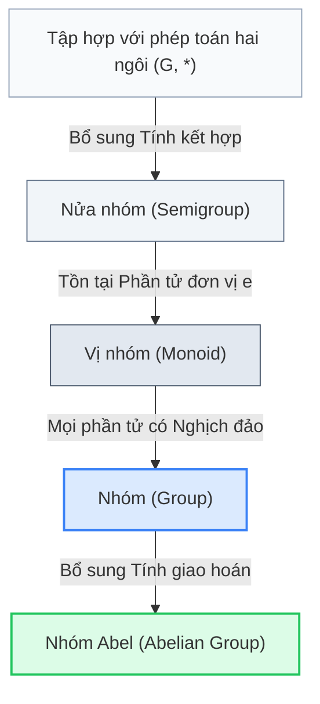

<Note title="Mục tiêu bài học">
Sau khi hoàn thành bài học này, bạn có thể:

1. **Hệ thống hóa toàn diện kiến thức Chương 1:** Nắm vững nấc thang tiến hóa từ *nửa nhóm* $\to$ *vị nhóm* $\to$ *nhóm* $\to$ *nhóm abel*, cùng mối liên hệ hình học và số học của 7 họ nhóm mẫu.
2. **Sử dụng chuẩn xác thuật ngữ song ngữ Việt – Anh:** Làm chủ bảng đối chiếu thuật ngữ đại số phục vụ việc đọc hiểu tài liệu quốc tế và viết khóa luận chuyên ngành.
3. **Giải thành thạo 4 nhóm bài tập cốt lõi:** Phục dựng bảng Cayley, chứng minh hệ tiên đề một phía tối thiểu, suy diễn tính chất giao hoán từ quy tắc lũy thừa, và phân loại toàn bộ các cấu trúc nhóm có cấp nhỏ hơn hoặc bằng 5.
</Note>

**Kiến thức tiên quyết:** Toàn bộ nội dung lý thuyết từ Bài 1.1 đến Bài 1.3 (<Cite source="gt-ctds-hvk-2026" page="17-30" note="Mục 1.1 - 1.7" />).

## 1. Sơ đồ tư duy và phân cấp các cấu trúc một phép toán

Lý thuyết nhóm nghiên cứu các tập hợp được trang bị một phép toán hai ngôi khép kín thỏa mãn các cấp độ tiên đề tăng dần (<Cite source="gt-ctds-hvk-2026" page="18-20" note="Mục 1.2" />):

<Figure caption="Bảng đối chiếu điều kiện tiên đề của các cấu trúc đại số có một phép toán hai ngôi.">
| Cấu trúc đại số | Tính đóng | Tính kết hợp | Phần tử đơn vị | Phần tử nghịch đảo | Tính giao hoán | Ví dụ tiêu biểu |
| :--- | :---: | :---: | :---: | :---: | :---: | :--- |
| **Nửa nhóm** (*Semigroup*) | Có | Có | Không bắt buộc | Không | Không bắt buộc | $(\Z^+, +)$, $(\{2k \mid k \in \Z\}, \cdot)$ |
| **Vị nhóm** (*Monoid*) | Có | Có | **Có** | Không bắt buộc | Không bắt buộc | $(\mathbb{N}, +)$, $(M_n(\R), \cdot)$ |
| **Nhóm** (*Group*) | Có | Có | **Có** | **Có** | Không bắt buộc | $S_n$ ($n \ge 3$), $D_{2n}$, $\operatorname{GL}_2(\R)$, $\operatorname{Aff}(\R)$ |
| **Nhóm Abel** (*Abelian group*) | Có | Có | **Có** | **Có** | **Có** | $(\Z, +)$, $(\Z/n\Z, +)$, $U(n)$, $(\R \setminus \{0\}, \cdot)$ |
</Figure>

### Bảng tóm tắt các kết quả then chốt của Chương 1

1. **Tính duy nhất và luật giản ước:** Trong một nhóm bất kỳ, phần tử đơn vị $e$ là duy nhất; mỗi phần tử $x$ có duy nhất một nghịch đảo $x^{-1}$; phương trình $ax = b$ và $ya = b$ luôn có nghiệm duy nhất ($x = a^{-1}b$ và $y = ba^{-1}$); luật giản ước trái và phải luôn đúng.
2. **Quy tắc nghịch đảo của tích:** $(a_1 a_2 \cdots a_k)^{-1} = a_k^{-1} \cdots a_2^{-1} a_1^{-1}$ (phải đảo ngược toàn bộ thứ tự các nhân tử).
3. **Quy tắc lũy thừa nguyên:** Với $m, n \in \Z$, ta luôn có $a^m a^n = a^{m+n}$ và $(a^m)^n = a^{mn}$. Đẳng thức $(ab)^n = a^n b^n$ chỉ được bảo đảm khi hai phần tử $a, b$ giao hoán với nhau.
4. **Bảng Cayley của nhóm hữu hạn:** Mỗi hàng và mỗi cột của bảng Cayley luôn là một hoán vị của tập hợp các phần tử trong nhóm (không có phần tử nào lặp lại trên cùng một hàng hoặc cùng một cột).
5. **Đặc trưng nhóm cấp chẵn:** Mọi nhóm hữu hạn có cấp chẵn luôn chứa ít nhất một phần tử cấp 2 ($x \neq e$ thỏa mãn $x^2 = e$).

## 2. Bảng thuật ngữ chuyên ngành đối chiếu Việt – Anh

Việc nắm vững thuật ngữ chuẩn quốc tế giúp sinh viên Sư phạm Toán học dễ dàng tra cứu tài liệu tham khảo và hội nhập học thuật:

<Figure caption="Bảng thuật ngữ đại số Chương 1 đối chiếu song ngữ Việt - Anh.">
| Thuật ngữ tiếng Việt | Thuật ngữ tiếng Anh | Định nghĩa / Ký hiệu vắn tắt |
| :--- | :--- | :--- |
| Phép toán hai ngôi | Binary operation | Ánh xạ $*: G \times G \to G, (a, b) \mapsto a * b$ |
| Tính kết hợp | Associativity | $(ab)c = a(bc)$ với mọi $a, b, c \in G$ |
| Nửa nhóm | Semigroup | Tập hợp có phép toán kết hợp |
| Vị nhóm | Monoid | Nửa nhóm có phần tử đơn vị |
| Nhóm | Group | Vị nhóm mà mọi phần tử đều có nghịch đảo |
| Nhóm giao hoán / Nhóm Abel | Abelian group | Nhóm có phép toán thỏa mãn $ab = ba$ |
| Cấp của nhóm | Order of a group | Số phần tử của nhóm, ký hiệu $\|G\|$ |
| Cấp của phần tử | Order of an element | Số nguyên dương nhỏ nhất $n$ sao cho $a^n = e$ |
| Bảng Cayley | Cayley table | Bảng nhân ma trận biểu diễn phép toán trên nhóm hữu hạn |
| Phép tịnh tiến trái / phải | Left / right translation | Ánh xạ $L_a(x) = ax$, $R_a(x) = xa$ (đều là song ánh) |
| Nhóm đối xứng | Symmetric group | $\operatorname{Sym}(X)$ gồm tất cả các song ánh từ $X$ vào $X$ |
| Nhóm hoán vị bậc $n$ | Permutation group $S_n$ | Nhóm đối xứng trên tập $n$ phần tử, cấp $\|S_n\| = n!$ |
| Chu trình / Chuyển vị | Cycle / Transposition | Chu trình $(i_1 \dots i_k)$; chuyển vị $(i \, j)$ có cấp 2 |
| Nhóm nhị diện | Dihedral group $D_{2n}$ | Nhóm đối xứng của đa giác đều $n$ cạnh, cấp $2n$ |
| Nhóm tuyến tính tổng quát | General linear group | $\operatorname{GL}_n(F)$ gồm các ma trận khả nghịch cấp $n$ |
| Nhóm Affine | Affine group $\operatorname{Aff}(\R)$ | Ánh xạ $T_{a,b}(x) = ax + b$ ($a \neq 0$), hợp thành ánh xạ |
| Nhóm bốn Klein | Klein four-group $V_4$ | Nhóm không cyclic cấp 4, $V_4 = \Z/2\Z \times \Z/2\Z$ |
</Figure>

---

## 3. Hệ thống bài tập chuyên đề chọn lọc

<Exercise id="exr-c1-b4-a1" title="Phục dựng bảng Cayley khuyết và nhận diện nhóm cấp 4" group="Nhóm A">
Cho $G = \{e, a, b, c\}$ là một nhóm gồm $4$ phần tử với phần tử đơn vị $e$. Bảng Cayley của $G$ đang bị khuyết một số vị trí như sau:

| $\cdot$ | $e$ | $a$ | $b$ | $c$ |
| :---: | :---: | :---: | :---: | :---: |
| $e$ | $e$ | $a$ | $b$ | $c$ |
| $a$ | $a$ | **?** | $c$ | **?** |
| $b$ | $b$ | $c$ | **?** | **?** |
| $c$ | $c$ | **?** | **?** | **?** |

Biết thêm rằng phần tử $a$ có cấp bằng $4$, nghĩa là $a^4 = e$ và $a^2 \neq e$.
1. Hãy điền đầy đủ tất cả các dấu hỏi **?** trong bảng Cayley của nhóm $G$.
2. Nhóm $(G, \cdot)$ này là nhóm cyclic $(\Z/4\Z, +)$ hay nhóm bốn Klein $V_4$? Giải thích lý do.

<Hint>
1. Vì $a$ có cấp 4, các lũy thừa $e, a, a^2, a^3$ đôi một phân biệt. Nhìn vào hàng của $a$: ta có $ab = c$, hãy xác định xem $a^2$ có thể bằng $b$ được không.
2. Áp dụng định lý bảng Cayley: trên mỗi hàng và mỗi cột, mỗi phần tử của $\{e, a, b, c\}$ xuất hiện đúng một lần.
</Hint>

<Solution>
**1. Hoàn thành bảng Cayley**

- Xét hàng thứ hai (phép nhân với $a$ bên trái): $\{a \cdot e, a \cdot a, a \cdot b, a \cdot c\} = \{a, a^2, c, ac\}$.
  Hàng này đã có $a$ (tại cột $e$) và $c$ (tại cột $b$). Như vậy hai phần tử còn lại là $a^2$ và $ac$ phải rơi vào tập $\{e, b\}$.
  Theo giả thiết $a$ có cấp 4 nên $a^2 \neq e$. Do đó bắt buộc:
  $$
  a^2 = b \quad \text{và} \quad ac = e.
  $$
  Điều này cho ta $c = a^{-1} = a^3$.
- Xét hàng thứ ba (phép nhân với $b$ bên trái): ta biết $b = a^2$.
  - $ba = a^2 a = a^3 = c$ (đã có trong bảng).
  - $bb = b^2 = (a^2)^2 = a^4 = e$. Vậy $b \cdot b = e$.
  - $bc = a^2 a^3 = a^5 = a$. Vậy $b \cdot c = a$.
- Xét hàng thứ tư (phép nhân với $c$ bên trái): ta biết $c = a^3$.
  - $ca = a^3 a = a^4 = e$. Vậy $c \cdot a = e$.
  - $cb = a^3 a^2 = a^5 = a$. Vậy $c \cdot b = a$.
  - $cc = a^3 a^3 = a^6 = a^2 = b$. Vậy $c \cdot c = b$.

Kiểm tra trên từng cột:
- Cột $e$: $e, a, b, c$ (đủ).
- Cột $a$: $a, b, c, e$ (đủ).
- Cột $b$: $b, c, e, a$ (đủ).
- Cột $c$: $c, e, a, b$ (đủ).

Bảng Cayley hoàn chỉnh là:

| $\cdot$ | $e$ | $a$ | $b$ | $c$ |
| :---: | :---: | :---: | :---: | :---: |
| $e$ | $e$ | $a$ | $b$ | $c$ |
| $a$ | $a$ | $b$ | $c$ | $e$ |
| $b$ | $b$ | $c$ | $e$ | $a$ |
| $c$ | $c$ | $e$ | $a$ | $b$ |

**2. Nhận diện cấu trúc nhóm**

Vì $G = \{e, a, a^2, a^3\}$ được sinh ra bởi một phần tử duy nhất $a$ có cấp bằng $4$, nhóm $G$ là một **nhóm cyclic cấp 4** (có cùng cấu trúc bảng phép toán với $(\Z/4\Z, +)$). Nó không phải là nhóm Klein $V_4$ vì trong nhóm Klein $V_4$, mọi phần tử khác đơn vị đều có bình phương bằng $e$ (cấp 2), trong khi ở đây $a^2 = b \neq e$.
</Solution>
</Exercise>

<Exercise id="exr-c1-b4-b1" title="Hệ tiên đề tối thiểu của Nhóm (Bài tập 1.9)" group="Nhóm B">
Cho $G$ là một tập hợp khác rỗng cùng với một phép toán hai ngôi có tính kết hợp (nghĩa là $(G, \cdot)$ là một nửa nhóm). Giả sử thỏa mãn hai điều kiện sau:
1. Tồn tại phần tử $e \in G$ sao cho $ea = a$ với mọi $a \in G$ ($e$ là **đơn vị trái**).
2. Với mỗi $a \in G$, tồn tại phần tử $a' \in G$ sao cho $a'a = e$ ($a'$ là **nghịch đảo trái** của $a$).

Hãy chứng minh rằng:
1. Với mỗi $a \in G$, phần tử $a'$ cũng là nghịch đảo phải của $a$, tức là $aa' = e$.
2. Phần tử $e$ cũng là đơn vị phải của $G$, tức là $ae = a$ với mọi $a \in G$.
3. Từ đó kết luận $(G, \cdot)$ là một nhóm.

<Hint>
1. Vì $a' \in G$, áp dụng điều kiện (2) cho chính $a'$, tồn tại phần tử $a'' \in G$ sao cho $a''a' = e$. Hãy tính tích $a''a'aa'$ theo hai cách kết hợp khác nhau.
2. Khi đã có $aa' = e$, hãy tính $ae = a(a'a)$ bằng cách đổi dấu ngoặc thành $(aa')a$.
</Hint>

<Solution>
**1. Chứng minh $aa' = e$ (nghịch đảo trái là nghịch đảo phải)**

Lấy tùy ý $a \in G$. Theo giả thiết (2), tồn tại $a' \in G$ sao cho $a'a = e$.
Vì $a' \in G$, tiếp tục áp dụng giả thiết (2) cho phần tử $a'$, tồn tại $a'' \in G$ sao cho:
$$
a'' a' = e.
$$
Bây giờ, ta biến đổi biểu thức $a'aa'$:
$$
a'aa' = (a'a)a' = ea' = a' \quad (\text{vì } ea' = a' \text{ theo tính chất đơn vị trái}).
$$
Nhân $a''$ vào phía bên trái của đẳng thức trên:
$$
a''(a'aa') = a''a'.
$$
Sử dụng tính kết hợp của phép nhân trên $G$:
- Vế trái: $a''(a'aa') = (a''a')(aa') = e(aa') = aa'$ (áp dụng $a''a' = e$ và $e$ là đơn vị trái đối với phần tử $aa'$).
- Vế phải: $a''a' = e$.
Từ đó ta suy ra:
$$
aa' = e.
$$
Vậy $a'$ cũng chính là nghịch đảo phải của $a$.

**2. Chứng minh $ae = a$ (đơn vị trái là đơn vị phải)**

Với mọi $a \in G$, sử dụng kết quả $a'a = e$ và $aa' = e$ vừa chứng minh:
$$
ae = a(a'a) = (aa')a = ea = a \quad (\text{vì } ea = a \text{ theo giả thiết đơn vị trái}).
$$
Vậy $ae = a$ với mọi $a \in G$, chứng tỏ $e$ là phần tử đơn vị phải.

**3. Kết luận**

Vì $ea = ae = a$ với mọi $a \in G$, $e$ là phần tử đơn vị hai phía.
Vì $a'a = aa' = e$, mỗi phần tử $a \in G$ đều có phần tử nghịch đảo hai phía là $a'$.
Kết hợp với tính kết hợp đã cho, $(G, \cdot)$ thỏa mãn đầy đủ các tiên đề của một nhóm.
</Solution>
</Exercise>

<Exercise id="exr-c1-b4-c1" title="Nhóm có mọi phần tử bình phương bằng đơn vị là nhóm Abel (Bài tập 1.11)" group="Nhóm C">
1. Cho $G$ là một nhóm thỏa mãn $x^2 = e$ với mọi $x \in G$. Chứng minh rằng $G$ là một nhóm abel (giao hoán).
2. Hãy chỉ ra một ví dụ về một nhóm thỏa mãn điều kiện trên.
3. Nếu thay đổi giả thiết thành $x^3 = e$ với mọi $x \in G$, thì nhóm $G$ có nhất thiết phải giao hoán hay không? Giải thích rõ.

<Hint>
1. Từ $x^2 = e$, suy ra nghịch đảo của $x$ là gì? Áp dụng công thức nghịch đảo của tích $(ab)^{-1}$ cho hai phần tử bất kỳ.
2. Xem lại nhóm bốn Klein $V_4$ hoặc nhóm $U(8)$.
3. Tìm hiểu nhóm Heisenberg hoặc nhóm không giao hoán cấp 27 có mọi phần tử đều có cấp 3 (nhóm lũy linh cấp 2).
</Hint>

<Solution>
**1. Chứng minh $G$ giao hoán khi $x^2 = e, \forall x \in G$**

Lấy tùy ý $x \in G$. Theo giả thiết $x^2 = e$, ta có $xx = e$.
Nhân $x^{-1}$ vào bên phải của đẳng thức, ta được:
$$
x = x^{-1}, \quad \forall x \in G.
$$
Nghĩa là trong nhóm $G$, mọi phần tử đều tự nghịch đảo chính nó.
Bây giờ lấy hai phần tử tùy ý $a, b \in G$. Vì $G$ là nhóm nên tích $ab \in G$.
Áp dụng tính chất tự nghịch đảo cho phần tử $ab$:
$$
ab = (ab)^{-1}.
$$
Mặt khác, theo quy tắc nghịch đảo của tích trong một nhóm bất kỳ:
$$
(ab)^{-1} = b^{-1}a^{-1}.
$$
Lại áp dụng tính chất tự nghịch đảo cho riêng từng phần tử $a$ và $b$:
$$
b^{-1} = b \quad \text{và} \quad a^{-1} = a.
$$
Do đó:
$$
ab = (ab)^{-1} = b^{-1}a^{-1} = ba.
$$
Vì đẳng thức $ab = ba$ đúng với mọi $a, b \in G$, ta kết luận $(G, \cdot)$ là một nhóm abel.

**2. Ví dụ minh họa**

Nhóm bốn Klein $V_4 = \{e, a, b, c\}$ thỏa mãn $a^2 = b^2 = c^2 = e^2 = e$.
Một ví dụ số học là nhóm $U(8) = \{[1]_8, [3]_8, [5]_8, [7]_8\}$ với $[1]^2 = [3]^2 = [5]^2 = [7]^2 = [1]_8$.

**3. Khảo sát trường hợp $x^3 = e$**

Nếu $x^3 = e$ với mọi $x \in G$, nhóm $G$ **không nhất thiết** phải giao hoán.
*Giải thích:* Điều kiện $x^3 = e$ cho ta $x^{-1} = x^2$. Khi đó $(ab)^{-1} = b^{-1}a^{-1} \iff (ab)^2 = b^2 a^2$. Từ đó suy ra $abab = bbaa \implies ba = a^2 b^2$, chưa đủ để kết luận $ab = ba$.
Trong đại số trừu tượng, tồn tại nhóm không giao hoán cấp $27$ (nhóm ma trận tam giác trên $\Z/3\Z$) gồm các ma trận:
$$
G = \left\{ \begin{pmatrix} 1 & a & b \\ 0 & 1 & c \\ 0 & 0 & 1 \end{pmatrix} \;\middle|\; a, b, c \in \Z/3\Z \right\}.
$$
Mọi ma trận khác đơn vị trong nhóm này đều thỏa mãn $A^3 = I_3$, nhưng nhóm này không giao hoán (ví dụ lấy $a = 1, c = 0$ và $a = 0, c = 1$).
</Solution>
</Exercise>

<Exercise id="exr-c1-b4-d1" title="Phân loại các cấu trúc nhóm cấp nhỏ hơn hoặc bằng 5" group="Nhóm D">
1. Chứng minh rằng mọi nhóm cấp $1, 2, 3$ đều là nhóm cyclic, và với mỗi cấp này chỉ tồn tại duy nhất một cấu trúc nhóm (sai khác phép đổi tên phần tử trong bảng Cayley).
2. Cho $G$ là nhóm cấp $4$. Chứng minh rằng $G$ chỉ có thể rơi vào đúng một trong hai trường hợp sau:
   - Trường hợp 1: $G$ chứa một phần tử cấp $4$, khi đó $G$ có cùng cấu trúc bảng phép toán với nhóm cyclic $(\Z/4\Z, +)$.
   - Trường hợp 2: Mọi phần tử khác đơn vị của $G$ đều có cấp $2$, khi đó $G$ có cùng cấu trúc bảng phép toán với nhóm bốn Klein $V_4$.
3. Tổng hợp kết quả: Tính số cấu trúc nhóm phân biệt (sai khác phép đổi tên phần tử bảo toàn phép toán) đối với từng cấp $n \in \{1, 2, 3, 4, 5\}$ và chỉ ra nhóm có cấp nhỏ nhất không giao hoán.

<Hint>
1. Dùng bảng Cayley: nhóm cấp 1 là $\{e\}$; nhóm cấp 2 là $\{e, a\}$ bắt buộc $a^2 = e$; nhóm cấp 3 là $\{e, a, b\}$ bắt buộc $a^2 = b, ab = e$.
2. Áp dụng bảng Cayley và tính duy nhất trên mỗi hàng: nếu không có phần tử cấp 4 thì mọi phần tử khác $e$ đều có bình phương bằng $e$.
3. Cấp 5 là số nguyên tố nên chỉ có nhóm cyclic. Nhóm không giao hoán nhỏ nhất là $S_3$ cấp 6.
</Hint>

<Solution>
**1. Phân loại nhóm cấp 1, 2, 3**

- *Cấp 1:* $G = \{e\}$. Bảng Cayley chỉ có một ô $e \cdot e = e$. Đây là nhóm tầm thường $\Z/1\Z$.
- *Cấp 2:* $G = \{e, a\}$ với $a \neq e$. Hàng thứ hai của bảng Cayley chứa $\{a \cdot e, a \cdot a\} = \{a, a^2\}$. Vì $a$ đã xuất hiện tại cột $e$, nên tại cột $a$ bắt buộc phải là phần tử còn lại: $a^2 = e$. Vậy bảng Cayley hoàn toàn bị xác định duy nhất: $G = \{e, a\} = \langle a \rangle \simeq \Z/2\Z$ (cyclic cấp 2).
- *Cấp 3:* $G = \{e, a, b\}$. Hàng của $a$ gồm $\{a, a^2, ab\}$. Cột $e$ đã có $a$. Do đó $\{a^2, ab\} = \{e, b\}$.
  Nếu $a^2 = e$, thì hàng của $a$ là $a, e, b$, suy ra cột $b$ có hai lần xuất hiện phần tử $b$ (ở hàng $e$ và hàng $a$), mâu thuẫn với định lý bảng Cayley.
  Do đó bắt buộc $a^2 = b$ và $ab = e$. Khi đó $a^3 = a \cdot a^2 = ab = e$.
  Vậy $G = \{e, a, a^2\}$ là nhóm cyclic cấp 3, có cùng cấu trúc bảng phép toán với $\Z/3\Z$. Bảng Cayley duy nhất.

**2. Phân loại nhóm cấp 4**

Cho $G = \{e, a, b, c\}$.
- *Nếu $G$ chứa một phần tử có cấp 4:* Giả sử $\operatorname{ord}(a) = 4$. Khi đó các phần tử $e, a, a^2, a^3$ đôi một phân biệt. Vì $|G| = 4$, ta có $G = \{e, a, a^2, a^3\} = \langle a \rangle$. Nhóm này là **nhóm cyclic cấp 4**, có cùng cấu trúc bảng phép toán với $(\Z/4\Z, +)$.
- *Nếu $G$ không chứa phần tử nào có cấp 4:* Do cấp của mỗi phần tử khác $e$ phải là ước của 4 và không bằng 4 (và không bằng 1 vì khác $e$), cấp của mọi phần tử $x \neq e$ bắt buộc phải bằng 2.
  Nghĩa là:
  $$
  a^2 = b^2 = c^2 = e.
  $$
  Theo Bài tập 1.11 vừa chứng minh ở trên, nhóm thỏa mãn tính chất này luôn là một nhóm abel.
  Xét tích $ab$: Vì $a \neq e$ và $b \neq e$, ta có $ab \neq b$ (vì nếu $ab = b \implies a = e$) và $ab \neq a$ (nếu $ab = a \implies b = e$).
  Hơn nữa $ab \neq e$ vì nếu $ab = e \implies b = a^{-1} = a$ (mâu thuẫn vì $a, b$ phân biệt).
  Vì tập $G = \{e, a, b, c\}$, khả năng duy nhất còn lại là:
  $$
  ab = c.
  $$
  Tương tự, ta suy ra $ba = c, bc = cb = a, ca = ac = b$.
  Đây chính là bảng Cayley của **nhóm bốn Klein $V_4$** (có cùng cấu trúc bảng phép toán với $\Z/2\Z \times \Z/2\Z$).
Vậy chỉ có đúng 2 cấu trúc nhóm cấp 4 sai khác phép đổi tên phần tử bảo toàn phép toán.

**3. Bảng tổng hợp số cấu trúc nhóm cấp $\le 5$**

Đối với cấp 5: Vì 5 là số nguyên tố, lý luận tương tự cấp 3 (hoặc dùng định lý Lagrange sau này), mọi phần tử $a \neq e$ đều sinh ra nhóm cấp 5, nên chỉ có duy nhất 1 cấu trúc nhóm cyclic $\Z/5\Z$.

| Cấp của nhóm $\|G\|$ | Số cấu trúc nhóm phân biệt (sai khác phép đổi tên phần tử bảo toàn phép toán) | Danh sách các nhóm | Tính giao hoán |
| :---: | :---: | :--- | :---: |
| 1 | 1 | Nhóm tầm thường $\{e\}$ | Abel |
| 2 | 1 | $\Z/2\Z$ (cyclic) | Abel |
| 3 | 1 | $\Z/3\Z$ (cyclic) | Abel |
| 4 | 2 | $\Z/4\Z$ (cyclic) và $V_4$ (Klein) | Abel |
| 5 | 1 | $\Z/5\Z$ (cyclic) | Abel |

Nhóm không giao hoán có cấp nhỏ nhất trong toàn bộ đại số là **nhóm đối xứng $S_3$** (cũng chính là nhóm nhị diện $D_6$), có cấp bằng $6 = 3!$. Mọi nhóm có cấp từ 1 đến 5 đều là nhóm abel.
</Solution>
</Exercise>

---

<KeyTakeaways>
- **Khung lý thuyết hoàn chỉnh:** Hệ thống đại số có một phép toán hai ngôi gồm 4 nấc thang: Nửa nhóm $\to$ Vị nhóm $\to$ Nhóm $\to$ Nhóm abel. Tiên đề một phía (đơn vị trái và nghịch đảo trái) là đủ để bảo đảm cấu trúc nhóm hoàn chỉnh.
- **Hệ quả lũy thừa và giao hoán:** Điều kiện $x^2 = e$ với mọi phần tử kéo theo tính tự nghịch đảo $x = x^{-1}$ và dẫn tới tính giao hoán $ab = ba$. Điều này không còn đúng khi số mũ lớn hơn 2 ($x^3 = e$).
- **Phân loại nhóm cấp nhỏ:** Mọi nhóm có cấp $1, 2, 3, 5$ đều là nhóm cyclic; nhóm cấp 4 có đúng 2 cấu trúc: nhóm cyclic $\Z/4\Z$ và nhóm Klein $V_4$.
- **Mọi nhóm có cấp nhỏ hơn 6 đều là nhóm Abel:** Nhóm không giao hoán có cấp nhỏ nhất là nhóm hoán vị $S_3$ (có cùng cấu trúc bảng phép toán với nhóm nhị diện $D_6$) có cấp bằng 6.
- **Cầu nối sang Chương 2:** Việc khảo sát các tập con của nhóm đóng dưới phép toán dẫn đến khái niệm trung tâm tiếp theo: **Nhóm con** ($H \le G$) và cấu trúc đặc biệt của **Nhóm cyclic** sinh bởi một phần tử.
</KeyTakeaways>
