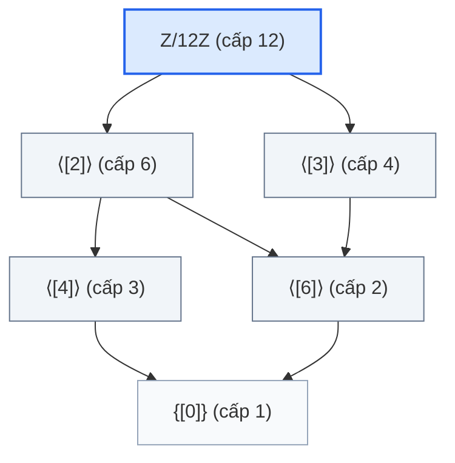

<Note title="Mục tiêu bài học">
Sau khi hoàn thành bài học này, bạn có thể:

1. **Chứng minh và giải thích Định lý cơ bản về nhóm cyclic:** Hiểu lý do vì sao tính chất cyclic được kế thừa hoàn toàn cho mọi nhóm con thông qua nguyên lý sắp thứ tự tốt và phép chia Euclid.
2. **Vận dụng công thức tính cấp của lũy thừa:** Sử dụng thành thạo $\operatorname{ord}(a^k) = \frac{n}{\gcd(n, k)}$ để xác định cấp của bất kỳ phần tử nào và tìm toàn bộ $\varphi(n)$ phần tử sinh của nhóm cyclic cấp $n$.
3. **Phân loại triệt để và vẽ lưới nhóm con:** Thiết lập song ánh giữa các ước dương $d \mid n$ và các nhóm con duy nhất cấp $d$ là $\langle a^{n/d} \rangle$; vẽ sơ đồ Hasse biểu diễn mạng lưới bao hàm nhóm con của $\Z/n\Z$.
</Note>

**Kiến thức tiên quyết:** Khái niệm cấp của phần tử, tính chất $a^k = e \iff \operatorname{ord}(a) \mid k$ và cấu trúc nhóm cyclic đã học ở Bài 2.2 (<Cite source="gt-ctds-hvk-2026" page="41-44" note="Mục 2.3" />).

## 1. Định lý cơ bản về nhóm con của nhóm cyclic

Nhóm cyclic sở hữu cấu trúc mạng nhóm con đơn giản và hoàn mỹ nhất trong toàn bộ lý thuyết nhóm. Mọi nhóm con của nó đều là cyclic, và số lượng nhóm con hữu hạn được kiểm soát hoàn toàn bởi các ước số nguyên (<Cite source="gt-ctds-hvk-2026" page="44-45" note="Định lý 2.12" />).

<Theorem
  id="thm-c2-b3-dinh-ly-co-ban-nhom-cyclic"
  title="Cấu trúc các nhóm con của nhóm cyclic (Định lý 2.12)"
  original="Định lý 2.12"
  source="gt-ctds-hvk-2026"
  page="44"
>
Cho $G = \langle a \rangle$ là một nhóm cyclic. Khi đó:

1. **Tính kế thừa:** Mọi nhóm con $H$ của $G$ đều là nhóm cyclic.
2. **Trường hợp nhóm cyclic vô hạn ($|G| = \infty$):**
   Mọi nhóm con của $G$ đều có dạng $H = \langle a^m \rangle$ với $m$ là số nguyên không âm duy nhất ($m \ge 0$). Khi đó $H$ là nhóm cyclic vô hạn (nếu $m > 0$) hoặc $H = \{e\}$ (nếu $m = 0$).
3. **Trường hợp nhóm cyclic hữu hạn ($|G| = n < \infty$):**
   - (a) Với mỗi số nguyên $k \in \Z$, cấp của phần tử $a^k$ được tính bởi công thức:
     $$
     \operatorname{ord}(a^k) = \frac{n}{\gcd(n, k)},
     $$
     và nhóm con sinh bởi $a^k$ trùng với nhóm con sinh bởi $a^{\gcd(n, k)}$:
     $$
     \langle a^k \rangle = \langle a^{\gcd(n, k)} \rangle.
     $$
   - (b) Phần tử $a^k$ là một phần tử sinh của $G$ ($\langle a^k \rangle = G$) khi và chỉ khi:
     $$
     \gcd(n, k) = 1.
     $$
     Do đó, nhóm cyclic cấp $n$ có đúng $\varphi(n)$ phần tử sinh phân biệt.
   - (c) **Tương ứng 1-1 giữa ước dương và nhóm con:** Với mỗi ước dương $d$ của $n$ ($d \mid n$), tồn tại **duy nhất** một nhóm con của $G$ có cấp bằng $d$, chính là nhóm con:
     $$
     H_d = \langle a^{n/d} \rangle.
     $$
</Theorem>

<Proof of="thm-c2-b3-dinh-ly-co-ban-nhom-cyclic">
Ta lần lượt chứng minh các khẳng định:

1. **Chứng minh mọi nhóm con $H \le G$ đều là cyclic:**
   - Nếu $H = \{e\}$, thì $H = \langle e \rangle$ là nhóm cyclic sinh bởi phần tử đơn vị.
   - Nếu $H \neq \{e\}$, thì $H$ chứa ít nhất một phần tử khác đơn vị có dạng $a^t$ với $t \neq 0$. Vì $H$ là nhóm con nên $H$ cũng chứa $(a^t)^{-1} = a^{-t}$. Vì một trong hai số $t$ hoặc $-t$ là số nguyên dương, tập hợp sau:
     $$
     S = \{k \in \Z^+ \mid a^k \in H\}
     $$
     là một tập con khác rỗng của tập số nguyên dương $\Z^+$.
   - Theo **nguyên lý sắp thứ tự tốt** của tập số tự nhiên, tập $S$ chứa một phần tử nhỏ nhất, đặt là:
     $$
     m = \min S.
     $$
   - Ta chứng minh rằng $H = \langle a^m \rangle$:
     - Vì $m \in S$, ta có $a^m \in H$. Do $H$ là nhóm con nên mọi lũy thừa của $a^m$ đều thuộc $H$, suy ra $\langle a^m \rangle \subseteq H$.
     - Ngược lại, lấy một phần tử tùy ý $x \in H$. Vì $H \subseteq G = \langle a \rangle$, tồn tại số nguyên $s \in \Z$ sao cho $x = a^s$.
       Thực hiện phép chia Euclid $s$ cho $m$: tồn tại các số nguyên $q, r$ sao cho:
       $$
       s = qm + r, \quad 0 \le r < m.
       $$
       Khi đó:
       $$
       a^r = a^{s - qm} = a^s (a^m)^{-q} = x (a^m)^{-q}.
       $$
       Vì $x \in H$ và $a^m \in H$, nên $a^r \in H$.
       Nếu $r > 0$, thì $r \in S$ và $r < m$, điều này mâu thuẫn trực tiếp với giả thiết $m$ là phần tử nhỏ nhất của $S$.
       Vì vậy bắt buộc $r = 0$, suy ra $s = qm$, dẫn tới $x = a^s = (a^m)^q \in \langle a^m \rangle$.
     - Từ đó $H \subseteq \langle a^m \rangle$.
   Vậy $H = \langle a^m \rangle$ là một nhóm cyclic. Khẳng định (1) và (2) được chứng minh xong.

2. **Chứng minh công thức cấp $\operatorname{ord}(a^k)$ và phần tử sinh (Ý 3a, 3b):**
   - Đặt $g = \gcd(n, k)$. Khi đó ta viết $n = g \cdot n'$ và $k = g \cdot k'$ với $\gcd(n', k') = 1$ và $n' = n/g$.
   - Xét lũy thừa bậc $n'$ của $a^k$:
     $$
     (a^k)^{n'} = a^{k n'} = a^{(g k') (n/g)} = a^{n k'} = (a^n)^{k'} = e^{k'} = e.
     $$
     Theo Định lý 2.8, cấp $\operatorname{ord}(a^k)$ phải là ước của $n'$: $\operatorname{ord}(a^k) \mid n'$.
   - Ngược lại, giả sử $(a^k)^t = e$ với $t \in \Z^+$. Khi đó $a^{kt} = e$, suy ra $n \mid kt$.
     Chia cả hai vế cho $g = \gcd(n, k)$, ta được:
     $$
     \frac{n}{g} \mid \left(\frac{k}{g} \cdot t\right) \iff n' \mid k' t.
     $$
     Vì $\gcd(n', k') = 1$, theo **Bổ đề Euclid**, ta suy ra $n' \mid t$.
     Do đó số nguyên dương nhỏ nhất $t$ để $(a^k)^t = e$ chính là $n' = \frac{n}{g} = \frac{n}{\gcd(n, k)}$.
     Vậy $\operatorname{ord}(a^k) = \frac{n}{\gcd(n, k)}$.
   - Từ công thức trên: $\langle a^k \rangle = G \iff |\langle a^k \rangle| = |G| \iff \operatorname{ord}(a^k) = n \iff \frac{n}{\gcd(n, k)} = n \iff \gcd(n, k) = 1$.
     Các số $k \in \{0, 1, \dots, n-1\}$ thỏa mãn $\gcd(n, k) = 1$ có số lượng đúng bằng giá trị hàm phi Euler $\varphi(n)$.

3. **Chứng minh tương ứng 1-1 giữa ước dương $d \mid n$ và nhóm con duy nhất (Ý 3c):**
   - Với mỗi ước dương $d \mid n$, xét phần tử $b = a^{n/d}$. Áp dụng công thức ở trên:
     $$
     \operatorname{ord}(b) = \operatorname{ord}(a^{n/d}) = \frac{n}{\gcd(n, n/d)} = \frac{n}{n/d} = d.
     $$
     Do đó nhóm con $H_d = \langle a^{n/d} \rangle$ có cấp đúng bằng $d$.
   - Ta chứng minh tính **duy nhất**: Giả sử $K$ là một nhóm con bất kỳ của $G$ có cấp $|K| = d$.
     Theo phần (1), $K$ là cyclic, sinh bởi một phần tử $a^s$ ($K = \langle a^s \rangle$).
     Vì $|K| = d$, ta có $\operatorname{ord}(a^s) = d$.
     Áp dụng công thức cấp: $\frac{n}{\gcd(n, s)} = d \implies \gcd(n, s) = \frac{n}{d}$.
     Theo ý 3a:
     $$
     K = \langle a^s \rangle = \langle a^{\gcd(n, s)} \rangle = \langle a^{n/d} \rangle = H_d.
     $$
     Vậy nhóm con cấp $d$ là duy nhất.
</Proof>

## 2. Giao và nhóm con sinh bởi hai nhóm con trong nhóm cyclic

Khi xét hai nhóm con trong một nhóm cyclic, các phép toán đại số giữa chúng có liên hệ trực tiếp với các phép toán số học $\gcd$ và $\operatorname{lcm}$ (<Cite source="gt-ctds-hvk-2026" page="45" note="Mục 2.4.2" />):

<Proposition
  id="prop-c2-b3-giao-va-tong-nhom-con-cyclic"
  title="Giao và nhóm con sinh bởi hai nhóm con trong nhóm cyclic"
  original="Mục 2.4.2"
  source="gt-ctds-hvk-2026"
  page="45"
>
Cho $G = \langle a \rangle$ là một nhóm cyclic và hai nhóm con $H = \langle a^r \rangle$, $K = \langle a^s \rangle$. Khi đó:

1. **Giao của hai nhóm con:**
   $$
   H \cap K = \langle a^r \rangle \cap \langle a^s \rangle = \langle a^{\operatorname{lcm}(r, s)} \rangle.
   $$
2. **Nhóm con sinh bởi hai nhóm con:**
   $$
   \langle H \cup K \rangle = \langle a^r, a^s \rangle = \langle a^{\gcd(r, s)} \rangle.
   $$

*Đặc biệt trong nhóm cộng các số nguyên $(\Z, +)$:*
$$
r\Z \cap s\Z = \operatorname{lcm}(r, s)\Z, \quad r\Z + s\Z = \gcd(r, s)\Z.
$$
</Proposition>

<Proof of="prop-c2-b3-giao-va-tong-nhom-con-cyclic">
1. Phần tử $a^k \in \langle a^r \rangle \cap \langle a^s \rangle \iff a^k \in \langle a^r \rangle$ và $a^k \in \langle a^s \rangle \iff r \mid k$ và $s \mid k \iff \operatorname{lcm}(r, s) \mid k \iff a^k \in \langle a^{\operatorname{lcm}(r, s)} \rangle$.
2. Vì $\gcd(r, s) \mid r$ và $\gcd(r, s) \mid s$, ta có $a^r \in \langle a^{\gcd(r, s)} \rangle$ và $a^s \in \langle a^{\gcd(r, s)} \rangle$, suy ra $\langle a^r, a^s \rangle \subseteq \langle a^{\gcd(r, s)} \rangle$.
   Ngược lại, theo đồng nhất thức Bézout, tồn tại $u, v \in \Z$ sao cho $\gcd(r, s) = ur + vs$. Do đó:
   $$
   a^{\gcd(r, s)} = a^{ur + vs} = (a^r)^u (a^s)^v \in \langle a^r, a^s \rangle.
   $$
   Suy ra $\langle a^{\gcd(r, s)} \rangle \subseteq \langle a^r, a^s \rangle$. Hai chiều bao hàm cho ta đẳng thức.
</Proof>

## 3. Khảo sát chi tiết mạng nhóm con của $\Z/12\Z$

Để thấy rõ sức mạnh của Định lý 2.12, ta khảo sát toàn bộ các nhóm con của nhóm cyclic $\Z/12\Z$ (<Cite source="gt-ctds-hvk-2026" page="46" note="Ví dụ 2.13" />).

Nhóm $G = (\Z/12\Z, +)$ có cấp $n = 12$. Các ước nguyên dương của 12 là:
$$
d \in \{1, 2, 3, 4, 6, 12\}.
$$
Theo <Ref to="thm-c2-b3-dinh-ly-co-ban-nhom-cyclic" />, $G$ có đúng 6 nhóm con tương ứng 1-1 với 6 ước số này:

<Figure caption="Bảng danh sách toàn bộ 6 nhóm con của Z/12Z theo cấp d (Giáo trình chính, tr. 46).">
| Cấp $d$ | Bước nhảy $12/d$ | Nhóm con duy nhất $H_d = \langle [12/d]_{12} \rangle$ | Danh sách phần tử cụ thể | Số phần tử sinh $\varphi(d)$ | Các phần tử sinh của $H_d$ |
| :-: | :-: | :--- | :--- | :-: | :--- |
| **1** | $12$ | $H_1 = \langle [0]_{12} \rangle$ | $\{[0]\}$ | $\varphi(1) = 1$ | $\{[0]\}$ |
| **2** | $6$ | $H_2 = \langle [6]_{12} \rangle$ | $\{[0], [6]\}$ | $\varphi(2) = 1$ | $\{[6]\}$ |
| **3** | $4$ | $H_3 = \langle [4]_{12} \rangle$ | $\{[0], [4], [8]\}$ | $\varphi(3) = 2$ | $\{[4], [8]\}$ |
| **4** | $3$ | $H_4 = \langle [3]_{12} \rangle$ | $\{[0], [3], [6], [9]\}$ | $\varphi(4) = 2$ | $\{[3], [9]\}$ |
| **6** | $2$ | $H_6 = \langle [2]_{12} \rangle$ | $\{[0], [2], [4], [6], [8], [10]\}$ | $\varphi(6) = 2$ | $\{[2], [10]\}$ |
| **12** | $1$ | $H_{12} = \langle [1]_{12} \rangle = G$ | $\Z/12\Z$ | $\varphi(12) = 4$ | $\{[1], [5], [7], [11]\}$ |
</Figure>

Quan hệ bao hàm giữa các nhóm con của nhóm cyclic tương ứng chính xác với quan hệ chia hết giữa các cấp:
$$
H_{d_1} \subseteq H_{d_2} \iff d_1 \mid d_2.
$$
Ta biểu diễn toàn bộ mạng nhóm con này bằng sơ đồ lưới (biểu đồ Hasse):

Tổng số phần tử sinh của tất cả các nhóm con:
$$
\sum_{d \mid 12} \varphi(d) = \varphi(1) + \varphi(2) + \varphi(3) + \varphi(4) + \varphi(6) + \varphi(12) = 1 + 1 + 2 + 2 + 2 + 4 = 12 = |\Z/12\Z|.
$$
Mỗi phần tử của $\Z/12\Z$ là phần tử sinh của đúng một nhóm con duy nhất!

---

## 4. Bài tập tự luyện

<Exercise id="exr-c2-b3-a1" title="Tính cấp phần tử và tìm phần tử sinh trong nhóm cyclic cấp 30" group="Nhóm A">
Cho $G = \langle a \rangle$ là một nhóm cyclic có cấp bằng $30$.
1. Tính cấp của các phần tử sau: $a^4$, $a^{18}$, $a^{25}$.
2. Nhóm con $\langle a^{18} \rangle$ có bao nhiêu phần tử? Hãy liệt kê một phần tử sinh khác của nhóm con này có số mũ nhỏ hơn 18.
3. Nhóm $G$ có tất cả bao nhiêu phần tử sinh? Hãy liệt kê 4 phần tử sinh phân biệt của $G$.

<Hint>
1. Dùng công thức $\operatorname{ord}(a^k) = \frac{30}{\gcd(30, k)}$.
2. $|\langle a^{18} \rangle| = \operatorname{ord}(a^{18})$. Nhóm con $\langle a^{18} \rangle = \langle a^{\gcd(30, 18)} \rangle$.
3. Số phần tử sinh bằng $\varphi(30) = 30(1 - 1/2)(1 - 1/3)(1 - 1/5)$.
</Hint>

<Solution>
**1. Tính cấp của $a^4, a^{18}, a^{25}$**

Áp dụng công thức $\operatorname{ord}(a^k) = \frac{30}{\gcd(30, k)}$:
- Với $a^4$: $\gcd(30, 4) = 2 \implies \operatorname{ord}(a^4) = \frac{30}{2} = 15$.
- Với $a^{18}$: $\gcd(30, 18) = 6 \implies \operatorname{ord}(a^{18}) = \frac{30}{6} = 5$.
- Với $a^{25}$: $\gcd(30, 25) = 5 \implies \operatorname{ord}(a^{25}) = \frac{30}{5} = 6$.

**2. Khảo sát nhóm con $\langle a^{18} \rangle$**

- Số phần tử của nhóm con là $|\langle a^{18} \rangle| = \operatorname{ord}(a^{18}) = 5$.
- Theo <Ref to="thm-c2-b3-dinh-ly-co-ban-nhom-cyclic" />:
  $$
  \langle a^{18} \rangle = \langle a^{\gcd(30, 18)} \rangle = \langle a^6 \rangle.
  $$
  Do đó $a^6$ là một phần tử sinh của nhóm con này với số mũ $6 < 18$.
  (Các phần tử sinh khác của nhóm con cấp 5 này là $a^{12}, a^{18}, a^{24}$).

**3. Số phần tử sinh của $G$**

Số phần tử sinh của $G$ bằng giá trị hàm phi Euler:
$$
\varphi(30) = 30 \times \left(1 - \frac{1}{2}\right) \times \left(1 - \frac{1}{3}\right) \times \left(1 - \frac{1}{5}\right) = 30 \times \frac{1}{2} \times \frac{2}{3} \times \frac{4}{5} = 8.
$$
Các phần tử sinh có dạng $a^k$ với $1 \le k < 30$ và $\gcd(30, k) = 1$.
Các số nguyên tố cùng nhau với 30 là: $1, 7, 11, 13, 17, 19, 23, 29$.
Bốn phần tử sinh cụ thể là: $a^1 = a, a^7, a^{11}, a^{13}$.
</Solution>
</Exercise>

<Exercise id="exr-c2-b3-b1" title="Phân loại mạng nhóm con của Z/18Z" group="Nhóm B">
Xét nhóm cộng các lớp thặng dư $G = (\Z/18\Z, +)$.
1. Tìm tất cả các ước nguyên dương của 18. Nhóm $G$ có bao nhiêu nhóm con?
2. Với mỗi ước dương $d$ của 18, hãy chỉ ra phần tử sinh chuẩn và liệt kê toàn bộ các phần tử của nhóm con cấp $d$.
3. Vẽ sơ đồ quan hệ bao hàm (sơ đồ Hasse) giữa các nhóm con của $\Z/18\Z$.

<Hint>
1. Các ước dương của 18 là $1, 2, 3, 6, 9, 18$.
2. Nhóm con cấp $d$ sinh bởi $[18/d]_{18}$.
3. Biểu diễn quan hệ $H_{d_1} \subseteq H_{d_2} \iff d_1 \mid d_2$.
</Hint>

<Solution>
**1. Các ước của 18 và số nhóm con**

Tập các ước nguyên dương của 18 là:
$$
\mathcal{D}(18) = \{1, 2, 3, 6, 9, 18\}.
$$
Vì $G = \Z/18\Z$ là nhóm cyclic cấp 18, theo Định lý 2.12, các nhóm con của $G$ tương ứng 1-1 với các ước dương của 18.
Do đó $G$ có đúng **6 nhóm con**.

**2. Danh sách 6 nhóm con theo cấp $d$**

Áp dụng công thức $H_d = \langle [18/d]_{18} \rangle$:
- $d = 1$: $H_1 = \langle [18]_{18} \rangle = \langle [0] \rangle = \{[0]\}$.
- $d = 2$: $H_2 = \langle [9] \rangle = \{[0], [9]\}$.
- $d = 3$: $H_3 = \langle [6] \rangle = \{[0], [6], [12]\}$.
- $d = 6$: $H_6 = \langle [3] \rangle = \{[0], [3], [6], [9], [12], [15]\}$.
- $d = 9$: $H_9 = \langle [2] \rangle = \{[0], [2], [4], [6], [8], [10], [12], [14], [16]\}$.
- $d = 18$: $H_{18} = \langle [1] \rangle = \Z/18\Z$.

**3. Sơ đồ Hasse quan hệ bao hàm**

Quan hệ bao hàm $H_{d_1} \subseteq H_{d_2} \iff d_1 \mid d_2$:
- $H_1$ nằm ở đáy, là tập con của mọi nhóm con.
- $H_2$ và $H_3$ bao hàm $H_1$.
- $H_6$ bao hàm cả $H_2$ (vì $2 \mid 6$) và $H_3$ (vì $3 \mid 6$).
- $H_9$ bao hàm $H_3$ (vì $3 \mid 9$), nhưng không bao hàm $H_2$ (vì $2 \nmid 9$).
- $H_{18} = G$ nằm ở đỉnh, bao hàm cả $H_6$ và $H_9$.

Sơ đồ liên kết:
- $H_{18} \to H_6 \to H_2 \to H_1$
- $H_{18} \to H_6 \to H_3 \to H_1$
- $H_{18} \to H_9 \to H_3 \to H_1$
</Solution>
</Exercise>

<Exercise id="exr-c2-b3-c1" title="Đếm số phần tử theo cấp và đồng nhất thức Gauss" group="Nhóm C">
Cho $G$ là một nhóm cyclic hữu hạn có cấp bằng $n$.
1. Chứng minh rằng nếu $d$ là một ước dương của $n$ ($d \mid n$), thì số phần tử có cấp đúng bằng $d$ trong $G$ là $\varphi(d)$.
2. Nếu $d \nmid n$, chứng minh rằng trong $G$ không có phần tử nào có cấp bằng $d$.
3. Từ đó chứng minh **đồng nhất thức Gauss**:
   $$
   \sum_{d \mid n} \varphi(d) = n.
   $$

<Hint>
1. Một phần tử $x \in G$ có cấp $d \iff \langle x \rangle$ là một nhóm con cấp $d$. Theo tính duy nhất của nhóm con, có bao nhiêu nhóm con cấp $d$? Trong nhóm con đó có bao nhiêu phần tử sinh?
2. Dùng tính chất cấp của phần tử phải chia hết cấp của nhóm con mà nó thuộc về.
3. Thiết lập quan hệ tương đương trên $G$: $x \sim y \iff \operatorname{ord}(x) = \operatorname{ord}(y)$.
</Hint>

<Solution>
**1. Số phần tử có cấp đúng bằng $d$ ($d \mid n$)**

Lấy một phần tử $x \in G$.
Phần tử $x$ có cấp đúng bằng $d$ khi và chỉ khi nhóm con $\langle x \rangle$ sinh bởi $x$ có cấp bằng $d$:
$$
\operatorname{ord}(x) = d \iff |\langle x \rangle| = d.
$$
Theo <Ref to="thm-c2-b3-dinh-ly-co-ban-nhom-cyclic" />, vì $G$ là nhóm cyclic và $d \mid n$, tồn tại **duy nhất** một nhóm con của $G$ có cấp bằng $d$, ký hiệu là $H_d$.
Do đó, $x$ có cấp $d$ khi và chỉ khi:
$$
\langle x \rangle = H_d.
$$
Điều này xảy ra khi và chỉ khi $x$ là một **phần tử sinh** của nhóm con cyclic $H_d$.
Vì $H_d$ là một nhóm cyclic cấp $d$, theo Định lý 2.12, số phần tử sinh của $H_d$ bằng đúng giá trị hàm phi Euler $\varphi(d)$.
Vì $H_d$ là duy nhất, tập tất cả các phần tử có cấp $d$ trong $G$ chính là tập các phần tử sinh của $H_d$.
Vậy số phần tử có cấp đúng bằng $d$ trong $G$ bằng $\varphi(d)$.

**2. Trường hợp $d \nmid n$**

Với mỗi $x \in G$, theo Định lý 2.8, nhóm con $\langle x \rangle$ là một nhóm con của $G$, do đó cấp $\operatorname{ord}(x) = |\langle x \rangle|$ phải là một ước của $n = |G|$ (sẽ được tổng quát hóa bằng Định lý Lagrange ở Chương 3).
Hoặc trực tiếp: vì $G = \langle a \rangle$, mọi phần tử có dạng $x = a^k$, cấp của nó là $\operatorname{ord}(a^k) = \frac{n}{\gcd(n, k)}$, số này luôn là ước của $n$.
Do đó, nếu $d$ không phải là ước của $n$, thì trong $G$ không thể tồn tại phần tử nào có cấp bằng $d$. Số phần tử cấp $d$ bằng 0.

**3. Chứng minh đồng nhất thức Gauss**

Mỗi phần tử $x \in G$ đều có một cấp $\operatorname{ord}(x)$ xác định, và cấp này luôn là một ước dương của $n$.
Ta phân hoạch tập hợp $G$ theo cấp của các phần tử:
$$
G = \bigcup_{d \mid n} \{x \in G \mid \operatorname{ord}(x) = d\}.
$$
Các tập trong phân hoạch này đôi một rời nhau. Lấy số phần tử hai vế:
$$
|G| = \sum_{d \mid n} |\{x \in G \mid \operatorname{ord}(x) = d\}|.
$$
Thay $|G| = n$ và số phần tử cấp $d$ bằng $\varphi(d)$ theo kết quả Ý 1, ta được:
$$
n = \sum_{d \mid n} \varphi(d).
$$
Đây chính là đồng nhất thức Gauss nổi tiếng trong lý thuyết số.
</Solution>
</Exercise>

<Exercise id="exr-c2-b3-d1" title="Tiêu chuẩn nhóm cyclic từ tính duy nhất của nhóm con" group="Nhóm D">
Cho $G$ là một nhóm hữu hạn có cấp bằng $n$. Giả sử rằng với mỗi ước nguyên dương $d$ của $n$, nhóm $G$ chứa **nhiều nhất một** nhóm con có cấp bằng $d$ (có thể không có hoặc có đúng một).
1. Với mỗi ước dương $d$ của $n$, chứng minh rằng số phần tử có cấp đúng bằng $d$ trong $G$ hoặc bằng $0$, hoặc bằng đúng $\varphi(d)$.
2. Chứng minh rằng với mọi ước dương $d \mid n$, trong $G$ luôn tồn tại đúng một nhóm con có cấp $d$.
3. Từ đó chứng minh rằng $G$ bắt buộc phải là một **nhóm cyclic**.

<Hint>
1. Nếu $G$ không có phần tử cấp $d$ thì số đó bằng 0. Nếu có phần tử $x$ cấp $d$, thì $\langle x \rangle$ là một nhóm con cấp $d$. Theo giả thiết nhóm con cấp $d$ là duy nhất. Hãy đếm số phần tử sinh của nhóm con đó.
2. Dùng bất đẳng thức: $\sum_{d \mid n} N(d) = n$, trong đó $N(d) \le \varphi(d)$. Kết hợp với đồng nhất thức Gauss $\sum_{d \mid n} \varphi(d) = n$.
3. Xét trường hợp $d = n$: tồn tại phần tử cấp $n$.
</Hint>

<Solution>
**1. Số phần tử cấp $d$ chỉ có thể là 0 hoặc $\varphi(d)$**

Đặt $N(d)$ là số phần tử có cấp đúng bằng $d$ trong $G$.
- Nếu trong $G$ không có phần tử nào có cấp $d$, thì $N(d) = 0$.
- Nếu trong $G$ tồn tại ít nhất một phần tử $a$ có cấp $d$:
  Khi đó nhóm con $\langle a \rangle$ là một nhóm con cyclic cấp $d$.
  Theo giả thiết của bài toán, nhóm $G$ chứa nhiều nhất một nhóm con cấp $d$. Vì đã có $\langle a \rangle$, nên $\langle a \rangle$ là nhóm con duy nhất cấp $d$ của $G$.
  Do đó, mọi phần tử $y \in G$ có cấp $d$ đều phải sinh ra nhóm con duy nhất này, tức là $\langle y \rangle = \langle a \rangle$.
  Điều này đồng nghĩa $y$ phải là một phần tử sinh của nhóm con cyclic $\langle a \rangle$.
  Vì nhóm con cyclic cấp $d$ có đúng $\varphi(d)$ phần tử sinh, ta suy ra có đúng $\varphi(d)$ phần tử như vậy.
  Vậy $N(d) = \varphi(d)$.
Tóm lại, với mọi ước $d \mid n$, ta luôn có $N(d) \in \{0, \varphi(d)\}$, tức $N(d) \le \varphi(d)$.

**2. Chứng minh $N(d) = \varphi(d)$ với mọi ước $d \mid n$**

Mỗi phần tử của $G$ đều có một cấp xác định là ước của $n$. Phân hoạch $G$ theo cấp phần tử:
$$
n = |G| = \sum_{d \mid n} N(d).
$$
Mặt khác, theo đồng nhất thức Gauss:
$$
n = \sum_{d \mid n} \varphi(d).
$$
Trừ hai đẳng thức cho nhau, ta được:
$$
\sum_{d \mid n} (\varphi(d) - N(d)) = 0.
$$
Theo kết quả ở Ý 1, với mọi $d \mid n$, ta có $\varphi(d) - N(d) \ge 0$.
Tổng của các số không âm bằng 0 khi và chỉ khi mỗi số hạng đều bằng 0:
$$
\varphi(d) - N(d) = 0 \iff N(d) = \varphi(d), \quad \forall d \mid n.
$$
Vì $N(d) = \varphi(d) > 0$ với mọi $d \mid n$, trong $G$ luôn tồn tại ít nhất một phần tử cấp $d$, và do đó luôn tồn tại đúng một nhóm con cấp $d$ với mọi ước $d$ của $n$.

**3. Kết luận $G$ là nhóm cyclic**

Đặc biệt, xét ước $d = n$.
Theo kết quả Ý 2, ta có:
$$
N(n) = \varphi(n) \ge 1.
$$
Điều này khẳng định trong nhóm $G$ tồn tại ít nhất một phần tử $g \in G$ có cấp đúng bằng $n = |G|$.
Khi đó nhóm con cyclic $\langle g \rangle$ sinh bởi $g$ có cấp bằng $|\langle g \rangle| = \operatorname{ord}(g) = n = |G|$.
Vì $\langle g \rangle \subseteq G$ và chúng có cùng số phần tử hữu hạn $n$, ta suy ra:
$$
G = \langle g \rangle.
$$
Vậy $G$ là một nhóm cyclic.
</Solution>
</Exercise>

---

<KeyTakeaways>
- **Định lý cơ bản về nhóm cyclic:** Mọi nhóm con của một nhóm cyclic đều là nhóm cyclic.
- **Công thức tính cấp lũy thừa:** Trong nhóm cyclic cấp $n$, $\operatorname{ord}(a^k) = \frac{n}{\gcd(n, k)}$ và $\langle a^k \rangle = \langle a^{\gcd(n, k)} \rangle$.
- **Tương ứng 1-1:** Với mỗi ước dương $d \mid n$, tồn tại duy nhất một nhóm con cấp $d$ là $\langle a^{n/d} \rangle$.
- **Số phần tử sinh:** Nhóm cyclic cấp $n$ có đúng $\varphi(n)$ phần tử sinh.
- **Đồng nhất thức Gauss:** $\sum_{d \mid n} \varphi(d) = n$, phản ánh việc mỗi phần tử của nhóm cyclic sinh ra đúng một nhóm con duy nhất.
</KeyTakeaways>
