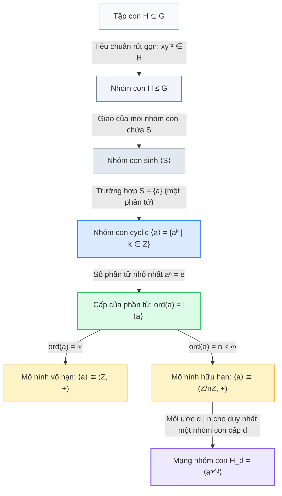
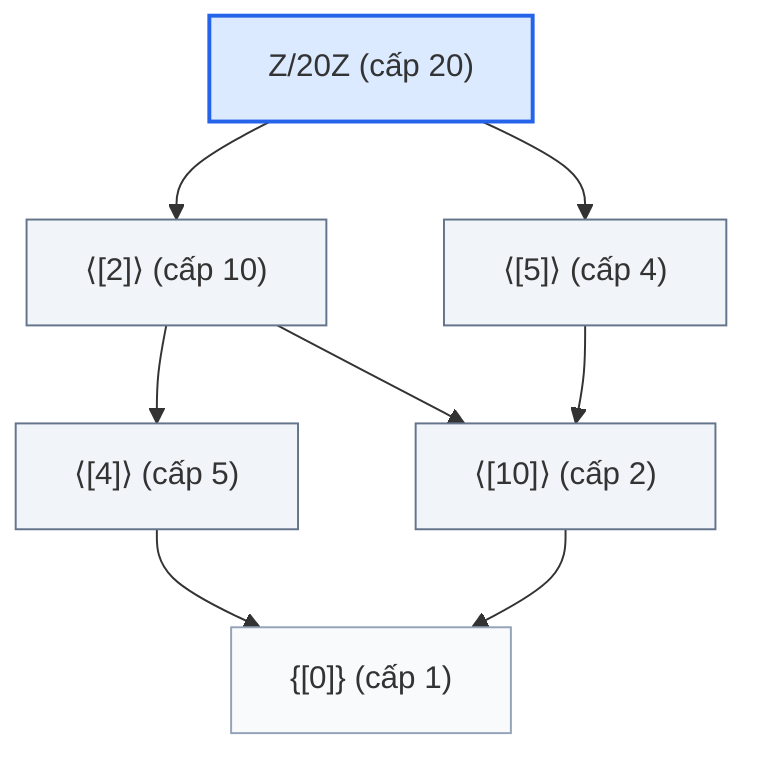

<Note title="Mục tiêu bài học">
Sau khi hoàn thành bài học này, bạn có thể:

1. **Hệ thống hóa toàn bộ lý thuyết Chương 2:** Nắm vững mối liên kết logic từ *tiêu chuẩn nhóm con* $\to$ *nhóm con sinh* $\to$ *cấp phần tử* $\to$ *nhóm cyclic* và *mạng lưới nhóm con duy nhất*.
2. **Sử dụng chuẩn xác thuật ngữ song ngữ Việt – Anh:** Làm chủ hệ thống thuật ngữ chuyên ngành về nhóm con, phần tử sinh, cấp và mạng nhóm con phục vụ học tập và nghiên cứu.
3. **Giải quyết thành thạo 4 dạng bài tập chuyên sâu:** Tính cấp phần tử và tìm phần tử sinh trong $U(n)$, phân loại mạng nhóm con qua sơ đồ Hasse, đặc trưng nhóm có cấu trúc nhóm con tối tiểu (cấp nguyên tố) và cấu trúc nhóm con xoắn $T(G)$ của nhóm abel.
</Note>

**Kiến thức tiên quyết:** Toàn bộ nội dung lý thuyết từ Bài 2.1 đến Bài 2.3 (<Cite source="gt-ctds-hvk-2026" page="37-47" note="Mục 2.1 - 2.5" />).

## 1. Sơ đồ tư duy và Hệ thống hóa lý thuyết Chương 2

Chương 2 đưa chúng ta từ việc khảo sát các tập con ổn định của nhóm đến việc phân loại hoàn toàn cấu trúc của họ nhóm đơn giản nhất: nhóm cyclic (<Cite source="gt-ctds-hvk-2026" page="37-47" note="Chương 2" />):

<Figure caption="Bảng đối chiếu các tiêu chuẩn và công thức then chốt của Chương 2.">
| Khái niệm / Công cụ | Điều kiện / Công thức cốt lõi | Ý nghĩa học thuật & Ứng dụng |
| :--- | :--- | :--- |
| **Tiêu chuẩn 1 bước** | $H \neq \varnothing$ và $\forall x, y \in H \implies xy^{-1} \in H$ | Cách nhanh nhất để chứng minh $H \le G$ ($x - y \in H$ trong nhóm cộng). |
| **Tiêu chuẩn tập hữu hạn** | $H \neq \varnothing$, $H$ hữu hạn và $\forall x, y \in H \implies xy \in H$ | Không cần kiểm tra nghịch đảo khi tập con hữu hạn đã đóng với phép toán. |
| **Đẳng thức lũy thừa** | $a^k = e \iff \operatorname{ord}(a) \mid k$ | Mọi số mũ triệt tiêu phần tử đều là bội số của cấp. |
| **Quan hệ số mũ** | $a^k = a^m \iff k \equiv m \pmod{\operatorname{ord}(a)}$ | Chuyển bài toán lũy thừa về bài toán đồng dư số học. |
| **Cấp của lũy thừa** | $\operatorname{ord}(a^k) = \frac{n}{\gcd(n, k)}$ với $n = \operatorname{ord}(a)$ | Tính cấp của mọi phần tử trong nhóm cyclic hữu hạn. |
| **Số phần tử sinh** | Số phần tử sinh của nhóm cyclic cấp $n$ là $\varphi(n)$ | Các phần tử sinh là $a^k$ với $\gcd(n, k) = 1$. |
| **Mạng nhóm con** | Tương ứng 1-1: $d \mid n \iff H_d = \langle a^{n/d} \rangle$ duy nhất cấp $d$ | Phân loại triệt để toàn bộ các nhóm con của nhóm cyclic. |
</Figure>

## 2. Bảng thuật ngữ chuyên ngành đối chiếu Việt – Anh

<Figure caption="Bảng thuật ngữ đại số Chương 2 đối chiếu song ngữ Việt - Anh.">
| Thuật ngữ tiếng Việt | Thuật ngữ tiếng Anh | Ký hiệu / Định nghĩa vắn tắt |
| :--- | :--- | :--- |
| Nhóm con | Subgroup | $H \le G$ |
| Nhóm con thực sự | Proper subgroup | $H < G$ ($H \le G$ và $H \neq G$) |
| Nhóm con tầm thường | Trivial subgroup | $\{e\}$ và chính $G$ |
| Tiêu chuẩn nhóm con | Subgroup criterion | Tiêu chuẩn 1 bước ($xy^{-1} \in H$) hoặc 2 bước |
| Nhóm con sinh bởi tập $S$ | Subgroup generated by $S$ | $\langle S \rangle$ (nhóm con nhỏ nhất chứa $S$) |
| Tập sinh | Generating set | $S$ thỏa mãn $\langle S \rangle = G$ |
| Nhóm hữu hạn sinh | Finitely generated group | Nhóm có tập sinh hữu hạn |
| Cấp của phần tử | Order of an element | $\operatorname{ord}(a) = \min\{n \in \Z^+ \mid a^n = e\}$ |
| Nhóm cyclic | Cyclic group | Nhóm sinh bởi một phần tử $G = \langle a \rangle$ |
| Phần tử sinh | Generator | Phần tử $a$ thỏa mãn $\langle a \rangle = G$ |
| Căn của đơn vị | Roots of unity | $\mu_n = \{z \in \mathbb{C} \mid z^n = 1\} \le \mathbb{C}^\times$ |
| Mạng nhóm con | Subgroup lattice | Mạng lưới các nhóm con với quan hệ bao hàm |
| Sơ đồ Hasse | Hasse diagram | Biểu đồ có hướng minh họa quan hệ thứ tự bao hàm |
| Nhóm con xoắn | Torsion subgroup | $T(G) = \{x \in G \mid \operatorname{ord}(x) < \infty\}$ trong nhóm abel |
</Figure>

---

## 3. Hệ thống bài tập chuyên đề chọn lọc

<Exercise id="exr-c2-b4-a1" title="[Nhóm A · Mã CTDS-C2-B4-A01] Khảo sát tính cyclic và phần tử sinh của nhóm U(14)">
- **Nhóm bài tập:** Nhóm A — Nhận diện và tính toán
- **Chủ đề:** Bài tập 2.12 giáo trình chính — Nhóm các lớp khả nghịch $U(14)$
- **Mục tiêu đánh giá:** Liệt kê các phần tử của $U(n)$, tính cấp từng phần tử và xác định phần tử sinh *(Đánh giá thường xuyên)*
- **Mức độ khó:** Cơ bản (Mức 1)

Xét nhóm nhân các lớp thặng dư khả nghịch môđulô 14:
$$
U(14) = \{[a]_{14} \in \Z/14\Z \mid \gcd(a, 14) = 1\}.
$$
1. Hãy liệt kê tất cả các phần tử của $U(14)$ và tính cấp của nhóm $|U(14)|$.
2. Tính cấp của từng phần tử trong nhóm $U(14)$.
3. Nhóm $U(14)$ có phải là một nhóm cyclic hay không? Nếu có, hãy chỉ ra tất cả các phần tử sinh của $U(14)$.

Gợi ý

1. Các số nguyên $1 \le a < 14$ lẻ và không chia hết cho 7. Cấp $|U(14)| = \varphi(14) = 14(1 - 1/2)(1 - 1/7)$.
2. Tính các lũy thừa môđulô 14: $[3]^1, [3]^2, [3]^3, \dots$
3. Nhóm có cấp 6, nếu có phần tử cấp 6 thì là nhóm cyclic.

Lời giải chi tiết

**Ý 1: Liệt kê phần tử và tính cấp của $U(14)$**
Các số nguyên từ $1$ đến $13$ nguyên tố cùng nhau với $14 = 2 \times 7$ là những số lẻ và khác $7$:
$$
U(14) = \{[1], [3], [5], [9], [11], [13]\}.
$$
Cấp của nhóm là:
$$
|U(14)| = \varphi(14) = 14 \times \left(1 - \frac{1}{2}\right) \times \left(1 - \frac{1}{7}\right) = 14 \times \frac{1}{2} \times \frac{6}{7} = 6.
$$

**Ý 2: Tính cấp của từng phần tử**
- $[1]$: phần tử đơn vị nên $\operatorname{ord}([1]) = 1$.
- $[13] = [-1]$: ta có $[-1]^2 = [1]$, nên $\operatorname{ord}([13]) = 2$.
- Xét phần tử $[3]$:
  $$
  [3]^1 = [3], \quad [3]^2 = [9], \quad [3]^3 = [27] = [13] = [-1],
  $$
  $$
  [3]^4 = [3][13] = [39] = [11], \quad [3]^5 = [3][11] = [33] = [5], \quad [3]^6 = [3][5] = [15] = [1].
  $$
  Vậy số nguyên dương nhỏ nhất để $[3]^k = [1]$ là $6$, suy ra $\operatorname{ord}([3]) = 6$.
- Xét phần tử $[5]$: ta có $[5] = [3]^5$. Vì $\gcd(5, 6) = 1$, cấp của $[5]$ bằng $\operatorname{ord}([5]) = \frac{6}{\gcd(6, 5)} = 6$.
  (Kiểm tra: $[5]^2 = [25] = [11], [5]^3 = [55] = [13] = [-1], [5]^6 = [1]$).
- Xét phần tử $[9]$: ta có $[9] = [3]^2$. Cấp là $\operatorname{ord}([9]) = \frac{6}{\gcd(6, 2)} = \frac{6}{2} = 3$.
  (Kiểm tra: $[9]^2 = [81] = [11], [9]^3 = [9][11] = [99] = [1]$).
- Xét phần tử $[11]$: ta có $[11] = [3]^4$. Cấp là $\operatorname{ord}([11]) = \frac{6}{\gcd(6, 4)} = \frac{6}{2} = 3$.

Bảng tổng kết cấp phần tử:
- Cấp 1: $[1]$ (1 phần tử).
- Cấp 2: $[13]$ (1 phần tử).
- Cấp 3: $[9], [11]$ (2 phần tử).
- Cấp 6: $[3], [5]$ (2 phần tử).

**Ý 3: Tính cyclic và phần tử sinh**
Vì trong nhóm $U(14)$ (có cấp 6) tồn tại phần tử $[3]$ có cấp đúng bằng 6, nhóm $U(14)$ là một **nhóm cyclic cấp 6**:
$$
U(14) = \langle [3] \rangle \cong (\Z/6\Z, +).
$$
Số phần tử sinh của $U(14)$ bằng $\varphi(6) = 6(1 - 1/2)(1 - 1/3) = 2$.
Hai phần tử sinh của $U(14)$ là $[3]^1 = [3]$ và $[3]^5 = [5]$.

| Tiêu chí đánh giá | Điểm tối đa |
| :--- | :---: |
| Liệt kê đúng 6 phần tử của $U(14)$ và tính đúng $|U(14)| = 6$ | 0.30 điểm |
| Tính chính xác cấp của cả 6 phần tử trong nhóm | 0.40 điểm |
| Khẳng định $U(14)$ cyclic và chỉ ra đúng hai phần tử sinh $[3]$ và $[5]$ | 0.30 điểm |
| **Tổng điểm** | **1.00 điểm** |
</Exercise>

<Exercise id="exr-c2-b4-b1" title="[Nhóm B · Mã CTDS-C2-B4-B01] Mạng nhóm con và sơ đồ Hasse của Z/20Z">
- **Nhóm bài tập:** Nhóm B — Áp dụng định lý
- **Chủ đề:** Bài tập 2.25 giáo trình chính — Phân loại toàn bộ các nhóm con của $\Z/20\Z$
- **Mục tiêu đánh giá:** Thiết lập song ánh giữa ước số và nhóm con, vẽ đúng sơ đồ Hasse *(Đánh giá thường xuyên)*
- **Mức độ khó:** Trung bình (Mức 2)

Xét nhóm cyclic $G = (\Z/20\Z, +)$.
1. Tìm tất cả các ước nguyên dương của 20 và cho biết $G$ có bao nhiêu nhóm con.
2. Với mỗi ước dương $d$ của 20, hãy viết nhóm con duy nhất $H_d$ cấp $d$ dưới dạng phần tử sinh chuẩn $\langle [20/d]_{20} \rangle$ và liệt kê các phần tử.
3. Vẽ sơ đồ quan hệ bao hàm (sơ đồ Hasse) giữa các nhóm con của $G$.

Gợi ý

1. Các ước dương của 20: $1, 2, 4, 5, 10, 20$.
2. Áp dụng $H_d = \langle [20/d]_{20} \rangle$.
3. Quan hệ bao hàm $H_{d_1} \subseteq H_{d_2} \iff d_1 \mid d_2$.

Lời giải chi tiết

**Ý 1: Các ước của 20 và số nhóm con**
Tập các ước nguyên dương của 20 là:
$$
\mathcal{D}(20) = \{1, 2, 4, 5, 10, 20\}.
$$
Vì $G = \Z/20\Z$ là nhóm cyclic cấp 20, theo Định lý 2.12, các nhóm con của $G$ tương ứng 1-1 với các ước nguyên dương của 20.
Do đó $G$ có đúng **6 nhóm con**.

**Ý 2: Danh sách 6 nhóm con theo cấp $d$**
- $d = 1$: $H_1 = \langle [20/1] \rangle = \langle [0]_{20} \rangle = \{[0]\}$.
- $d = 2$: $H_2 = \langle [20/2] \rangle = \langle [10]_{20} \rangle = \{[0], [10]\}$.
- $d = 4$: $H_4 = \langle [20/4] \rangle = \langle [5]_{20} \rangle = \{[0], [5], [10], [15]\}$.
- $d = 5$: $H_5 = \langle [20/5] \rangle = \langle [4]_{20} \rangle = \{[0], [4], [8], [12], [16]\}$.
- $d = 10$: $H_{10} = \langle [20/10] \rangle = \langle [2]_{20} \rangle = \{[0], [2], [4], [6], [8], [10], [12], [14], [16], [18]\}$.
- $d = 20$: $H_{20} = \langle [20/20] \rangle = \langle [1]_{20} \rangle = \Z/20\Z$.

**Ý 3: Sơ đồ Hasse**
Quan hệ bao hàm: $H_{d_1} \subseteq H_{d_2} \iff d_1 \mid d_2$:
- $H_1$ là nhóm con nhỏ nhất, chứa trong mọi nhóm con.
- $H_2$ bao hàm $H_1$.
- $H_4$ bao hàm $H_2$ (vì $2 \mid 4$).
- $H_5$ bao hàm $H_1$, nhưng không có quan hệ bao hàm với $H_2$ và $H_4$ (vì $\gcd(5, 4) = 1$).
- $H_{10}$ bao hàm $H_2$ (vì $2 \mid 10$) và $H_5$ (vì $5 \mid 10$), nhưng không bao hàm $H_4$ (vì $4 \nmid 10$).
- $H_{20} = G$ bao hàm cả $H_4$ và $H_{10}$.

Sơ đồ liên kết:

| Tiêu chí đánh giá | Điểm tối đa |
| :--- | :---: |
| Liệt kê đúng 6 ước số của 20 và kết luận số lượng nhóm con | 0.30 điểm |
| Xác định đúng phần tử sinh chuẩn và danh sách phần tử của 6 nhóm con | 0.40 điểm |
| Vẽ đúng sơ đồ Hasse thể hiện chính xác quan hệ chia hết giữa các cấp | 0.30 điểm |
| **Tổng điểm** | **1.00 điểm** |
</Exercise>

<Exercise id="exr-c2-b4-c1" title="[Nhóm C · Mã CTDS-C2-B4-C01] Đặc trưng nhóm chỉ có các nhóm con tầm thường">
- **Nhóm bài tập:** Nhóm C — Chứng minh và phản ví dụ
- **Chủ đề:** Bài tập 2.27 giáo trình chính — Nhóm có cấu trúc nhóm con tối tiểu
- **Mục tiêu đánh giá:** Chứng minh nhóm không có nhóm con thực sự không tầm thường phải là cyclic cấp nguyên tố *(Đánh giá thường xuyên)*
- **Mức độ khó:** Nâng cao (Mức 3)

Cho $G$ là một nhóm có nhiều hơn một phần tử ($|G| > 1$). Giả sử rằng $G$ **không có bất kỳ nhóm con thực sự không tầm thường nào** (nghĩa là các nhóm con duy nhất của $G$ chỉ là $\{e\}$ và $G$).
1. Lấy một phần tử $a \in G$ với $a \neq e$. Chứng minh rằng $G = \langle a \rangle$, và suy ra $G$ là một nhóm cyclic.
2. Chứng minh rằng cấp của nhóm $G$ không thể là vô hạn ($|G| < \infty$).
3. Chứng minh rằng cấp của nhóm $G$ phải là một **số nguyên tố** $p$.

Gợi ý

1. Xét nhóm con cyclic $\langle a \rangle$. Vì $a \neq e$ nên $\langle a \rangle \neq \{e\}$. Theo giả thiết, $\langle a \rangle$ buộc phải bằng $G$.
2. Nếu $|G| = \infty$ thì $G \cong \Z$. Nhóm $\Z$ có chứa các nhóm con thực sự không? (Ví dụ $2\Z$).
3. Nếu $|G| = n$ là hợp số ($n = rs$ với $1 < r < n$), hãy xét nhóm con $\langle a^r \rangle$.

Lời giải chi tiết

**Ý 1: Chứng minh $G$ là nhóm cyclic**
Vì $|G| > 1$, tồn tại ít nhất một phần tử $a \in G$ sao cho $a \neq e$.
Xét nhóm con $\langle a \rangle$ sinh bởi phần tử $a$.
Vì $a \in \langle a \rangle$ và $a \neq e$, nhóm con $\langle a \rangle$ chứa ít nhất hai phần tử phân biệt $e$ và $a$, do đó:
$$
\langle a \rangle \neq \{e\}.
$$
Theo giả thiết của bài toán, nhóm $G$ chỉ có đúng hai nhóm con là $\{e\}$ và $G$.
Vì $\langle a \rangle$ là một nhóm con của $G$ và $\langle a \rangle \neq \{e\}$, ta bắt buộc phải có:
$$
\langle a \rangle = G.
$$
Vì $G$ được sinh bởi một phần tử duy nhất $a$, ta kết luận $G$ là một **nhóm cyclic**.

**Ý 2: Chứng minh $|G| < \infty$**
Ta chứng minh bằng phản chứng: giả sử $|G| = \infty$.
Vì $G$ là nhóm cyclic vô hạn, theo Định lý 2.8, $G$ đẳng cấu với nhóm cộng các số nguyên $(\Z, +)$.
Xét nhóm con $H = \langle a^2 \rangle \le G$ (tương ứng với nhóm con $2\Z \le \Z$).
- Rõ ràng $a \notin \langle a^2 \rangle$ (vì trong nhóm cyclic vô hạn, $a = a^{2k} \implies 2k = 1$, vô nghiệm nguyên), nên $\langle a^2 \rangle \neq G$.
- Mặt khác $a^2 \neq e$ (vì $\operatorname{ord}(a) = \infty$), nên $\langle a^2 \rangle \neq \{e\}$.
Như vậy $\langle a^2 \rangle$ là một nhóm con thực sự không tầm thường của $G$, mâu thuẫn trực tiếp với giả thiết của bài toán.
Do đó cấp của $G$ không thể vô hạn. Vậy $|G| = n < \infty$.

**Ý 3: Chứng minh $|G| = p$ là số nguyên tố**
Vì $|G| = n > 1$ là số nguyên dương hữu hạn, ta chứng minh $n$ là số nguyên tố bằng phản chứng.
Giả sử $n$ là một hợp số, nghĩa là tồn tại hai số nguyên $r, s$ sao cho:
$$
n = rs \quad \text{với} \quad 1 < r < n \text{ và } 1 < s < n.
$$
Xét phần tử $b = a^r \in G$ và nhóm con $K = \langle a^r \rangle \le G$.
- Cấp của nhóm con $K$ là:
  $$
  |K| = \operatorname{ord}(a^r) = \frac{n}{\gcd(n, r)} = \frac{rs}{r} = s.
  $$
- Vì $1 < s < n$, ta có:
  - $|K| = s > 1 \implies K \neq \{e\}$.
  - $|K| = s < n = |G| \implies K \neq G$.
Do đó $K = \langle a^r \rangle$ là một nhóm con thực sự không tầm thường của $G$, tiếp tục mâu thuẫn với giả thiết.
Vì vậy $n$ không thể là hợp số. Do $n > 1$, $n$ bắt buộc phải là một số nguyên tố $p$.
Vậy $G$ là một nhóm cyclic cấp nguyên tố ($G \cong \Z/p\Z$).

| Tiêu chí đánh giá | Điểm tối đa |
| :--- | :---: |
| Lập luận $\langle a \rangle \neq \{e\} \implies \langle a \rangle = G$ và kết luận $G$ cyclic | 0.35 điểm |
| Chứng minh phản chứng loại trừ trường hợp vô hạn qua nhóm con $\langle a^2 \rangle$ | 0.35 điểm |
| Chứng minh phản chứng loại trừ hợp số qua nhóm con $\langle a^r \rangle$ cấp $s$ và kết luận cấp nguyên tố | 0.30 điểm |
| **Tổng điểm** | **1.00 điểm** |
</Exercise>

<Exercise id="exr-c2-b4-d1" title="[Nhóm D · Mã CTDS-C2-B4-D01] Nhóm con xoắn của nhóm Abel (Torsion Subgroup)">
- **Nhóm bài tập:** Nhóm D — Tổng hợp và cấu trúc thương
- **Chủ đề:** Bài tập 2.35, 2.36 giáo trình chính — Cấu trúc nhóm con xoắn $T(G)$
- **Mục tiêu đánh giá:** Chứng minh tập các phần tử cấp hữu hạn trong nhóm abel là nhóm con và phân tích phản ví dụ *(Đánh giá thường xuyên)*
- **Mức độ khó:** Rất khó (Mức 4)

Cho $G$ là một nhóm. Ta gọi tập hợp tất cả các phần tử có cấp hữu hạn trong $G$ là **tập các phần tử xoắn**, ký hiệu là:
$$
T(G) = \{x \in G \mid \operatorname{ord}(x) < \infty\}.
$$
1. Giả sử $G$ là một **nhóm abel**. Chứng minh rằng $T(G)$ là một nhóm con của $G$ ($T(G) \le G$). Nhóm con này được gọi là **nhóm con xoắn** (*torsion subgroup*) của $G$.
2. Hãy chỉ ra một phản ví dụ chứng minh rằng nếu nhóm $G$ **không giao hoán**, thì tập $T(G)$ chưa chắc là một nhóm con của $G$.
3. Trong nhóm nhân các số phức khác không $\mathbb{C}^\times$, hãy mô tả cụ thể nhóm con xoắn $T(\mathbb{C}^\times)$ và cho biết nhóm con này là hữu hạn hay vô hạn.

Gợi ý

1. Dùng tiêu chuẩn hai bước: $e \in T(G)$; nếu $\operatorname{ord}(a) = m, \operatorname{ord}(b) = n$ và $ab = ba$, hãy tính $(ab)^{mn}$ và $(a^{-1})^m$.
2. Trong nhóm ma trận $\operatorname{GL}_2(\R)$, tìm hai ma trận có cấp 2 hoặc 4 nhưng tích của chúng có cấp vô hạn.
3. Phần tử $z \in \mathbb{C}^\times$ có cấp hữu hạn $n \iff z^n = 1 \iff |z| = 1$ và argument là bội hữu tỉ của $2\pi$.

Lời giải chi tiết

**Ý 1: Chứng minh $T(G) \le G$ khi $G$ là nhóm abel**
Ta kiểm tra tiêu chuẩn hai bước cho $T(G)$:
- *Khác rỗng:* Vì $\operatorname{ord}(e) = 1 < \infty$, phần tử đơn vị luôn có cấp hữu hạn. Do đó $e \in T(G)$, suy ra $T(G) \neq \varnothing$.
- *Đóng với phép nhân:* Lấy $a, b \in T(G)$.
  Theo định nghĩa, tồn tại các số nguyên dương $m, n \in \Z^+$ sao cho $\operatorname{ord}(a) = m$ và $\operatorname{ord}(b) = n$.
  Khi đó $a^m = e$ và $b^n = e$.
  Vì $G$ là nhóm abel nên $a$ và $b$ giao hoán với nhau: $ab = ba$.
  Xét số nguyên dương $k = mn$. Ta có:
  $$
  (ab)^{mn} = a^{mn} b^{mn} = (a^m)^n (b^n)^m = e^n e^m = e \cdot e = e.
  $$
  Vì tồn tại số nguyên dương $k = mn$ sao cho $(ab)^k = e$, cấp của tích $ab$ là hữu hạn và thỏa mãn $\operatorname{ord}(ab) \le mn < \infty$.
  Do đó $ab \in T(G)$.
- *Đóng với phép lấy nghịch đảo:* Lấy $a \in T(G)$ với $\operatorname{ord}(a) = m < \infty$.
  Ta có $(a^{-1})^m = (a^m)^{-1} = e^{-1} = e$.
  Do đó cấp của $a^{-1}$ cũng là hữu hạn (thực tế $\operatorname{ord}(a^{-1}) = \operatorname{ord}(a) = m$).
  Suy ra $a^{-1} \in T(G)$.
Theo tiêu chuẩn nhóm con, $T(G)$ là một nhóm con của $G$.

**Ý 2: Phản ví dụ khi nhóm không giao hoán**
Trong nhóm ma trận không giao hoán $\operatorname{GL}_2(\R)$, xét hai ma trận sau:
$$
A = \begin{pmatrix} 0 & -1 \\ 1 & 0 \end{pmatrix}, \quad B = \begin{pmatrix} 0 & 1 \\ -1 & -1 \end{pmatrix}.
$$
- Ta tính lũy thừa của $A$:
  $$
  A^2 = \begin{pmatrix} -1 & 0 \\ 0 & -1 \end{pmatrix} = -I_2 \implies A^4 = (-I_2)^2 = I_2.
  $$
  Do đó $\operatorname{ord}(A) = 4 < \infty$, suy ra $A \in T(\operatorname{GL}_2(\R))$.
- Ta tính lũy thừa của $B$:
  $$
  B^2 = \begin{pmatrix} -1 & -1 \\ 1 & 0 \end{pmatrix}, \quad B^3 = B^2 B = \begin{pmatrix} 1 & 0 \\ 0 & 1 \end{pmatrix} = I_2.
  $$
  Do đó $\operatorname{ord}(B) = 3 < \infty$, suy ra $B \in T(\operatorname{GL}_2(\R))$.
- Bây giờ ta tính ma trận tích $AB$:
  $$
  AB = \begin{pmatrix} 0 & -1 \\ 1 & 0 \end{pmatrix} \begin{pmatrix} 0 & 1 \\ -1 & -1 \end{pmatrix} = \begin{pmatrix} 1 & 1 \\ 0 & 1 \end{pmatrix}.
  $$
  Bằng quy nạp, ta dễ dàng thấy với mọi số nguyên dương $k \ge 1$:
  $$
  (AB)^k = \begin{pmatrix} 1 & k \\ 0 & 1 \end{pmatrix}.
  $$
  Để $(AB)^k = I_2 = \begin{pmatrix} 1 & 0 \\ 0 & 1 \end{pmatrix}$, ta bắt buộc phải có $k = 0$, điều này không thể xảy ra với $k \in \Z^+$.
  Do đó $\operatorname{ord}(AB) = \infty$, nghĩa là $AB \notin T(\operatorname{GL}_2(\R))$.
Vì tích của hai phần tử trong $T(\operatorname{GL}_2(\R))$ không thuộc $T(\operatorname{GL}_2(\R))$, tập $T(\operatorname{GL}_2(\R))$ không đóng với phép nhân ma trận.
Vậy khi $G$ không giao hoán, $T(G)$ nói chung không phải là nhóm con của $G$.

**Ý 3: Nhóm con xoắn của $\mathbb{C}^\times$**
Nhóm nhân $\mathbb{C}^\times$ là nhóm giao hoán. Do đó $T(\mathbb{C}^\times)$ là một nhóm con của $\mathbb{C}^\times$.
Một số phức $z \in \mathbb{C}^\times$ có cấp hữu hạn khi và chỉ khi tồn tại $n \in \Z^+$ sao cho $z^n = 1$.
Lấy môđun hai vế: $|z|^n = 1 \implies |z| = 1$.
Do đó $z$ phải nằm trên đường tròn đơn vị và có dạng $z = e^{i 2\pi \theta}$ với $\theta \in \mathbb{R}$.
Khi đó $z^n = 1 \iff e^{i 2\pi n \theta} = 1 \iff n\theta \in \Z \iff \theta = \frac{m}{n} \in \mathbb{Q}$.
Vậy nhóm con xoắn của $\mathbb{C}^\times$ là:
$$
T(\mathbb{C}^\times) = \left\{ e^{i 2\pi \frac{m}{n}} \;\middle|\; m \in \Z, \; n \in \Z^+ \right\} = \bigcup_{n=1}^\infty \mu_n.
$$
Đây là hợp của tất cả các nhóm các căn bậc $n$ của đơn vị.
Nhóm con này là một **nhóm vô hạn** (chứa vô hạn các căn của đơn vị với mọi bậc $n \ge 1$).

| Tiêu chí đánh giá | Điểm tối đa |
| :--- | :---: |
| Sử dụng tính giao hoán tính đúng $(ab)^{mn} = e$ và $(a^{-1})^m = e$ suy ra $T(G) \le G$ | 0.40 điểm |
| Xây dựng chính xác hai ma trận cấp hữu hạn có tích cấp vô hạn trong $\operatorname{GL}_2(\R)$ | 0.35 điểm |
| Mô tả đúng $T(\mathbb{C}^\times)$ là tập các căn đơn vị và khẳng định là nhóm vô hạn | 0.25 điểm |
| **Tổng điểm** | **1.00 điểm** |
</Exercise>

---

<KeyTakeaways>
- **Khung lý thuyết hoàn chỉnh của Chương 2:** Nhóm con $\le G$ kế thừa cấu trúc nhóm; nhóm con sinh $\langle S \rangle$ là nhóm con nhỏ nhất chứa $S$; cấp phần tử $\operatorname{ord}(a) = |\langle a \rangle|$.
- **Tính ưu việt của nhóm cyclic:** Mọi nhóm con của nhóm cyclic đều là cyclic; với mỗi ước $d \mid n$ có đúng một nhóm con cấp $d$ là $\langle a^{n/d} \rangle$; số phần tử sinh luôn bằng $\varphi(n)$.
- **Đặc trưng cấp nguyên tố:** Một nhóm có nhiều hơn 1 phần tử không có nhóm con thực sự không tầm thường khi và chỉ khi nó là nhóm cyclic cấp nguyên tố.
- **Nhóm con xoắn $T(G)$:** Trong nhóm abel, các phần tử cấp hữu hạn lập thành nhóm con $T(G)$; tính chất này có thể thất bại trong các nhóm không giao hoán.
- **Cầu nối sang Chương 3:** Khi $H$ là một nhóm con bất kỳ của $G$, ta có thể dùng $H$ để "phân hoạch" toàn bộ nhóm $G$ thành các mảnh rời nhau có cùng kích thước. Đó chính là lý thuyết về **Lớp kề** (*Cosets*) và định lý trung tâm của lý thuyết nhóm hữu hạn: **Định lý Lagrange**.
</KeyTakeaways>
