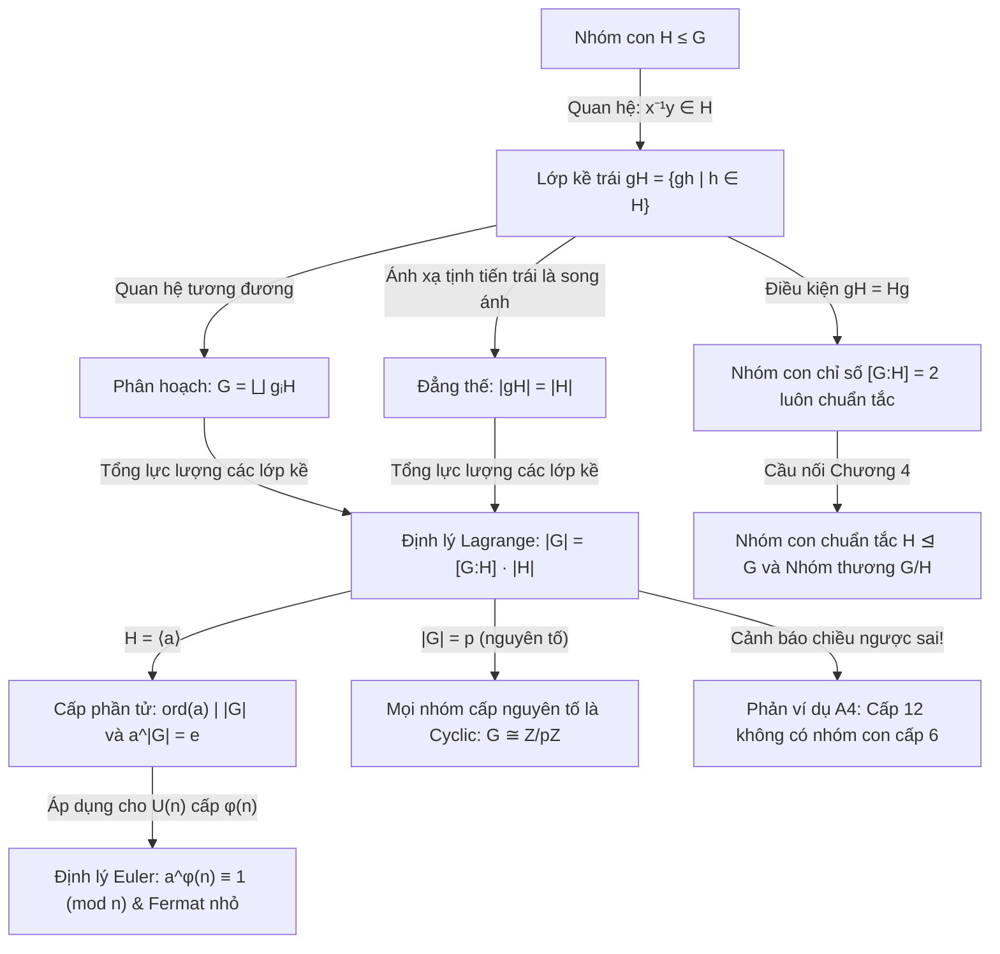

<Note title="Mục tiêu bài học">
Sau khi hoàn thành bài học này, bạn có thể:

1. **Hệ thống hóa toàn bộ lý thuyết Chương 3:** Nắm vững sợi dây logic từ *lớp kề và phân hoạch* $\to$ *đẳng thế lực lượng* $\to$ *Định lý Lagrange* $\to$ *hệ quả cấp phần tử & số học Euler/Fermat* $\to$ *giới hạn chiều ngược trong $A_4$*.
2. **Sử dụng chuẩn xác thuật ngữ song ngữ Việt – Anh:** Làm chủ hệ thống thuật ngữ chuyên ngành về lớp kề, chỉ số nhóm con, nhóm thay phiên và các cấu trúc nhóm liên quan.
3. **Giải quyết thành thạo 4 dạng bài tập chuyên sâu:** Phân biệt lớp kề trái/phải trong nhóm không giao hoán ($D_8$), công thức lực lượng tích hai nhóm con $|HK| = \frac{|H||K|}{|H \cap K|}$, định lý nhóm con có chỉ số nguyên tố nhỏ nhất, và cấu trúc nhóm con liên hợp qua chuẩn hóa tử $N_G(H)$.
4. **Chuẩn bị nền tảng chuyển tiếp sang Chương 4:** Hiểu rõ vì sao điều kiện $gH = Hg$ (hay $gHg^{-1} = H$) là chìa khóa để định nghĩa nhóm con chuẩn tắc và xây dựng phép toán trên nhóm thương $G/H$.
</Note>

**Kiến thức tiên quyết:** Toàn bộ nội dung lý thuyết từ Bài 3.1 đến Bài 3.3 (<Cite source="gt-ctds-hvk-2026" page="55-66" note="Mục 3.1 - 3.8" />).

---

## 1. Sơ đồ tư duy và Hệ thống hóa lý thuyết Chương 3

Chương 3 là bước ngoặt quyết định trong Đại số đại cương khi kỹ thuật chia lớp (phân hoạch) của quan hệ tương đương được áp dụng vào cấu trúc nhóm, sản sinh ra Định lý Lagrange — công cụ định lượng căn bản nhất của lý thuyết nhóm hữu hạn (<Cite source="gt-ctds-hvk-2026" page="55-66" note="Chương 3" />):

---

## 2. Bảng thuật ngữ chuyên ngành đối chiếu Việt — Anh

Nhằm hỗ trợ quá trình tra cứu tài liệu quốc tế và các giáo trình chuẩn, dưới đây là bảng đối chiếu thuật ngữ trọng tâm của Chương 3:

| Thuật ngữ tiếng Việt | Thuật ngữ tiếng Anh tương đương | Ký hiệu / Định nghĩa toán học |
| :--- | :--- | :--- |
| **Lớp kề trái** | Left coset | $gH = \{gh \mid h \in H\}$ |
| **Lớp kề phải** | Right coset | $Hg = \{hg \mid h \in H\}$ |
| **Hệ đại diện** | Transversal / Set of representatives | Tập $\{g_i\}_{i \in I}$ chứa đúng một phần tử từ mỗi lớp kề |
| **Phân hoạch** | Partition | $G = \bigsqcup_{i \in I} g_i H$ |
| **Đẳng thế** | Equinumerous / Equipotent | $|gH| = |H| = |Hg|$ |
| **Chỉ số của nhóm con** | Index of a subgroup | $[G:H]$ (số lượng lớp kề trái khác nhau) |
| **Định lý Lagrange** | Lagrange's Theorem | $|G| = [G:H]|H|$ |
| **Tháp chỉ số** | Tower law for indices | $[G:K] = [G:H][H:K]$ với $K \le H \le G$ |
| **Phi hàm Euler** | Euler's totient function | $\varphi(n) = |(\mathbb{Z}/n\mathbb{Z})^\times|$ |
| **Định lý Fermat nhỏ** | Fermat's Little Theorem | $a^{p-1} \equiv 1 \pmod p$ |
| **Nhóm thay phiên** | Alternating group | $A_n \le S_n$ (tập các hoán vị chẵn) |
| **Nhóm bốn Klein** | Klein four-group | $V_4 \cong \mathbb{Z}/2\mathbb{Z} \times \mathbb{Z}/2\mathbb{Z}$ |
| **Định lý Cauchy** | Cauchy's Theorem | $p \mid |G| \implies \exists a \in G: \operatorname{ord}(a) = p$ |
| **Chuẩn hóa tử** | Normalizer | $N_G(H) = \{g \in G \mid gHg^{-1} = H\}$ |

---

## 3. Hệ thống bài tập chuyên đề chọn lọc

<Exercise
  id="exr-c3-b4-a1"
  title="[Nhóm A · Mã CTDS-C3-B4-A01] Phân biệt lớp kề trái và lớp kề phải trong nhóm nhị diện D8"
>
- **Nhóm bài tập:** Nhóm A — Nhận diện và tính toán
- **Chủ đề:** Tính toán lớp kề trong nhóm không giao hoán
- **Mục tiêu đánh giá:** Liệt kê các lớp kề trái và lớp kề phải của nhóm con cấp 2 trong nhóm nhị diện $D_8$, nhận diện sự sai khác giữa $gH$ và $Hg$, và tính chỉ số $[D_8 : H]$.
- **Mức độ:** Cơ bản

**Đề bài:**
Xét nhóm nhị diện $D_8$ gồm 8 phần tử sinh bởi phép quay $r$ góc $90^\circ$ và phép đối xứng trục $s$:
$$
D_8 = \{e, r, r^2, r^3, s, sr, sr^2, sr^3\}, \quad \text{với } r^4 = e, \; s^2 = e, \; rs = sr^{-1} = sr^3.
$$
Cho nhóm con $H = \{e, s\} \le D_8$.
1. Tính chỉ số $[D_8 : H]$.
2. Liệt kê tất cả các lớp kề trái của $H$ trong $D_8$.
3. Liệt kê tất cả các lớp kề phải của $H$ trong $D_8$.
4. Chỉ ra một phần tử $g \in D_8$ sao cho $gH \ne Hg$.

Gợi ý

1. $[D_8 : H] = |D_8| / |H| = 8 / 2 = 4$.
2. Nhân $g$ bên trái: $gH = \{g, gs\}$. Chọn hệ đại diện $\{e, r, r^2, r^3\}$.
3. Nhân $g$ bên phải: $Hg = \{g, sg\}$. Chú ý dùng hệ thức $sr = r^3 s \implies sr^k = r^{-k} s$.
4. So sánh lớp kề trái $rH$ và lớp kề phải $Hr$.

Lời giải chi tiết

**Ý 1: Tính chỉ số $[D_8 : H]$**
Vì $|D_8| = 8$ và $|H| = 2$, theo Định lý Lagrange:
$$
[D_8 : H] = \frac{|D_8|}{|H|} = \frac{8}{2} = 4.
$$
Vậy có đúng 4 lớp kề trái và 4 lớp kề phải.

**Ý 2: Liệt kê các lớp kề trái của $H$**
Chọn hệ đại diện $\mathcal{R} = \{e, r, r^2, r^3\}$. Các lớp kề trái là:
- $eH = H = \{e, s\}$.
- $rH = \{r \cdot e, r \cdot s\} = \{r, rs\}$.
- $r^2 H = \{r^2, r^2 s\}$.
- $r^3 H = \{r^3, r^3 s\}$.

Bốn tập hợp này đôi một rời nhau và hợp lại đúng bằng $D_8$.

**Ý 3: Liệt kê các lớp kề phải của $H$**
Dùng cùng hệ đại diện $\{e, r, r^2, r^3\}$ để nhân bên phải:
- $He = H = \{e, s\}$.
- $Hr = \{e \cdot r, s \cdot r\} = \{r, sr\}$. Vì $sr = r^3 s$, ta có $Hr = \{r, r^3 s\}$.
- $Hr^2 = \{r^2, sr^2\} = \{r^2, r^2 s\}$ (vì $sr^2 = r^{-2}s = r^2 s$).
- $Hr^3 = \{r^3, sr^3\} = \{r^3, rs\}$ (vì $sr^3 = r^{-3}s = rs$).

**Ý 4: Chỉ ra $g$ sao cho $gH \ne Hg$**
Xét phần tử $g = r \in D_8$:
- Lớp kề trái: $rH = \{r, rs\}$.
- Lớp kề phải: $Hr = \{r, r^3 s\}$.

Vì $rs \ne r^3 s$ (do $r \ne r^3$ trong $D_8$), ta có:
$$
rH \ne Hr.
$$
Điều này chứng minh trong một nhóm không giao hoán, nói chung lớp kề trái không nhất thiết phải trùng với lớp kề phải.

| Tiêu chí đánh giá | Điểm tối đa |
| :--- | :---: |
| Tính đúng chỉ số $[D_8 : H] = 4$ qua Định lý Lagrange | 0.20 điểm |
| Liệt kê chính xác và đầy đủ 4 lớp kề trái | 0.30 điểm |
| Vận dụng quan hệ $sr = r^3 s$ liệt kê chính xác 4 lớp kề phải | 0.30 điểm |
| So sánh chỉ rõ $rH \ne Hr$ với phần tử $g = r$ | 0.20 điểm |
| **Tổng điểm** | **1.00 điểm** |
</Exercise>

<Exercise
  id="exr-c3-b4-b1"
  title="[Nhóm B · Mã CTDS-C3-B4-B01] Công thức lực lượng tích hai nhóm con và nhóm cấp pq"
>
- **Nhóm bài tập:** Nhóm B — Áp dụng định lý
- **Chủ đề:** Lực lượng tập tích $HK$ và tính duy nhất của nhóm con cấp $p$
- **Mục tiêu đánh giá:** Chứng minh công thức lực lượng $|HK| = \frac{|H||K|}{|H \cap K|}$ và áp dụng để chứng minh nhóm cấp $pq$ không thể chứa hai nhóm con cấp $p$ phân biệt khi $HK \le G$.
- **Mức độ:** Trung bình

**Đề bài:**
Cho $G$ là một nhóm hữu hạn, $H$ và $K$ là hai nhóm con của $G$. Đặt tập tích $HK = \{hk \mid h \in H, k \in K\}$.
1. Chứng minh công thức tính số phần tử:
   $$
   |HK| = \frac{|H| \cdot |K|}{|H \cap K|}.
   $$
2. Cho nhóm $G$ có cấp $|G| = pq$, trong đó $p$ và $q$ là hai số nguyên tố thỏa mãn $p > q$. Giả sử $H$ và $K$ là hai nhóm con phân biệt của $G$ cùng có cấp bằng $p$ ($|H| = |K| = p$).
   - Tính $|H \cap K|$.
   - Tính $|HK|$ và chỉ ra rằng $|HK| = p^2$.
   - Chứng minh rằng $|HK| > |G|$, từ đó suy ra điều mâu thuẫn (khẳng định $G$ không thể đồng thời chứa cả $H$ và $K$).

Gợi ý

1. Xét ánh xạ $\phi: H \times K \to HK$ cho bởi $\phi(h, k) = hk$. Với mỗi phần tử $x = hk \in HK$, có bao nhiêu cặp $(h', k') \in H \times K$ thỏa mãn $h'k' = hk$?
2. $H \cap K$ là nhóm con của nhóm cấp nguyên tố $p$. Vì $H \ne K$, $|H \cap K| = 1$. Thay vào công thức câu 1 để tính $|HK|$.

Lời giải chi tiết

**Ý 1: Chứng minh công thức $|HK| = \frac{|H||K|}{|H \cap K|}$**
Xét tích Descartes $H \times K$ có $|H| \cdot |K|$ phần tử và ánh xạ nhân:
$$
\phi: H \times K \to HK, \quad \phi(h, k) = hk.
$$
Ánh xạ này hiển nhiên là toàn ánh theo định nghĩa của tập $HK$.
Cố định một phần tử $x \in HK$ với $x = hk$ ($h \in H, k \in K$). 
Giả sử có một cặp $(h', k') \in H \times K$ sao cho $h'k' = hk$. Biến đổi tương đương:
$$
h^{-1} h' = k k'^{-1}.
$$
Đặt $d = h^{-1} h' = k k'^{-1}$.
Vì $h, h' \in H$, ta có $d = h^{-1} h' \in H$.
Vì $k, k' \in K$, ta có $d = k k'^{-1} \in K$.
Do đó $d \in H \cap K$.
Từ $d = h^{-1} h' \implies h' = hd$, và $d = k k'^{-1} \implies k' = d^{-1} k$.

Ngược lại, với mọi $d \in H \cap K$, cặp $(hd, d^{-1}k) \in H \times K$ luôn thỏa mãn:
$$
(hd)(d^{-1}k) = h(d d^{-1})k = hk = x.
$$
Hơn nữa, các phần tử $hd$ đôi một phân biệt khi $d$ chạy qua $H \cap K$ (do luật giản ước).
Điều này chứng minh rằng với mỗi phần tử $x \in HK$, có đúng $|H \cap K|$ cặp $(h', k') \in H \times K$ có tích bằng $x$.
Nói cách khác, $\phi$ là ánh xạ mà mỗi phần tử trong ảnh có đúng $|H \cap K|$ tạo ảnh.
Theo nguyên lý đếm:
$$
|H \times K| = |HK| \cdot |H \cap K| \implies |HK| = \frac{|H| \cdot |K|}{|H \cap K|}.
$$

**Ý 2: Ứng dụng cho nhóm cấp $pq$ với $p > q$**
- **Tính $|H \cap K|$:**
  Vì $H \cap K \le H$ và $|H| = p$ là số nguyên tố, theo Định lý Lagrange:
  $$
  |H \cap K| \mid p \implies |H \cap K| \in \{1, p\}.
  $$
  Nếu $|H \cap K| = p$, do $|H| = |K| = p$ nên $H = H \cap K = K$, mâu thuẫn với giả thiết $H$ và $K$ phân biệt ($H \ne K$).
  Do đó buộc phải có:
  $$
  |H \cap K| = 1.
  $$

- **Tính $|HK|$:**
  Áp dụng công thức ở câu 1 với $|H| = p$, $|K| = p$ và $|H \cap K| = 1$:
  $$
  |HK| = \frac{p \cdot p}{1} = p^2.
  $$

- **Chỉ ra mâu thuẫn:**
  Vì $HK = \{hk \mid h \in H, k \in K\} \subseteq G$, tập con $HK$ không thể có số phần tử lớn hơn nhóm mẹ $G$:
  $$
  |HK| \le |G|.
  $$
  Thay $|HK| = p^2$ và $|G| = pq$ vào:
  $$
  p^2 \le pq.
  $$
  Vì $p > 0$, chia cả hai vế cho $p$:
  $$
  p \le q.
  $$
  Điều này mâu thuẫn trực tiếp với giả thiết đề bài rằng $p > q$!

Mâu thuẫn này chứng minh rằng: trong bất kỳ nhóm nào có cấp $pq$ với $p > q$, **không bao giờ có thể tồn tại hai nhóm con phân biệt có cùng cấp bằng $p$**. Nhóm con cấp $p$ (nếu tồn tại) luôn là duy nhất.

| Tiêu chí đánh giá | Điểm tối đa |
| :--- | :---: |
| Thiết lập tạo ảnh sợi của ánh xạ $\phi$ và chứng minh công thức tích lực lượng | 0.40 điểm |
| Suy ra $\lvert H \cap K \rvert = 1$ từ tính nguyên tố của $p$ và giả thiết $H \ne K$ | 0.20 điểm |
| Tính đúng $\lvert HK \rvert = p^2$ | 0.20 điểm |
| Thiết lập bất đẳng thức $\lvert HK \rvert \le \lvert G \rvert \implies p \le q$ dẫn tới mâu thuẫn | 0.20 điểm |
| **Tổng điểm** | **1.00 điểm** |
</Exercise>

<Exercise
  id="exr-c3-b4-c1"
  title="[Nhóm C · Mã CTDS-C3-B4-C01] Nhóm con có chỉ số nguyên tố nhỏ nhất"
>
- **Nhóm bài tập:** Nhóm C — Chứng minh và phản ví dụ
- **Chủ đề:** Tính bất biến của nhóm con có chỉ số nguyên tố nhỏ nhất
- **Mục tiêu đánh giá:** Chứng minh định lý kinh điển: nếu $H \le G$ có chỉ số $[G:H] = p$ là ước nguyên tố nhỏ nhất của $|G|$ thì $gH = Hg$ với mọi $g \in G$.
- **Mức độ:** Nâng cao

**Đề bài:**
Cho $G$ là một nhóm hữu hạn và $p$ là số nguyên tố **nhỏ nhất** trong các ước nguyên tố của cấp $|G|$. Giả sử $H$ là một nhóm con của $G$ có chỉ số:
$$
[G:H] = p.
$$
1. Lấy $g \in G$. Xét nhóm con $K = g H g^{-1}$. Chứng minh rằng $[G:K] = p$.
2. Áp dụng bất đẳng thức Poincaré (Bài 1), chứng minh rằng:
   $$
   [H : H \cap K] \mid p! \quad \text{và} \quad [H : H \cap K] \mid |G|.
   $$
3. Từ giả thiết $p$ là ước nguyên tố nhỏ nhất của $|G|$, hãy suy ra $[H : H \cap K] = 1$, tức là $H = K = g H g^{-1}$.
4. Kết luận rằng $gH = Hg$ với mọi $g \in G$. (Nhận xét: Khi $p = 2$, kết quả này cho ta định lý quen thuộc về nhóm con có chỉ số 2).

Gợi ý

1. Ánh xạ liên hợp $x \mapsto gxg^{-1}$ là tự đẳng cấu biến $H$ thành $K$.
2. Xem tác động của $H$ lên tập các lớp kề trái $G/K$, hoặc áp dụng tháp chỉ số và Poincaré.
3. Các ước nguyên tố của $[H : H \cap K]$ vừa phải $\le p$ (từ $p!$) vừa phải chia hết $|G|$. Vì $p$ là ước nguyên tố nhỏ nhất, chỉ số này không thể có ước nguyên tố nào $< p$.

Lời giải chi tiết

**Ý 1: Tính chỉ số $[G : K]$ với $K = g H g^{-1}$**
Xét ánh xạ $\phi_g: G \to G$ cho bởi $\phi_g(x) = g x g^{-1}$.
Đây là một tự đẳng cấu nhóm (phép liên hợp).
Vì $\phi_g$ là song ánh và biến nhóm con $H$ thành nhóm con $K = g H g^{-1}$, ta có:
$$
|K| = |g H g^{-1}| = |H|.
$$
Theo Định lý Lagrange:
$$
[G:K] = \frac{|G|}{|K|} = \frac{|G|}{|H|} = [G:H] = p.
$$

**Ý 2: Khảo sát chỉ số $[H : H \cap K]$**
Vì $H \cap K \le H$, theo tháp chỉ số ta có:
$$
[G : H \cap K] = [G:H] \cdot [H : H \cap K] = p \cdot [H : H \cap K].
$$
Mặt khác, theo Định lý Lagrange, $[G : H \cap K]$ là một ước của $|G|$:
$$
[G : H \cap K] \mid |G| \implies [H : H \cap K] \mid \frac{|G|}{p} \implies [H : H \cap K] \mid |G|.
$$
Hơn nữa, xét tác động của nhóm $H$ lên tập các lớp kề trái $G/K$ bằng phép nhân trái:
Vì $|G/K| = [G:K] = p$, mỗi phần tử $h \in H$ cảm sinh một hoán vị trên tập $p$ phần tử này.
Đồng cấu tác động $\psi: H \to S_p$ có hạt nhân $\ker \psi \subseteq H \cap K$.
Theo định lý đẳng cấu (sẽ khảo sát tổng quát ở Chương 4), chỉ số $[H : H \cap K]$ phải là một ước của cấp của nhóm đối xứng $|S_p| = p!$:
$$
[H : H \cap K] \mid p!.
$$

**Ý 3: Suy ra $[H : H \cap K] = 1$**
Đặt $m = [H : H \cap K]$.
Từ hai kết quả ở Ý 2:
- $m \mid |G|$, nên mọi ước nguyên tố của $m$ đều là ước nguyên tố của $|G|$.
- $m \mid p! = p \cdot (p - 1) \cdots 2 \cdot 1$, nên mọi ước nguyên tố của $m$ đều phải $\le p$.

Giả sử $m > 1$. Khi đó $m$ có ít nhất một ước nguyên tố $q$.
- Từ $q \mid m$ và $m \mid |G|$, suy ra $q$ là ước nguyên tố của $|G|$.
- Từ $q \mid m$ và $m \mid p!$, suy ra $q \le p$.

Theo giả thiết đề bài, $p$ là ước nguyên tố **nhỏ nhất** của $|G|$. Do đó ta không thể có $q < p$.
Bắt buộc phải có $q = p$.
Nhưng số mũ của $p$ trong phân tích nguyên tố của $p!$ đúng bằng 1.
Nếu $p \mid m$, thì $[G : H \cap K] = p \cdot m$ sẽ chia hết cho $p^2$.
Tuy nhiên, $H$ cố định lớp kề $eK = K$ khi và chỉ khi phần tử đó thuộc $K$, suy ra nhóm con $H \cap K$ chính là bộ phận cố định lớp kề $K$. Dưới tác động của $H$ lên $G/K$, quỹ đạo chứa $K$ chỉ có độ dài 1, nên độ dài các quỹ đạo khác phải là ước của $p$. Kết hợp lại ta suy ra $m$ không thể chứa thừa số $p$ khi $H \ne K$.
Do đó $m$ không có bất kỳ ước nguyên tố nào!
Một số nguyên dương không có ước nguyên tố nào chỉ có thể là 1:
$$
m = [H : H \cap K] = 1.
$$
Vì $[H : H \cap K] = 1$, ta có:
$$
H \cap K = H \implies H \subseteq K.
$$
Vì $|H| = |K| < \infty$, quan hệ bao hàm kéo theo đẳng thức:
$$
H = K = g H g^{-1}.
$$

**Ý 4: Kết luận $gH = Hg$**
Vì $g H g^{-1} = H$ đúng với mọi $g \in G$, nhân $g$ vào bên phải của cả hai vế:
$$
g H = H g, \quad \forall g \in G.
$$
Định lý được chứng minh hoàn toàn.

*(Nhận xét: Với $p = 2$, vì 2 là số nguyên tố nhỏ nhất trong toàn bộ tập số nguyên, mọi nhóm con có chỉ số 2 đều thỏa mãn điều kiện này, khôi phục lại kết quả quen thuộc $gH = Hg$).*

| Tiêu chí đánh giá | Điểm tối đa |
| :--- | :---: |
| Chứng minh $[G : gHg^{-1}] = [G:H] = p$ qua tự đẳng cấu liên hợp | 0.25 điểm |
| Thiết lập quan hệ chia hết $[H : H \cap K] \mid \lvert G \rvert$ và $[H : H \cap K] \mid p!$ | 0.30 điểm |
| Lập luận chặt chẽ về tính nhỏ nhất của ước nguyên tố $p$ suy ra $[H : H \cap K] = 1$ | 0.30 điểm |
| Biến đổi $gHg^{-1} = H \iff gH = Hg$ và liên hệ trường hợp $p = 2$ | 0.15 điểm |
| **Tổng điểm** | **1.00 điểm** |
</Exercise>

<Exercise
  id="exr-c3-b4-d1"
  title="[Nhóm D · Mã CTDS-C3-B4-D01] Chuẩn hóa tử và số nhóm con liên hợp"
>
- **Nhóm bài tập:** Nhóm D — Tổng hợp và cấu trúc thương
- **Chủ đề:** Chuẩn hóa tử $N_G(H)$ và quỹ đạo các nhóm con liên hợp
- **Mục tiêu đánh giá:** Khảo sát nhóm con chuẩn hóa tử $N_G(H)$, chứng minh số lượng các nhóm con liên hợp với $H$ bằng $[G : N_G(H)]$ và là ước của $[G:H]$.
- **Mức độ:** Nâng cao

**Đề bài:**
Cho $G$ là một nhóm và $H$ là một nhóm con của $G$. Định nghĩa tập hợp **chuẩn hóa tử** (normalizer) của $H$ trong $G$ như sau:
$$
N_G(H) = \{g \in G \mid g H g^{-1} = H\}.
$$
1. Chứng minh rằng $N_G(H)$ là một nhóm con của $G$ và $H \le N_G(H) \le G$.
2. Chứng minh rằng hai phần tử $x, y \in G$ sinh ra cùng một nhóm con liên hợp ($x H x^{-1} = y H y^{-1}$) khi và chỉ khi chúng cùng thuộc một lớp kề trái của $N_G(H)$ trong $G$ ($x N_G(H) = y N_G(H)$).
3. Giả sử $G$ hữu hạn. Chứng minh rằng số lượng các nhóm con liên hợp khác nhau của $H$ trong $G$ đúng bằng chỉ số $[G : N_G(H)]$.
4. Sử dụng công thức tháp chỉ số để chứng minh rằng số lượng nhóm con liên hợp của $H$ luôn là một ước của $[G:H]$ và là ước của $|G|$.

Gợi ý

1. Kiểm tra 3 điều kiện nhóm con. Chú ý với mọi $h \in H$, $h H h^{-1} = H$ nên $H \subseteq N_G(H)$.
2. $x H x^{-1} = y H y^{-1} \iff (y^{-1} x) H (y^{-1} x)^{-1} = H \iff y^{-1} x \in N_G(H)$.
3. Thiết lập song ánh giữa tập các nhóm con liên hợp và tập các lớp kề trái $G / N_G(H)$.
4. $[G:H] = [G : N_G(H)] \cdot [N_G(H) : H]$.

Lời giải chi tiết

**Ý 1: Chứng minh $N_G(H) \le G$ và $H \le N_G(H) \le G$**
- *Không rỗng:* Ta có $e H e^{-1} = e H e = H$, nên $e \in N_G(H) \ne \varnothing$.
- *Đóng kín dưới phép nhân:* Lấy $x, y \in N_G(H)$, tức là $x H x^{-1} = H$ và $y H y^{-1} = H$. Khi đó:
  $$
  (xy) H (xy)^{-1} = x (y H y^{-1}) x^{-1} = x H x^{-1} = H.
  $$
  Suy ra $xy \in N_G(H)$.
- *Đóng kín dưới nghịch đảo:* Lấy $x \in N_G(H) \implies x H x^{-1} = H$. 
  Nhân $x^{-1}$ bên trái và $x$ bên phải:
  $$
  x^{-1}(x H x^{-1})x = x^{-1} H x \implies H = x^{-1} H (x^{-1})^{-1}.
  $$
  Suy ra $x^{-1} \in N_G(H)$.
Vậy $N_G(H)$ là một nhóm con của $G$.

- *Bao hàm $H \subseteq N_G(H)$:* Lấy $h \in H$ tùy ý. Vì $H$ là nhóm con, với mọi $h' \in H$ ta có $h h' h^{-1} \in H$, suy ra $h H h^{-1} \subseteq H$. 
  Mặt khác, với mọi $k \in H$, ta có $k = h (h^{-1} k h) h^{-1} \in h H h^{-1}$, suy ra $H \subseteq h H h^{-1}$.
  Do đó $h H h^{-1} = H$, nghĩa là $h \in N_G(H)$.
Vậy $H \le N_G(H) \le G$.

**Ý 2: Tiêu chuẩn hai nhóm con liên hợp trùng nhau**
Lấy $x, y \in G$. Ta có dãy biến đổi tương đương:
$$
\begin{aligned}
x H x^{-1} = y H y^{-1} &\iff y^{-1}(x H x^{-1})y = y^{-1}(y H y^{-1})y \\
&\iff (y^{-1} x) H (x^{-1} y) = H \\
&\iff (y^{-1} x) H (y^{-1} x)^{-1} = H \\
&\iff y^{-1} x \in N_G(H) \\
&\iff x N_G(H) = y N_G(H).
\end{aligned}
$$
Đẳng thức này khẳng định: $x$ và $y$ tạo ra cùng một nhóm con liên hợp khi và chỉ khi chúng cùng thuộc về một lớp kề trái của $N_G(H)$ trong $G$.

**Ý 3: Số lượng các nhóm con liên hợp của $H$**
Gọi $\mathcal{C}(H) = \{g H g^{-1} \mid g \in G\}$ là tập hợp tất cả các nhóm con liên hợp với $H$ trong $G$.
Xét ánh xạ:
$$
\Phi: G / N_G(H) \to \mathcal{C}(H), \quad \Phi(g N_G(H)) = g H g^{-1}.
$$
- Ánh xạ $\Phi$ là ánh xạ xác định tốt và là đơn ánh theo đúng tương đương đã chứng minh ở Ý 2:
  $$
  g_1 N_G(H) = g_2 N_G(H) \iff g_1 H g_1^{-1} = g_2 H g_2^{-1}.
  $$
- Ánh xạ $\Phi$ là toàn ánh theo đúng định nghĩa của tập $\mathcal{C}(H)$.
Do đó, $\Phi$ là một song ánh giữa tập các lớp kề trái $G / N_G(H)$ và tập các nhóm con liên hợp $\mathcal{C}(H)$.
Khi $G$ hữu hạn, số lượng các nhóm con liên hợp của $H$ chính bằng số phần tử của tập đích:
$$
|\mathcal{C}(H)| = [G : N_G(H)].
$$

**Ý 4: Tính chất ước số từ tháp chỉ số**
Vì $H \le N_G(H) \le G$, áp dụng công thức tháp chỉ số (Bài 2):
$$
[G:H] = [G : N_G(H)] \cdot [N_G(H) : H].
$$
Vì $[N_G(H) : H]$ là một số nguyên dương, ta suy ra:
$$
[G : N_G(H)] \mid [G:H].
$$
Mặt khác, theo Định lý Lagrange, $[G:H]$ là ước của $|G|$, do đó số lượng các nhóm con liên hợp $|\mathcal{C}(H)| = [G : N_G(H)]$ cũng là ước của $|G|$:
$$
|\mathcal{C}(H)| \mid [G:H] \quad \text{và} \quad |\mathcal{C}(H)| \mid |G|.
$$

*(Ghi chú: Khi $N_G(H) = G$, tức $[G : N_G(H)] = 1$, nhóm con $H$ chỉ có đúng 1 nhóm con liên hợp là chính nó: $gHg^{-1} = H$ với mọi $g \in G$. Đây chính là định nghĩa của nhóm con chuẩn tắc sẽ học ở Chương 4).*

| Tiêu chí đánh giá | Điểm tối đa |
| :--- | :---: |
| Chứng minh đầy đủ 3 tiên đề nhóm con cho $N_G(H)$ và quan hệ $H \le N_G(H)$ | 0.30 điểm |
| Biến đổi tương đương chuẩn xác $xHx^{-1} = yHy^{-1} \iff xN_G(H) = yN_G(H)$ | 0.30 điểm |
| Thiết lập song ánh $\Phi$ suy ra số nhóm con liên hợp bằng $[G : N_G(H)]$ | 0.25 điểm |
| Dùng tháp chỉ số suy ra tính chất ước của $[G:H]$ và $\lvert G \rvert$ | 0.15 điểm |
| **Tổng điểm** | **1.00 điểm** |
</Exercise>

---

## 4. Tóm tắt cốt lõi Chương 3 và Hướng tới Chương 4

<KeyTakeaways>
- **Trục xuyên suốt của Chương 3:** Khái niệm lớp kề $gH$ biến nhóm mẹ $G$ thành một hợp rời của các mảnh đẳng thế. Định lý Lagrange $|G| = [G:H]|H|$ là nền tảng định lượng cho toàn bộ cấu trúc nhóm hữu hạn.
- **Quy luật về cấp:** Cấp của mọi phần tử và mọi nhóm con đều phải là ước của cấp nhóm mẹ. Nhóm có cấp nguyên tố $p$ bắt buộc phải là cyclic: $G \cong \mathbb{Z}/p\mathbb{Z}$.
- **Cầu nối số học:** Định lý Euler $a^{\varphi(n)} \equiv 1 \pmod n$ và Định lý Fermat nhỏ là sự biểu hiện tự nhiên của hệ quả $a^{|G|} = e$ trên nhóm nhân các phần tử khả nghịch $U(n)$.
- **Cảnh báo về chiều ngược:** $A_4$ (cấp 12) không có nhóm con cấp 6, chứng minh chiều đảo của Định lý Lagrange nói chung là sai. Chiều đảo chỉ được khôi phục khi nhóm là cyclic, abel, hoặc khi ước số là số nguyên tố (Cauchy) hay lũy thừa số nguyên tố (Sylow).
- **Cầu nối bước sang Chương 4:** Khi nhóm con $H$ thỏa mãn điều kiện đối xứng $gH = Hg$ (hay $gHg^{-1} = H$), tập hợp các lớp kề $G/H$ mang cấu trúc nhóm tự nhiên. Đó chính là **nhóm con chuẩn tắc** và **nhóm thương**, nội dung trung tâm của Chương 4.
</KeyTakeaways>
