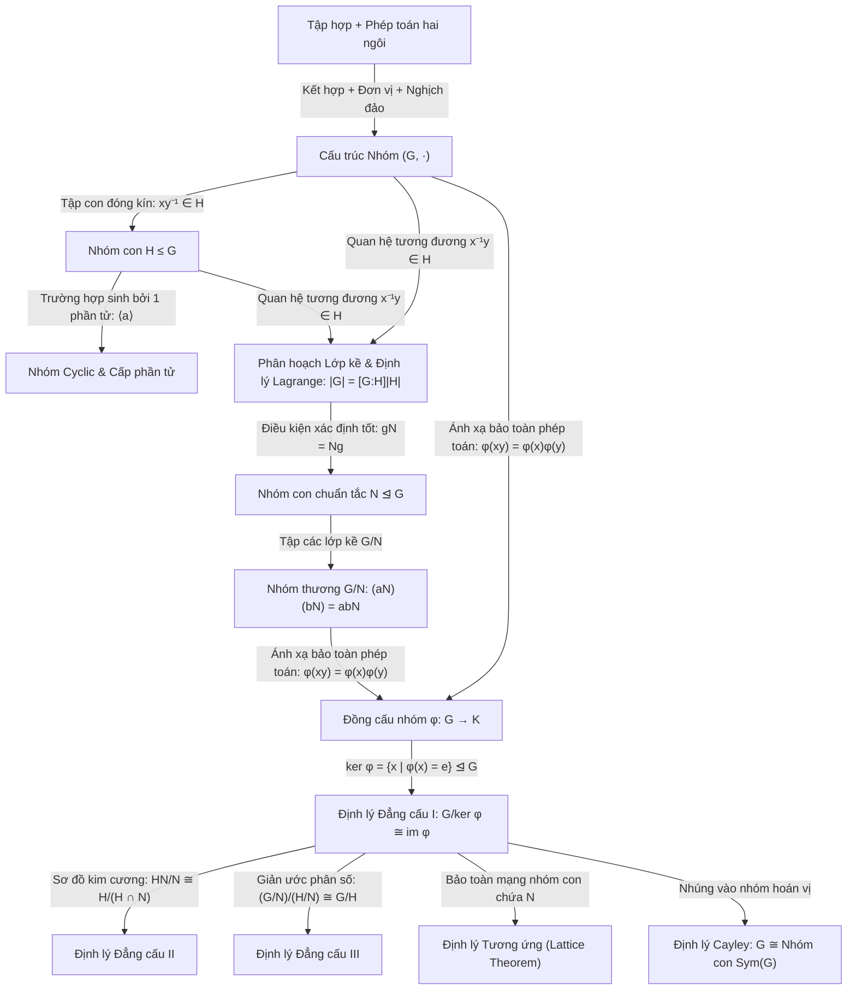

<Note title="Mục tiêu bài học">
Sau khi hoàn thành bài học này, bạn có thể:

1. **Hệ thống hóa toàn bộ bức tranh kiến thức Phần I (Lý thuyết Nhóm):** Nắm vững sợi dây phát triển logic từ *Tiên đề nhóm* $\to$ *Nhóm con & Nhóm cyclic* $\to$ *Lớp kề & Định lý Lagrange* $\to$ *Nhóm con chuẩn tắc & Nhóm thương* $\to$ *Đồng cấu & Ba định lý đẳng cấu*.
2. **Sử dụng chuẩn xác hệ thống thuật ngữ chuyên ngành song ngữ:** Làm chủ toàn bộ từ vựng chuyên ngành quốc tế về lý thuyết nhóm phục vụ tra cứu và đọc tài liệu đại số hiện đại.
3. **Chinh phục 4 dạng bài tập đỉnh cao của Phần Nhóm:** Khảo sát đồng cấu ma trận và nghiệm đơn vị, phân loại nhóm cấp $pq$ ($p > q, q \nmid p-1$), chứng minh Định lý nhúng Cayley kinh điển (1854), và định lý phần dư Trung Hoa cho nhóm qua tích trực tiếp.
4. **Tổng hợp toàn diện Phần Lý thuyết Nhóm:** Kết nối liền mạch chuỗi kiến thức từ nhóm, nhóm con, lớp kề, Định lý Lagrange, nhóm thương đến các định lý đẳng cấu nhóm.
</Note>

**Kiến thức tiên quyết:** Toàn bộ nội dung lý thuyết từ Chương 0 đến Chương 5 (<Cite source="gt-ctds-hvk-2026" page="1-96" note="Phần I: Nhóm" />).

---

## 1. Sơ đồ tư duy toàn cảnh Phần I: Lý thuyết Nhóm

Hành trình của chúng ta trong Lý thuyết Nhóm khởi đầu từ một tập hợp trang bị một phép toán hai ngôi và phát triển dần thành một hệ thống cấu trúc đại số tinh xảo (<Cite source="gt-ctds-hvk-2026" page="96" note="Mục 5.10" />):

---

## 2. Bảng thuật ngữ chuyên ngành đối chiếu Việt — Anh (Toàn bộ Phần I)

Dưới đây là bảng đối chiếu thuật ngữ cốt lõi của toàn bộ Phần I (Lý thuyết Nhóm) hỗ trợ đọc hiểu tài liệu quốc tế:

| Thuật ngữ tiếng Việt | Thuật ngữ tiếng Anh tương đương | Ký hiệu / Định nghĩa toán học |
| :--- | :--- | :--- |
| **Đồng cấu nhóm** | Group homomorphism | $\varphi(xy) = \varphi(x)\varphi(y)$ |
| **Đơn cấu / Toàn cấu** | Monomorphism / Epimorphism | Đồng cấu đơn ánh / Đồng cấu toàn ánh |
| **Đẳng cấu nhóm** | Group isomorphism | Đồng cấu song ánh ($G \cong K$) |
| **Tự đẳng cấu** | Automorphism | Đẳng cấu $\varphi: G \to G$, tập $\operatorname{Aut}(G)$ |
| **Tự đẳng cấu trong** | Inner automorphism | $c_g(x) = gxg^{-1}$, tập $\operatorname{Inn}(G) \cong G/Z(G)$ |
| **Hạt nhân** | Kernel | $\ker\varphi = \{x \in G \mid \varphi(x) = e_K\} \trianglelefteq G$ |
| **Ảnh** | Image | $\operatorname{im}\varphi = \{\varphi(x) \mid x \in G\} \le K$ |
| **Nguyên lý phân tích qua thương** | Universal factorisation property | $\bar{\varphi}(aN) = \varphi(a)$ khi $N \subseteq \ker\varphi$ |
| **Định lý đẳng cấu thứ nhất** | First Isomorphism Theorem | $G/\ker\varphi \cong \operatorname{im}\varphi$ |
| **Định lý đẳng cấu thứ hai** | Second / Diamond Isomorphism Theorem | $H/(H \cap N) \cong HN/N$ |
| **Định lý đẳng cấu thứ ba** | Third Isomorphism Theorem | $(G/N)/(H/N) \cong G/H$ |
| **Định lý tương ứng** | Correspondence / Lattice Theorem | $\{H \le G \mid N \subseteq H\} \longleftrightarrow \{\bar{H} \le G/N\}$ |
| **Bất biến đẳng cấu** | Isomorphism invariant | Cấp, tính giao hoán, phổ cấp phần tử, tâm |
| **Tích trực tiếp trong** | Internal direct product | $G \cong H \times K$ khi $H, K \trianglelefteq G, H \cap K = \{e\}, HK = G$ |
| **Định lý Cayley** | Cayley's Theorem | Mọi nhóm $G$ đẳng cấu với một nhóm con của $\operatorname{Sym}(G)$ |

---

## 3. Hệ thống bài tập chuyên đề đỉnh cao

<Exercise
  id="exr-c5-b4-a1"
  title="Đồng cấu ma trận và đồng cấu vào nhóm nhân số phức" group="Nhóm A"
  source="gt-ctds-hvk-2026"
  page="92"
  original="Bài 5.4, 5.8"
>
1. Xét ánh xạ $\varphi: \operatorname{GL}_2(\mathbb{R}) \to (\mathbb{R}_{>0}, \cdot)$ xác định bởi $\varphi(A) = (\det A)^2$.
   - Chứng minh $\varphi$ là một toàn cấu nhóm.
   - Tìm hạt nhân $\ker\varphi$ và viết đẳng cấu nhóm thương theo Định lý đẳng cấu thứ nhất.
2. Tìm tất cả các đồng cấu nhóm từ nhóm cyclic $\mathbb{Z}/4\mathbb{Z}$ vào nhóm nhân các số phức khác không $(\mathbb{C}^\times, \cdot)$.

<Hint>
Dùng $(\det(AB))^2 = (\det A)^2 (\det B)^2$. Với câu 2, ảnh của phần tử sinh $[1]$ có cấp là ước của 4 trong $\mathbb{C}^\times$, tức là các căn bậc 4 của đơn vị.
</Hint>

<Solution>
**1. Khảo sát $\varphi(A) = (\det A)^2$ trên $\operatorname{GL}_2(\mathbb{R})$**

 - *Đồng cấu:* Với mọi $A, B \in \operatorname{GL}_2(\mathbb{R})$, theo tính chất định thức:
     $$
     \varphi(AB) = (\det(AB))^2 = (\det A \cdot \det B)^2 = (\det A)^2 \cdot (\det B)^2 = \varphi(A)\varphi(B).
     $$
     Vậy $\varphi$ là một đồng cấu nhóm.
   - *Toàn ánh:* Với mọi số thực dương $r > 0$, xét ma trận $A = \begin{pmatrix} \sqrt{r} & 0 \\ 0 & 1 \end{pmatrix} \in \operatorname{GL}_2(\mathbb{R})$.
     Ta có $\det A = \sqrt{r}$, suy ra $\varphi(A) = (\sqrt{r})^2 = r$. Do đó $\operatorname{im}\varphi = \mathbb{R}_{>0}$, tức $\varphi$ là toàn cấu.
   - *Hạt nhân:*
     $$
     \ker\varphi = \{A \in \operatorname{GL}_2(\mathbb{R}) \mid (\det A)^2 = 1\} = \{A \in \operatorname{GL}_2(\mathbb{R}) \mid \det A = \pm 1\}.
     $$
     Nhóm con này thường được ký hiệu là $\operatorname{SL}_2^\pm(\mathbb{R})$.
   - *Nhóm thương:* Theo Định lý đẳng cấu thứ nhất:
     $$
     \operatorname{GL}_2(\mathbb{R}) / \operatorname{SL}_2^\pm(\mathbb{R}) \cong (\mathbb{R}_{>0}, \cdot).
     $$

**2. Tìm các đồng cấu từ $\mathbb{Z}/4\mathbb{Z}$ vào $\mathbb{C}^\times$**

Theo Mệnh đề 5.1.3, một đồng cấu $\psi: \mathbb{Z}/4\mathbb{Z} \to \mathbb{C}^\times$ được xác định duy nhất bởi giá trị $w = \psi([1]_4) \in \mathbb{C}^\times$.
   Vì $4 \cdot [1]_4 = [0]_4$, ta phải có:
   $$
   w^4 = (\psi([1]_4))^4 = \psi(4 \cdot [1]_4) = \psi([0]_4) = 1.
   $$
   Do đó, $w$ bắt buộc phải là một nghiệm phức của phương trình $w^4 = 1$ (căn bậc 4 của đơn vị).
   Phương trình này có đúng 4 nghiệm phức phân biệt là:
   $$
   w \in \{1, -1, i, -i\}.
   $$
   Mỗi nghiệm $w$ xác định duy nhất một đồng cấu nhóm hợp thức $\psi_w([x]_4) = w^x$:
   - $\psi_1([x]_4) = 1^x = 1$ (đồng cấu tầm thường, $\ker\psi_1 = \mathbb{Z}/4\mathbb{Z}$).
   - $\psi_{-1}([x]_4) = (-1)^x$ (hạt nhân $\ker\psi_{-1} = \{[0], [2]\}$).
   - $\psi_i([x]_4) = i^x$ (đơn cấu, hạt nhân $\ker\psi_i = \{[0]\}$).
   - $\psi_{-i}([x]_4) = (-i)^x$ (đơn cấu, hạt nhân $\ker\psi_{-i} = \{[0]\}$).
   Vậy có đúng 4 đồng cấu nhóm từ $\mathbb{Z}/4\mathbb{Z}$ vào $\mathbb{C}^\times$.
</Solution>
</Exercise>

<Exercise
  id="exr-c5-b4-b1"
  title="Phân loại nhóm cấp pq khi q không chia hết p - 1" group="Nhóm B"
  source="gt-ctds-hvk-2026"
  page="94"
  original="Bài 5.22, 5.40"
>
Cho $G$ là một nhóm có cấp $|G| = pq$, trong đó $p$ và $q$ là hai số nguyên tố thỏa mãn $p > q$ và $q \nmid (p - 1)$ (ví dụ $|G| = 15 = 3 \cdot 5$, với $5 > 3$ và $3 \nmid 4$).
Giả sử đã biết $G$ có duy nhất một nhóm con $H$ cấp $p$ và duy nhất một nhóm con $K$ cấp $q$.
1. Chứng minh rằng $H \trianglelefteq G$ và $K \trianglelefteq G$.
2. Chứng minh rằng $H \cap K = \{e\}$ và $HK = G$.
3. Áp dụng định lý nhận diện tích trực tiếp trong để suy ra $G \cong H \times K$.
4. Từ đó chứng minh $G$ là một nhóm cyclic và $G \cong \mathbb{Z}/pq\mathbb{Z}$.

<Hint>
Nhóm con duy nhất của một cấp luôn chuẩn tắc. Dùng Định lý nhận diện tích trực tiếp $G \cong H \times K$ và định lý phần dư Trung Hoa cho nhóm cyclic: $\mathbb{Z}/p\mathbb{Z} \times \mathbb{Z}/q\mathbb{Z} \cong \mathbb{Z}/pq\mathbb{Z}$ khi $\gcd(p, q) = 1$.
</Hint>

<Solution>
**1. Chứng minh $H \trianglelefteq G$ và $K \trianglelefteq G$**

Theo Bài tập 3.2.4 (Chương 3), với mọi $g \in G$, nhóm con liên hợp $gHg^{-1}$ có cùng cấp với $H$: $|gHg^{-1}| = |H| = p$.
   Vì theo giả thiết $H$ là nhóm con DUY NHẤT của $G$ có cấp $p$, ta bắt buộc phải có $gHg^{-1} = H$ với mọi $g \in G$.
   Do đó $H \trianglelefteq G$.
   Hoàn toàn tương tự, $K$ là nhóm con duy nhất có cấp $q$, nên $gKg^{-1} = K$ với mọi $g \in G$. Do đó $K \trianglelefteq G$.

**2. Chứng minh $H \cap K = \{e\}$ và $HK = G$**

 - Vì $H \cap K \le H$ và $H \cap K \le K$, theo Định lý Lagrange, cấp $|H \cap K|$ phải vừa là ước của $p$, vừa là ước của $q$. Do đó $|H \cap K| \mid \gcd(p, q)$.
     Vì $p, q$ là hai số nguyên tố phân biệt, $\gcd(p, q) = 1$. Suy ra $|H \cap K| = 1 \implies H \cap K = \{e\}$.
   - Vì $K \trianglelefteq G$, tích $HK$ là một nhóm con của $G$. Theo công thức lực lượng tích:
     $$
     |HK| = \frac{|H| \cdot |K|}{|H \cap K|} = \frac{p \cdot q}{1} = pq = |G|.
     $$
     Vì $HK \subseteq G$ và $|HK| = |G| < \infty$, ta kết luận $HK = G$.

**3. Chứng minh $G \cong H \times K$**

Theo Định lý nhận diện tích trực tiếp trong (Bài 3, Bài tập 5.3.4), vì:
   - $H \trianglelefteq G$ và $K \trianglelefteq G$,
   - $H \cap K = \{e\}$,
   - $HK = G$,
   ánh xạ $\theta: H \times K \to G$ cho bởi $\theta(h, k) = hk$ là một đẳng cấu nhóm.
   Vậy $G \cong H \times K$.

**4. Kết luận $G \cong \mathbb{Z}/pq\mathbb{Z}$ là nhóm cyclic**

Vì $p$ và $q$ là các số nguyên tố, theo Hệ quả 3.2.3, mọi nhóm cấp nguyên tố đều là nhóm cyclic:
   $$
   H \cong \mathbb{Z}/p\mathbb{Z} \quad \text{và} \quad K \cong \mathbb{Z}/q\mathbb{Z}.
   $$
   Do đó:
   $$
   G \cong (\mathbb{Z}/p\mathbb{Z}) \times (\mathbb{Z}/q\mathbb{Z}).
   $$
   Vì $\gcd(p, q) = 1$, theo Định lý phần dư Trung Hoa cho nhóm cyclic (Chương 2, Định lý 2.4.4), ta có:
   $$
   (\mathbb{Z}/p\mathbb{Z}) \times (\mathbb{Z}/q\mathbb{Z}) \cong \mathbb{Z}/pq\mathbb{Z}.
   $$
   Vậy $G$ là một nhóm cyclic và $G \cong \mathbb{Z}/pq\mathbb{Z}$.
   *(Ví dụ: Mọi nhóm có cấp 15 đều bắt buộc phải đẳng cấu với $\mathbb{Z}/15\mathbb{Z}$).*
</Solution>
</Exercise>

<Exercise
  id="exr-c5-b4-c1"
  title="Định lý Cayley (1854): Mọi nhóm đều là nhóm hoán vị" group="Nhóm C"
  source="gt-ctds-hvk-2026"
  page="95"
  original="Bài 5.43"
>
Cho $(G, \cdot)$ là một nhóm bất kỳ. Ký hiệu $\operatorname{Sym}(G)$ là nhóm tất cả các song ánh từ tập hợp $G$ lên chính nó dưới phép toán hợp thành ánh xạ.
Với mỗi phần tử $g \in G$, xét ánh xạ tịnh tiến trái $L_g: G \to G$ xác định bởi:
$$
L_g(x) = gx, \quad \forall x \in G.
$$
1. Chứng minh rằng $L_g$ là một song ánh, tức $L_g \in \operatorname{Sym}(G)$.
2. Xét ánh xạ $\Psi: G \to \operatorname{Sym}(G)$ xác định bởi $\Psi(g) = L_g$. Chứng minh rằng $\Psi$ là một đồng cấu nhóm (nhúng Cayley).
3. Chứng minh rằng $\ker\Psi = \{e_G\}$, từ đó suy ra $\Psi$ là một đơn cấu.
4. Áp dụng Định lý đẳng cấu thứ nhất để rút ra phát biểu của **Định lý Cayley**: Mọi nhóm $G$ đều đẳng cấu với một nhóm con của nhóm đối xứng $\operatorname{Sym}(G)$. Đặc biệt, nếu $|G| = n < \infty$ thì $G$ đẳng cấu với một nhóm con của nhóm đối xứng $S_n$.

<Hint>
Kiểm tra $L_{gh} = L_g \circ L_h$. Điều kiện $\Psi(g) = \operatorname{id}_G \iff L_g(x) = x, \forall x$. Chọn $x = e$.
</Hint>

<Solution>
**1. Chứng minh $L_g \in \operatorname{Sym}(G)$**

Ta kiểm tra $L_g$ là song ánh:
   - *Đơn ánh:* Nếu $L_g(x) = L_g(y) \implies gx = gy$, nhân $g^{-1}$ vào bên trái theo luật giản ước ta được $x = y$.
   - *Toàn ánh:* Với mọi $y \in G$, chọn $x = g^{-1}y \in G$. Khi đó $L_g(x) = g(g^{-1}y) = y$.
   Vậy $L_g$ là một song ánh từ $G$ lên $G$, tức là $L_g \in \operatorname{Sym}(G)$.

**2. Chứng minh $\Psi$ là đồng cấu nhóm**

Với mọi $g, h \in G$, ta so sánh hai ánh xạ $\Psi(gh) = L_{gh}$ và $\Psi(g) \circ \Psi(h) = L_g \circ L_h$.
   Với mọi $x \in G$, theo tính kết hợp của phép nhân trong $G$:
   $$
   (L_g \circ L_h)(x) = L_g(L_h(x)) = L_g(hx) = g(hx) = (gh)x = L_{gh}(x).
   $$
   Vì đẳng thức đúng với mọi $x \in G$, ta có:
   $$
   L_{gh} = L_g \circ L_h \iff \Psi(gh) = \Psi(g) \circ \Psi(h).
   $$
   Vậy $\Psi$ là một đồng cấu nhóm từ $(G, \cdot)$ vào $(\operatorname{Sym}(G), \circ)$.

**3. Chứng minh $\ker\Psi = \{e_G\}$**

Phần tử đơn vị của $\operatorname{Sym}(G)$ là ánh xạ đồng nhất $\operatorname{id}_G$.
   Theo định nghĩa hạt nhân:
   $$
   g \in \ker\Psi \iff \Psi(g) = \operatorname{id}_G \iff L_g = \operatorname{id}_G \iff L_g(x) = x, \; \forall x \in G \iff gx = x, \; \forall x \in G.
   $$
   Đặc biệt, chọn $x = e_G$, đẳng thức trở thành:
   $$
   g \cdot e_G = e_G \implies g = e_G.
   $$
   Ngược lại, nếu $g = e_G$ thì hiển nhiên $L_{e_G}(x) = e_G x = x = \operatorname{id}_G(x)$.
   Do đó:
   $$
   \ker\Psi = \{e_G\}.
   $$
   Theo tiêu chuẩn đơn cấu, $\Psi$ là một **đơn cấu nhóm** (nhúng Cayley).

**4. Kết luận Định lý Cayley**

Theo Định lý đẳng cấu thứ nhất:
   $$
   G/\ker\Psi \cong \operatorname{im}\Psi \iff G/\{e_G\} \cong \operatorname{im}\Psi \iff G \cong \operatorname{im}\Psi.
   $$
   Vì $\operatorname{im}\Psi$ là một nhóm con của $\operatorname{Sym}(G)$, ta kết luận:
   **Mọi nhóm $G$ đều đẳng cấu với một nhóm con của nhóm đối xứng $\operatorname{Sym}(G)$.**
   Khi $G$ hữu hạn có cấp $n$, tập $G$ có $n$ phần tử nên $\operatorname{Sym}(G) \cong S_n$. Do đó mọi nhóm hữu hạn cấp $n$ đều đẳng cấu với một nhóm con của nhóm hoán vị $S_n$.
</Solution>
</Exercise>

<Exercise
  id="exr-c5-b4-d1"
  title="Định lý Phần dư Trung Hoa cho nhóm qua Định lý đẳng cấu" group="Nhóm D"
  source="gt-ctds-hvk-2026"
  page="96"
  original="Bài 5.44"
>
Cho $(G, \cdot)$ là một nhóm và $M, N$ là hai nhóm con chuẩn tắc của $G$ ($M \trianglelefteq G, N \trianglelefteq G$) thỏa mãn điều kiện $MN = G$.
1. Áp dụng Định lý đẳng cấu thứ hai để chứng minh rằng $G/M \cong N/(M \cap N)$ và $G/N \cong M/(M \cap N)$.
2. Xét ánh xạ $\theta: G \to (G/M) \times (G/N)$ xác định bởi $\theta(g) = (gM, gN)$. Chứng minh rằng $\theta$ là một đồng cấu nhóm.
3. Tìm hạt nhân $\ker\theta$ và chứng minh $\ker\theta = M \cap N$.
4. Chứng minh rằng $\theta$ là một toàn ánh (gợi ý: với bất kỳ $(aM, bN)$, hãy sử dụng giả thiết $MN = G$ để viết $a^{-1}b = m n$ với $m \in M, n \in N$ và tìm phần tử $g \in G$ thỏa $\theta(g) = (aM, bN)$).
5. Áp dụng Định lý đẳng cấu thứ nhất để rút ra đẳng cấu kinh điển:
   $$
   G/(M \cap N) \cong (G/M) \times (G/N).
   $$

<Hint>
Để tìm $g$: đặt $g = an = bm^{-1}$. Kiểm tra $gM = anM = aM$ (vì $n = m^{-1}a^{-1}b \in M(a^{-1}b)$) và $gN = bN$.
</Hint>

<Solution>
**1. Áp dụng Định lý đẳng cấu thứ hai**

Vì $M \trianglelefteq G$ và $N \le G$, áp dụng Định lý đẳng cấu thứ hai (Định lý kim cương):
   $$
   N / (M \cap N) \cong MN / M.
   $$
   Theo giả thiết $MN = G$, thay vào ta được:
   $$
   N / (M \cap N) \cong G / M \iff G / M \cong N / (M \cap N).
   $$
   Hoàn toàn tương tự, hoán đổi vai trò của $M$ và $N$ (chú ý $NM = MN = G$ do cả hai đều chuẩn tắc):
   $$
   G / N \cong M / (M \cap N).
   $$

**2. Chứng minh $\theta$ là đồng cấu nhóm**

Ánh xạ $\theta(g) = (gM, gN)$. Với mọi $x, y \in G$:
   $$
   \theta(xy) = ((xy)M, (xy)N) = (xM \cdot yM, \; xN \cdot yN) = (xM, xN)(yM, yN) = \theta(x)\theta(y).
   $$
   Vậy $\theta$ là một đồng cấu nhóm từ $G$ vào nhóm tích $(G/M) \times (G/N)$.

**3. Xác định hạt nhân $\ker\theta$**

Phần tử đơn vị của nhóm tích là $(e_{G/M}, e_{G/N}) = (M, N)$.
   Theo định nghĩa hạt nhân:
   $$
   g \in \ker\theta \iff (gM, gN) = (M, N) \iff gM = M \text{ và } gN = N \iff g \in M \text{ và } g \in N \iff g \in M \cap N.
   $$
   Do đó:
   $$
   \ker\theta = M \cap N.
   $$

**4. Chứng minh $\theta$ là toàn ánh**

Lấy một phần tử tùy ý $(aM, bN) \in (G/M) \times (G/N)$. Ta cần tìm $g \in G$ sao cho $gM = aM$ và $gN = bN$.
   Xét phần tử $a^{-1}b \in G$. Vì theo giả thiết $MN = G$, tồn tại $m \in M$ và $n \in N$ sao cho:
   $$
   a^{-1}b = mn \iff b = a m n \iff b n^{-1} = am.
   $$
   Đặt phần tử:
   $$
   g = a m = b n^{-1} \in G.
   $$
   Ta kiểm tra ảnh của $g$:
   - Vì $g = am$ với $m \in M$, ta có $gM = (am)M = a(mM) = aM$.
   - Vì $g = bn^{-1}$ với $n^{-1} \in N$, ta có $gN = (bn^{-1})N = b(n^{-1}N) = bN$.
   Do đó:
   $$
   \theta(g) = (gM, gN) = (aM, bN).
   $$
   Điều này chứng minh $\theta$ là một toàn ánh ($\operatorname{im}\theta = (G/M) \times (G/N)$).

**5. Áp dụng Định lý đẳng cấu thứ nhất**

Theo Định lý đẳng cấu thứ nhất:
   $$
   G/\ker\theta \cong \operatorname{im}\theta.
   $$
   Thay $\ker\theta = M \cap N$ và $\operatorname{im}\theta = (G/M) \times (G/N)$ vào, ta thu được đẳng cấu:
   $$
   G/(M \cap N) \cong (G/M) \times (G/N).
   $$
   Đây chính là phiên bản tổng quát của Định lý phần dư Trung Hoa cho các nhóm bất kỳ (khi $G = \mathbb{Z}$, $M = m\mathbb{Z}, N = n\mathbb{Z}$ với $\gcd(m, n) = 1$, ta có $M + N = \mathbb{Z}$ và $M \cap N = mn\mathbb{Z}$, khôi phục lại đẳng cấu $\mathbb{Z}/mn\mathbb{Z} \cong \mathbb{Z}/m\mathbb{Z} \times \mathbb{Z}/n\mathbb{Z}$).
</Solution>
</Exercise>

---

## 4. Tóm tắt cốt lõi và Khép lại Phần I (Lý thuyết Nhóm)

<KeyTakeaways>
- **Đỉnh cao của Lý thuyết Nhóm:** Ba định lý đẳng cấu và Định lý tương ứng là bộ công cụ tối thượng cho phép giải mã cấu trúc của mọi nhóm thương mà không cần tính toán thủ công.
- **Định lý Cayley:** Mọi cấu trúc nhóm trừu tượng đều có thể xem như một nhóm các phép biến đổi hoán vị cụ thể.
- **Định lý phần dư Trung Hoa cho nhóm:** Khi hai nhóm con chuẩn tắc thỏa $MN = G$, nhóm thương $G/(M \cap N)$ phân tích thành tích trực tiếp $(G/M) \times (G/N)$.
- **Tổng kết Phần Lý thuyết Nhóm:** Nhóm là cấu trúc nền tảng của một phép toán hai ngôi kết hợp có đơn vị và nghịch đảo; toàn bộ các công cụ nhóm con, lớp kề, nhóm thương và đồng cấu nhóm tạo nên nền tảng vững chắc cho đại số trừu tượng.
</KeyTakeaways>
