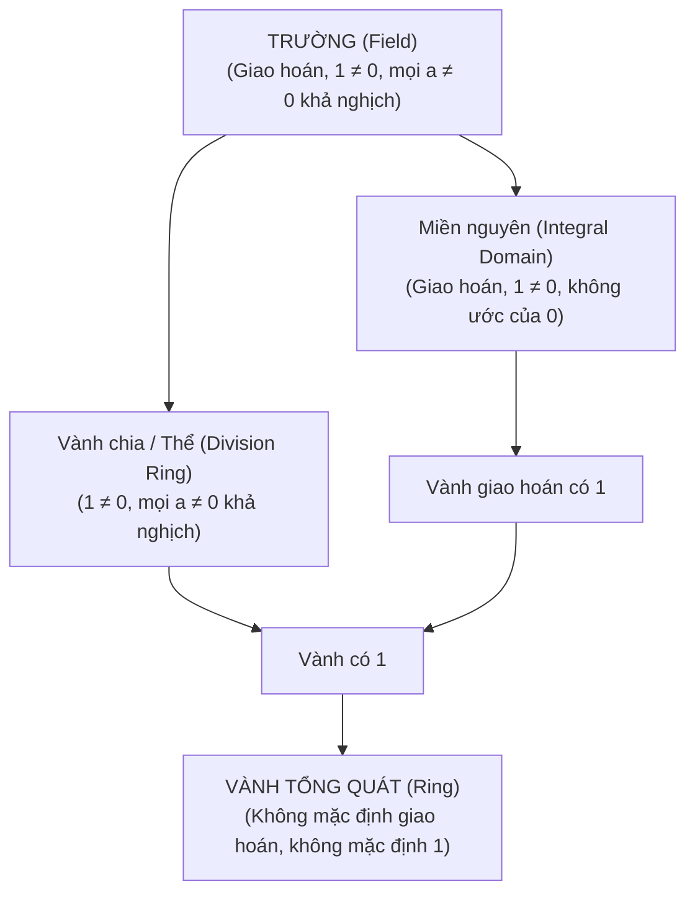

<Note title="Mục tiêu bài học">
Sau khi hoàn thành bài học này, bạn có thể:

1. **Hiểu bản chất của ước của không:** Nắm vững định nghĩa ước của không bên trái ($ab = 0_R$) và bên phải ($ca = 0_R$) trong vành bất kỳ.
2. **Chứng minh mối liên hệ tương đương với luật giản ước:** Thiết lập và chứng minh định lý cơ bản: $a \neq 0_R$ không là ước của không trái $\iff$ ánh xạ nhân trái $L_a$ là đơn ánh $\iff$ thỏa mãn luật giản ước trái $ax = ay \implies x = y$.
3. **Phân biệt sắc nét phần tử khả nghịch và ước của không:** Chứng minh hai tập hợp này luôn rời nhau trong mọi vành có đơn vị $1_R \neq 0_R$.
4. **Làm chủ hệ thống phân cấp cấu trúc hai phép toán:** Nắm vững và phân biệt rạch ròi ba nấc thang cấu trúc: **Miền nguyên** (*Integral Domain*), **Vành chia / Thể** (*Division Ring / Skew Field*), và **Trường** (*Field*).
5. **Chứng minh định lý trường hợp hữu hạn:** Chứng minh chi tiết định lý kinh điển: Mọi miền nguyên hữu hạn đều là một trường, từ đó suy ra điều kiện cần và đủ để $\mathbb{Z}/n\mathbb{Z}$ là trường.
</Note>

**Kiến thức tiên quyết:** Khái niệm vành, phần tử đơn vị và nhóm các đơn vị $R^\times$ (<Cite source="gt-ctds-hvk-2026" page="98-101" note="Mục 6.1, 6.2, 6.3" />).

---

## 1. Ước của không và mối liên hệ với Luật giản ước

Trong số học phổ thông trên $\mathbb{R}$, ta đã quen thuộc với tính chất: Nếu tích $ab = 0$ thì bắt buộc $a = 0$ hoặc $b = 0$. Tuy nhiên, trong lý thuyết vành tổng quát, điều này hoàn toàn có thể không xảy ra (chẳng hạn trong $\mathbb{Z}/6\mathbb{Z}$ ta có $[2] \cdot [3] = [0]$ dù cả hai thừa số đều khác $[0]$). Hiện tượng này dẫn đến khái niệm trung tâm: **ước của không**.

<Definition id="def-c6-b2-uoc-cua-khong" title="Ước của không trái và Ước của không phải (Định nghĩa 6.7 Giáo trình)">
Cho $(R, +, \cdot)$ là một vành. Một phần tử $a \in R, a \neq 0_R$ được gọi là:
1. **Ước của không trái** (*left zero divisor*) nếu tồn tại phần tử $b \in R, b \neq 0_R$ sao cho:
   $$
   a \cdot b = 0_R.
   $$
2. **Ước của không phải** (*right zero divisor*) nếu tồn tại phần tử $c \in R, c \neq 0_R$ sao cho:
   $$
   c \cdot a = 0_R.
   $$
3. Một phần tử được gọi là **ước của không hai phía** (hay đơn giản là *ước của không*) nếu nó đồng thời là ước của không trái và ước của không phải.

Nếu $R$ là một vành giao hoán, khái niệm ước của không trái và phải trùng nhau hoàn toàn.
</Definition>

<Theorem id="thm-c6-b2-luat-gian-uoc" title="Ước của không và Luật giản ước nhân (Định lý 6.8 Giáo trình)">
Cho $(R, +, \cdot)$ là một vành và $a \in R, a \neq 0_R$. Các mệnh đề sau là tương đương:

1. $a$ không phải là ước của không trái.
2. Ánh xạ nhân trái $L_a: R \to R, x \mapsto a \cdot x$ là một đơn ánh.
3. Thỏa mãn **luật giản ước bên trái** đối với $a$: Với mọi $x, y \in R$,
   $$
   a \cdot x = a \cdot y \implies x = y.
   $$

Hoàn toàn tương tự, $a$ không phải là ước của không phải khi và chỉ khi ánh xạ nhân phải $R_a: R \to R, x \mapsto x \cdot a$ là đơn ánh, tương đương với luật giản ước bên phải: $x \cdot a = y \cdot a \implies x = y$.
</Theorem>

<Proof>
Ta chứng minh chuỗi tương đương vòng tròn (1) $\implies$ (2) $\implies$ (3) $\implies$ (1):

- **(1) $\implies$ (2):** Giả sử $a$ không phải là ước của không trái. Xét hai phần tử $x, y \in R$ sao cho $L_a(x) = L_a(y)$, tức là $ax = ay$. Theo quy tắc phân phối đối với phép trừ:
  $$
  ax - ay = 0_R \iff a(x - y) = 0_R.
  $$
  Vì $a$ không phải là ước của không trái và $a \neq 0_R$, thừa số còn lại bắt buộc phải bằng không: $x - y = 0_R \implies x = y$. Vậy $L_a$ là đơn ánh.

- **(2) $\implies$ (3):** Giả sử $L_a$ là đơn ánh. Khi đó $ax = ay \iff L_a(x) = L_a(y) \implies x = y$. Đây chính là luật giản ước bên trái.

- **(3) $\implies$ (1):** Giả sử luật giản ước trái đúng đối với $a$. Xét phần tử $b \in R$ sao cho $ab = 0_R$. Ta có thể viết:
  $$
  ab = a \cdot 0_R \quad (\text{vì } a \cdot 0_R = 0_R).
  $$
  Áp dụng luật giản ước trái cho phần tử $a \neq 0_R$, suy ra $b = 0_R$. Như vậy không tồn tại $b \neq 0_R$ thỏa mãn $ab = 0_R$, tức là $a$ không phải là ước của không trái.
</Proof>

<Proposition id="prop-c6-b2-roi-nhau-uoc-khong-va-don-vi" title="Sự rời nhau giữa Phần tử khả nghịch và Ước của không">
Cho $R$ là một vành có phần tử đơn vị $1_R \neq 0_R$. Khi đó:
$$
R^\times \cap (\text{Tập các ước của không của } R) = \varnothing.
$$
Nói cách khác, **một phần tử khả nghịch không bao giờ là một ước của không** (cả bên trái lẫn bên phải).
</Proposition>

<Proof>
Giả sử phản chứng tồn tại $u \in R^\times$ là một ước của không trái.
Theo định nghĩa, tồn tại $b \in R, b \neq 0_R$ sao cho $u \cdot b = 0_R$.
Vì $u \in R^\times$, tồn tại nghịch đảo $u^{-1} \in R$. Nhân $u^{-1}$ vào bên trái của đẳng thức:
$$
u^{-1} \cdot (u \cdot b) = u^{-1} \cdot 0_R \implies (u^{-1} \cdot u) \cdot b = 0_R \implies 1_R \cdot b = 0_R \implies b = 0_R.
$$
Điều này mâu thuẫn trực tiếp với giả thiết $b \neq 0_R$.
Chứng minh hoàn toàn tương tự cho ước của không phải bằng cách nhân $u^{-1}$ vào bên phải. Vậy mệnh đề được chứng minh trọn vẹn.
</Proof>

---

## 2. Thang bậc cấu trúc: Miền nguyên, Vành chia và Trường

Dựa trên sự tương tác giữa tính giao hoán, sự tồn tại của đơn vị và sự vắng mặt của ước của không, đại số trừu tượng thiết lập ba nấc thang cấu trúc kinh điển.

<Definition id="def-c6-b2-mien-nguyen-vanh-chia-truong" title="Miền nguyên, Vành chia và Trường (Định nghĩa 6.10 Giáo trình)">
Cho $(R, +, \cdot)$ là một vành:

1. **Miền nguyên (*Integral Domain*):** $R$ được gọi là một **miền nguyên** nếu:
   - $R$ là vành giao hoán có phần tử đơn vị $1_R \neq 0_R$.
   - $R$ **không có ước của không**, nghĩa là với mọi $a, b \in R$:
     $$
     a \cdot b = 0_R \implies a = 0_R \quad \text{hoặc} \quad b = 0_R.
     $$
   *(Tương đương: trong $R$, luật giản ước nhân thỏa mãn với mọi phần tử khác $0_R$).*

2. **Vành chia hay Thể (*Division Ring / Skew Field*):** $R$ được gọi là một **vành chia** (hay một *thể*) nếu:
   - $R$ có phần tử đơn vị $1_R \neq 0_R$.
   - Mọi phần tử khác không đều có nghịch đảo nhân hai phía:
     $$
     R^\times = R \setminus \{0_R\}.
     $$
   *(Chú ý: Vành chia không bắt buộc phép nhân phải giao hoán).*

3. **Trường (*Field*):** $R$ được gọi là một **trường** nếu $R$ là một **vành chia giao hoán**.
   *(Tương đương: $R$ là miền nguyên mà mọi phần tử khác không đều khả nghịch).*
</Definition>

### Sơ đồ phân cấp bao hàm giữa các cấu trúc

Quan hệ giữa các lớp cấu trúc đại số hai phép toán được biểu diễn cô đọng qua sơ đồ:

<Example id="ex-c6-b2-phan-loai-cac-cau-truc" title="Minh họa các nấc thang cấu trúc">
1. **Miền nguyên nhưng KHÔNG là trường:** Vành số nguyên $(\mathbb{Z}, +, \cdot)$ là miền nguyên mẫu mực: phép nhân giao hoán, $1 \neq 0$, không có ước của không ($ab = 0 \implies a = 0 \lor b = 0$). Tuy nhiên $\mathbb{Z}$ không là trường vì chỉ có $\pm 1$ là khả nghịch; phần tử $2 \neq 0$ không có nghịch đảo trong $\mathbb{Z}$.
2. **Vành chia nhưng KHÔNG là trường:** **Thể Quaternion Hamilton $\mathbb{H}$** định nghĩa bởi:
   $$
   \mathbb{H} = \{a + bi + cj + dk \mid a, b, c, d \in \mathbb{R}\},
   $$
   với các quan hệ $i^2 = j^2 = k^2 = ijk = -1$, $ij = k = -ji$.
   Phép nhân trên $\mathbb{H}$ không giao hoán ($ij \neq ji$). Mỗi phần tử khác không $q = a+bi+cj+dk \neq 0$ đều có chuẩn $N(q) = a^2+b^2+c^2+d^2 > 0$ và có nghịch đảo nhân là:
   $$
   q^{-1} = \frac{a - bi - cj - dk}{a^2 + b^2 + c^2 + d^2}.
   $$
   Do đó $\mathbb{H}$ là một vành chia nhưng không phải là trường.
3. **Trường quen thuộc:** $\mathbb{Q}, \mathbb{R}, \mathbb{C}$ là các trường vô hạn.
4. **Vành có đơn vị nhưng không là miền nguyên và không là vành chia:** $\mathbb{Z}/6\mathbb{Z}$ (vành giao hoán có ước của không $[2][3]=[0]$) và $M_2(\mathbb{R})$ (vành không giao hoán có ma trận suy biến khác không).
</Example>

---

## 3. Định lý trường hợp hữu hạn: Khi Miền nguyên biến thành Trường

Khoảng cách giữa miền nguyên và trường là yêu cầu: mọi phần tử khác không phải khả nghịch. Trong thế giới vô hạn, khoảng cách này rất lớn ($\mathbb{Z}$ so với $\mathbb{Q}$). Tuy nhiên, trong thế giới hữu hạn, một điều kỳ diệu xảy ra: **hai khái niệm này trùng nhau hoàn toàn**.

<Theorem id="thm-c6-b2-mien-nguyen-huu-han-la-truong" title="Mọi miền nguyên hữu hạn đều là một Trường (Định lý 6.12 Giáo trình)">
Cho $R$ là một miền nguyên. Nếu tập hợp $R$ là hữu hạn thì $R$ là một **trường**.
</Theorem>

<Proof>
Theo định nghĩa, $R$ đã là một vành giao hoán có phần tử đơn vị $1_R \neq 0_R$. Để chứng minh $R$ là một trường, ta chỉ cần chứng minh mọi phần tử khác không $a \in R \setminus \{0_R\}$ đều có nghịch đảo nhân trong $R$.

Lấy tùy ý một phần tử $a \in R, a \neq 0_R$. Xét ánh xạ nhân bên trái:
$$
L_a: R \to R, \quad x \mapsto a \cdot x.
$$
1. **$L_a$ là một đơn ánh:** Giả sử $L_a(x) = L_a(y)$, tức là $ax = ay \iff a(x - y) = 0_R$. Vì $R$ là một miền nguyên và $a \neq 0_R$, suy ra $x - y = 0_R \implies x = y$. Vậy $L_a$ là đơn ánh.
2. **$L_a$ là một toàn ánh:** Vì tập hợp $R$ là hữu hạn và $L_a: R \to R$ là một đơn ánh từ một tập hữu hạn vào chính nó, theo nguyên lý Dirichlet, $L_a$ **bắt buộc phải là một toàn ánh**.
3. **Tìm phần tử nghịch đảo:** Do $L_a$ toàn ánh và $1_R \in R$, tồn tại một phần tử $b \in R$ sao cho:
   $$
   L_a(b) = 1_R \iff a \cdot b = 1_R.
   $$
   Vì $R$ giao hoán, ta có $b \cdot a = a \cdot b = 1_R$.
Điều này chứng minh phần tử $b$ chính là nghịch đảo nhân của $a$, tức $a \in R^\times$.
Do $a \neq 0_R$ được chọn tùy ý, ta kết luận mọi phần tử khác không của $R$ đều khả nghịch. Vậy $R$ là một trường.
</Proof>

<Corollary id="cor-c6-b2-z-mod-n-la-truong" title="Đặc trưng Trường của vành Z/nZ (Hệ quả 6.13 Giáo trình)">
Với mọi số nguyên $n \ge 2$, các khẳng định sau là tương đương:
1. $\mathbb{Z}/n\mathbb{Z}$ là một trường (thường ký hiệu là $\mathbb{F}_p$ khi $n=p$).
2. $\mathbb{Z}/n\mathbb{Z}$ là một miền nguyên.
3. $n$ là một số nguyên tố.
</Corollary>

<Proof>
- **(1) $\implies$ (2):** Hiển nhiên vì mọi trường đều là miền nguyên.
- **(2) $\implies$ (3):** Giả sử phản chứng $n$ không phải số nguyên tố, tức là hợp số $n = ab$ với $1 < a, b < n$. Khi đó $[a]_n \neq [0]_n$ và $[b]_n \neq [0]_n$, nhưng $[a]_n [b]_n = [ab]_n = [n]_n = [0]_n$. Điều này chứng tỏ $[a]_n$ là ước của không, mâu thuẫn với giả thiết $\mathbb{Z}/n\mathbb{Z}$ là miền nguyên. Vậy $n$ phải là số nguyên tố.
- **(3) $\implies$ (1):** Giả sử $n = p$ là số nguyên tố. Xét $[a]_p [b]_p = [0]_p \implies ab \equiv 0 \pmod p \implies p \mid ab$. Do $p$ nguyên tố, suy ra $p \mid a$ hoặc $p \mid b$, tức $[a]_p = [0]_p$ hoặc $[b]_p = [0]_p$. Do đó $\mathbb{Z}/p\mathbb{Z}$ là một miền nguyên. Vì $\mathbb{Z}/p\mathbb{Z}$ có đúng $p$ phần tử (hữu hạn), theo Định lý 6.12, $\mathbb{Z}/p\mathbb{Z}$ là một trường.
</Proof>

<Note title="Mở rộng sâu sắc: Định lý Nhỏ Wedderburn (Wedderburn's Little Theorem, 1905)">
Định lý 6.12 khẳng định rằng trong thế giới hữu hạn: **Miền nguyên $\implies$ Trường**. Vậy đối với Vành chia thì sao?
Định lý nổi tiếng của nhà toán học Joseph Wedderburn khẳng định:
> **Mọi vành chia hữu hạn đều là một trường.**

Nói cách khác, trong các cấu trúc đại số hữu hạn có hai phép toán, nếu mọi phần tử khác không đều khả nghịch thì **tính giao hoán của phép nhân tự động được thỏa mãn**! Không tồn tại bất kỳ vành chia không giao hoán hữu hạn nào.
</Note>

---

## 4. Hệ thống bài tập 4 phân lớp có lời giải

<Exercise id="ex-c6-b2-nhom-a" title="Bài tập 6.5 (Nhóm A): Phân loại ước của không và phần tử khả nghịch trong Z/15Z">
Trong vành các lớp thặng dư $\mathbb{Z}/15\mathbb{Z}$:
1. Liệt kê tất cả các ước của không của vành.
2. Liệt kê tất cả các phần tử khả nghịch của vành và chỉ rõ nghịch đảo của $[2], [4], [7]$.
3. Kiểm tra xem có phần tử nào khác $[0]$ không thuộc vào cả hai tập trên hay không.
</Exercise>

<Hint>
Số nguyên $a \in \{1, 2, \dots, 14\}$ nguyên tố cùng nhau với $15$ cho phần tử khả nghịch; có ước chung lớn hơn $1$ với $15$ cho ước của không.
</Hint>

<Solution>
1. **Các ước của không trong $\mathbb{Z}/15\mathbb{Z}$:**
   Đó là các lớp $[a]_{15} \neq [0]$ sao cho $\gcd(a, 15) > 1$. Vì $15 = 3 \times 5$, các phần tử này gồm:
   - Các bội của $3$ (khác $0$ mod $15$): $[3], [6], [9], [12]$.
   - Các bội của $5$ (khác $0$ mod $15$): $[5], [10]$.
   Vậy tập ước của không là:
   $$
   \mathcal{Z}(\mathbb{Z}/15\mathbb{Z}) = \{[3], [5], [6], [9], [10], [12]\}.
   $$
   Ví dụ tích triệt tiêu: $[3][5] = [15] = [0]$, $[6][5] = [30] = [0]$, $[9][5] = [45] = [0]$, $[10][3] = [30] = [0]$.

2. **Các phần tử khả nghịch và nghịch đảo:**
   Đó là các lớp $[a]_{15}$ với $\gcd(a, 15) = 1$:
   $$
   (\mathbb{Z}/15\mathbb{Z})^\times = \{[1], [2], [4], [7], [8], [11], [13], [14]\}.
   $$
   Số phần tử là $\varphi(15) = 15 \times (1 - 1/3)(1 - 1/5) = 8$.
   - Tìm nghịch đảo của $[2]$: $2 \times 8 = 16 \equiv 1 \pmod{15} \implies [2]^{-1} = [8]$.
   - Tìm nghịch đảo của $[4]$: $4 \times 4 = 16 \equiv 1 \pmod{15} \implies [4]^{-1} = [4]$.
   - Tìm nghịch đảo của $[7]$: $7 \times 13 = 91 = 6 \times 15 + 1 \equiv 1 \pmod{15} \implies [7]^{-1} = [13]$.

3. **Phân hoạch tập phần tử khác không:**
   Tổng số phần tử khác không là $14$. Số ước của không là $6$, số phần tử khả nghịch là $8$.
   Vì $6 + 8 = 14$, tập hợp các phần tử khác không của $\mathbb{Z}/15\mathbb{Z}$ được phân hoạch hoàn toàn thành hai tập rời nhau:
   $$
   (\mathbb{Z}/15\mathbb{Z}) \setminus \{[0]\} = (\mathbb{Z}/15\mathbb{Z})^\times \cup \mathcal{Z}(\mathbb{Z}/15\mathbb{Z}).
   $$
   Không có phần tử khác không nào nằm ngoài hai tập này.
</Solution>

---

<Exercise id="ex-c6-b2-nhom-b" title="Bài tập 6.6 (Nhóm B): Phân loại phần tử trong Z/nZ tổng quát">
Cho $n \ge 2$ là một số nguyên dương bất kỳ.
1. Chứng minh rằng trong vành $\mathbb{Z}/n\mathbb{Z}$, mọi phần tử khác $[0]$ hoặc là phần tử khả nghịch, hoặc là ước của không.
2. Từ đó chứng minh lại rằng $\mathbb{Z}/n\mathbb{Z}$ không có ước của không khi và chỉ khi $n$ là số nguyên tố.
</Exercise>

<Hint>
Với mỗi $a \in \{1, 2, \dots, n-1\}$, xét số nguyên $d = \gcd(a, n)$. Phân chia hai trường hợp: $d = 1$ và $d > 1$.
</Hint>

<Solution>
1. **Chứng minh tính phân loại đầy đủ:**
   Lấy tùy ý một lớp $[a] \in \mathbb{Z}/n\mathbb{Z}$ với $[a] \neq [0]$, tức là $a \not\equiv 0 \pmod n$. Đặt $d = \gcd(a, n) \ge 1$.
   - **Trường hợp 1: $d = 1$.**
     Theo đồng nhất thức Bézout, tồn tại các số nguyên $u, v \in \mathbb{Z}$ sao cho $au + nv = 1$.
     Lấy modulo $n$ cả hai vế:
     $$
     [a][u] + [n][v] = [1] \iff [a][u] = [1].
     $$
     Do đó $[a]$ là một phần tử khả nghịch với nghịch đảo $[a]^{-1} = [u]$.
   - **Trường hợp 2: $d > 1$.**
     Vì $d = \gcd(a, n) > 1$ và $d \mid n$, ta đặt $b = \frac{n}{d} \in \mathbb{Z}$.
     Do $d > 1$, ta có $1 \le b < n$, suy ra $[b] \neq [0]$ trong $\mathbb{Z}/n\mathbb{Z}$.
     Xét tích $[a][b]$:
     $$
     [a][b] = [ab] = \left[ a \cdot \frac{n}{d} \right] = \left[ \frac{a}{d} \cdot n \right] = [0] \pmod n \quad \left(\text{vì } \frac{a}{d} \in \mathbb{Z}\right).
     $$
     Như vậy $[a]$ nhân với phần tử khác không $[b]$ cho kết quả bằng $[0]$. Do đó $[a]$ là một ước của không.
   Vì $d = 1$ hoặc $d > 1$ là hai trường hợp vét cạn và xung khắc, mọi phần tử khác $[0]$ của $\mathbb{Z}/n\mathbb{Z}$ hoặc là phần tử khả nghịch, hoặc là ước của không.

2. **Hệ quả về tính nguyên tố:**
   - $\mathbb{Z}/n\mathbb{Z}$ không có ước của không $\iff$ tập ước của không là rỗng $\iff$ mọi phần tử khác $[0]$ đều có $\gcd(a, n) = 1$ với mọi $1 \le a < n \iff n$ không có ước số thực sự nào lớn hơn $1 \iff n$ là số nguyên tố.
</Solution>

---

<Exercise id="ex-c6-b2-nhom-c" title="Bài tập 6.7 (Nhóm C): Tính chất của phần tử lũy linh và luật giản ước">
Cho $R$ là một vành có phần tử đơn vị $1_R$. Một phần tử $a \in R$ được gọi là **lũy linh** (*nilpotent*) nếu tồn tại số nguyên dương $m \ge 1$ sao cho $a^m = 0_R$.
1. Chứng minh rằng nếu $a \in R$ lũy linh và $a \neq 0_R$ thì $a$ bắt buộc phải là một ước của không.
2. Chứng minh rằng nếu $a$ là phần tử lũy linh thì $1_R - a$ là một phần tử khả nghịch trong $R$. Hãy chỉ ra công thức tường minh cho $(1_R - a)^{-1}$.
3. Suy ra rằng trong một miền nguyên, phần tử lũy linh duy nhất là $0_R$.
</Exercise>

<Hint>
1. Xét số nguyên dương nhỏ nhất $k$ sao cho $a^k = 0$, khi đó $a \cdot a^{k-1} = 0$.
2. Áp dụng hằng đẳng thức hình học hữu hạn: $(1 - a)(1 + a + a^2 + \dots + a^{m-1}) = 1 - a^m$.
</Hint>

<Solution>
1. **Chứng minh $a$ là ước của không:**
   Vì $a$ lũy linh và $a \neq 0_R$, tập hợp các số nguyên dương $k$ sao cho $a^k = 0_R$ là khác rỗng. Theo nguyên lý thứ tự tốt, tồn tại số nguyên dương nhỏ nhất $k \ge 2$ sao cho $a^k = 0_R$ (chú ý $k \ge 2$ vì $a^1 = a \neq 0_R$).
   Đặt $b = a^{k-1}$. Do $k$ là số nguyên dương nhỏ nhất làm triệt tiêu lũy thừa, ta có $b = a^{k-1} \neq 0_R$.
   Khi đó:
   $$
   a \cdot b = a \cdot a^{k-1} = a^k = 0_R.
   $$
   Vì $a \neq 0_R$ và $b \neq 0_R$ thỏa mãn $ab = 0_R$, suy ra $a$ là một ước của không (trái và phải).

2. **Chứng minh $1_R - a$ khả nghịch:**
   Giả sử $a^m = 0_R$ với $m \ge 1$. Đặt:
   $$
   v = 1_R + a + a^2 + \cdots + a^{m-1} \in R.
   $$
   Khai triển tích $(1_R - a)v$:
   $$
   (1_R - a)(1_R + a + a^2 + \cdots + a^{m-1}) = (1_R + a + \cdots + a^{m-1}) - (a + a^2 + \cdots + a^m) = 1_R - a^m.
   $$
   Vì $a^m = 0_R$, ta được $(1_R - a)v = 1_R - 0_R = 1_R$.
   Hoàn toàn tương tự, $v(1_R - a) = 1_R - a^m = 1_R$.
   Do đó $1_R - a$ khả nghịch với nghịch đảo duy nhất:
   $$
   (1_R - a)^{-1} = 1_R + a + a^2 + \cdots + a^{m-1}.
   $$

3. **Phần tử lũy linh trong miền nguyên:**
   Trong miền nguyên $R$, theo định nghĩa không tồn tại ước của không. Theo câu 1, nếu tồn tại $a \in R$ lũy linh với $a \neq 0_R$ thì $a$ phải là ước của không, mâu thuẫn! Do đó, phần tử lũy linh duy nhất trong miền nguyên là $0_R$.
</Solution>

---

<Exercise id="ex-c6-b2-nhom-d" title="Bài tập 6.8 (Nhóm D): Vành hữu hạn không có ước của không là một Vành chia">
Cho $R$ là một vành **hữu hạn** có nhiều hơn một phần tử ($|R| \ge 2$) thỏa mãn điều kiện: $R$ không có ước của không bên trái và không có ước của không bên phải (tuy nhiên **chưa giả thiết** $R$ có phần tử đơn vị).
1. Chứng minh rằng với mỗi $a \in R, a \neq 0_R$, ánh xạ nhân trái $L_a: R \to R, x \mapsto ax$ là một song ánh.
2. Chứng minh tồn tại phần tử $e \in R$ đóng vai trò phần tử đơn vị hai phía của $R$.
3. Chứng minh $R$ là một vành chia (và nếu $R$ giao hoán thì $R$ là một trường).
</Exercise>

<Hint>
Dùng tính toàn ánh của $L_a$ để tìm $e_a$ sao cho $a e_a = a$, sau đó chứng minh $e_a$ độc lập với $a$ và là đơn vị trên toàn vành.
</Hint>

<Solution>
1. **Chứng minh $L_a$ là song ánh:**
   Lấy tùy ý $a \in R, a \neq 0_R$.
   - Nếu $L_a(x) = L_a(y)$ thì $ax = ay \iff a(x - y) = 0_R$. Do $R$ không có ước của không trái và $a \neq 0_R$, suy ra $x - y = 0_R \implies x = y$. Vậy $L_a$ đơn ánh.
   - Vì $R$ hữu hạn, một đơn ánh từ $R$ vào $R$ bắt buộc phải là toàn ánh. Vậy $L_a$ là song ánh.
   Hoàn toàn tương tự, ánh xạ nhân phải $R_a: R \to R, x \mapsto xa$ cũng là một song ánh.

2. **Chứng minh sự tồn tại của phần tử đơn vị:**
   - Cố định một phần tử $a \neq 0_R$. Vì $L_a$ toàn ánh, tồn tại $e \in R$ sao cho:
     $$
     L_a(e) = a \iff ae = a.
     $$
   - Ta chứng minh $e$ là đơn vị phải cho toàn bộ vành $R$. Thật vậy, với mọi $y \in R$, vì $R_a$ toàn ánh, tồn tại $x \in R$ sao cho $y = xa$. Khi đó:
     $$
     ye = (xa)e = x(ae) = xa = y.
     $$
     Vậy $ye = y$ với mọi $y \in R$, tức $e$ là đơn vị phải của $R$.
   - Tương tự, dùng tính toàn ánh của $R_a$, tồn tại $e' \in R$ sao cho $e'a = a$. Bằng cách nhân trái với $y = ax$, ta chứng minh được $e'y = y$ với mọi $y \in R$, tức $e'$ là đơn vị trái của $R$.
   - Xét tích $e'e$: Vì $e'$ là đơn vị trái nên $e'e = e$; vì $e$ là đơn vị phải nên $e'e = e'$. Suy ra $e = e'$.
   Đặt $1_R = e = e'$, ta có $x \cdot 1_R = 1_R \cdot x = x$ với mọi $x \in R$. Vì $|R| \ge 2$, ta có $1_R \neq 0_R$.

3. **Chứng minh $R$ là vành chia:**
   Với mọi $a \in R, a \neq 0_R$, vì $L_a$ và $R_a$ là toàn ánh và $1_R \in R$, tồn tại $b, c \in R$ sao cho:
   $$
   ab = 1_R \quad \text{và} \quad ca = 1_R.
   $$
   Khi đó $c = c \cdot 1_R = c(ab) = (ca)b = 1_R \cdot b = b$.
   Do đó $a$ khả nghịch hai phía với $a^{-1} = b = c \in R$.
   Vậy mọi phần tử khác không của $R$ đều khả nghịch, tức $R$ là một vành chia. Nếu $R$ giao hoán thì hiển nhiên $R$ là một trường.
</Solution>

---

## 5. Tóm tắt các điểm then chốt

<KeyTakeaways>
- **Ước của không:** $a \neq 0_R$ là ước của không trái nếu $\exists b \neq 0_R, ab = 0_R$. Khái niệm này tương đương với sự thất bại của luật giản ước nhân.
- **Tính rời nhau:** Phần tử khả nghịch không bao giờ là ước của không ($R^\times \cap \mathcal{Z}(R) = \varnothing$).
- **Miền nguyên (Integral Domain):** Vành giao hoán có $1 \neq 0$ không có ước của không (ví dụ $\mathbb{Z}, \mathbb{R}[x]$).
- **Vành chia / Thể (Division Ring):** Vành có $1 \neq 0$ mà mọi $a \neq 0$ đều khả nghịch; không bắt buộc giao hoán (ví dụ Thể Quaternion $\mathbb{H}$).
- **Trường (Field):** Đỉnh cao của cấu trúc hai phép toán: Vành chia giao hoán (hoặc miền nguyên có mọi phần tử khác 0 khả nghịch).
- **Định lý trường hợp hữu hạn:** Mọi miền nguyên hữu hạn đều là một trường. Suy ra $\mathbb{Z}/n\mathbb{Z}$ là trường $\iff n$ là số nguyên tố.
</KeyTakeaways>
