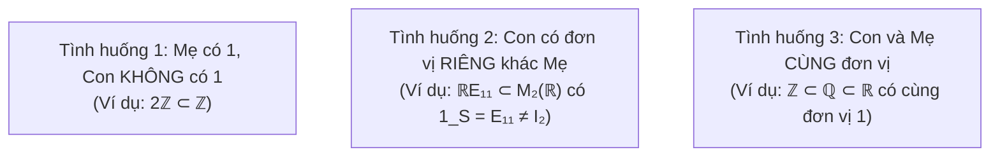

<Note title="Mục tiêu bài học">
Sau khi hoàn thành bài học này, bạn có thể:

1. **Làm chủ 4 phương pháp dựng vành mới từ các vành đã có:** Vành tích trực tiếp $R \times S$, vành hàm $R^X$, vành ma trận $M_n(R)$, và vành đa thức một ẩn $R[x]$.
2. **Chứng minh định lý bậc đa thức trên miền nguyên:** Chứng minh công thức $\deg(fg) = \deg f + \deg g$ khi $R$ là miền nguyên, và giải thích hiện tượng sụp đổ bậc đa thức khi $R$ có ước của không.
3. **Hiểu các phần tử đặc biệt:** Phân tích phần tử lũy đẳng ($e^2 = e$) và phần tử lũy linh ($a^m = 0$), cùng mối liên hệ với phân tích cấu trúc vành.
4. **Áp dụng chính xác Tiêu chuẩn Vành con:** Nắm vững và chứng minh điều kiện cần và đủ: $S \subseteq R$ là vành con $\iff S \neq \varnothing, \forall x, y \in S: x - y \in S \text{ và } xy \in S$.
5. **Nhận diện hiện tượng đơn vị riêng của vành con:** Nắm vững quy ước học thuật của giáo trình: **Vành con không bắt buộc phải có cùng đơn vị với vành mẹ**; phân tích 3 tình huống sai khác đơn vị kinh điển.
</Note>

**Kiến thức tiên quyết:** Tiêu chuẩn nhóm con từ Chương 2 và thang bậc miền nguyên - trường (<Cite source="gt-ctds-hvk-2026" page="37-43, 102-104" note="Mục 2.1, 6.4, 6.5" />).

---

## 1. Các phương pháp dựng vành mới

Để tạo ra các không gian đại số mới phục vụ hình học, giải tích và mật mã học, chúng ta có 4 kỹ thuật dựng vành tiêu biểu:

### 1.1. Vành tích trực tiếp $R \times S$
Cho hai vành $(R, +, \cdot)$ và $(S, +, \cdot)$. Trên tập tích Descartes $R \times S$, hai phép toán được định nghĩa theo từng tọa độ:
$$
(r_1, s_1) + (r_2, s_2) = (r_1 + r_2, s_1 + s_2), \quad (r_1, s_1) \cdot (r_2, s_2) = (r_1 r_2, s_1 s_2).
$$
- Phần tử không là $(0_R, 0_S)$.
- Nếu $R$ và $S$ có đơn vị $1_R, 1_S$, thì $R \times S$ có đơn vị là $(1_R, 1_S)$.
- **Cảnh báo về ước của không:** Khi $R \neq \{0\}$ và $S \neq \{0\}$, vành tích $R \times S$ **luôn luôn có ước của không**! Thật vậy:
  $$
  (1_R, 0_S) \cdot (0_R, 1_S) = (1_R \cdot 0_R, 0_S \cdot 1_S) = (0_R, 0_S).
  $$
  Do đó, tích trực tiếp của hai vành khác không **không bao giờ là miền nguyên**.

### 1.2. Vành các hàm $R^X$
Cho $X$ là một tập hợp khác rỗng và $R$ là một vành. Tập hợp các hàm $\mathcal{F}(X, R) = \{f: X \to R\}$ lập thành một vành dưới phép cộng và nhân hàm điểm:
$$
(f + g)(x) = f(x) + g(x), \quad (fg)(x) = f(x)g(x) \quad \forall x \in X.
$$
Nếu $X$ có nhiều hơn một phần tử, vành hàm luôn có ước của không (chọn các hàm có giá triệt tiêu trên các tập bù nhau).

### 1.3. Vành ma trận $M_n(R)$
Cho $R$ là một vành có phần tử đơn vị và $n \ge 2$. Tập hợp các ma trận vuông cỡ $n \times n$ với các hệ số trong $R$, ký hiệu là $M_n(R)$, cùng phép cộng và phép nhân ma trận thông thường, lập thành một vành có phần tử đơn vị là ma trận đơn vị $I_n$.
- Vành $M_n(R)$ **không giao hoán** ngay cả khi $R$ là vành giao hoán.
- Vành $M_n(R)$ luôn chứa ước của không (chẳng hạn các ma trận đơn vị cơ sở $E_{ij}$ thỏa mãn $E_{12} E_{12} = 0$).

### 1.4. Vành đa thức một ẩn $R[x]$
Cho $R$ là một vành giao hoán có phần tử đơn vị $1_R$. Tập hợp các biểu thức hình thức:
$$
f(x) = a_0 + a_1 x + a_2 x^2 + \cdots + a_n x^n \quad (a_i \in R, n \ge 0)
$$
lập thành **vành đa thức một ẩn** $R[x]$ với phép cộng và nhân đa thức thông thường.
Nếu $f(x) \neq 0$, bậc của $f(x)$ là số nguyên $\deg f = \max\{i \mid a_i \neq 0_R\}$. Quy ước $\deg(0_R) = -\infty$.

---

## 2. Vành đa thức trên miền nguyên và sự sụp đổ của công thức bậc

Mối liên hệ giữa cấu trúc của vành hệ số $R$ và cấu trúc của vành đa thức $R[x]$ là một trong những định lý nền tảng của đại số hiện đại.

<Theorem id="thm-c6-b3-vanh-da-thuc-tren-mien-nguyen" title="Vành đa thức trên Miền nguyên (Định lý 6.15 Giáo trình)">
Cho $R$ là một miền nguyên. Khi đó:
1. **Công thức bậc của tích:** Với mọi đa thức khác không $f, g \in R[x] \setminus \{0\}$, ta có:
   $$
   \deg(f \cdot g) = \deg f + \deg g.
   $$
2. **Bảo toàn cấu trúc miền nguyên:** Vành đa thức $R[x]$ là một **miền nguyên**.
3. **Nhóm các phần tử khả nghịch:** Các phần tử khả nghịch duy nhất của $R[x]$ là các đa thức hằng khả nghịch trong $R$:
   $$
   (R[x])^\times = R^\times.
   $$
</Theorem>

<Proof>
1. Giả sử $\deg f = m$ và $\deg g = n$ với $m, n \ge 0$. Ta viết:
   $$
   f(x) = a_0 + a_1 x + \cdots + a_m x^m \quad (a_m \neq 0_R),
   $$
   $$
   g(x) = b_0 + b_1 x + \cdots + b_n x^n \quad (b_n \neq 0_R).
   $$
   Theo định nghĩa phép nhân đa thức, tích $f(x)g(x) = \sum_{k=0}^{m+n} c_k x^k$, trong đó hệ số cao nhất ứng với lũy thừa $m+n$ là:
   $$
   c_{m+n} = a_m \cdot b_n.
   $$
   Vì $R$ là một miền nguyên và $a_m \neq 0_R, b_n \neq 0_R$, nên tích $a_m b_n \neq 0_R$.
   Mặt khác, với mọi $k > m + n$, hệ số $c_k = 0_R$.
   Do đó bậc của tích chính xác bằng $m + n$, tức là:
   $$
   \deg(fg) = \deg f + \deg g.
   $$

2. Nếu $f, g \in R[x]$ thỏa mãn $f \cdot g = 0$, giả sử phản chứng cả hai đều khác không. Khi đó theo câu 1, $\deg(fg) = \deg f + \deg g \ge 0$, mâu thuẫn với $\deg(0) = -\infty$. Do đó $f = 0$ hoặc $g = 0$. Vì $R$ giao hoán có $1 \neq 0$, nên $R[x]$ cũng giao hoán có đơn vị $1 \neq 0$. Vậy $R[x]$ là miền nguyên.

3. Giả sử $f \in (R[x])^\times$. Tồn tại $g \in R[x]$ sao cho $fg = 1$. Lấy bậc hai vế:
   $$
   \deg(fg) = \deg(1) = 0 \iff \deg f + \deg g = 0.
   $$
   Vì $\deg f, \deg g \ge 0$, buộc $\deg f = \deg g = 0$.
   Do đó $f(x) = a_0$ là một đa thức hằng. Đẳng thức $a_0 b_0 = 1$ cho thấy $a_0 \in R^\times$. Vậy $(R[x])^\times = R^\times$.
</Proof>

<Counterexample id="ce-c6-b3-sup-do-cong-thuc-bac" title="Sự sụp đổ công thức bậc khi R có ước của không">
Nếu vành hệ số $R$ có ước của không, công thức bậc $\deg(fg) = \deg f + \deg g$ **hoàn toàn có thể sai**, và vành đa thức có thể xuất hiện các phần tử khả nghịch bậc cao!

1. **Sụp đổ bậc trong $(\mathbb{Z}/6\mathbb{Z})[x]$:**
   Xét hai đa thức bậc nhất $f(x) = [2]x + [1]$ và $g(x) = [3]x + [1]$. Khai triển tích:
   $$
   f(x)g(x) = ([2] \cdot [3])x^2 + ([2] + [3])x + [1] = [6]x^2 + [5]x + [1] = [5]x + [1].
   $$
   Ta thấy $\deg f = 1, \deg g = 1$, nhưng $\deg(fg) = 1 \neq 1 + 1 = 2$.
   Hệ số cao nhất $[2] \cdot [3] = [0]$ đã biến mất do gặp ước của không!

2. **Đa thức khả nghịch bậc cao trong $(\mathbb{Z}/4\mathbb{Z})[x]$:**
   Xét đa thức bậc nhất $f(x) = [1] + [2]x \in (\mathbb{Z}/4\mathbb{Z})[x]$. Bình phương của $f(x)$ là:
   $$
   (f(x))^2 = ([1] + [2]x)^2 = [1] + [4]x + [4]x^2 = [1] + [0] + [0] = [1].
   $$
   Như vậy $f(x) \cdot f(x) = [1]$, nghĩa là $f(x)$ là một **phần tử khả nghịch bậc nhất** với $f(x)^{-1} = f(x)$. Hiện tượng này không bao giờ xảy ra trên miền nguyên!
</Counterexample>

---

## 3. Khái niệm Vành con và Tiêu chuẩn kiểm tra

Tương tự như cấu trúc nhóm con, một tập con của một vành kế thừa các phép toán để tự thân lập thành một vành được gọi là một **vành con**.

<Definition id="def-c6-b3-vanh-con" title="Vành con (Subring, Định nghĩa 6.17 Giáo trình)">
Cho $(R, +, \cdot)$ là một vành. Một tập con khác rỗng $S \subseteq R$ được gọi là một **vành con** (*subring*) của $R$ nếu $S$ cùng với hai phép toán cộng và nhân thu hẹp từ $R$ tự thân lập thành một vành.
</Definition>

<Theorem id="thm-c6-b3-tieu-chuan-vanh-con" title="Tiêu chuẩn Vành con (Định lý 6.18 Giáo trình)">
Cho $R$ là một vành. Một tập con $S \subseteq R$ là một vành con của $R$ khi và chỉ khi thỏa mãn đồng thời ba điều kiện:

1. $S \neq \varnothing$.
2. Với mọi $x, y \in S$, ta có:
   $$
   x - y \in S \quad (\text{đóng đối với phép trừ / nhóm con cộng}).
   $$
3. Với mọi $x, y \in S$, ta có:
   $$
   x \cdot y \in S \quad (\text{đóng đối với phép nhân}).
   $$
</Theorem>

<Proof>
- **Chiều thuận ($\implies$):** Nếu $S$ là vành con, theo định nghĩa $(S, +)$ là một nhóm Abel, do đó $S \neq \varnothing$ và $S$ đóng đối với phép trừ ($x - y \in S$). Phép nhân trên $S$ là phép toán hai ngôi đóng kín, do đó $xy \in S$ với mọi $x, y \in S$.
- **Chiều đảo ($\impliedby$):** Giả sử $S$ thỏa mãn 3 điều kiện:
  1. Vì $S \neq \varnothing$ và đóng đối với phép trừ ($x - y \in S$), theo Tiêu chuẩn nhóm con (Chương 2), cấu trúc $(S, +)$ là một nhóm con của $(R, +)$. Hơn nữa, vì $(R, +)$ giao hoán nên $(S, +)$ tự động là nhóm Abel.
  2. Vì $xy \in S$ với mọi $x, y \in S$, phép nhân là một phép toán hai ngôi trên $S$. Tính kết hợp của phép nhân và luật phân phối hai phía đối với phép cộng hiển nhiên đúng trong $S$ vì chúng đã đúng trên toàn bộ tập mẹ $R$.
  Do đó $(S, +, \cdot)$ thỏa mãn đầy đủ ba nhóm tiên đề vành, tức $S$ là một vành con của $R$.
</Proof>

---

## 4. Hiện tượng đặc thù: Sự sai khác về phần tử đơn vị của Vành con

Một trong những điểm khác biệt tinh tế nhất giữa Lý thuyết Nhóm và Lý thuyết Vành theo quy chuẩn học thuật của giáo trình Huỳnh Việt Khánh là:

> **Khác với nhóm con (bắt buộc phải có cùng phần tử trung hòa với nhóm mẹ), một vành con KHÔNG bắt buộc phải có phần tử đơn vị, hoặc có thể có phần tử đơn vị RIÊNG khác với đơn vị của vành mẹ.**

Cụ thể, có ba tình huống kinh điển:

<Example id="ex-c6-b3-phan-tich-don-vi-vanh-con" title="Phân tích chi tiết 3 tình huống đơn vị">
1. **Vành mẹ có đơn vị nhưng vành con không có đơn vị:**
   Xét tập các số nguyên chẵn $2\mathbb{Z} \subset \mathbb{Z}$.
   - $2\mathbb{Z}$ là vành con của $\mathbb{Z}$ theo tiêu chuẩn: $2a - 2b = 2(a-b) \in 2\mathbb{Z}$ và $(2a)(2b) = 2(2ab) \in 2\mathbb{Z}$.
   - Vành mẹ $\mathbb{Z}$ có đơn vị là $1$. Tuy nhiên $2\mathbb{Z}$ hoàn toàn **không có phần tử đơn vị** vì phương trình $2 \cdot e = 2$ đòi hỏi $e = 1 \notin 2\mathbb{Z}$.

2. **Vành con có đơn vị riêng khác với đơn vị vành mẹ:**
   Trong vành ma trận $M_2(\mathbb{R})$ có đơn vị là $I_2 = \begin{pmatrix} 1 & 0 \\ 0 & 1 \end{pmatrix}$, xét tập con:
   $$
   S = \left\{ \begin{pmatrix} a & 0 \\ 0 & 0 \end{pmatrix} \;\Bigg|\; a \in \mathbb{R} \right\} = \mathbb{R} E_{11}.
   $$
   - Dễ thấy $S$ là vành con của $M_2(\mathbb{R})$.
   - Xét ma trận $E_{11} = \begin{pmatrix} 1 & 0 \\ 0 & 0 \end{pmatrix} \in S$. Với mọi $A = \begin{pmatrix} a & 0 \\ 0 & 0 \end{pmatrix} \in S$:
     $$
     A \cdot E_{11} = E_{11} \cdot A = \begin{pmatrix} a & 0 \\ 0 & 0 \end{pmatrix} = A.
     $$
   - Do đó $S$ có phần tử đơn vị riêng là $1_S = E_{11}$. Rõ ràng $1_S \neq 1_{M_2(\mathbb{R})} = I_2$!

3. **Vành con trên vành tích:**
   Xét vành tích $\mathbb{Z} \times \mathbb{Z}$ có đơn vị là $(1, 1)$. Tập con $S = \mathbb{Z} \times \{0\}$ là một vành con. Phần tử $(1, 0) \in S$ là đơn vị riêng của $S$, và $(1, 0) \neq (1, 1)$.
</Example>

---

## 5. Bước đệm sư phạm: Phép nhân trên tập thương và vì sao Vành con chưa đủ?

Một câu hỏi cốt tử mang tính dẫn dắt toàn bộ Phần II của Cấu trúc đại số là:
> **Nếu $S$ là một vành con của $R$, khi nào tập các lớp kề cộng $R/S$ có thể trang bị phép nhân lớp kề $(a+S)(b+S) = ab+S$ một cách xác định tốt?**

<Proposition id="prop-c6-b3-dieu-kien-nhan-tap-thuong" title="Điều kiện để phép nhân lớp kề xác định tốt trên tập thương">
Cho $R$ là một vành và $S$ là một vành con của $R$.
1. Vì $(R, +)$ là một nhóm Abel, mọi nhóm con cộng $S$ đều tự động là nhóm con chuẩn tắc: $S \trianglelefteq (R, +)$. Do đó tập các lớp kề cộng:
   $$
   R/S = \{a + S \mid a \in R\}
   $$
   luôn lập thành một **nhóm cộng thương** Abel xác định tốt với phép cộng $(a + S) + (b + S) = (a + b) + S$.
2. Để phép nhân tự nhiên giữa các lớp kề:
   $$
   (a + S) \cdot (b + S) = (a \cdot b) + S
   $$
   **xác định tốt** (*well-defined*, tức là không phụ thuộc vào đại diện được chọn), điều kiện cần và đủ là $S$ phải thỏa mãn **tính chất hấp thụ phép nhân hai phía**:
   $$
   r \cdot s \in S \quad \text{và} \quad s \cdot r \in S \quad \text{với mọi } r \in R \text{ và mọi } s \in S.
   $$
</Proposition>

<Proof>
Giả sử ta chọn hai đại diện khác $a' \in a + S$ và $b' \in b + S$. Theo định nghĩa lớp kề cộng, tồn tại $s_1, s_2 \in S$ sao cho:
$$
a' = a + s_1, \quad b' = b + s_2.
$$
Tích của hai đại diện mới trong vành $R$ là:
$$
a'b' = (a + s_1)(b + s_2) = ab + a s_2 + s_1 b + s_1 s_2.
$$
Để phép nhân trên tập thương xác định tốt, hai tích đại diện phải sinh ra cùng một lớp kề, tức là $a'b' + S = ab + S$, tương đương với việc phần chênh lệch phải thuộc về $S$:
$$
a'b' - ab = a s_2 + s_1 b + s_1 s_2 \in S.
$$
Vì $S$ là một vành con, tích nội bộ $s_1 s_2$ hiển nhiên thuộc $S$. Do đó điều kiện cần và đủ tương đương với:
$$
a s_2 + s_1 b \in S \quad \text{với mọi } a, b \in R \text{ và } s_1, s_2 \in S.
$$
- Cho $b = 0_R$ và $s_1 = 0_R$: ta buộc phải có $a s_2 \in S$ với mọi $a \in R$ và mọi $s_2 \in S$ (hấp thụ bên trái: $RS \subseteq S$).
- Cho $a = 0_R$ và $s_2 = 0_R$: ta buộc phải có $s_1 b \in S$ với mọi $b \in R$ và mọi $s_1 \in S$ (hấp thụ bên phải: $SR \subseteq S$).

Ngược lại, nếu $RS \subseteq S$ và $SR \subseteq S$, thì hiển nhiên $a s_2 \in S$ và $s_1 b \in S$, kéo theo $a'b' - ab \in S$, và phép nhân lớp kề hoàn toàn xác định tốt.
</Proof>

<Counterexample id="ce-c6-b3-phep-nhan-hong-tren-tap-thuong" title="Sự sụp đổ của phép nhân lớp kề trên vành con Z ⊂ Q">
Xét trường số hữu tỉ $\mathbb{Q}$ và vành con các số nguyên $\mathbb{Z} \subset \mathbb{Q}$.
- Nhóm cộng thương $\mathbb{Q}/\mathbb{Z}$ là một nhóm Abel xác định tốt (nhóm các góc xoay hữu tỉ của đường tròn).
- Hãy thử thực hiện phép nhân lớp kề: $(a + \mathbb{Z})(b + \mathbb{Z}) = ab + \mathbb{Z}$.
  - Lấy hai lớp: $1/2 + \mathbb{Z}$ và $1/3 + \mathbb{Z}$.
  - Lựa chọn đại diện 1: Chọn $a = 1/2, b = 1/3$. Tích là:
    $$
    ab = \frac{1}{2} \cdot \frac{1}{3} = \frac{1}{6} \implies \left(\frac{1}{2} + \mathbb{Z}\right)\left(\frac{1}{3} + \mathbb{Z}\right) = \frac{1}{6} + \mathbb{Z}.
    $$
  - Lựa chọn đại diện 2: Thay $a$ bằng đại diện khác $a' = 1/2 + 1 = 3/2 \in 1/2 + \mathbb{Z}$, giữ nguyên $b = 1/3$. Tích mới là:
    $$
    a'b = \frac{3}{2} \cdot \frac{1}{3} = \frac{1}{2} \implies \left(\frac{3}{2} + \mathbb{Z}\right)\left(\frac{1}{3} + \mathbb{Z}\right) = \frac{1}{2} + \mathbb{Z}.
    $$
  - So sánh hai kết quả: Hiệu giữa hai đại diện tích là $\frac{1}{2} - \frac{1}{6} = \frac{1}{3} \notin \mathbb{Z}$, do đó:
    $$
    \frac{1}{6} + \mathbb{Z} \neq \frac{1}{2} + \mathbb{Z}!
    $$
Kết quả nhân lớp kề phụ thuộc vào việc chọn đại diện. Phép nhân $(a + \mathbb{Z})(b + \mathbb{Z}) = ab + \mathbb{Z}$ **hoàn toàn vô nghĩa (không xác định tốt)** trên $\mathbb{Q}/\mathbb{Z}$.

*Bình luận sư phạm:* Vành con $\mathbb{Z}$ không hấp thụ phép nhân từ bên ngoài của $\mathbb{Q}$ (chẳng hạn $\frac{1}{2} \in \mathbb{Q}, 1 \in \mathbb{Z}$ nhưng $\frac{1}{2} \cdot 1 = \frac{1}{2} \notin \mathbb{Z}$). Như vậy, điều kiện vành con $S \le R$ là chưa đủ để phép nhân các lớp kề cộng $(a+S)(b+S) = ab+S$ xác định tốt; ta sẽ cần thêm tính chất hấp thụ phép nhân hai phía $rS \subseteq S$ và $Sr \subseteq S$ ở chương tiếp theo.
</Counterexample>

---

## 6. Hệ thống bài tập 4 phân lớp có lời giải

<Exercise id="ex-c6-b3-nhom-a" title="Kiểm tra tiêu chuẩn vành con" group="Nhóm A">
Trong các tập con sau của trường số thực $\mathbb{R}$, tập nào là vành con của $\mathbb{R}$?
1. $S_1 = \mathbb{Z}[\sqrt{2}] = \{a + b\sqrt{2} \mid a, b \in \mathbb{Z}\}$.
2. $S_2 = \{a/2^k \mid a \in \mathbb{Z}, k \in \mathbb{Z}_{\ge 0}\}$ (tập các phân số nhị phân).
3. $S_3 = \{a + b\sqrt[3]{2} \mid a, b \in \mathbb{Z}\}$.

<Hint>
Kiểm tra tính đóng đối với phép trừ và phép nhân. Chú ý $(\sqrt[3]{2})^2 = \sqrt[3]{4}$.
</Hint>

<Solution>
**1. Tập $S_1 = \mathbb{Z}[\sqrt{2}]$**

 - Khác rỗng vì $0 = 0 + 0\sqrt{2} \in S_1$.
   - Hiệu: $(a_1 + b_1\sqrt{2}) - (a_2 + b_2\sqrt{2}) = (a_1 - a_2) + (b_1 - b_2)\sqrt{2} \in S_1$ (do $a_1-a_2, b_1-b_2 \in \mathbb{Z}$).
   - Tích: $(a_1 + b_1\sqrt{2})(a_2 + b_2\sqrt{2}) = (a_1 a_2 + 2b_1 b_2) + (a_1 b_2 + a_2 b_1)\sqrt{2} \in S_1$.
   Vậy $S_1$ là một vành con của $\mathbb{R}$.

**2. Tập $S_2$ (các phân số nhị phân)**

 - Khác rỗng (chứa $0 = 0/2^0$).
   - Hiệu: $\frac{a_1}{2^{k_1}} - \frac{a_2}{2^{k_2}} = \frac{a_1 2^{k_2} - a_2 2^{k_1}}{2^{k_1 + k_2}} \in S_2$.
   - Tích: $\frac{a_1}{2^{k_1}} \cdot \frac{a_2}{2^{k_2}} = \frac{a_1 a_2}{2^{k_1 + k_2}} \in S_2$.
   Vậy $S_2$ là một vành con của $\mathbb{R}$.

**3. Tập $S_3$**

 - Lấy $x = \sqrt[3]{2} = 0 + 1\sqrt[3]{2} \in S_3$.
   - Xét bình phương: $x^2 = (\sqrt[3]{2})^2 = \sqrt[3]{4}$.
   - Nếu $\sqrt[3]{4} \in S_3$ thì tồn tại $a, b \in \mathbb{Z}$ sao cho $\sqrt[3]{4} = a + b\sqrt[3]{2}$. Nhân hai vế với $\sqrt[3]{2}$:
     $$
     2 = a\sqrt[3]{2} + b\sqrt[3]{4} = a\sqrt[3]{2} + b(a + b\sqrt[3]{2}) = ab + (a + b^2)\sqrt[3]{2}.
     $$
     Vì $\sqrt[3]{2}$ là số vô công ước bậc 3 trên $\mathbb{Q}$, điều này đòi hỏi $a + b^2 = 0$ và $ab = 2$, vô nghiệm nguyên.
   - Do đó $x^2 \notin S_3$, tức $S_3$ không đóng đối với phép nhân. Vậy $S_3$ **không phải** là vành con của $\mathbb{R}$.
</Solution>
</Exercise>

---

<Exercise id="ex-c6-b3-nhom-b" title="Vành con tam giác trên trong M_2(R)" group="Nhóm B">
Xét tập hợp các ma trận tam giác trên cấp hai:
$$
T_2(\mathbb{R}) = \left\{ \begin{pmatrix} a & b \\ 0 & c \end{pmatrix} \;\Bigg|\; a, b, c \in \mathbb{R} \right\} \subset M_2(\mathbb{R}).
$$
1. Chứng minh $T_2(\mathbb{R})$ là một vành con của $M_2(\mathbb{R})$.
2. Tìm điều kiện của $a, b, c$ để ma trận $A = \begin{pmatrix} a & b \\ 0 & c \end{pmatrix}$ là phần tử khả nghịch trong $T_2(\mathbb{R})$.
3. Chỉ ra một ước của không trái khác không trong $T_2(\mathbb{R})$.

<Hint>
Nhân hai ma trận tam giác trên để kiểm tra tính đóng. Một ma trận tam giác trên khả nghịch khi và chỉ khi định thức của nó khác không ($ac \neq 0$).
</Hint>

<Solution>
**1. Chứng minh $T_2(\mathbb{R})$ là vành con**

 - $T_2(\mathbb{R})$ chứa ma trận không nên khác rỗng.
   - Với mọi $A = \begin{pmatrix} a_1 & b_1 \\ 0 & c_1 \end{pmatrix}, B = \begin{pmatrix} a_2 & b_2 \\ 0 & c_2 \end{pmatrix} \in T_2(\mathbb{R})$:
     $$
     A - B = \begin{pmatrix} a_1 - a_2 & b_1 - b_2 \\ 0 & c_1 - c_2 \end{pmatrix} \in T_2(\mathbb{R}),
     $$
     $$
     AB = \begin{pmatrix} a_1 a_2 & a_1 b_2 + b_1 c_2 \\ 0 & c_1 c_2 \end{pmatrix} \in T_2(\mathbb{R}).
     $$
   Theo Tiêu chuẩn vành con, $T_2(\mathbb{R})$ là vành con của $M_2(\mathbb{R})$.

**2. Điều kiện khả nghịch**

Định thức của $A$ là $\det A = ac$.
   - Nếu $ac \neq 0$ (tức $a \neq 0$ và $c \neq 0$), nghịch đảo của $A$ trong $M_2(\mathbb{R})$ là:
     $$
     A^{-1} = \frac{1}{ac} \begin{pmatrix} c & -b \\ 0 & a \end{pmatrix} = \begin{pmatrix} 1/a & -b/(ac) \\ 0 & 1/c \end{pmatrix}.
     $$
     Ma trận này có dạng tam giác trên, nên $A^{-1} \in T_2(\mathbb{R})$.
   - Vậy $A \in (T_2(\mathbb{R}))^\times \iff a \neq 0$ và $c \neq 0$.

**3. Chỉ ra ước của không**

Chọn $A = \begin{pmatrix} 1 & 0 \\ 0 & 0 \end{pmatrix} \neq 0$ và $B = \begin{pmatrix} 0 & 1 \\ 0 & 0 \end{pmatrix} \neq 0 \in T_2(\mathbb{R})$. Ta có:
   $$
   B \cdot A = \begin{pmatrix} 0 & 1 \\ 0 & 0 \end{pmatrix} \begin{pmatrix} 1 & 0 \\ 0 & 0 \end{pmatrix} = \begin{pmatrix} 0 & 0 \\ 0 & 0 \end{pmatrix}.
   $$
   Vậy $B$ là một ước của không trái trong $T_2(\mathbb{R})$.
</Solution>
</Exercise>

---

<Exercise id="ex-c6-b3-nhom-c" title="Phần tử lũy đẳng và sự phân rã của vành" group="Nhóm C">
Cho $R$ là một vành có phần tử đơn vị $1_R$. Một phần tử $e \in R$ được gọi là **lũy đẳng** (*idempotent*) nếu $e^2 = e$.
1. Chứng minh rằng nếu $e$ là phần tử lũy đẳng thì $1_R - e$ cũng là phần tử lũy đẳng và $e(1_R - e) = (1_R - e)e = 0_R$.
2. Chứng minh rằng nếu $e$ là phần tử lũy đẳng khác $0_R$ và $1_R$ thì $e$ bắt buộc phải là một ước của không.
3. Giả sử $R$ là vành giao hoán. Chứng minh các tập con:
   $$
   Re = \{re \mid r \in R\} \quad \text{và} \quad R(1_R - e) = \{r(1_R - e) \mid r \in R\}
   $$
   là các vành con của $R$, trong đó $Re$ có phần tử đơn vị riêng là $e$.

<Hint>
Khai triển $(1-e)^2 = 1 - 2e + e^2$. Dùng $e^2 = e$ để rút gọn.
</Hint>

<Solution>
**1. Tính lũy đẳng của $1_R - e$**

Ta tính bình phương:
   $$
   (1_R - e)^2 = (1_R - e)(1_R - e) = 1_R - e - e + e^2 = 1_R - 2e + e = 1_R - e.
   $$
   Do đó $1_R - e$ cũng là phần tử lũy đẳng.
   Tích chéo:
   $$
   e(1_R - e) = e \cdot 1_R - e^2 = e - e = 0_R,
   $$
   $$
   (1_R - e)e = 1_R \cdot e - e^2 = e - e = 0_R.
   $$

**2. $e$ là ước của không**

Vì $e \neq 0_R$ và $e \neq 1_R$, ta có $1_R - e \neq 0_R$.
   Theo câu 1, $e(1_R - e) = 0_R$ với cả hai thừa số $e \neq 0_R$ và $1_R - e \neq 0_R$.
   Do đó $e$ là một ước của không (và $1_R - e$ cũng là một ước của không).

**3. Cấu trúc vành con $Re$**

 - $Re \neq \varnothing$ vì $0_R = 0_R \cdot e \in Re$.
   - Phép trừ: $r_1 e - r_2 e = (r_1 - r_2)e \in Re$.
   - Phép nhân (dùng tính giao hoán của $R$ và $e^2 = e$):
     $$
     (r_1 e)(r_2 e) = r_1 r_2 e^2 = (r_1 r_2)e \in Re.
     $$
   Theo Tiêu chuẩn vành con, $Re$ là một vành con của $R$.
   Với mọi phần tử $x = re \in Re$:
   $$
   x \cdot e = (re)e = r e^2 = re = x.
   $$
   Do đó $e \in Re$ chính là phần tử đơn vị riêng của vành con $Re$.
   Đối với $e' = 1_R - e$, vì $(e')^2 = (1_R - e)^2 = 1_R - 2e + e^2 = 1_R - e = e'$, phần tử $e'$ cũng là phần tử lũy đẳng trong $R$, nên áp dụng chứng minh trên với $e'$ thay cho $e$ ta suy ra ngay $R(1_R - e)$ là vành con có phần tử đơn vị riêng là $1_R - e$.
</Solution>
</Exercise>

---

<Exercise id="ex-c6-b3-nhom-d" title="Tâm của vành ma trận và tính đơn" group="Nhóm D">
Cho $R$ là một vành bất kỳ. **Tâm của vành** $R$, ký hiệu là $Z(R)$, được định nghĩa bởi:
$$
Z(R) = \{z \in R \mid zr = rz, \; \forall r \in R\}.
$$
1. Chứng minh rằng $Z(R)$ luôn là một vành con giao hoán của $R$. Hơn nữa nếu $R$ có phần tử đơn vị $1_R$ thì $1_R \in Z(R)$.
2. Cho $F$ là một trường. Xét vành ma trận $M_2(F)$. Chứng minh rằng tâm của $M_2(F)$ chỉ gồm các ma trận vô hướng:
   $$
   Z(M_2(F)) = \{\lambda I_2 \mid \lambda \in F\}.
   $$
3. Chỉ ra song ánh bảo toàn cả phép cộng và phép nhân giữa trường $F$ và tâm $Z(M_2(F))$.

<Hint>
Dùng các ma trận đơn vị cơ sở $E_{11}, E_{12}, E_{21}, E_{22}$. Đẳng thức $A E_{12} = E_{12} A$ sẽ buộc các phần tử trên đường chéo bằng nhau và các phần tử ngoài đường chéo bằng không.
</Hint>

<Solution>
**1. Chứng minh $Z(R)$ là vành con giao hoán**

 - $0_R \in Z(R)$ vì $0_R \cdot r = r \cdot 0_R = 0_R$ với mọi $r \in R$, nên $Z(R) \neq \varnothing$.
   - Với mọi $x, y \in Z(R)$ và $r \in R$:
     $$
     (x - y)r = xr - yr = rx - ry = r(x - y) \implies x - y \in Z(R),
     $$
     $$
     (xy)r = x(yr) = x(ry) = (xr)y = (rx)y = r(xy) \implies xy \in Z(R).
     $$
   Theo Tiêu chuẩn vành con, $Z(R)$ là vành con của $R$.
   Vì mọi phần tử trong $Z(R)$ giao hoán với toàn bộ $R$, hiển nhiên chúng giao hoán với nhau, nên $Z(R)$ là vành giao hoán.
   Nếu $R$ có đơn vị $1_R$, hiển nhiên $1_R \cdot r = r \cdot 1_R = r \implies 1_R \in Z(R)$.

**2. Xác định tâm của $M_2(F)$**

Giả sử ma trận $A = \begin{pmatrix} a & b \\ c & d \end{pmatrix} \in Z(M_2(F))$.
   Khi đó $A$ phải giao hoán với ma trận đơn vị cơ sở $E_{12} = \begin{pmatrix} 0 & 1 \\ 0 & 0 \end{pmatrix}$:
   $$
   A E_{12} = \begin{pmatrix} a & b \\ c & d \end{pmatrix} \begin{pmatrix} 0 & 1 \\ 0 & 0 \end{pmatrix} = \begin{pmatrix} 0 & a \\ 0 & c \end{pmatrix},
   $$
   $$
   E_{12} A = \begin{pmatrix} 0 & 1 \\ 0 & 0 \end{pmatrix} \begin{pmatrix} a & b \\ c & d \end{pmatrix} = \begin{pmatrix} c & d \\ 0 & 0 \end{pmatrix}.
   $$
   So sánh hai ma trận: $c = 0$, $a = d$, và $0 = 0$.
   Tiếp tục cho $A$ giao hoán với $E_{21} = \begin{pmatrix} 0 & 0 \\ 1 & 0 \end{pmatrix}$:
   $$
   A E_{21} = \begin{pmatrix} a & b \\ 0 & a \end{pmatrix} \begin{pmatrix} 0 & 0 \\ 1 & 0 \end{pmatrix} = \begin{pmatrix} b & 0 \\ a & 0 \end{pmatrix},
   $$
   $$
   E_{21} A = \begin{pmatrix} 0 & 0 \\ 1 & 0 \end{pmatrix} \begin{pmatrix} a & b \\ 0 & a \end{pmatrix} = \begin{pmatrix} 0 & 0 \\ a & b \end{pmatrix}.
   $$
   So sánh hai ma trận cho ta $b = 0$.
   Như vậy $b = c = 0$ và $a = d = \lambda \in F$. Do đó:
   $$
   A = \begin{pmatrix} \lambda & 0 \\ 0 & \lambda \end{pmatrix} = \lambda I_2.
   $$
   Ngược lại, ma trận vô hướng $\lambda I_2$ hiển nhiên giao hoán với mọi ma trận trong $M_2(F)$.
   Vậy $Z(M_2(F)) = \{\lambda I_2 \mid \lambda \in F\}$.

**3. Song ánh bảo toàn phép toán với trường $F$**

Ánh xạ $\varphi: F \to Z(M_2(F)), \lambda \mapsto \lambda I_2$ là một song ánh bảo toàn phép cộng và nhân:
   $$
   \varphi(\lambda + \mu) = (\lambda + \mu)I_2 = \lambda I_2 + \mu I_2 = \varphi(\lambda) + \varphi(\mu),
   $$
   $$
   \varphi(\lambda \mu) = (\lambda \mu)I_2 = (\lambda I_2)(\mu I_2) = \varphi(\lambda)\varphi(\mu).
   $$
   Vậy $Z(M_2(F))$ là một trường gồm các ma trận vô hướng $\lambda I_2$ tương ứng một-một bảo toàn hai phép toán với $F$.
</Solution>
</Exercise>

---

## 7. Tóm tắt các điểm then chốt

<KeyTakeaways>
- **Bốn cách dựng vành mới:** Vành tích $R \times S$ (luôn có ước của không khi $R, S \neq \{0\}$), vành hàm $R^X$, vành ma trận $M_n(R)$ (không giao hoán), và vành đa thức $R[x]$.
- **Định lý đa thức trên miền nguyên:** $\deg(fg) = \deg f + \deg g$; nếu $R$ là miền nguyên thì $R[x]$ cũng là miền nguyên và $(R[x])^\times = R^\times$.
- **Sự sụp đổ công thức bậc:** Nếu $R$ có ước của không, bậc của tích đa thức có thể bị giảm và có thể tồn tại đa thức khả nghịch bậc cao (như $[1]+[2]x$ trong $(\mathbb{Z}/4\mathbb{Z})[x]$).
- **Tiêu chuẩn vành con:** $S \subseteq R$ là vành con $\iff S \neq \varnothing, x - y \in S, xy \in S$ với mọi $x, y \in S$.
- **Hiện tượng đơn vị của vành con:** Vành con không nhất thiết có đơn vị (ví dụ $2\mathbb{Z} \subset \mathbb{Z}$), hoặc có thể có đơn vị riêng khác đơn vị vành mẹ (ví dụ $\mathbb{R}E_{11} \subset M_2(\mathbb{R})$ có đơn vị riêng $E_{11} \neq I_2$).
- **Giới hạn của vành con đối với phép nhân lớp kề:** Một vành con $S \le R$ luôn tạo ra nhóm thương cộng $(R/S, +)$, nhưng phép nhân lớp kề $(a+S)(b+S) = ab+S$ chỉ xác định tốt khi $S$ thỏa mãn thêm điều kiện hấp thụ phép nhân hai phía ($rS \subseteq S, Sr \subseteq S$).
</KeyTakeaways>
