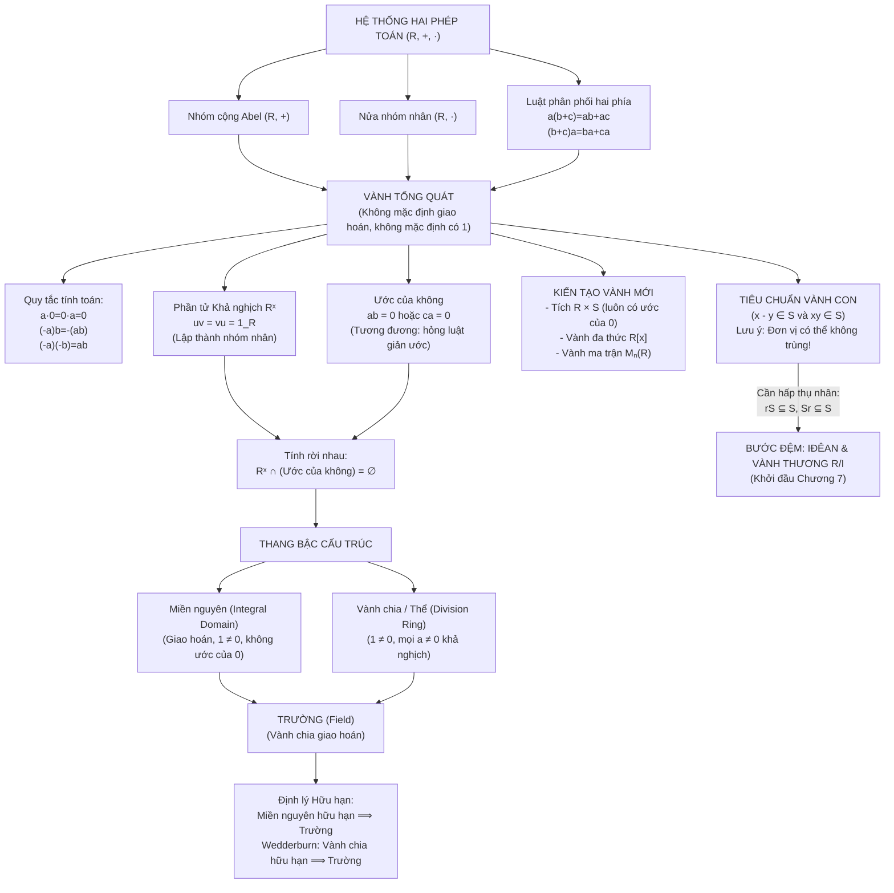

<Note title="Mục tiêu bài học">
Sau khi hoàn thành bài học này, bạn có thể:

1. **Hệ thống hóa toàn bộ kiến thức Chương 6:** Nắm vững cấu trúc tổng quan từ tiên đề vành, quy tắc tính toán, phần tử khả nghịch, ước của không đến thang bậc Miền nguyên - Vành chia - Trường qua sơ đồ tư duy trực quan.
2. **Thành thạo bảng thuật ngữ song ngữ Việt - Anh:** Chuẩn hóa ngôn ngữ học thuật đại số trừu tượng chuẩn quốc tế.
3. **Tra cứu và so sánh 8 mô hình vành chuẩn mực:** Nắm chắc tính chất giao hoán, đơn vị, nhóm $R^\times$ và ước của không trên các vành đại diện.
4. **Chứng minh các kết quả chuyên sâu kinh điển:** Chứng minh tính giao hoán bắt buộc của Vành Boole ($x^2 = x \implies 2x = 0$), định lý đặc trưng đa thức khả nghịch qua hệ số lũy linh, và nhúng trường số phức vào vành ma trận thực.
5. **Làm chủ 4 phân lớp bài tập tổng hợp A, B, C, D:** Rèn luyện kỹ năng phân tích, áp dụng định lý, tìm phản ví dụ biên và xử lý các bài toán cấu trúc nâng cao.
</Note>

**Kiến thức tiên quyết:** Toàn bộ lý thuyết từ Bài 1 đến Bài 3 của Chương 6 (<Cite source="gt-ctds-hvk-2026" page="98-107" note="Mục 6.1 đến 6.8" />).

---

## 1. Sơ đồ tư duy tổng kết Chương 6 (Vành & các cấu trúc)

Hệ thống kiến thức của Chương 6 được tổ chức xoay quanh quá trình tương tác giữa hai phép toán cộng và nhân:

---

## 2. Bảng thuật ngữ song ngữ Việt - Anh chuẩn mực

Nhằm hỗ trợ sinh viên đọc tài liệu quốc tế và các giáo trình chuyên ngành, dưới đây là bảng đối chiếu thuật ngữ của Chương 6:

| Thuật ngữ tiếng Việt | Thuật ngữ tiếng Anh tương đương | Ký hiệu / Ví dụ tiêu biểu |
| :--- | :--- | :--- |
| **Vành** | Ring | $(R, +, \cdot)$ |
| **Vành giao hoán** | Commutative ring | $ab = ba, \; \forall a, b \in R$ |
| **Vành có phần tử đơn vị** | Ring with identity / Unitary ring | Tồn tại $1_R$ sao cho $a \cdot 1_R = 1_R \cdot a = a$ |
| **Vành không** | Trivial ring / Zero ring | $R = \{0\}$, trong đó $1_R = 0_R$ |
| **Phần tử khả nghịch (đơn vị)** | Unit / Invertible element | $u \in R$ sao cho $\exists v \in R, uv = vu = 1_R$ |
| **Nhóm các phần tử khả nghịch** | Group of units | $R^\times$ hoặc $U(R)$ |
| **Ước của không (trái / phải)** | Zero divisor (left / right) | $a \neq 0$ sao cho $\exists b \neq 0, ab = 0$ |
| **Luật giản ước** | Cancellation law | $ax = ay \implies x = y$ |
| **Miền nguyên** | Integral domain | $\mathbb{Z}, \mathbb{R}[x], \mathbb{Z}[i]$ |
| **Vành chia / Thể** | Division ring / Skew field | Thể Quaternion Hamilton $\mathbb{H}$ |
| **Trường** | Field | $\mathbb{Q}, \mathbb{R}, \mathbb{C}, \mathbb{F}_p$ |
| **Vành con** | Subring | $S \subseteq R$ thỏa $x - y \in S, xy \in S$ |
| **Phần tử lũy linh** | Nilpotent element | $a^m = 0$ với một số nguyên $m \ge 1$ |
| **Phần tử lũy đẳng** | Idempotent element | $e^2 = e$ |
| **Tâm của vành** | Center of a ring | $Z(R) = \{z \in R \mid zr = rz, \forall r \in R\}$ |
| **Vành Boole** | Boolean ring | Mọi $x \in R$ đều thỏa $x^2 = x$ |

---

## 3. Bảng kiểm định toàn diện 8 mô hình vành chuẩn mực

Dưới đây là bảng tổng kết phân loại cấu trúc của 8 vành kinh điển nhất trong đại số trừu tượng:

| Vành $(R, +, \cdot)$ | Giao hoán? | Đơn vị $1_R$ | Nhóm khả nghịch $R^\times$ | Tập ước của không | Phân loại cấu trúc chính xác |
| :--- | :---: | :---: | :--- | :--- | :--- |
| **$\mathbb{Z}$** | Có | $1$ | $\{1, -1\} \cong \mathbb{Z}_2$ | Không có | **Miền nguyên** (vô hạn, không là trường) |
| **$2\mathbb{Z}$** | Có | Không | $\varnothing$ | Không có | **Vành giao hoán không có đơn vị** |
| **$\mathbb{Z}/6\mathbb{Z}$** | Có | $[1]$ | $\{[1], [5]\} \cong \mathbb{Z}_2$ | $\{[2], [3], [4]\}$ | **Vành giao hoán có ước của không** |
| **$\mathbb{Z}/5\mathbb{Z}$** | Có | $[1]$ | $\{[1], [2], [3], [4]\} \cong \mathbb{Z}_4$ | Không có | **Trường hữu hạn** $\mathbb{F}_5$ |
| **$\mathbb{Q}, \mathbb{R}, \mathbb{C}$** | Có | $1$ | $R \setminus \{0\}$ | Không có | **Trường vô hạn** |
| **$M_2(\mathbb{R})$** | Không | $I_2$ | $\operatorname{GL}_2(\mathbb{R})$ ($\det A \neq 0$) | Các ma trận $A \neq 0$ có $\det A = 0$ | **Vành không giao hoán có đơn vị** |
| **$\mathbb{R}[x]$** | Có | $1$ | $\mathbb{R} \setminus \{0\}$ (đa thức hằng) | Không có | **Miền nguyên đa thức** |
| **Thể Quaternion $\mathbb{H}$** | Không | $1$ | $\mathbb{H} \setminus \{0\}$ | Không có | **Vành chia không giao hoán** |

---

## 4. Các định lý học thuật chuyên sâu chọn lọc

<Theorem id="thm-c6-b4-vanh-boole" title="Định lý Vành Boole (Bài tập 6.22 - 6.23 Giáo trình)">
Cho $R$ là một vành có tính chất: Mọi phần tử đều là lũy đẳng, tức là:
$$
x^2 = x \quad \text{với mọi } x \in R.
$$
Vành thỏa mãn tính chất này được gọi là một **Vành Boole** (*Boolean Ring*). Khi đó:
1. Với mọi $x \in R$, ta có $2x = x + x = 0_R$ (nghĩa là mọi phần tử tự đối: $x = -x$).
2. Vành $R$ **bắt buộc phải là một vành giao hoán**, tức là $xy = yx$ với mọi $x, y \in R$.
</Theorem>

<Proof>
1. **Chứng minh $2x = 0_R$:**
   Lấy tùy ý $x \in R$. Xét phần tử $x + x \in R$. Theo giả thiết lũy đẳng áp dụng cho $x + x$:
   $$
   (x + x)^2 = x + x.
   $$
   Mặt khác, khai triển bình phương theo luật phân phối:
   $$
   (x + x)^2 = (x + x)(x + x) = x^2 + x^2 + x^2 + x^2 = x + x + x + x.
   $$
   Do đó ta có đẳng thức trong nhóm cộng:
   $$
   x + x + x + x = x + x.
   $$
   Cộng phần tử đối $-(x + x)$ vào hai vế trong nhóm Abel $(R, +)$, ta suy ra:
   $$
   x + x = 0_R \iff 2x = 0_R \iff x = -x.
   $$

2. **Chứng minh tính giao hoán $xy = yx$:**
   Lấy tùy ý hai phần tử $x, y \in R$. Xét tổng $x + y \in R$. Theo giả thiết lũy đẳng:
   $$
   (x + y)^2 = x + y.
   $$
   Khai triển vế trái:
   $$
   (x + y)^2 = x^2 + xy + yx + y^2 = x + xy + yx + y.
   $$
   Do đó:
   $$
   x + xy + yx + y = x + y.
   $$
   Giản ước $x$ ở bên trái và $y$ ở bên phải trong nhóm cộng, ta được:
   $$
   xy + yx = 0_R \iff xy = -yx.
   $$
   Nhưng theo câu 1, mọi phần tử của $R$ đều tự đối, tức là $-z = z$ với mọi $z \in R$. Áp dụng cho $z = yx$:
   $$
   -yx = yx.
   $$
   Thay vào đẳng thức trên, ta thu được:
   $$
   xy = yx \quad \text{với mọi } x, y \in R.
   $$
   Vậy $R$ bắt buộc là một vành giao hoán.
</Proof>

---

<Theorem id="thm-c6-b4-da-thuc-kha-nghich" title="Đặc trưng Phần tử khả nghịch trong Vành đa thức (Bài tập 6.27 - 6.28 Giáo trình)">
Cho $R$ là một vành giao hoán có phần tử đơn vị $1_R$. Xét đa thức:
$$
f(x) = a_0 + a_1 x + a_2 x^2 + \cdots + a_m x^m \in R[x].
$$
Đa thức $f(x)$ là một phần tử khả nghịch trong $R[x]$ khi và chỉ khi:
1. Hệ số tự do $a_0$ là một phần tử khả nghịch trong $R$ ($a_0 \in R^\times$).
2. Tất cả các hệ số bậc cao $a_1, a_2, \dots, a_m$ đều là các **phần tử lũy linh** trong $R$ (tức tồn tại $k_i \ge 1$ để $a_i^{k_i} = 0_R$).
</Theorem>

<Proof>
- **Chiều đảo ($\impliedby$):** Giả sử $a_0 \in R^\times$ và $a_1, \dots, a_m$ lũy linh.
  Vì tích của một phần tử lũy linh với bất kỳ phần tử nào trong vành giao hoán là lũy linh, và tổng của hai phần tử lũy linh trong vành giao hoán là lũy linh, nên đa thức $g(x) = a_1 x + \dots + a_m x^m$ là một phần tử lũy linh trong vành $R[x]$.
  Theo kết quả Bài tập 6.7 (Bài 2), trong một vành có đơn vị, tổng của một phần tử khả nghịch $a_0$ và một phần tử lũy linh $g(x)$ luôn là một phần tử khả nghịch:
  $$
  f(x) = a_0 + g(x) = a_0(1 + a_0^{-1} g(x)) \in (R[x])^\times.
  $$

- **Chiều thuận ($\implies$):** Giả sử $f(x)$ khả nghịch trong $R[x]$, tức tồn tại $g(x) = b_0 + b_1 x + \dots + b_n x^n \in R[x]$ sao cho $f(x)g(x) = 1$.
  Đồng nhất hệ số tự do: $a_0 b_0 = 1 \implies a_0 \in R^\times$.
  Phần chứng minh các hệ số $a_i$ ($i \ge 1$) lũy linh được tiến hành bằng quy nạp lùi theo tích các hệ số cao nhất hoặc thông qua việc chuyển qua các iđêan nguyên tố $P$ của $R$ (sẽ nghiên cứu chi tiết ở Chương 7).
</Proof>

---

## 5. Hệ thống bài tập 4 phân lớp tổng hợp có lời giải

<Exercise id="ex-c6-b4-nhom-a" title="Bài tập 6.13 (Nhóm A): Liệt kê và tính toán trên Z/8Z[x]">
Trong vành đa thức $(\mathbb{Z}/8\mathbb{Z})[x]$:
1. Liệt kê tất cả các phần tử lũy linh của vành hệ số $\mathbb{Z}/8\mathbb{Z}$.
2. Dựa vào Định lý đặc trưng đa thức khả nghịch, kiểm tra xem các đa thức sau có khả nghịch trong $(\mathbb{Z}/8\mathbb{Z})[x]$ hay không:
   - $f_1(x) = [3] + [4]x + [2]x^2$.
   - $f_2(x) = [5] + [3]x$.
   - $f_3(x) = [7] + [6]x^3$.
3. Tìm nghịch đảo tường minh của đa thức $f(x) = [1] + [2]x$ trong $(\mathbb{Z}/8\mathbb{Z})[x]$.
</Exercise>

<Hint>
Trong $\mathbb{Z}/8\mathbb{Z}$, $[a]$ lũy linh khi và chỉ khi $a$ là số chẵn. Với câu 3, dùng $(1 - a)^{-1} = 1 + a + a^2 + \dots$ với $a = -[2]x$.
</Hint>

<Solution>
1. **Các phần tử lũy linh trong $\mathbb{Z}/8\mathbb{Z}$:**
   Lớp $[a]_8$ lũy linh khi và chỉ khi tồn tại $m$ để $a^m \equiv 0 \pmod 8$, tức $8 \mid a^m \iff 2 \mid a$.
   Vậy các phần tử lũy linh là các lớp chẵn:
   $$
   \operatorname{Nil}(\mathbb{Z}/8\mathbb{Z}) = \{[0], [2], [4], [6]\}.
   $$
   Kiểm tra: $[2]^3 = [8] = [0]$, $[4]^2 = [16] = [0]$, $[6]^3 = [216] = 27 \times [8] = [0]$.

2. **Kiểm tra tính khả nghịch:**
   - $f_1(x) = [3] + [4]x + [2]x^2$: Hệ số tự do $[3]$ khả nghịch vì $\gcd(3, 8) = 1$. Các hệ số bậc cao $[4]$ và $[2]$ đều là phần tử lũy linh. Theo định lý, $f_1(x)$ **khả nghịch**.
   - $f_2(x) = [5] + [3]x$: Hệ số tự do $[5] \in (\mathbb{Z}/8\mathbb{Z})^\times$, nhưng hệ số bậc nhất $[3]$ không lũy linh ($[3]^m$ luôn lẻ, không chia hết cho $8$). Do đó $f_2(x)$ **không khả nghịch**.
   - $f_3(x) = [7] + [6]x^3$: Hệ số tự do $[7]$ khả nghịch, hệ số $[6]$ lũy linh. Do đó $f_3(x)$ **khả nghịch**.

3. **Tìm nghịch đảo của $f(x) = [1] + [2]x$:**
   Đặt $u = -[2]x = [6]x$. Ta có $f(x) = [1] - u$.
   Vì $([2]x)^3 = [8]x^3 = [0]$, phần tử $u$ lũy linh với bậc triệt tiêu bằng $3$ ($u^3 = 0$).
   Áp dụng chuỗi hình học hữu hạn:
   $$
   (f(x))^{-1} = ([1] + [2]x)^{-1} = [1] - [2]x + ([2]x)^2 - ([2]x)^3 = [1] - [2]x + [4]x^2 - [0] = [1] + [6]x + [4]x^2.
   $$
   Kiểm tra lại tích:
   $$
   ([1] + [2]x)([1] + [6]x + [4]x^2) = [1] + [6]x + [4]x^2 + [2]x + [12]x^2 + [8]x^3 = [1] + [8]x + [16]x^2 = [1].
   $$
   Kết quả hoàn toàn chính xác.
</Solution>

---

<Exercise id="ex-c6-b4-nhom-b" title="Bài tập 6.14 (Nhóm B): Chuẩn và nhóm đơn vị của vành Z[sqrt(-2)]">
Xét vành con của $\mathbb{C}$ định nghĩa bởi:
$$
\mathbb{Z}[\sqrt{-2}] = \{a + b\sqrt{-2} \mid a, b \in \mathbb{Z}\} = \{a + b\sqrt{2}i \mid a, b \in \mathbb{Z}\}.
$$
1. Chứng minh $\mathbb{Z}[\sqrt{-2}]$ là một miền nguyên.
2. Với mỗi $z = a + b\sqrt{2}i$, định nghĩa ánh xạ chuẩn $N(z) = |z|^2 = a^2 + 2b^2 \in \mathbb{Z}_{\ge 0}$. Chứng minh $N(z_1 z_2) = N(z_1) N(z_2)$.
3. Tìm tất cả các phần tử khả nghịch của $\mathbb{Z}[\sqrt{-2}]$. So sánh với $(\mathbb{Z}[i])^\times$.
</Exercise>

<Hint>
Nếu $z$ khả nghịch thì $z w = 1$, suy ra $N(z) N(w) = N(1) = 1$ trong $\mathbb{Z}$. Giải phương trình $a^2 + 2b^2 = 1$ trên tập số nguyên.
</Hint>

<Solution>
1. **Chứng minh $\mathbb{Z}[\sqrt{-2}]$ là miền nguyên:**
   - Dễ thấy $\mathbb{Z}[\sqrt{-2}]$ khác rỗng và đóng đối với phép trừ và phép nhân số phức:
     $$
     (a_1 + b_1\sqrt{2}i) - (a_2 + b_2\sqrt{2}i) = (a_1 - a_2) + (b_1 - b_2)\sqrt{2}i \in \mathbb{Z}[\sqrt{-2}],
     $$
     $$
     (a_1 + b_1\sqrt{2}i)(a_2 + b_2\sqrt{2}i) = (a_1 a_2 - 2b_1 b_2) + (a_1 b_2 + a_2 b_1)\sqrt{2}i \in \mathbb{Z}[\sqrt{-2}].
     $$
   - Do đó $\mathbb{Z}[\sqrt{-2}]$ là một vành con của trường số phức $\mathbb{C}$.
   - Vì $\mathbb{C}$ là một trường (không có ước của không và giao hoán), bất kỳ vành con nào chứa phần tử đơn vị $1 = 1 + 0\sqrt{2}i$ của $\mathbb{C}$ đều kế thừa tính giao hoán và tính không có ước của không.
   Vậy $\mathbb{Z}[\sqrt{-2}]$ là một miền nguyên.

2. **Tính nhân của chuẩn:**
   Với $z_1, z_2 \in \mathbb{C}$, chuẩn $N(z) = z \bar{z}$. Do đó:
   $$
   N(z_1 z_2) = (z_1 z_2)\overline{(z_1 z_2)} = (z_1 \bar{z}_1)(z_2 \bar{z}_2) = N(z_1) N(z_2).
   $$

3. **Tìm nhóm các phần tử khả nghịch:**
   - Nếu $z = a + b\sqrt{2}i \in (\mathbb{Z}[\sqrt{-2}])^\times$, tồn tại $w \in \mathbb{Z}[\sqrt{-2}]$ sao cho $zw = 1$.
   - Lấy chuẩn hai vế: $N(z) N(w) = N(1) = 1$.
   - Vì $N(z) = a^2 + 2b^2 \in \mathbb{Z}_{\ge 0}$, phương trình ước số trong $\mathbb{Z}$ đòi hỏi:
     $$
     a^2 + 2b^2 = 1 \quad (a, b \in \mathbb{Z}).
     $$
   - Vì $2b^2 \ge 0$, ta có:
     - Nếu $b \neq 0$ thì $2b^2 \ge 2$, suy ra $a^2 + 2b^2 \ge 2 > 1$, vô nghiệm.
     - Buộc $b = 0$. Khi đó $a^2 = 1 \implies a = \pm 1$.
   - Vậy nhóm các phần tử khả nghịch là:
     $$
     (\mathbb{Z}[\sqrt{-2}])^\times = \{1, -1\} \cong \mathbb{Z}_2.
     $$
   - **So sánh:** Trong vành số nguyên Gauss $\mathbb{Z}[i]$, phương trình $a^2 + b^2 = 1$ có thêm nghiệm $b = \pm 1$, cho 4 đơn vị $\{\pm 1, \pm i\} \cong \mathbb{Z}_4$. Trong khi đó $\mathbb{Z}[\sqrt{-2}]$ chỉ có đúng 2 đơn vị $\{\pm 1\}$.
</Solution>

---

<Exercise id="ex-c6-b4-nhom-c" title="Bài tập 6.15 (Nhóm C): Tổng của phần tử lũy linh và phần tử khả nghịch">
Cho $R$ là một vành có phần tử đơn vị $1_R$.
1. Cho $a \in R$ là một phần tử lũy linh và $u \in R^\times$ là một phần tử khả nghịch thỏa mãn tính chất giao hoán: $au = ua$. Chứng minh rằng $u + a$ là một phần tử khả nghịch trong $R$.
2. Xây dựng một phản ví dụ trong $M_2(\mathbb{R})$ chỉ ra rằng: Nếu bỏ giả thiết giao hoán $au = ua$, tổng của một ma trận khả nghịch và một ma trận lũy linh có thể **không khả nghịch**.
</Exercise>

<Hint>
1. Đặt thừa số $u$ ra ngoài: $u + a = u(1_R + u^{-1}a)$. Chứng minh $u^{-1}a$ là phần tử lũy linh.
2. Chọn ma trận lũy linh $A$ và ma trận khả nghịch $U$ sao cho $U + A$ có định thức bằng 0.
</Hint>

<Solution>
1. **Chứng minh $u + a$ khả nghịch khi $au = ua$:**
   - Ta biến đổi:
     $$
     u + a = u(1_R + u^{-1}a).
     $$
   - Đặt $v = u^{-1}a$. Vì $au = ua$, nhân hai vế bên trái và phải với $u^{-1}$ ta được $u^{-1}a = au^{-1}$.
   - Do đó $v$ giao hoán với chính nó và lũy thừa của $v$ thỏa mãn:
     $$
     v^m = (u^{-1}a)^m = (u^{-1})^m a^m.
     $$
   - Vì $a$ lũy linh, tồn tại $m \ge 1$ để $a^m = 0_R$. Suy ra $v^m = (u^{-1})^m \cdot 0_R = 0_R$, tức $v = u^{-1}a$ cũng là phần tử lũy linh trong $R$.
   - Theo kết quả Bài 2, phần tử $1_R + v = 1_R - (-v)$ là khả nghịch với nghịch đảo:
     $$
     (1_R + v)^{-1} = 1_R - v + v^2 - \cdots + (-1)^{m-1} v^{m-1}.
     $$
   - Tích của hai phần tử khả nghịch $u$ và $1_R + u^{-1}a$ là một phần tử khả nghịch:
     $$
     (u + a)^{-1} = (1_R + u^{-1}a)^{-1} u^{-1}.
     $$

2. **Phản ví dụ trong $M_2(\mathbb{R})$ khi không giao hoán:**
   Chọn ma trận khả nghịch:
   $$
   U = \begin{pmatrix} 1 & 0 \\ 0 & 1 \end{pmatrix} = I_2 \in \operatorname{GL}_2(\mathbb{R}) \quad (\det U = 1 \neq 0).
   $$
   Chọn ma trận lũy linh:
   $$
   A = \begin{pmatrix} -1 & 1 \\ -1 & 1 \end{pmatrix}.
   $$
   Kiểm tra tính lũy linh của $A$:
   $$
   A^2 = \begin{pmatrix} -1 & 1 \\ -1 & 1 \end{pmatrix} \begin{pmatrix} -1 & 1 \\ -1 & 1 \end{pmatrix} = \begin{pmatrix} 1 - 1 & -1 + 1 \\ 1 - 1 & -1 + 1 \end{pmatrix} = \begin{pmatrix} 0 & 0 \\ 0 & 0 \end{pmatrix} = 0.
   $$
   Vậy $A$ là ma trận lũy linh.
   Bây giờ xét tổng $U + A$:
   $$
   U + A = \begin{pmatrix} 1 & 0 \\ 0 & 1 \end{pmatrix} + \begin{pmatrix} -1 & 1 \\ -1 & 1 \end{pmatrix} = \begin{pmatrix} 0 & 1 \\ -1 & 2 \end{pmatrix}.
   $$
   Ma trận này có $\det(U + A) = 0 \times 2 - 1 \times (-1) = 1 \neq 0$, nên vẫn khả nghịch.
   Để tổng suy biến, ta chỉ cần chọn:
   $$
   U = \begin{pmatrix} 1 & -1 \\ 0 & 1 \end{pmatrix} \in \operatorname{GL}_2(\mathbb{R}) \quad (\det U = 1),
   $$
   và ma trận lũy linh:
   $$
   A = \begin{pmatrix} -1 & 1 \\ 0 & 0 \end{pmatrix} \quad (A^2 = 0).
   $$
   Khi đó tổng là:
   $$
   U + A = \begin{pmatrix} 1 & -1 \\ 0 & 1 \end{pmatrix} + \begin{pmatrix} -1 & 1 \\ 0 & 0 \end{pmatrix} = \begin{pmatrix} 0 & 0 \\ 0 & 1 \end{pmatrix}.
   $$
   Ma trận tổng có $\det(U + A) = 0 \times 1 - 0 \times 0 = 0$.
   Do đó ma trận tổng $U + A$ **không khả nghịch** (là một ước của không).
   Phản ví dụ chứng tỏ tính giao hoán $au = ua$ là điều kiện không thể thiếu.
</Solution>

---

<Exercise id="ex-c6-b4-nhom-d" title="Bài tập 6.16 (Nhóm D): Biểu diễn ma trận của Trường số phức và Thể Quaternion">
1. Xét tập hợp các ma trận thực cỡ $2 \times 2$:
   $$
   \mathcal{C} = \left\{ \begin{pmatrix} a & -b \\ b & a \end{pmatrix} \;\Bigg|\; a, b \in \mathbb{R} \right\} \subset M_2(\mathbb{R}).
   $$
   Chứng minh rằng $\mathcal{C}$ là một vành con của $M_2(\mathbb{R})$ và $\mathcal{C}$ là một trường đẳng cấu với trường số phức $\mathbb{C}$.
2. Xét tập hợp các ma trận phức cỡ $2 \times 2$:
   $$
   \mathcal{H} = \left\{ \begin{pmatrix} z & w \\ -\bar{w} & \bar{z} \end{pmatrix} \;\Bigg|\; z, w \in \mathbb{C} \right\} \subset M_2(\mathbb{C}).
   $$
   Chứng minh rằng $\mathcal{H}$ là một vành con của $M_2(\mathbb{C})$, và $\mathcal{H}$ là một vành chia không giao hoán đẳng cấu với thể Quaternion Hamilton $\mathbb{H}$.
</Exercise>

<Hint>
1. Ánh xạ $\phi(a + bi) = \begin{pmatrix} a & -b \\ b & a \end{pmatrix}$. Kiểm tra $\phi(1) = I_2$ và $\phi(i) = J = \begin{pmatrix} 0 & -1 \\ 1 & 0 \end{pmatrix}$ thỏa mãn $J^2 = -I_2$.
2. Tính định thức $\det \begin{pmatrix} z & w \\ -\bar{w} & \bar{z} \end{pmatrix} = |z|^2 + |w|^2$.
</Hint>

<Solution>
1. **Biểu diễn ma trận của trường số phức $\mathbb{C}$:**
   - **Tính đóng:** Với hai ma trận $A = \begin{pmatrix} a & -b \\ b & a \end{pmatrix}$ và $B = \begin{pmatrix} c & -d \\ d & c \end{pmatrix} \in \mathcal{C}$:
     $$
     A - B = \begin{pmatrix} a-c & -(b-d) \\ b-d & a-c \end{pmatrix} \in \mathcal{C},
     $$
     $$
     AB = \begin{pmatrix} ac - bd & -(ad + bc) \\ ad + bc & ac - bd \end{pmatrix} \in \mathcal{C}.
     $$
     Theo Tiêu chuẩn vành con, $\mathcal{C}$ là một vành con của $M_2(\mathbb{R})$.
   - **Tính giao hoán:** Đặt $a + bi, c + di \in \mathbb{C}$. Biểu thức ma trận tích $AB$ tương ứng chính xác với phép nhân số phức $(a+bi)(c+di) = (ac-bd) + (ad+bc)i$. Vì phép nhân số phức giao hoán, nên $AB = BA$. Do đó $\mathcal{C}$ là vành giao hoán.
   - **Tính khả nghịch:** Ma trận $A \neq 0 \iff a^2 + b^2 > 0$. Định thức $\det A = a^2 + b^2 > 0 \neq 0$.
     Do đó mọi ma trận khác không trong $\mathcal{C}$ đều khả nghịch và:
     $$
     A^{-1} = \frac{1}{a^2 + b^2} \begin{pmatrix} a & b \\ -b & a \end{pmatrix} = \begin{pmatrix} \frac{a}{a^2+b^2} & -\frac{-b}{a^2+b^2} \\ \frac{-b}{a^2+b^2} & \frac{a}{a^2+b^2} \end{pmatrix} \in \mathcal{C}.
     $$
   - Vậy $\mathcal{C}$ là một trường và ánh xạ $a + bi \mapsto \begin{pmatrix} a & -b \\ b & a \end{pmatrix}$ là một đẳng cấu trường giữa $\mathbb{C}$ và $\mathcal{C}$.

2. **Biểu diễn ma trận của Thể Quaternion $\mathbb{H}$:**
   - Đặt $M(z, w) = \begin{pmatrix} z & w \\ -\bar{w} & \bar{z} \end{pmatrix}$. Hiệu hai ma trận dạng này hiển nhiên có dạng tương tự.
   - Khai triển tích hai ma trận:
     $$
     M(z_1, w_1) M(z_2, w_2) = \begin{pmatrix} z_1 & w_1 \\ -\bar{w}_1 & \bar{z}_1 \end{pmatrix} \begin{pmatrix} z_2 & w_2 \\ -\bar{w}_2 & \bar{z}_2 \end{pmatrix} = \begin{pmatrix} z_1 z_2 - w_1 \bar{w}_2 & z_1 w_2 + w_1 \bar{z}_2 \\ -\bar{w}_1 z_2 - \bar{z}_1 \bar{w}_2 & -\bar{w}_1 w_2 + \bar{z}_1 \bar{z}_2 \end{pmatrix}.
     $$
     Nhận xét rằng phần tử góc dưới phải chính là liên hợp phức của phần tử góc trên trái:
     $$
     \overline{z_1 z_2 - w_1 \bar{w}_2} = \bar{z}_1 \bar{z}_2 - \bar{w}_1 w_2 = -\bar{w}_1 w_2 + \bar{z}_1 \bar{z}_2.
     $$
     Phần tử góc dưới trái là âm liên hợp của phần tử góc trên phải:
     $$
     -\overline{z_1 w_2 + w_1 \bar{z}_2} = -\bar{z}_1 \bar{w}_2 - \bar{w}_1 z_2.
     $$
     Do đó tích ma trận vẫn thuộc $\mathcal{H}$. Vậy $\mathcal{H}$ là vành con của $M_2(\mathbb{C})$.
   - **Định thức:**
     $$
     \det M(z, w) = z \bar{z} - w(-\bar{w}) = |z|^2 + |w|^2.
     $$
     Với mỗi $M(z, w) \neq 0$, ít nhất một trong $z, w$ khác 0, suy ra $\det M(z, w) = |z|^2 + |w|^2 > 0$.
     Do đó mọi ma trận khác không trong $\mathcal{H}$ đều khả nghịch trong $M_2(\mathbb{C})$, và ma trận nghịch đảo:
     $$
     (M(z, w))^{-1} = \frac{1}{|z|^2 + |w|^2} \begin{pmatrix} \bar{z} & -w \\ \bar{w} & z \end{pmatrix} = M\left( \frac{\bar{z}}{|z|^2 + |w|^2}, \frac{-w}{|z|^2 + |w|^2} \right) \in \mathcal{H}.
     $$
   - Cuối cùng, chọn $z_1 = i, w_1 = 0$ và $z_2 = 0, w_2 = 1$, ta tính được tích hai phía khác nhau:
     $$
     \begin{pmatrix} i & 0 \\ 0 & -i \end{pmatrix} \begin{pmatrix} 0 & 1 \\ -1 & 0 \end{pmatrix} = \begin{pmatrix} 0 & i \\ i & 0 \end{pmatrix} \neq \begin{pmatrix} 0 & -i \\ -i & 0 \end{pmatrix} = \begin{pmatrix} 0 & 1 \\ -1 & 0 \end{pmatrix} \begin{pmatrix} i & 0 \\ 0 & -i \end{pmatrix}.
     $$
     Vậy phép nhân không giao hoán.
   - Do đó $\mathcal{H}$ là một vành chia không giao hoán đẳng cấu với thể Quaternion $\mathbb{H}$.
</Solution>

---

## 6. Tiêu chí đánh giá mức độ thuần thục Chương 6

Dưới đây là bảng tiêu chí phân tầng hỗ trợ người học tự lượng giá năng lực sau khi hoàn thành Chương 6:

| Phân lớp bài tập | Mục tiêu năng lực cốt lõi | Dấu hiệu thuần thục | Lỗi thường gặp cần tránh |
| :--- | :--- | :--- | :--- |
| **Nhóm A (Nhận diện & Tính toán)** | Nhận diện đúng các loại vành, nhóm $R^\times$ và ước của không | Tính đúng $U(n)$, giải phương trình khả nghịch trong $\mathbb{Z}/n\mathbb{Z}$, tìm phần tử lũy linh/lũy đẳng | Nhầm lẫn giữa "khác không" và "khả nghịch"; quên rằng vành không có đơn vị vẫn có thể tồn tại |
| **Nhóm B (Áp dụng định lý)** | Vận dụng tiêu chuẩn vành con, chuẩn trên $\mathbb{Z}[\sqrt{d}]$ | Chứng minh đóng phép trừ và nhân; dùng chuẩn $N(z)$ tìm đúng mọi đơn vị | Quên kiểm tra tập khác rỗng; suy luận sai bậc đa thức khi vành hệ số có ước của không |
| **Nhóm C (Chứng minh & Phản ví dụ)** | Khai triển đa thức không giao hoán, cấu trúc vành Boole | Khai triển đúng thứ tự $(a+b)^2 = a^2+ab+ba+b^2$; chứng minh $2x=0$ trong vành Boole | Tự ý đổi chỗ hai biến $ab \to ba$; quên chứng minh tính lũy linh khi cộng phần tử khả nghịch |
| **Nhóm D (Tổng hợp & Biểu diễn)** | Nhúng trường vào vành ma trận, xác định tâm $Z(R)$ | Dùng ma trận đơn vị cơ sở $E_{ij}$ tìm tâm; thiết lập đẳng cấu ma trận cho $\mathbb{C}$ và $\mathbb{H}$ | Quên kiểm tra nghịch đảo ma trận thuộc lại tập con ban đầu |

---

## 7. Tóm tắt các điểm then chốt

<KeyTakeaways>
- **Toàn cảnh Chương 6:** Chuyển dịch từ cấu trúc một phép toán (Nhóm) sang hệ thống tương tác hai phép toán (Vành) qua luật phân phối hai phía.
- **Quy chuẩn giáo trình:** Vành không mặc định giao hoán và không mặc định có đơn vị. Vành con không bắt buộc có cùng đơn vị với vành mẹ.
- **Ranh giới bất khả xâm phạm:** Phần tử khả nghịch không bao giờ là ước của không ($R^\times \cap \mathcal{Z}(R) = \varnothing$).
- **Vành Boole:** Mọi phần tử thỏa $x^2 = x$ thì $2x = 0$ và vành tự động giao hoán.
- **Đa thức khả nghịch:** $f(x) \in (R[x])^\times \iff a_0 \in R^\times$ và các hệ số cao $a_1, \dots, a_m$ đều lũy linh (trên vành giao hoán).
- **Mô hình ma trận:** Trường số phức $\mathbb{C}$ và thể Quaternion $\mathbb{H}$ đều có thể biểu diễn trung thực qua các vành con ma trận thực và phức cấp hai.
</KeyTakeaways>
