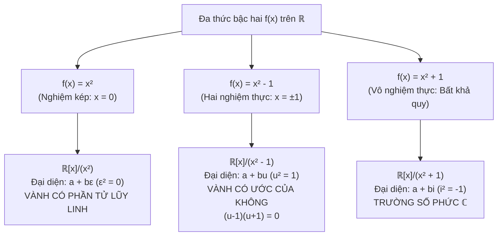

<Note title="Mục tiêu bài học">
Sau khi hoàn thành bài học này, bạn có thể:

1. **Chứng minh tính xác định tốt của Vành thương $R/I$:** Nắm vững Định lý 7.11: phép nhân lớp kề $(a+I)(b+I) = ab+I$ xác định tốt khi và chỉ khi $I$ là iđêan hai phía.
2. **Hiểu vai trò của phép chiếu chính tắc:** Khảo sát toàn cấu $\pi_I: R \to R/I, a \mapsto a+I$ và nhận diện mối liên hệ căn bản $\ker\pi_I = I$.
3. **Làm chủ cấu trúc thương đa thức $F[x]/(f)$:** Áp dụng định lý chia có dư để chứng minh mỗi phần tử trong $F[x]/(f)$ có duy nhất một đại diện chuẩn bậc $< \deg f$.
4. **Phân tích bộ ba mô hình thương đa thức bậc hai:** So sánh bản chất đại số giữa $F[x]/(x^2)$ (vành có phần tử lũy linh), $\mathbb{R}[x]/(x^2-1)$ (vành có ước của không), và $\mathbb{R}[x]/(x^2+1)$ (trường số phức $\mathbb{C}$).
5. **Thực hiện thành thạo các phép tính đại số trong $F[x]/(f)$:** Cộng, nhân các lớp đa thức, rút gọn theo $f(\bar{x}) = 0$, và tìm phần tử nghịch đảo bằng thuật toán Euclid mở rộng (Bézout).
</Note>

**Kiến thức tiên quyết:** Khái niệm iđêan hai phía và phép chia đa thức có dư (<Cite source="gt-ctds-hvk-2026" page="104-107, 113-118" note="Mục 6.6, 7.1, 7.2" />).

---

## 1. Phép dựng Vành thương $R/I$ và Phép chiếu chính tắc

Từ Bài 1, ta đã biết rằng điều kiện hấp thụ nhân hai phía của iđêan $I$ chính là chìa khóa duy nhất tháo gỡ sự bế tắc của phép nhân lớp kề.

<Theorem id="thm-c7-b2-vanh-thuong" title="Phép dựng Vành thương (Định lý 7.11 Giáo trình)">
Cho $(R, +, \cdot)$ là một vành và $I$ là một iđêan hai phía của $R$ ($I \trianglelefteq R$).
Trên tập hợp các lớp kề cộng:
$$
R/I = \{a + I \mid a \in R\},
$$
ta định nghĩa hai phép toán hai ngôi:
- **Phép cộng:** $(a + I) + (b + I) = (a + b) + I$.
- **Phép nhân:** $(a + I) \cdot (b + I) = (a \cdot b) + I$.

Khi đó:
1. Cả hai phép toán trên đều **xác định tốt** (*well-defined*).
2. Cấu trúc $(R/I, +, \cdot)$ lập thành một vành, được gọi là **Vành thương** (*Quotient Ring* hay *Factor Ring*) của $R$ theo $I$.
3. **Phần tử không:** Phần tử không của $R/I$ là $0_{R/I} = 0_R + I = I$.
4. **Phần tử đối:** Phần tử đối của lớp $a + I$ là $-(a + I) = (-a) + I$.
5. **Tính giao hoán:** Nếu $R$ là vành giao hoán thì $R/I$ cũng là vành giao hoán.
6. **Phần tử đơn vị:** Nếu $R$ có phần tử đơn vị $1_R$ thì $R/I$ có phần tử đơn vị là $1_{R/I} = 1_R + I$.
</Theorem>

<Proof>
1. **Chứng minh tính xác định tốt:**
   - *Phép cộng:* Đã được chứng minh trong lý thuyết nhóm (Chương 4), vì $(R, +)$ là một nhóm Abel nên $(I, +)$ là nhóm con chuẩn tắc, suy ra phép cộng lớp kề luôn xác định tốt.
   - *Phép nhân:* Giả sử $a + I = a' + I$ và $b + I = b' + I$. Khi đó tồn tại $x, y \in I$ sao cho $a' = a + x$ và $b' = b + y$.
     Xét tích đại diện mới:
     $$
     a'b' = (a + x)(b + y) = ab + ay + xb + xy.
     $$
     Vì $I \trianglelefteq R$ và $y \in I$, tính hấp thụ trái cho $ay \in I$.
     Vì $I \trianglelefteq R$ và $x \in I$, tính hấp thụ phải cho $xb \in I$.
     Vì $I$ là vành con, tích nội bộ $xy \in I$.
     Do $I$ đóng đối với phép cộng, tổng $ay + xb + xy \in I$.
     Đặt $z = ay + xb + xy \in I$, ta có $a'b' = ab + z \implies a'b' + I = ab + I$.
     Vậy phép nhân hoàn toàn không phụ thuộc vào việc chọn phần tử đại diện.

2. **Kiểm tra các tiên đề vành:**
   - $(R/I, +)$ là nhóm Abel theo lý thuyết nhóm thương.
   - *Tính kết hợp của phép nhân:*
     $$
     [(a+I)(b+I)](c+I) = (ab+I)(c+I) = (ab)c+I = a(bc)+I = (a+I)[(b+I)(c+I)].
     $$
   - *Luật phân phối hai phía:*
     $$
     (a+I)[(b+I) + (c+I)] = (a+I)[(b+c)+I] = a(b+c)+I = (ab+ac)+I = (ab+I) + (ac+I).
     $$
     Phân phối phải chứng minh hoàn toàn tương tự.

3. **Tính giao hoán và đơn vị:**
   - Nếu $ab = ba$ trong $R$, thì $(a+I)(b+I) = ab+I = ba+I = (b+I)(a+I)$, nên $R/I$ giao hoán.
   - Nếu $a \cdot 1_R = 1_R \cdot a = a$, thì $(a+I)(1_R+I) = a \cdot 1_R + I = a+I$, nên $1_R+I$ là đơn vị.
</Proof>

<Definition id="def-c7-b2-phep-chieu-chinh-tac" title="Phép chiếu chính tắc (Canonical Projection)">
Cho $R$ là một vành và $I \trianglelefteq R$. Ánh xạ:
$$
\pi_I: R \to R/I, \quad a \mapsto a + I
$$
được gọi là **phép chiếu chính tắc** (hay *đồng cấu thương*).
- $\pi_I$ là một **toàn cấu vành** (toàn ánh bảo toàn cả phép cộng và phép nhân).
- Hạt nhân của $\pi_I$ chính xác bằng $I$:
  $$
  \ker\pi_I = \{a \in R \mid \pi_I(a) = 0_{R/I}\} = \{a \in R \mid a + I = I\} = I.
  $$
</Definition>

<Note title="Ý nghĩa nền tảng: Mọi Iđêan đều là Hạt nhân">
Trong Lý thuyết Nhóm, mọi nhóm con chuẩn tắc $N \trianglelefteq G$ đều là hạt nhân của một đồng cấu nhóm (cụ thể là phép chiếu $\pi_N: G \to G/N$).
Hoàn toàn tương tự, trong Lý thuyết Vành:
> **Mọi iđêan hai phía $I \trianglelefteq R$ đều là hạt nhân của một đồng cấu vành (chính là phép chiếu $\pi_I: R \to R/I$).**

Ngược lại, như sẽ chứng minh ở Chương 8, hạt nhân của bất kỳ đồng cấu vành nào cũng bắt buộc phải là một iđêan hai phía! Do đó, hai khái niệm "iđêan hai phía" và "hạt nhân của đồng cấu vành" là **hoàn toàn tương đương**.
</Note>

---

## 2. Vành thương đa thức $F[x]/(f)$ trên một trường

Một trong những ứng dụng vĩ đại nhất của cấu trúc vành thương là việc mở rộng các trường số (từ số thực $\mathbb{R}$ lên số phức $\mathbb{C}$, hoặc xây dựng các trường hữu hạn $\mathbb{F}_{p^n}$ dùng trong mật mã học). Tất cả đều thông qua vành thương đa thức $F[x]/(f)$.

<Theorem id="thm-c7-b2-dai-dien-chuan" title="Đại diện chuẩn trong Vành thương đa thức (Mệnh đề 7.12 Giáo trình)">
Cho $F$ là một trường và $f(x) \in F[x]$ là một đa thức có bậc $\deg f = d \ge 1$.
1. Mỗi lớp kề $g(x) + (f(x)) \in F[x]/(f(x))$ chứa **duy nhất một đa thức đại diện** $r(x) \in F[x]$ thỏa mãn:
   $$
   r(x) = 0 \quad \text{hoặc} \quad \deg r < d.
   $$
   Đa thức $r(x)$ này chính là **phần dư trong phép chia Euclid** của $g(x)$ cho $f(x)$.
2. Nếu ký hiệu $\bar{x} = x + (f(x)) \in F[x]/(f(x))$, thì mọi phần tử của vành thương $F[x]/(f(x))$ đều biểu diễn được duy nhất dưới dạng:
   $$
   c_0 + c_1 \bar{x} + c_2 \bar{x}^2 + \cdots + c_{d-1} \bar{x}^{d-1} \quad (c_i \in F),
   $$
   với hệ thức triệt tiêu cốt lõi: $f(\bar{x}) = \bar{0}$.
3. Xem $F[x]/(f(x))$ như một không gian vectơ trên trường $F$, thì tập hợp $\{1, \bar{x}, \bar{x}^2, \dots, \bar{x}^{d-1}\}$ lập thành một cơ sở, và số chiều là:
   $$
   \dim_F(F[x]/(f(x))) = d = \deg f.
   $$
   Đặc biệt, nếu trường nền $F = \mathbb{F}_q$ có $q$ phần tử thì $|F[x]/(f(x))| = q^d$.
</Theorem>

<Proof>
1. **Sự tồn tại của đại diện:**
   Vì $F$ là một trường và $f(x) \neq 0$, theo định lý chia đa thức có dư, tồn tại các đa thức $q(x), r(x) \in F[x]$ sao cho:
   $$
   g(x) = q(x)f(x) + r(x), \quad \text{với } r(x) = 0 \text{ hoặc } \deg r < d.
   $$
   Khi đó $g(x) - r(x) = q(x)f(x) \in (f(x))$, suy ra:
   $$
   g(x) + (f(x)) = r(x) + (f(x)).
   $$
   Vậy lớp của $g(x)$ luôn chứa ít nhất một đại diện $r(x)$ có bậc $< d$.

2. **Tính duy nhất của đại diện:**
   Giả sử lớp này có hai đại diện $r_1(x), r_2(x)$ đều có bậc $< d$ (hoặc bằng 0). Khi đó:
   $$
   r_1(x) + (f(x)) = r_2(x) + (f(x)) \iff r_1(x) - r_2(x) \in (f(x)).
   $$
   Điều này có nghĩa là $f(x) \mid (r_1(x) - r_2(x))$.
   Nếu $r_1(x) - r_2(x) \neq 0$, thì:
   $$
   \deg(r_1 - r_2) \ge \deg f = d.
   $$
   Mặt khác, vì $\deg r_1 < d$ và $\deg r_2 < d$, nên $\deg(r_1 - r_2) \le \max\{\deg r_1, \deg r_2\} < d$.
   Mâu thuẫn này buộc $r_1(x) - r_2(x) = 0 \iff r_1(x) = r_2(x)$.
   Vậy đại diện bậc $< d$ là duy nhất.
</Proof>

---

## 3. Bộ ba mô hình thương đa thức bậc hai kinh điển

Cấu trúc của vành thương $F[x]/(f(x))$ phụ thuộc sống còn vào việc đa thức $f(x)$ có phân tích được thành nhân tử trên trường $F$ hay không. Dưới đây là ba trường hợp tương phản sắc nét nhất:

<Example id="ex-c7-b2-bo-ba-mo-hinh" title="Khảo sát chi tiết bộ ba mô hình đa thức">
1. **Mô hình 1: Đa thức có nghiệm kép — Vành số đối ngẫu $F[x]/(x^2)$:**
   - Mỗi phần tử có dạng duy nhất $a + b\varepsilon$ với $a, b \in F$ và $\bar{x} = \varepsilon$.
   - Hệ thức: $\varepsilon^2 = 0$.
   - Phép nhân: $(a_1 + b_1\varepsilon)(a_2 + b_2\varepsilon) = a_1 a_2 + (a_1 b_2 + a_2 b_1)\varepsilon$.
   - Phần tử $\varepsilon \neq 0$ là một **phần tử lũy linh** ($\varepsilon^2 = 0$). Vành này mô hình hóa phép vi phân và đạo hàm tự động trong giải tích.

2. **Mô hình 2: Đa thức có 2 nghiệm phân biệt — Vành có ước của không $\mathbb{R}[x]/(x^2-1)$:**
   - Mỗi phần tử có dạng duy nhất $a + bu$ với $a, b \in \mathbb{R}$ và $u = \bar{x}$.
   - Hệ thức: $u^2 = 1$.
   - Ta có: $(u - 1)(u + 1) = u^2 - 1 = 0$.
   - Vì $u \neq 1$ và $u \neq -1$, nên cả hai phần tử $u - 1$ và $u + 1$ đều khác không nhưng có tích bằng không! Do đó vành thương này **chứa ước của không** và không phải là miền nguyên (sau này ở Chương 8 ta sẽ thấy $\mathbb{R}[x]/(x^2-1) \cong \mathbb{R} \times \mathbb{R}$).

3. **Mô hình 3: Đa thức bất khả quy — Dựng Trường số phức $\mathbb{R}[x]/(x^2+1) \cong \mathbb{C}$:**
   - Đa thức $x^2 + 1$ không có nghiệm thực nào trên $\mathbb{R}$, tức là bất khả quy trên $\mathbb{R}[x]$.
   - Đặt $i = \bar{x} = x + (x^2+1)$. Khi đó mỗi phần tử có dạng duy nhất:
     $$
     a + bi \quad (a, b \in \mathbb{R}), \quad \text{với } i^2 = -1.
     $$
   - Phép nhân hai lớp:
     $$
     (a + bi)(c + di) = ac + (ad + bc)i + bd i^2 = (ac - bd) + (ad + bc)i.
     $$
   - Với mọi phần tử khác không $a + bi \neq 0$ (tức $a^2 + b^2 > 0$):
     $$
     (a + bi) \cdot \frac{a - bi}{a^2 + b^2} = \frac{a^2 - b^2 i^2}{a^2 + b^2} = \frac{a^2 + b^2}{a^2 + b^2} = 1.
     $$
   - Mọi phần tử khác không đều khả nghịch! Do đó $\mathbb{R}[x]/(x^2+1)$ là một **trường**, và trường này đẳng cấu với trường số phức $\mathbb{C}$.
</Example>

---

## 4. Kỹ thuật tính nghịch đảo trong $F[x]/(f)$ bằng thuật toán Euclid mở rộng

Khi $f(x)$ là đa thức bất khả quy trên trường $F$, ta biết rằng $F[x]/(f(x))$ là một trường. Vậy làm thế nào để tìm nghịch đảo của một lớp $g(x) + (f(x)) \neq \bar{0}$ một cách thuật toán?

<Theorem id="thm-c7-b2-nghich-dao-euclid" title="Tìm nghịch đảo trong F[x]/(f) bằng Đồng nhất thức Bézout">
Cho $F$ là một trường và $f(x) \in F[x]$ với $\deg f \ge 1$.
Một lớp $g(x) + (f(x))$ khả nghịch trong $F[x]/(f(x))$ khi và chỉ khi:
$$
\gcd(g(x), f(x)) = 1 \quad \text{trong } F[x].
$$
Khi đó, áp dụng thuật toán Euclid mở rộng cho $g(x)$ và $f(x)$, ta tìm được các đa thức $u(x), v(x) \in F[x]$ sao cho:
$$
u(x) g(x) + v(x) f(x) = 1.
$$
Lấy lớp kề modulo $f(x)$, ta được:
$$
u(x) g(x) \equiv 1 \pmod{f(x)} \implies (g(x) + (f(x)))^{-1} = u(x) + (f(x)).
$$
</Theorem>

---

## 5. Hệ thống bài tập 4 phân lớp có lời giải

<Exercise id="ex-c7-b2-nhom-a" title="Bài tập 7.5 (Nhóm A): Tính toán trong vành thương Z/2Z[x]/(x^3 + x + 1)">
Xét trường $\mathbb{F}_2 = \mathbb{Z}/2\mathbb{Z}$ và đa thức $f(x) = x^3 + x + 1 \in \mathbb{F}_2[x]$.
Đặt $K = \mathbb{F}_2[x]/(x^3 + x + 1)$ và gọi $\alpha = \bar{x} = x + (f(x))$.
1. Vành $K$ có bao nhiêu phần tử? Liệt kê tất cả các phần tử của $K$ dưới dạng đại diện chuẩn theo $\alpha$.
2. Tính tổng và tích của hai phần tử $u = \alpha^2 + 1$ và $v = \alpha^2 + \alpha$.
</Exercise>

<Hint>
Số phần tử là $2^{\deg f} = 2^3 = 8$. Chú ý hệ thức $\alpha^3 + \alpha + 1 = 0 \iff \alpha^3 = \alpha + 1$ trong đặc số 2 (nơi $+1 = -1$).
</Hint>

<Solution>
1. **Số phần tử và liệt kê:**
   Đa thức $f(x)$ có bậc $d = 3$. Vì trường nền $\mathbb{F}_2$ có $2$ phần tử, số phần tử của $K$ là:
   $$
   |K| = 2^3 = 8.
   $$
   Mỗi phần tử được biểu diễn duy nhất dưới dạng $c_0 + c_1 \alpha + c_2 \alpha^2$ với $c_i \in \{0, 1\}$.
   Tập hợp 8 phần tử là:
   $$
   K = \{0, 1, \alpha, \alpha + 1, \alpha^2, \alpha^2 + 1, \alpha^2 + \alpha, \alpha^2 + \alpha + 1\}.
   $$

2. **Thực hiện phép tính:**
   - **Phép cộng:** Vì trong $\mathbb{F}_2$ ta có $1 + 1 = 0$:
     $$
     u + v = (\alpha^2 + 1) + (\alpha^2 + \alpha) = (\alpha^2 + \alpha^2) + \alpha + 1 = 0 + \alpha + 1 = \alpha + 1.
     $$
   - **Phép nhân:**
     $$
     u \cdot v = (\alpha^2 + 1)(\alpha^2 + \alpha) = \alpha^4 + \alpha^3 + \alpha^2 + \alpha.
     $$
     Vì $\alpha^3 = \alpha + 1$, nhân hai vế với $\alpha$ ta được:
     $$
     \alpha^4 = \alpha(\alpha + 1) = \alpha^2 + \alpha.
     $$
     Thay $\alpha^4$ và $\alpha^3$ vào tích:
     $$
     u \cdot v = (\alpha^2 + \alpha) + (\alpha + 1) + \alpha^2 + \alpha = (\alpha^2 + \alpha^2) + (\alpha + \alpha + \alpha) + 1 = 0 + \alpha + 1 = \alpha + 1.
     $$
     Vậy $u \cdot v = \alpha + 1$.
</Solution>

---

<Exercise id="ex-c7-b2-nhom-b" title="Bài tập 7.6 (Nhóm B): Tìm phần tử nghịch đảo trong Q[x]/(x^2 - 2)">
Xét đa thức $f(x) = x^2 - 2 \in \mathbb{Q}[x]$ và vành thương $E = \mathbb{Q}[x]/(x^2 - 2)$.
Đặt $\theta = \bar{x} = x + (x^2 - 2)$.
1. Giải thích vì sao $E = \{a + b\theta \mid a, b \in \mathbb{Q}\}$ với $\theta^2 = 2$.
2. Với phần tử khác không $u = 3 + 2\theta \in E$, hãy tìm phần tử nghịch đảo $u^{-1}$ trong $E$.
3. Rút ra đẳng cấu trường $E \cong \mathbb{Q}(\sqrt{2}) = \{a + b\sqrt{2} \mid a, b \in \mathbb{Q}\}$.
</Exercise>

<Hint>
Sử dụng biểu thức liên hợp $3 - 2\theta$ hoặc áp dụng thuật toán chia Euclid cho $x^2 - 2$ và $2x + 3$.
</Hint>

<Solution>
1. **Cấu trúc của $E$:**
   Vì $f(x) = x^2 - 2$ có bậc $2$, theo Mệnh đề 7.12, mỗi lớp trong $E$ có duy nhất đại diện bậc $< 2$, tức dạng $a + bx$ ($a, b \in \mathbb{Q}$).
   Thay $x$ bằng $\theta = \bar{x}$, ta có $E = \{a + b\theta \mid a, b \in \mathbb{Q}\}$ với hệ thức triệt tiêu $\theta^2 - 2 = 0 \iff \theta^2 = 2$.

2. **Tìm nghịch đảo của $u = 3 + 2\theta$:**
   - *Cách 1 (Nhân lượng liên hợp):*
     Xét phần tử liên hợp $v = 3 - 2\theta \in E$. Tính tích:
     $$
     u \cdot v = (3 + 2\theta)(3 - 2\theta) = 3^2 - (2\theta)^2 = 9 - 4\theta^2 = 9 - 4(2) = 9 - 8 = 1.
     $$
     Vì tích bằng $1$, nên $u^{-1} = v = 3 - 2\theta$.
   - *Cách 2 (Thuật toán Euclid mở rộng):*
     Chia $x^2 - 2$ cho $2x + 3$:
     $$
     x^2 - 2 = (2x + 3)\left(\frac{1}{2}x - \frac{3}{4}\right) + \frac{1}{4}.
     $$
     Nhân hai vế với $4$:
     $$
     1 = 4(x^2 - 2) - (2x + 3)(2x - 3) = 4(x^2 - 2) + (2x + 3)(3 - 2x).
     $$
     Lấy modulo $x^2 - 2$, ta được $(2\theta + 3)(3 - 2\theta) = 1$.
     Vậy $(3 + 2\theta)^{-1} = 3 - 2\theta$.

3. **Đẳng cấu trường:**
   Ánh xạ $\phi: E \to \mathbb{Q}(\sqrt{2}), a + b\theta \mapsto a + b\sqrt{2}$ là một song ánh bảo toàn phép cộng và nhân (vì $\theta^2 = 2$ tương ứng với $(\sqrt{2})^2 = 2$). Do đó $E \cong \mathbb{Q}(\sqrt{2})$.
</Solution>

---

<Exercise id="ex-c7-b2-nhom-c" title="Bài tập 7.7 (Nhóm C): Phân tích tính lũy linh và ước của không trong R[x]/(x^2 - x)">
Xét vành thương $R = \mathbb{R}[x]/(x^2 - x)$. Đặt $e = \bar{x} = x + (x^2 - x)$.
1. Chứng minh rằng $e$ là một phần tử lũy đẳng trong $R$ ($e^2 = e$).
2. Chứng minh rằng $R$ có chứa ước của không.
3. Chứng minh rằng $R$ không chứa bất kỳ phần tử lũy linh khác không nào.
</Exercise>

<Hint>
Đa thức $x^2 - x = x(x-1)$. Kiểm tra $e(e-1) = 0$. Một phần tử lũy linh trong $R$ tương ứng với đa thức $g(x)$ thỏa mãn $g(x)^m \in (x(x-1))$.
</Hint>

<Solution>
1. **$e$ là phần tử lũy đẳng:**
   Trong vành thương $R$, hệ thức triệt tiêu là $e^2 - e = 0 \iff e^2 = e$.
   Do đó $e$ là một phần tử lũy đẳng.

2. **Chỉ ra ước của không:**
   Xét hai phần tử $e$ và $1 - e$ trong $R$.
   - Vì $e$ là lớp của $x$ và $\deg x = 1 < 2$, nên $e \neq 0$ trong $R$.
   - Vì $1 - e$ là lớp của $1 - x$ có bậc $1 < 2$, nên $1 - e \neq 0$ trong $R$.
   - Tuy nhiên:
     $$
     e(1 - e) = e - e^2 = e - e = 0.
     $$
   Tích của hai phần tử khác không bằng không, vậy $e$ và $1 - e$ là các ước của không trong $R$.

3. **Không có phần tử lũy linh khác không:**
   Giả sử $u = a + bx \in R$ ($a, b \in \mathbb{R}$) là một phần tử lũy linh, tức tồn tại $m \ge 1$ để $u^m = 0$ trong $R$.
   Điều này có nghĩa là đa thức $(a + bx)^m$ chia hết cho $x^2 - x = x(x - 1)$ trong $\mathbb{R}[x]$.
   - Vì $x \mid (a + bx)^m$, nên $0$ là nghiệm của $(a + bx)^m$, suy ra $a + b(0) = 0 \implies a = 0$.
   - Vì $x - 1 \mid (a + bx)^m$, nên $1$ là nghiệm của $(a + bx)^m$, suy ra $a + b(1) = 0 \implies 0 + b = 0 \implies b = 0$.
   Do đó $a = b = 0$, tức là $u = 0$.
   Vậy phần tử lũy linh duy nhất của $R$ là phần tử không.
</Solution>

---

<Exercise id="ex-c7-b2-nhom-d" title="Bài tập 7.8 (Nhóm D): Dựng Trường hữu hạn 4 phần tử F_4">
Xét trường $\mathbb{F}_2 = \mathbb{Z}/2\mathbb{Z}$ và đa thức $p(x) = x^2 + x + 1 \in \mathbb{F}_2[x]$.
1. Chứng minh rằng $p(x)$ là đa thức bất khả quy trên $\mathbb{F}_2$.
2. Đặt $\mathbb{F}_4 = \mathbb{F}_2[x]/(x^2 + x + 1)$ và gọi $\omega = \bar{x} = x + (x^2 + x + 1)$. Lập bảng Cayley cho phép nhân của nhóm các phần tử khả nghịch $\mathbb{F}_4^\times$.
3. Chứng minh $\mathbb{F}_4^\times \cong \mathbb{Z}_3$ và kiểm chứng mọi phần tử $a \in \mathbb{F}_4$ đều thỏa mãn $a^4 = a$.
</Exercise>

<Hint>
Đa thức bậc 2 bất khả quy trên trường khi và chỉ khi không có nghiệm trong trường đó. Nhóm khả nghịch $\mathbb{F}_4^\times$ gồm 3 phần tử khác không: $\{1, \omega, \omega^2\}$.
</Hint>

<Solution>
1. **Tính bất khả quy của $p(x)$:**
   Đa thức $p(x) = x^2 + x + 1$ có bậc $2$.
   Thử các giá trị trong $\mathbb{F}_2$:
   - $p(0) = 0^2 + 0 + 1 = 1 \neq 0$.
   - $p(1) = 1^2 + 1 + 1 = 3 \equiv 1 \neq 0$.
   Vì $p(x)$ không có nghiệm trong $\mathbb{F}_2$, nên $p(x)$ không thể phân tích thành tích của hai đa thức bậc nhất. Do đó $p(x)$ bất khả quy trên $\mathbb{F}_2$.

2. **Cấu trúc của $\mathbb{F}_4$ và bảng nhân:**
   Vì $p(x)$ có bậc $2$, $\mathbb{F}_4 = \{0, 1, \omega, \omega + 1\}$ với $\omega^2 + \omega + 1 = 0 \iff \omega^2 = \omega + 1$ (do $-1 = 1$ trong $\mathbb{F}_2$).
   Ba phần tử khác không lập thành nhóm nhân $\mathbb{F}_4^\times = \{1, \omega, \omega^2 = \omega + 1\}$.
   Ta lập bảng nhân:
   - $\omega \cdot \omega = \omega^2 = \omega + 1$.
   - $\omega \cdot \omega^2 = \omega^3 = \omega(\omega + 1) = \omega^2 + \omega = (\omega + 1) + \omega = 2\omega + 1 = 1$.
   - $(\omega^2)^2 = \omega^4 = \omega^3 \cdot \omega = 1 \cdot \omega = \omega$.

   | $\cdot$ | $1$ | $\omega$ | $\omega + 1$ |
   | :---: | :---: | :---: | :---: |
   | **$1$** | $1$ | $\omega$ | $\omega + 1$ |
   | **$\omega$** | $\omega$ | $\omega + 1$ | $1$ |
   | **$\omega + 1$** | $\omega + 1$ | $1$ | $\omega$ |

   Mọi phần tử khác không đều có nghịch đảo: $1^{-1} = 1$, $\omega^{-1} = \omega^2 = \omega + 1$, và $(\omega+1)^{-1} = \omega$.
   Vậy $\mathbb{F}_4$ là một **trường hữu hạn gồm 4 phần tử**.

3. **Cấu trúc nhóm nhân và phương trình $a^4 = a$:**
   Nhóm nhân $\mathbb{F}_4^\times$ có cấp $3$. Vì $3$ là số nguyên tố, $\mathbb{F}_4^\times$ bắt buộc là nhóm cyclic:
   $$
   \mathbb{F}_4^\times = \langle \omega \rangle \cong \mathbb{Z}_3.
   $$
   Theo định lý Lagrange cho nhóm nhân, với mọi $u \in \mathbb{F}_4^\times$, ta có $u^3 = 1 \implies u^4 = u$.
   Đối với phần tử $0 \in \mathbb{F}_4$, hiển nhiên $0^4 = 0$.
   Vậy với mọi $a \in \mathbb{F}_4$, ta luôn có $a^4 = a$.
</Solution>

---

## 6. Tóm tắt các điểm then chốt

<KeyTakeaways>
- **Định lý Vành thương:** Phép nhân $(a+I)(b+I) = ab+I$ xác định tốt $\iff I$ là iđêan hai phía. Khi đó $R/I$ là một vành có phần tử không $I$ và đơn vị $1_R+I$.
- **Phép chiếu chính tắc:** $\pi_I: R \to R/I, a \mapsto a+I$ là toàn cấu vành với $\ker\pi_I = I$. Mọi iđêan đều là hạt nhân của một đồng cấu vành.
- **Đại diện chuẩn trong $F[x]/(f)$:** Mỗi lớp kề có duy nhất một đa thức đại diện có bậc $< \deg f$ (chính là phần dư trong phép chia cho $f$). Số chiều không gian vectơ là $\dim_F(F[x]/(f)) = \deg f$.
- **Bộ ba mô hình đa thức:** $F[x]/(x^2)$ có lũy linh; $\mathbb{R}[x]/(x^2-1)$ có ước của không; $\mathbb{R}[x]/(x^2+1)$ là trường số phức $\mathbb{C}$.
- **Kỹ thuật Euclid mở rộng:** Lớp $g + (f)$ khả nghịch trong $F[x]/(f) \iff \gcd(g, f) = 1$. Nghịch đảo tìm được từ đồng nhất thức Bézout $ug + vf = 1$.
</KeyTakeaways>
