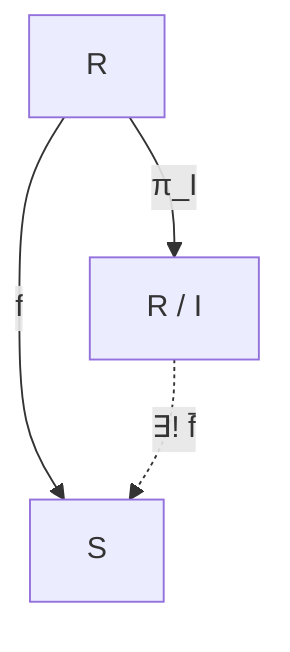

Trong lý thuyết nhóm, cấu trúc đại số được nghiên cứu thông qua các ánh xạ bảo toàn một phép toán (đồng cấu nhóm). Khi bước sang lý thuyết vành, một ánh xạ muốn bảo toàn cấu trúc phải tương thích đồng thời với **cả hai phép toán** cộng và nhân. 

Bài học này xây dựng nền tảng cho lý thuyết đồng cấu vành: làm rõ điều kiện bảo toàn phép tính, phân tích bản chất của điều kiện bảo toàn đơn vị $f(1_R) = 1_S$, chứng minh vì sao hạt nhân $\ker f$ luôn là một iđêan hai phía và thiết lập **nguyên lý phân tích qua vành thương** — chiếc chìa khóa dẫn tới bộ ba định lý đẳng cấu kinh điển.

---

## 1. Định nghĩa đồng cấu vành và điều kiện đơn vị

<Definition id="def-c8-b1-dong-cau-vanh">
### Định nghĩa 8.1: Đồng cấu vành
Cho $(R, +, \cdot)$ và $(S, +, \cdot)$ là hai vành. Một ánh xạ $f: R \to S$ được gọi là một **đồng cấu vành** (ring homomorphism) nếu $f$ bảo toàn cả hai phép toán cộng và nhân:
1. $f(a + b) = f(a) + f(b)$ với mọi $a, b \in R$.
2. $f(ab) = f(a)f(b)$ với mọi $a, b \in R$.

Nếu $f$ vừa là đơn ánh vừa là toàn ánh thì $f$ được gọi là một **đẳng cấu vành** (ring isomorphism). Khi đó ta nói hai vành $R$ và $S$ đẳng cấu với nhau, ký hiệu $R \cong S$.
</Definition>

Do điều kiện (1), $f$ trước hết là một đồng cấu giữa hai nhóm cộng abel $(R, +)$ và $(S, +)$. Do đó, theo tính chất của đồng cấu nhóm, ta tự động nhận được:
- $f(0_R) = 0_S$,
- $f(-a) = -f(a)$ với mọi $a \in R$,
- $f(a - b) = f(a) - f(b)$ với mọi $a, b \in R$,
- $f(n \cdot a) = n \cdot f(a)$ với mọi $n \in \mathbb{Z}, a \in R$.

Tuy nhiên, đối với phép nhân, điều kiện $f(1_R) = 1_S$ **không tự động suy ra** từ hai tiên đề trên!

### Sự cần thiết của điều kiện bảo toàn phần tử đơn vị

<Proposition id="prop-c8-b1-phan-tu-luy-dang">
### Mệnh đề 8.2: Tính chất lũy đẳng của ảnh phần tử đơn vị
Cho $R, S$ là hai vành có đơn vị $1_R$ và $1_S$. Nếu $f: R \to S$ là một đồng cấu vành thì phần tử $e = f(1_R) \in S$ thỏa mãn tính chất **lũy đẳng**:
$$
e^2 = e \quad (\text{tức là } [f(1_R)]^2 = f(1_R)).
$$
</Proposition>

<Proof>
Vì $1_R$ là phần tử đơn vị trong $R$, ta có $1_R \cdot 1_R = 1_R$.
Do $f$ bảo toàn phép nhân:
$$
e^2 = f(1_R) \cdot f(1_R) = f(1_R \cdot 1_R) = f(1_R) = e.
$$
Đẳng thức được chứng minh.
</Proof>

Trong một vành tổng quát, phương trình lũy đẳng $e^2 = e$ có thể có nhiều nghiệm khác ngoài $1_S$ (chẳng hạn $e = 0_S$, hoặc các ma trận chiếu trong $M_2(\mathbb{R})$). Vì vậy, trong đại số hiện đại, đối với các vành có đơn vị, ta phân biệt hai định nghĩa:
- **Đồng cấu vành tổng quát:** Chỉ thỏa mãn $f(a+b) = f(a)+f(b)$ và $f(ab) = f(a)f(b)$.
- **Đồng cấu vành có đơn vị (unital ring homomorphism):** Thỏa mãn thêm điều kiện $f(1_R) = 1_S$.

<Theorem id="thm-c8-b1-khi-nao-bao-toan-don-vi">
### Mệnh đề 8.3: Điều kiện bảo đảm $f(1_R) = 1_S$
Cho $R, S$ là hai vành có đơn vị và $f: R \to S$ là một đồng cấu vành. Khi đó $f(1_R) = 1_S$ trong mỗi trường hợp sau:
1. $f$ là một **toàn ánh**.
2. $S$ là một **miền nguyên** và $f$ **không phải là ánh xạ không** (tức là tồn tại $x \in R$ sao cho $f(x) \neq 0_S$).
</Theorem>

<Proof>
1. **Trường hợp $f$ là toàn ánh:** Lấy bất kỳ phần tử $y \in S$. Vì $f$ toàn ánh, tồn tại $x \in R$ sao cho $y = f(x)$. Khi đó:
$$
f(1_R) \cdot y = f(1_R) \cdot f(x) = f(1_R \cdot x) = f(x) = y,
$$
và tương tự $y \cdot f(1_R) = y$. Vì phần tử đơn vị trong vành $S$ là duy nhất, ta kết luận $f(1_R) = 1_S$.

2. **Trường hợp $S$ là miền nguyên và $f \neq 0$:** Ta có phương trình:
$$
[f(1_R)]^2 = f(1_R) \iff f(1_R)[f(1_R) - 1_S] = 0_S.
$$
Vì $S$ là miền nguyên, tích của hai phần tử bằng $0_S$ khi và chỉ khi ít nhất một trong hai phần tử bằng $0_S$.
Nếu $f(1_R) = 0_S$, thì với mọi $x \in R$:
$$
f(x) = f(1_R \cdot x) = f(1_R) \cdot f(x) = 0_S \cdot f(x) = 0_S,
$$
suy ra $f$ là ánh xạ không, mâu thuẫn với giả thiết $f \neq 0$.
Do đó, ta bắt buộc phải có $f(1_R) - 1_S = 0_S$, tức là $f(1_R) = 1_S$.
</Proof>

<Counterexample id="counter-c8-b1-khong-bao-toan-don-vi">
### Phản ví dụ: Các đồng cấu vành không bảo toàn phần tử đơn vị
1. **Ánh xạ không:** Ánh xạ $f: \mathbb{Z} \to \mathbb{Z}$ định bởi $f(x) = 0$ với mọi $x \in \mathbb{Z}$. Rõ ràng $f(a+b) = 0 = f(a)+f(b)$ và $f(ab) = 0 = f(a)f(b)$, nhưng:
$$
f(1) = 0 \neq 1.
$$
2. **Phép nhúng vào vành tích:** Xét ánh xạ $g: \mathbb{Z} \to \mathbb{Z} \times \mathbb{Z}$ định bởi $g(x) = (x, 0)$.
Ánh xạ này bảo toàn phép cộng và phép nhân tọa độ, nhưng:
$$
g(1) = (1, 0) \neq (1, 1) = 1_{\mathbb{Z} \times \mathbb{Z}}.
$$
Phần tử $(1, 0)$ là một phần tử lũy đẳng không tầm thường trong $\mathbb{Z} \times \mathbb{Z}$.
</Counterexample>

---

## 2. Hạt nhân và Ảnh của đồng cấu vành

<Definition id="def-c8-b1-hat-nhan-va-anh">
### Định nghĩa 8.4: Hạt nhân và Ảnh
Cho $f: R \to S$ là một đồng cấu vành.
1. **Hạt nhân** của $f$, ký hiệu là $\ker f$, là tập hợp mọi phần tử của $R$ được $f$ biến thành phần tử không của $S$:
$$
\ker f = \{x \in R \mid f(x) = 0_S\} = f^{-1}(\{0_S\}).
$$
2. **Ảnh** của $f$, ký hiệu là $\operatorname{im} f$ (hoặc $f(R)$), là tập hợp:
$$
\operatorname{im} f = \{f(x) \in S \mid x \in R\}.
$$
</Definition>

<Theorem id="thm-c8-b1-tinh-chat-hat-nhan-va-anh">
### Định lý 8.5: Cấu trúc đại số của Hạt nhân và Ảnh
Cho $f: R \to S$ là một đồng cấu vành. Khi đó:
1. $\operatorname{im} f$ là một **vành con** của $S$. (Nếu $f(1_R) = 1_S$ thì $\operatorname{im} f$ là vành con chứa đơn vị $1_S$).
2. $\ker f$ là một **iđêan hai phía** của $R$.
3. $f$ là một **đơn ánh** khi và chỉ khi $\ker f = \{0_R\}$.
</Theorem>

<Proof>
1. **Chứng minh $\operatorname{im} f$ là vành con của $S$:**
   - Vì $0_R \in R$, $f(0_R) = 0_S \in \operatorname{im} f \neq \emptyset$.
   - Với mọi $y_1, y_2 \in \operatorname{im} f$, tồn tại $x_1, x_2 \in R$ sao cho $y_1 = f(x_1), y_2 = f(x_2)$. Khi đó:
     $$
     y_1 - y_2 = f(x_1) - f(x_2) = f(x_1 - x_2) \in \operatorname{im} f,
     $$
     $$
     y_1 y_2 = f(x_1) f(x_2) = f(x_1 x_2) \in \operatorname{im} f.
     $$
   - Theo tiêu chuẩn vành con, $\operatorname{im} f$ là một vành con của $S$.

2. **Chứng minh $\ker f$ là iđêan hai phía của $R$:**
   - Do $f$ là đồng cấu nhóm cộng, $(\ker f, +)$ là một nhóm con của $(R, +)$. Cụ thể, $0_R \in \ker f$ và với mọi $x, y \in \ker f$, $f(x - y) = f(x) - f(y) = 0_S - 0_S = 0_S \implies x - y \in \ker f$.
   - Kiểm tra điều kiện hấp thụ phép nhân: Lấy $r \in R$ bất kỳ và $x \in \ker f$ (suy ra $f(x) = 0_S$). Ta có:
     $$
     f(rx) = f(r) f(x) = f(r) \cdot 0_S = 0_S \implies rx \in \ker f,
     $$
     $$
     f(xr) = f(x) f(r) = 0_S \cdot f(r) = 0_S \implies xr \in \ker f.
     $$
   - Như vậy, $\ker f$ thỏa mãn cả điều kiện hấp thụ trái và hấp thụ phải. Vậy $\ker f \triangleleft R$.

3. **Tiêu chuẩn đơn cấu:**
   - Vì $f$ là đồng cấu nhóm cộng $(R, +) \to (S, +)$, theo tính chất của đồng cấu nhóm, $f$ là đơn ánh khi và chỉ khi hạt nhân của nhóm cộng bằng phần tử trung hòa: $\ker f = \{0_R\}$.
</Proof>

<Note>
**Tương phản quan trọng giữa Hạt nhân và Ảnh:**
- Hạt nhân $\ker f$ luôn luôn là một **iđêan hai phía** của vành nguồn $R$.
- Ngược lại, ảnh $\operatorname{im} f$ nhìn chung chỉ là một **vành con**, **chưa chắc là một iđêan** của vành đích $S$.
</Note>

<Counterexample id="counter-c8-b1-anh-cua-idean">
### Phản ví dụ: Ảnh của iđêan không nhất thiết là iđêan
Xét phép nhúng chính tắc $\iota: \mathbb{Z} \to \mathbb{Q}$ định bởi $\iota(n) = n$.
- Rõ ràng $\iota$ là một đơn cấu vành.
- Toàn bộ miền xác định $I = \mathbb{Z}$ (hoặc iđêan $2\mathbb{Z}$) là một iđêan của $\mathbb{Z}$.
- Tuy nhiên, ảnh $\iota(\mathbb{Z}) = \mathbb{Z}$ **không phải là một iđêan** của $\mathbb{Q}$, vì $\mathbb{Z}$ không thỏa mãn tính chất hấp thụ đối với các phần tử của trường $\mathbb{Q}$ (chẳng hạn: $1 \in \mathbb{Z}$ và $\frac{1}{2} \in \mathbb{Q}$, nhưng $\frac{1}{2} \cdot 1 = \frac{1}{2} \notin \mathbb{Z}$).

*Quy tắc chuẩn:* Ảnh $f(I)$ của một iđêan $I \triangleleft R$ được bảo đảm là một iđêan của $S$ khi $f$ là một **toàn ánh**. Ngược lại, đối với nghịch ảnh: nếu $J \triangleleft S$ là một iđêan bất kỳ của $S$ thì nghịch ảnh $f^{-1}(J)$ **luôn luôn là một iđêan** của $R$ mà không đòi hỏi bất kỳ điều kiện toàn ánh nào.
</Counterexample>

---

## 3. Nguyên lý phân tích qua vành thương

Tương tự như trong lý thuyết nhóm, mỗi đồng cấu vành $f: R \to S$ đều có thể "phân rã" qua một vành thương $R/I$ nếu $I$ bị triệt tiêu bởi $f$.

<Theorem id="thm-c8-b1-nguyen-ly-phan-tich">
### Định lý 8.7: Nguyên lý phân tích qua vành thương
Cho $f: R \to S$ là một đồng cấu vành và $I$ là một iđêan hai phía của $R$ sao cho $I \subseteq \ker f$. Khi đó:
1. Tồn tại duy nhất một đồng cấu vành $\bar{f}: R/I \to S$ thỏa mãn:
$$
\bar{f}(a + I) = f(a) \quad \forall a \in R.
$$
Nói cách khác, sơ đồ sau giao hoán: $f = \bar{f} \circ \pi_I$, trong đó $\pi_I: R \to R/I$ là phép chiếu chính tắc.
2. $\operatorname{im} \bar{f} = \operatorname{im} f$.
3. $\ker \bar{f} = (\ker f)/I = \{a + I \in R/I \mid a \in \ker f\}$.
4. Ánh xạ $\bar{f}$ là một đơn ánh khi và chỉ khi $I = \ker f$.
</Theorem>

<Proof>
Ta lần lượt kiểm tra bốn khẳng định:

1. **Tính xác định tốt (Well-definedness) của $\bar{f}$:**
   Giả sử $a + I = a' + I$, tức là $a - a' \in I$.
   Vì $I \subseteq \ker f$, ta có $a - a' \in \ker f$, suy ra:
   $$
   f(a - a') = 0_S \iff f(a) - f(a') = 0_S \iff f(a) = f(a').
   $$
   Do đó $\bar{f}(a + I) = \bar{f}(a' + I)$. Ánh xạ $\bar{f}$ hoàn toàn xác định tốt và không phụ thuộc vào đại diện lớp kề.

2. **$\bar{f}$ là một đồng cấu vành:**
   Với mọi $a + I, b + I \in R/I$:
   $$
   \bar{f}((a + I) + (b + I)) = \bar{f}((a + b) + I) = f(a + b) = f(a) + f(b) = \bar{f}(a + I) + \bar{f}(b + I),
   $$
   $$
   \bar{f}((a + I)(b + I)) = \bar{f}(ab + I) = f(ab) = f(a)f(b) = \bar{f}(a + I) \bar{f}(b + I).
   $$
   Nếu $R, S$ có đơn vị và $f(1_R) = 1_S$, ta cũng có $\bar{f}(1_R + I) = f(1_R) = 1_S$.

3. **Tính duy nhất của $\bar{f}$:**
   Nếu có một đồng cấu $g: R/I \to S$ thỏa mãn $g \circ \pi_I = f$, thì với mọi $a + I \in R/I$:
   $$
   g(a + I) = g(\pi_I(a)) = (g \circ \pi_I)(a) = f(a) = \bar{f}(a + I).
   $$
   Do đó $g = \bar{f}$.

4. **Hạt nhân và tính đơn ánh của $\bar{f}$:**
   Ta xét các phần tử biến thành $0_S$:
   $$
   a + I \in \ker \bar{f} \iff \bar{f}(a + I) = 0_S \iff f(a) = 0_S \iff a \in \ker f.
   $$
   Do đó $\ker \bar{f} = \{a + I \mid a \in \ker f\} = (\ker f)/I$.
   Ánh xạ $\bar{f}$ là đơn ánh khi và chỉ khi $\ker \bar{f} = \{0_{R/I}\} = \{0 + I\}$, điều này tương đương với $a \in \ker f \implies a \in I$, tức là $\ker f \subseteq I$. Vì ban đầu ta đã có $I \subseteq \ker f$, điều kiện trở thành $I = \ker f$.
</Proof>

---

## 4. Hệ thống bài tập 4 phân lớp kèm lời giải chi tiết

<Exercise id="ex-c8-b1-a1">
### Bài 8.1.A1 (Nhóm A - Kiểm tra đồng cấu vành, tìm hạt nhân và ảnh)
Xét hai ánh xạ sau:
1. $f: \mathbb{Z}[x] \to \mathbb{Z}$ định bởi $f(P(x)) = P(0)$ (đồng cấu tính giá trị tại $0$).
2. $g: \mathbb{C} \to \mathbb{C}$ định bởi $g(a + bi) = a - bi$ (phép liên hợp phức).
Hỏi ánh xạ nào là đồng cấu vành? Có bảo toàn phần tử đơn vị không? Xác định hạt nhân và ảnh của mỗi đồng cấu.
</Exercise>

<Solution>
1. **Xét ánh xạ $f: \mathbb{Z}[x] \to \mathbb{Z}, P(x) \mapsto P(0)$:**
   - Với mọi đa thức $P(x), Q(x) \in \mathbb{Z}[x]$:
     $$
     f(P(x) + Q(x)) = (P + Q)(0) = P(0) + Q(0) = f(P(x)) + f(Q(x)),
     $$
     $$
     f(P(x) Q(x)) = (P \cdot Q)(0) = P(0) \cdot Q(0) = f(P(x)) f(Q(x)).
     $$
   - Phần tử đơn vị: Đa thức hằng $1$ có $f(1) = 1 \in \mathbb{Z}$. Vậy $f$ là một đồng cấu vành bảo toàn đơn vị.
   - Hạt nhân: $\ker f = \{P(x) \in \mathbb{Z}[x] \mid P(0) = 0\}$. Một đa thức có hệ số tự do bằng $0$ khi và chỉ khi chia hết cho $x$. Do đó:
     $$
     \ker f = (x) = x\mathbb{Z}[x].
     $$
   - Ảnh: Với mọi số nguyên $n \in \mathbb{Z}$, xét đa thức hằng $P(x) = n$, ta có $f(n) = n$. Vậy $\operatorname{im} f = \mathbb{Z}$ ($f$ là toàn ánh).

2. **Xét ánh xạ $g: \mathbb{C} \to \mathbb{C}, z \mapsto \bar{z}$:**
   - Theo tính chất cơ bản của số phức liên hợp:
     $$
     g(z_1 + z_2) = \overline{z_1 + z_2} = \bar{z}_1 + \bar{z}_2 = g(z_1) + g(z_2),
     $$
     $$
     g(z_1 z_2) = \overline{z_1 z_2} = \bar{z}_1 \cdot \bar{z}_2 = g(z_1) g(z_2).
     $$
   - Phần tử đơn vị: $g(1) = \bar{1} = 1$. Do đó $g$ là một đồng cấu vành bảo toàn đơn vị.
   - Hạt nhân: $\ker g = \{z \in \mathbb{C} \mid \bar{z} = 0\} = \{0\}$.
   - Vì $\ker g = \{0\}$, $g$ là một đơn ánh. Hơn nữa, với mọi $w \in \mathbb{C}$, $g(\bar{w}) = \bar{\bar{w}} = w$ nên $g$ là toàn ánh. Vậy $\operatorname{im} g = \mathbb{C}$, và $g$ là một tự đẳng cấu vành của $\mathbb{C}$.
</Solution>

<Exercise id="ex-c8-b1-a2">
### Bài 8.1.A2 (Nhóm A - Xác định tất cả các đồng cấu vành từ $\mathbb{Z}$)
1. Tìm tất cả các đồng cấu vành $f: \mathbb{Z} \to \mathbb{Z}$.
2. Tìm tất cả các đồng cấu vành $g: \mathbb{Z} \to \mathbb{Z}/6\mathbb{Z}$. Chỉ rõ đồng cấu nào bảo toàn đơn vị.
</Exercise>

<Solution>
Một đồng cấu vành $f: \mathbb{Z} \to S$ được xác định hoàn toàn bởi giá trị của phần tử sinh $f(1) = e \in S$.
Theo Mệnh đề 8.2, $e$ phải thỏa mãn phương trình lũy đẳng: $e^2 = e$ trong $S$.

1. **Tìm tất cả các đồng cấu $f: \mathbb{Z} \to \mathbb{Z}$:**
   Trong vành $\mathbb{Z}$, phương trình $e^2 = e \iff e(e - 1) = 0$.
   Vì $\mathbb{Z}$ là miền nguyên, các nghiệm duy nhất là $e = 0$ hoặc $e = 1$.
   - Nếu $e = 0$: $f(x) = f(x \cdot 1) = x f(1) = x \cdot 0 = 0$ với mọi $x \in \mathbb{Z}$ (ánh xạ không).
   - Nếu $e = 1$: $f(x) = x \cdot 1 = x$ với mọi $x \in \mathbb{Z}$ (ánh xạ đồng nhất $\operatorname{id}_{\mathbb{Z}}$).
   Vậy có đúng $2$ đồng cấu vành từ $\mathbb{Z}$ vào $\mathbb{Z}$, trong đó chỉ có $\operatorname{id}_{\mathbb{Z}}$ bảo toàn đơn vị.

2. **Tìm tất cả các đồng cấu $g: \mathbb{Z} \to \mathbb{Z}/6\mathbb{Z}$:**
   Trong vành $\mathbb{Z}_6 = \mathbb{Z}/6\mathbb{Z}$, ta giải phương trình $e^2 \equiv e \pmod 6$:
   - $0^2 \equiv 0 \pmod 6 \implies e = \bar{0}$.
   - $1^2 \equiv 1 \pmod 6 \implies e = \bar{1}$.
   - $2^2 \equiv 4 \not\equiv 2 \pmod 6$.
   - $3^2 = 9 \equiv 3 \pmod 6 \implies e = \bar{3}$.
   - $4^2 = 16 \equiv 4 \pmod 6 \implies e = \bar{4}$.
   - $5^2 = 25 \equiv 1 \not\equiv 5 \pmod 6$.
   Như vậy, $\mathbb{Z}_6$ có đúng $4$ phần tử lũy đẳng: $\bar{0}, \bar{1}, \bar{3}, \bar{4}$.
   Tương ứng có đúng $4$ đồng cấu vành $g_e: \mathbb{Z} \to \mathbb{Z}_6$ định bởi $g_e(x) = x \cdot e$:
   - $g_0(x) = \bar{0}$,
   - $g_1(x) = \bar{x}$ (phép chiếu chính tắc, bảo toàn đơn vị vì $g_1(1) = \bar{1}$),
   - $g_3(x) = \overline{3x}$,
   - $g_4(x) = \overline{4x}$.
   Trong số đó, chỉ có duy nhất $g_1$ bảo toàn phần tử đơn vị.
</Solution>

<Exercise id="ex-c8-b1-b1">
### Bài 8.1.B1 (Nhóm B - Ảnh và nghịch ảnh của iđêan qua đồng cấu)
Cho $f: R \to S$ là một đồng cấu vành.
1. Chứng minh rằng nếu $J$ là một iđêan của $S$ thì nghịch ảnh $f^{-1}(J) = \{x \in R \mid f(x) \in J\}$ luôn là một iđêan của $R$.
2. Chứng minh rằng nếu $f$ là một **toàn ánh** và $I$ là một iđêan của $R$ thì ảnh $f(I) = \{f(x) \mid x \in I\}$ là một iđêan của $S$.
</Exercise>

<Solution>
**1. Chứng minh $f^{-1}(J) \triangleleft R$:**
- Vì $0_S \in J$ và $f(0_R) = 0_S$, ta có $0_R \in f^{-1}(J) \neq \emptyset$.
- Lấy $x, y \in f^{-1}(J)$, tức $f(x), f(y) \in J$. Do $J$ là nhóm con cộng của $S$:
  $$
  f(x - y) = f(x) - f(y) \in J \implies x - y \in f^{-1}(J).
  $$
- Kiểm tra tính hấp thụ: Lấy $r \in R$ và $x \in f^{-1}(J)$ (suy ra $f(x) \in J$). Vì $J$ là iđêan của $S$:
  $$
  f(rx) = f(r) f(x) \in J \quad (\text{do } f(r) \in S \text{ và } J \triangleleft S) \implies rx \in f^{-1}(J),
  $$
  $$
  f(xr) = f(x) f(r) \in J \implies xr \in f^{-1}(J).
  $$
Vậy $f^{-1}(J)$ là một iđêan hai phía của $R$.

**2. Chứng minh $f(I) \triangleleft S$ khi $f$ toàn ánh:**
- Vì $0_R \in I$, $0_S = f(0_R) \in f(I) \neq \emptyset$.
- Lấy $u, v \in f(I)$, tồn tại $x, y \in I$ sao cho $u = f(x), v = f(y)$. Khi đó:
  $$
  u - v = f(x) - f(y) = f(x - y) \in f(I) \quad (\text{vì } x - y \in I).
  $$
- Kiểm tra tính hấp thụ: Lấy $s \in S$ bất kỳ và $u \in f(I)$ (với $u = f(x), x \in I$).
  **Do $f$ là toàn ánh**, tồn tại $r \in R$ sao cho $s = f(r)$. Do đó:
  $$
  s \cdot u = f(r) f(x) = f(rx).
  $$
  Vì $I$ là iđêan của $R$ và $r \in R, x \in I$, ta có $rx \in I$.
  Suy ra $s \cdot u = f(rx) \in f(I)$.
  Chứng minh tương tự: $u \cdot s = f(xr) \in f(I)$.
Vậy $f(I)$ là một iđêan hai phía của $S$.
</Solution>

<Exercise id="ex-c8-b1-b2">
### Bài 8.1.B2 (Nhóm B - Áp dụng nguyên lý phân tích cho đồng cấu đa thức)
Xét đồng cấu tính giá trị $f: \mathbb{R}[x] \to \mathbb{C}$ định bởi $f(P(x)) = P(i)$, trong đó $i^2 = -1$.
1. Xác định hạt nhân $\ker f$ và ảnh $\operatorname{im} f$.
2. Áp dụng Định lý 8.7 với $I = (x^2 + 1)$ để chứng minh tồn tại một đơn cấu cảm sinh $\bar{f}: \mathbb{R}[x]/(x^2 + 1) \to \mathbb{C}$.
</Exercise>

<Solution>
**1. Xác định $\ker f$ và $\operatorname{im} f$:**
- *Ảnh $\operatorname{im} f$:* Với bất kỳ số phức $a + bi \in \mathbb{C}$ ($a, b \in \mathbb{R}$), xét đa thức bậc nhất $P(x) = bx + a \in \mathbb{R}[x]$.
  Ta có $f(P(x)) = bi + a = a + bi$.
  Như vậy mọi số phức đều có nghịch ảnh trong $\mathbb{R}[x]$. Do đó $\operatorname{im} f = \mathbb{C}$ ($f$ là toàn ánh).
- *Hạt nhân $\ker f$:*
  $$
  P(x) \in \ker f \iff P(i) = 0.
  $$
  Vì $i^2 + 1 = 0$, đa thức $x^2 + 1$ triệt tiêu tại $i$, nên $(x^2 + 1) \subseteq \ker f$.
  Ngược lại, thực hiện phép chia Euclid $P(x)$ cho $x^2 + 1$ trong $\mathbb{R}[x]$:
  $$
  P(x) = Q(x)(x^2 + 1) + (ax + b) \quad (a, b \in \mathbb{R}).
  $$
  Thay $x = i$:
  $$
  0 = P(i) = Q(i)(i^2 + 1) + (ai + b) = 0 + ai + b \implies ai + b = 0 \implies a = b = 0.
  $$
  Do đó phần dư bằng $0$, nghĩa là $P(x)$ chia hết cho $x^2 + 1$.
  Vậy $\ker f = (x^2 + 1) = \{Q(x)(x^2 + 1) \mid Q(x) \in \mathbb{R}[x]\}$.

**2. Áp dụng Nguyên lý phân tích:**
Đặt $I = (x^2 + 1)$. Vì $I = \ker f$, theo Định lý 8.7:
- Tồn tại duy nhất một đồng cấu vành $\bar{f}: \mathbb{R}[x]/(x^2 + 1) \to \mathbb{C}$ thỏa mãn $\bar{f}(P(x) + I) = P(i)$.
- Hạt nhân của $\bar{f}$ là $\ker \bar{f} = (\ker f)/I = I/I = \{0\}$.
- Vì $\ker \bar{f} = \{0\}$, $\bar{f}$ là một **đơn cấu**.
- Hơn nữa, vì $f$ toàn ánh, $\bar{f}$ cũng là một **toàn ánh**.
Do đó $\bar{f}$ là một song ánh đồng cấu, chứng tỏ $\mathbb{R}[x]/(x^2 + 1) \cong \mathbb{C}$.
</Solution>

<Exercise id="ex-c8-b1-c1">
### Bài 8.1.C1 (Nhóm C - Nghịch ảnh của iđêan nguyên tố và iđêan cực đại)
Cho $f: R \to S$ là một đồng cấu vành toàn ánh giữa hai vành giao hoán có phần tử đơn vị.
1. Chứng minh rằng nếu $P$ là một iđêan nguyên tố của $S$ thì $f^{-1}(P)$ là một iđêan nguyên tố của $R$.
2. Chứng minh rằng nếu $M$ là một iđêan cực đại của $S$ thì $f^{-1}(M)$ là một iđêan cực đại của $R$.
</Exercise>

<Proof>
Theo Bài 8.1.B1, vì $P$ và $M$ là các iđêan của $S$, nên $f^{-1}(P)$ và $f^{-1}(M)$ là các iđêan của $R$.
Vì $1_S \notin P$ (do $P \subsetneq S$) và $f(1_R) = 1_S$ (do $f$ toàn ánh), ta có $1_R \notin f^{-1}(P)$, chứng tỏ $f^{-1}(P) \subsetneq R$.

**1. Chứng minh $f^{-1}(P)$ là iđêan nguyên tố:**
Lấy $a, b \in R$ sao cho $ab \in f^{-1}(P)$.
Theo định nghĩa nghịch ảnh:
$$
f(ab) \in P \iff f(a) f(b) \in P.
$$
Vì $P$ là iđêan nguyên tố của $S$, điều kiện nguyên tố cho ta:
$$
f(a) \in P \quad \text{hoặc} \quad f(b) \in P.
$$
Điều này tương đương với:
$$
a \in f^{-1}(P) \quad \text{hoặc} \quad b \in f^{-1}(P).
$$
Vậy $f^{-1}(P)$ là một iđêan nguyên tố của $R$.

**2. Chứng minh $f^{-1}(M)$ là iđêan cực đại:**
Ta sử dụng Định lý tương ứng hoặc chứng minh trực tiếp:
Giả sử tồn tại iđêan $J \triangleleft R$ sao cho $f^{-1}(M) \subsetneq J \subseteq R$.
Ta cần chứng minh $J = R$.
Vì $f^{-1}(M) \subsetneq J$, tồn tại phần tử $x_0 \in J$ sao cho $x_0 \notin f^{-1}(M)$, nghĩa là $f(x_0) \notin M$.
Vì $f$ là toàn ánh, theo Bài 8.1.B1, $f(J)$ là một iđêan của $S$.
Mặt khác:
$$
M = f(f^{-1}(M)) \subseteq f(J) \subseteq S,
$$
và $f(x_0) \in f(J)$ nhưng $f(x_0) \notin M$, nên $M \subsetneq f(J) \subseteq S$.
Vì $M$ là một iđêan cực đại của $S$, ta bắt buộc phải có:
$$
f(J) = S.
$$
Do đó $1_S \in f(J)$, tồn tại $y \in J$ sao cho $f(y) = 1_S$.
Khi đó $f(1_R - y) = 1_S - 1_S = 0_S \in M$, suy ra:
$$
1_R - y \in f^{-1}(M) \subseteq J.
$$
Vì cả $y \in J$ và $1_R - y \in J$, ta suy ra $1_R = (1_R - y) + y \in J$.
Một iđêan chứa phần tử đơn vị $1_R$ thì bắt buộc phải bằng $R$. Vậy $J = R$.
Điều này chứng minh $f^{-1}(M)$ là một iđêan cực đại của $R$.
</Proof>

<Exercise id="ex-c8-b1-c2">
### Bài 8.1.C2 (Nhóm C - Tính đơn cấu của đồng cấu xuất phát từ một trường)
Cho $K$ là một trường và $S$ là một vành có phần tử đơn vị với $S \neq \{0\}$.
Chứng minh rằng mọi đồng cấu vành bảo toàn đơn vị $f: K \to S$ đều là một **đơn ánh**.
</Exercise>

<Proof>
Theo Định lý 8.5, hạt nhân $\ker f$ là một iđêan của trường $K$.
Theo định lý về cấu trúc iđêan của một trường (Bài học trước), một trường $K$ chỉ có đúng hai iđêan là iđêan tầm thường $\{0\}$ và chính nó $K$.
Do đó, chỉ có hai khả năng đối với $\ker f$:
- **Khả năng 1: $\ker f = K$.**
  Khi đó mọi phần tử của $K$ đều biến thành $0_S$, đặc biệt $f(1_K) = 0_S$.
  Nhưng theo giả thiết, $f$ là đồng cấu bảo toàn đơn vị nên $f(1_K) = 1_S$.
  Suy ra $1_S = 0_S$, dẫn tới vành $S = \{0\}$, mâu thuẫn với giả thiết $S \neq \{0\}$.
- **Khả năng 2: $\ker f = \{0\}$.**
  Theo tiêu chuẩn đơn cấu của Định lý 8.5, $\ker f = \{0\}$ chứng minh $f$ là một **đơn ánh**.

Vậy mọi đồng cấu vành bảo toàn đơn vị xuất phát từ một trường vào một vành khác không đều bắt buộc phải là đơn ánh.
</Proof>

<Exercise id="ex-c8-b1-d1">
### Bài 8.1.D1 (Nhóm D - Tính cứng của trường số hữu tỉ $\mathbb{Q}$)
Chứng minh rằng chỉ có đúng hai đồng cấu vành $f: \mathbb{Q} \to \mathbb{Q}$:
1. Ánh xạ không: $f(x) = 0$ với mọi $x \in \mathbb{Q}$.
2. Ánh xạ đồng nhất: $f(x) = x$ với mọi $x \in \mathbb{Q}$ ($\operatorname{id}_{\mathbb{Q}}$).
Từ đó kết luận rằng nhóm các tự đẳng cấu vành của $\mathbb{Q}$ là nhóm tầm thường: $\operatorname{Aut}(\mathbb{Q}) = \{\operatorname{id}_{\mathbb{Q}}\}$.
</Exercise>

<Proof>
Giả sử $f: \mathbb{Q} \to \mathbb{Q}$ là một đồng cấu vành bất kỳ.
Theo Mệnh đề 8.2, $e = f(1)$ thỏa mãn $e^2 = e$ trong trường $\mathbb{Q}$.
Vì $\mathbb{Q}$ là một trường, phương trình chỉ có hai nghiệm: $e = 0$ hoặc $e = 1$.

- **Trường hợp 1: $f(1) = 0$.**
  Với mọi $x \in \mathbb{Q}$, ta có $f(x) = f(x \cdot 1) = f(x) f(1) = f(x) \cdot 0 = 0$.
  Vậy $f$ là ánh xạ không.

- **Trường hợp 2: $f(1) = 1$.**
  Ta chứng minh $f(x) = x$ với mọi $x \in \mathbb{Q}$ qua 3 bước:
  1. *Với số nguyên dương $n \in \mathbb{Z}^+$:*
     $$
     f(n) = f(\underbrace{1 + 1 + \dots + 1}_{n \text{ lần}}) = \underbrace{f(1) + \dots + f(1)}_{n \text{ lần}} = n \cdot 1 = n.
     $$
  2. *Với số nguyên âm và $0$:*
     $f(0) = 0$. Nếu $n < 0$, đặt $n = -m$ với $m > 0$, ta có $f(n) = f(-m) = -f(m) = -m = n$.
     Vậy $f(n) = n$ với mọi $n \in \mathbb{Z}$.
  3. *Với số hữu tỉ bất kỳ $x = \frac{p}{q}$ ($p, q \in \mathbb{Z}, q \neq 0$):*
     Ta có $q \cdot x = p$. Tác động đồng cấu $f$ lên hai vế:
     $$
     f(q \cdot x) = f(p) \iff f(q) f(x) = f(p).
     $$
     Vì $p, q \in \mathbb{Z}$, theo bước 2 ta có $f(p) = p$ và $f(q) = q \neq 0$.
     Do đó:
     $$
     q \cdot f(x) = p \iff f(x) = \frac{p}{q} = x.
     $$
     Vậy $f(x) = x$ với mọi $x \in \mathbb{Q}$, tức $f = \operatorname{id}_{\mathbb{Q}}$.

Vì tự đẳng cấu là một đồng cấu song ánh nên tự đẳng cấu không thể là ánh xạ không. Do đó tự đẳng cấu duy nhất của $\mathbb{Q}$ là $\operatorname{id}_{\mathbb{Q}}$, nghĩa là $\operatorname{Aut}(\mathbb{Q}) = \{\operatorname{id}_{\mathbb{Q}}\}$.
</Proof>

<Exercise id="ex-c8-b1-d2">
### Bài 8.1.D2 (Nhóm D - Phân tích cấu trúc qua phần tử lũy đẳng)
Cho $R$ là một vành giao hoán có đơn vị $1$ và $e \in R$ là một phần tử lũy đẳng ($e^2 = e$).
Xét ánh xạ $f: R \to Re$ định bởi $f(x) = xe$.
1. Chứng minh rằng $Re = \{re \mid r \in R\}$ là một vành với phần tử đơn vị là $e$.
2. Chứng minh rằng $f$ là một đồng cấu vành toàn ánh.
3. Xác định hạt nhân $\ker f$ và chứng minh $R \cong Re \times R(1 - e)$.
</Exercise>

<Solution>
**1. Chứng minh $Re$ là vành có đơn vị $e$:**
- Vì $0 \in R$, $0 = 0 \cdot e \in Re \neq \emptyset$.
- Với mọi $ae, be \in Re$:
  $$
  ae - be = (a - b)e \in Re,
  $$
  $$
  (ae)(be) = (ab) e^2 = (ab)e \in Re.
  $$
  Do đó $Re$ là một vành con đóng đối với hai phép toán.
- Phần tử đơn vị của $Re$: Với mọi phần tử $ae \in Re$, ta có:
  $$
  e \cdot (ae) = a \cdot e^2 = a e.
  $$
  Vậy $e$ đóng vai trò là phần tử đơn vị của vành $Re$ (dù $e$ có thể khác $1_R$).

**2. Chứng minh $f: R \to Re$ là đồng cấu vành toàn ánh:**
- Bảo toàn phép cộng: $f(x + y) = (x + y)e = xe + ye = f(x) + f(y)$.
- Bảo toàn phép nhân: $f(xy) = (xy)e = (xy) e^2 = (xe)(ye) = f(x) f(y)$.
- Bảo toàn đơn vị: $f(1) = 1 \cdot e = e = 1_{Re}$.
- Tính toàn ánh: Với bất kỳ $y \in Re$, theo định nghĩa $y = re$ với $r \in R$, do đó $y = f(r) \in \operatorname{im} f$. Vậy $f$ toàn ánh.

**3. Hạt nhân và phân tích đẳng cấu:**
- Xét hạt nhân:
  $$
  \ker f = \{x \in R \mid xe = 0\}.
  $$
  Mặt khác, xét iđêan $R(1 - e)$: Nếu $x \in R(1 - e)$ thì $x = r(1 - e)$, suy ra $xe = r(1 - e)e = r(e - e^2) = 0 \implies x \in \ker f$.
  Ngược lại, nếu $x \in \ker f$ thì $xe = 0$, khi đó $x = x - xe = x(1 - e) \in R(1 - e)$.
  Vậy $\ker f = R(1 - e)$.
- Tương tự, ánh xạ $g: R \to R(1 - e), x \mapsto x(1 - e)$ là đồng cấu vành toàn ánh với $\ker g = Re$.
- Xét ánh xạ:
  $$
  \Phi: R \to Re \times R(1 - e), \quad \Phi(x) = (xe, x(1 - e)).
  $$
  - $\Phi$ là đồng cấu vành vì từng tọa độ là đồng cấu vành.
  - $\ker\Phi = \ker f \cap \ker g = R(1 - e) \cap Re$. Nếu $x \in \ker\Phi$ thì $x = xe + x(1 - e) = 0 + 0 = 0$. Vậy $\Phi$ là đơn ánh.
  - Toàn ánh: Với mọi $(ae, b(1 - e))$, đặt $x = ae + b(1 - e) \in R$. Ta có:
    $$
    xe = ae^2 + b(1 - e)e = ae + 0 = ae,
    $$
    $$
    x(1 - e) = ae(1 - e) + b(1 - e)^2 = 0 + b(1 - e) = b(1 - e).
    $$
    Suy ra $\Phi(x) = (ae, b(1 - e))$.
  Vậy $\Phi$ là một đẳng cấu vành: $R \cong Re \times R(1 - e)$.
</Solution>

---

## 5. Tóm tắt trọng tâm bài học

<KeyTakeaways>
- **Bảo toàn hai phép toán:** Đồng cấu vành $f: R \to S$ phải thỏa mãn đồng thời $f(a+b) = f(a)+f(b)$ và $f(ab) = f(a)f(b)$.
- **Điều kiện đơn vị $f(1_R) = 1_S$:** Phần tử $f(1_R)$ luôn là một phần tử lũy đẳng trong $S$. Nó bằng $1_S$ khi $f$ toàn ánh hoặc khi $S$ là miền nguyên ($f \neq 0$). Trong trường hợp tổng quát, phép nhúng hoặc ánh xạ không có thể không bảo toàn đơn vị.
- **Hạt nhân và Ảnh:**
  - $\ker f$ luôn là một **iđêan hai phía** của $R$. Tiêu chuẩn đơn cấu: $f$ là đơn ánh $\iff \ker f = \{0_R\}$.
  - $\operatorname{im} f$ luôn là một **vành con** của $S$. Ảnh của một iđêan nói chung không phải là iđêan nếu thiếu tính toàn ánh.
- **Nguyên lý phân tích:** Mọi đồng cấu $f: R \to S$ đều cảm sinh duy nhất một đồng cấu $\bar{f}: R/I \to S$ thỏa mãn $\bar{f}(a + I) = f(a)$ khi $I \subseteq \ker f$. Khi chọn $I = \ker f$, $\bar{f}$ trở thành một đơn cấu, đặt tiền đề cho Định lý đẳng cấu thứ nhất.
</KeyTakeaways>
