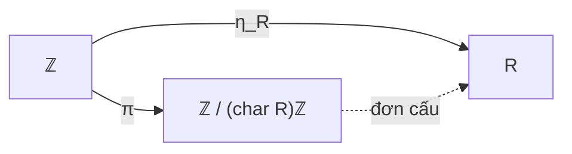

Mỗi vành có phần tử đơn vị đều chứa đựng một "đồng hồ đếm nhịp" bên trong: đó là sự tích lũy của phần tử đơn vị $1_R$ qua phép cộng lặp lại $1_R, 1_R + 1_R, \dots$ Khái niệm **đặc số** ($\operatorname{char} R$) đo lường xem chuỗi cộng này có bao giờ quay trở về phần tử không hay không. 

Bài học này nghiên cứu bản chất đại số của đặc số thông qua đồng cấu đơn vị tự nhiên từ $\mathbb{Z}$, chứng minh định lý nền tảng về đặc số của miền nguyên/trường, giới thiệu tự đồng cấu Frobenius kinh điển trong đặc số nguyên tố, và khép lại bằng bảng đối chiếu tổng thể song song giữa Lý thuyết Nhóm và Lý thuyết Vành.

---

## 1. Đồng cấu đơn vị tự nhiên và Định nghĩa đặc số

Cho $R$ là một vành có phần tử đơn vị $1_R$. Với mỗi số nguyên $n \in \mathbb{Z}$, ta định nghĩa bội nguyên $n \cdot 1_R$ như sau:
$$
n \cdot 1_R = \begin{cases}
\underbrace{1_R + 1_R + \dots + 1_R}_{n \text{ lần}} & \text{nếu } n > 0, \\
0_R & \text{nếu } n = 0, \\
-\underbrace{(1_R + 1_R + \dots + 1_R)}_{-n \text{ lần}} & \text{nếu } n < 0.
\end{cases}
$$

<Proposition id="prop-c8-b3-dong-cau-don-vi" title="Đồng cấu đơn vị tự nhiên" original="Mệnh đề 8.19">
Ánh xạ:
$$
\eta_R: \mathbb{Z} \longrightarrow R, \quad n \longmapsto n \cdot 1_R
$$
là một **đồng cấu vành duy nhất** từ vành số nguyên $\mathbb{Z}$ vào $R$ bảo toàn phần tử đơn vị ($\eta_R(1) = 1_R$).
</Proposition>

<Proof>
Theo quy tắc tính toán của lũy thừa nguyên trong nhóm cộng abel $(R, +)$:
- $\eta_R(m + n) = (m + n) \cdot 1_R = m \cdot 1_R + n \cdot 1_R = \eta_R(m) + \eta_R(n)$.
- $\eta_R(mn) = (mn) \cdot 1_R = (m \cdot 1_R)(n \cdot 1_R) = \eta_R(m)\eta_R(n)$.
- $\eta_R(1) = 1 \cdot 1_R = 1_R$.
Vì $1$ sinh ra nhóm cộng $\mathbb{Z}$, một đồng cấu bảo toàn đơn vị bị xác định duy nhất bởi ảnh của $1$. Vậy $\eta_R$ là duy nhất.
</Proof>

Theo Định lý 8.5, hạt nhân $\ker\eta_R$ là một iđêan của vành số nguyên $\mathbb{Z}$.
Vì mọi iđêan của $\mathbb{Z}$ đều là iđêan chính sinh bởi một số nguyên không âm duy nhất, tồn tại duy nhất một số $n \in \mathbb{N}$ sao cho:
$$
\ker\eta_R = n\mathbb{Z}.
$$
Số nguyên $n$ này chính là **đặc số** của vành $R$.

<Definition id="def-c8-b3-dac-so" title="Đặc số của vành (Characteristic)" original="Định nghĩa 8.20">
Cho $R$ là một vành có phần tử đơn vị $1_R$. **Đặc số** của $R$, ký hiệu là $\operatorname{char}(R)$, được định nghĩa như sau:
1. Nếu tồn tại số nguyên dương $k \ge 1$ sao cho $k \cdot 1_R = 0_R$, thì $\operatorname{char}(R)$ là **số nguyên dương nhỏ nhất** thỏa mãn điều này.
2. Nếu không tồn tại số nguyên dương nào như vậy (nghĩa là $k \cdot 1_R \neq 0_R$ với mọi $k \ge 1$), ta định nghĩa:
$$
\operatorname{char}(R) = 0.
$$
Nói cách khác, $\ker\eta_R = (\operatorname{char} R)\mathbb{Z}$.
</Definition>

Áp dụng Định lý đẳng cấu thứ nhất cho đồng cấu đơn vị $\eta_R$:
$$
\mathbb{Z}/\ker\eta_R \cong \operatorname{im}\eta_R \iff \mathbb{Z}/(\operatorname{char} R)\mathbb{Z} \cong \{n \cdot 1_R \mid n \in \mathbb{Z}\} \subseteq R.
$$
Như vậy, mọi vành có đơn vị $R$ đều chứa một vành con đẳng cấu với $\mathbb{Z}/(\operatorname{char} R)\mathbb{Z}$.

### Các ví dụ tiêu biểu về đặc số
- **Đặc số $0$:** Các tập số quen thuộc $\mathbb{Z}, \mathbb{Q}, \mathbb{R}, \mathbb{C}$ đều có $\operatorname{char} = 0$, vì $n \cdot 1 = n \neq 0$ với mọi $n \ge 1$. Vành đa thức $F[x]$ trên trường $F$ có $\operatorname{char}(F[x]) = \operatorname{char}(F)$.
- **Đặc số $n > 0$:**
  - Vành các lớp thặng dư $\mathbb{Z}/n\mathbb{Z} = \mathbb{Z}/n\mathbb{Z}$ có $\operatorname{char}(\mathbb{Z}/n\mathbb{Z}) = n$.
  - Vành ma trận $M_m(\mathbb{Z}/n\mathbb{Z})$ có đặc số bằng $n$.
  - Vành tích $R \times S$ có $\operatorname{char}(R \times S) = \operatorname{lcm}(\operatorname{char} R, \operatorname{char} S)$ (nếu cả hai đều khác $0$).

---

## 2. Đặc số của Miền nguyên và Trường

<Theorem id="thm-c8-b3-dac-so-mien-nguyen" title="Đặc số của miền nguyên và trường" original="Định lý 8.21">
Nếu $R$ là một **miền nguyên** (đặc biệt nếu $R$ là một **trường**) thì đặc số của $R$ chỉ có thể là **$0$** hoặc một **số nguyên tố $p$**.
</Theorem>

<Proof>
Giả sử $R$ là một miền nguyên. Khi đó $R$ không có ước của không khác $0$, và $1_R \neq 0_R$.
Đặt $n = \operatorname{char}(R)$. Ta chứng minh $n$ không thể là một hợp số:

Phản chứng: Giả sử $n > 0$ và $n$ là một hợp số. Khi đó tồn tại hai số nguyên $a, b$ sao cho:
$$
n = a \cdot b \quad \text{với } 1 < a < n \text{ và } 1 < b < n.
$$
Theo tính chất phân phối của phép nhân trong vành:
$$
(a \cdot 1_R) \cdot (b \cdot 1_R) = (ab) \cdot (1_R \cdot 1_R) = (ab) \cdot 1_R = n \cdot 1_R.
$$
Vì $\operatorname{char}(R) = n$, ta có $n \cdot 1_R = 0_R$. Do đó:
$$
(a \cdot 1_R) \cdot (b \cdot 1_R) = 0_R.
$$
Vì $R$ là miền nguyên, tích của hai phần tử bằng $0_R$ bắt buộc ít nhất một trong hai phần tử phải bằng $0_R$:
$$
a \cdot 1_R = 0_R \quad \text{hoặc} \quad b \cdot 1_R = 0_R.
$$
Tuy nhiên:
- $1 < a < n$, nên $a \cdot 1_R = 0_R$ mâu thuẫn với tính nhỏ nhất của $n = \operatorname{char}(R)$.
- $1 < b < n$, nên $b \cdot 1_R = 0_R$ cũng mâu thuẫn với tính nhỏ nhất của $n = \operatorname{char}(R)$.

Mâu thuẫn này chứng tỏ $n$ không thể là hợp số.
Vậy $n = 0$ hoặc $n = p$ là một số nguyên tố.
</Proof>

---

## 3. Tự đồng cấu Frobenius trong đặc số nguyên tố $p$

Trong các vành giao hoán có đặc số nguyên tố $p$, xảy ra một hiện tượng giải tích kỳ diệu: lũy thừa bậc $p$ biến thành một phép toán tuyến tính phân phối qua phép cộng!

<Theorem id="thm-c8-b3-dong-cau-frobenius" title="Tự đồng cấu Frobenius" original="Định lý 8.22">
Cho $R$ là một vành giao hoán có đơn vị với đặc số $\operatorname{char}(R) = p$ là một số nguyên tố. Khi đó:
1. Với mọi $a, b \in R$:
$$
(a + b)^p = a^p + b^p.
$$
2. Ánh xạ $\Phi: R \to R$ định bởi $\Phi(x) = x^p$ là một đồng cấu vành bảo toàn đơn vị, được gọi là **tự đồng cấu Frobenius** (Frobenius endomorphism).
3. Nếu $R$ là một miền nguyên, $\Phi$ là một **đơn cấu**.
4. Nếu $R$ là một trường hữu hạn, $\Phi$ là một **tự đẳng cấu** (Frobenius automorphism).
</Theorem>

<Proof>
1. **Chứng minh $(a+b)^p = a^p + b^p$:**
   Vì $R$ giao hoán, ta áp dụng công thức khai triển nhị thức Newton:
   $$
   (a + b)^p = \sum_{k=0}^p \binom{p}{k} a^{p-k} b^k = a^p + \left( \sum_{k=1}^{p-1} \binom{p}{k} a^{p-k} b^k \right) + b^p.
   $$
   Hệ số nhị thức là $\binom{p}{k} = \frac{p!}{k!(p-k)!}$.
   Với mọi $1 \le k \le p - 1$, vì $p$ là số nguyên tố và mẫu số $k!(p-k)!$ chỉ gồm các thừa số nhỏ hơn $p$, thừa số nguyên tố $p$ ở tử số không bị triệt tiêu. Do đó:
   $$
   p \mid \binom{p}{k} \quad \forall k \in \{1, 2, \dots, p - 1\}.
   $$
   Vì $\operatorname{char}(R) = p$, ta có $p \cdot x = 0_R$ với mọi $x \in R$. Suy ra:
   $$
   \binom{p}{k} a^{p-k} b^k = 0_R \quad \forall k \in \{1, 2, \dots, p - 1\}.
   $$
   Do đó toàn bộ các số hạng ở giữa đều triệt tiêu, chỉ còn lại:
   $$
   (a + b)^p = a^p + b^p.
   $$

2. **$\Phi$ là đồng cấu vành:**
   - $\Phi(a + b) = (a + b)^p = a^p + b^p = \Phi(a) + \Phi(b)$.
   - $\Phi(ab) = (ab)^p = a^p b^p = \Phi(a)\Phi(b)$ (do $R$ giao hoán).
   - $\Phi(1_R) = 1_R^p = 1_R$.
   Vậy $\Phi$ là một đồng cấu vành bảo toàn đơn vị.

3. **Tính đơn ánh trên miền nguyên:**
   Giả sử $x \in \ker\Phi$. Khi đó $\Phi(x) = x^p = 0_R$.
   Vì $R$ là miền nguyên (không có ước của không), phương trình $x^p = 0_R$ dẫn tới $x = 0_R$.
   Vậy $\ker\Phi = \{0_R\}$, suy ra $\Phi$ là một đơn ánh.

4. **Tính toàn ánh trên trường hữu hạn:**
   Nếu $R = F$ là một trường hữu hạn, $\Phi: F \to F$ là một đơn ánh giữa hai tập hợp hữu hạn có cùng số phần tử. Theo nguyên lý Dirichlet, $\Phi$ bắt buộc phải là một toàn ánh. Do đó $\Phi$ là một đẳng cấu vành.
</Proof>

---

## 4. Bảng đối chiếu tổng thể song song Nhóm và Vành

Bảng dưới đây tổng kết toàn bộ kiến thức tương ứng giữa cấu trúc Nhóm (Phần I) và cấu trúc Vành (Phần II) đã học trong suốt 8 chương vừa qua:

| Khái niệm trong Lý thuyết Nhóm (Phần I) | Khái niệm tương ứng trong Lý thuyết Vành (Phần II) | Điểm tương đồng và khác biệt bản chất |
| :--- | :--- | :--- |
| **Nhóm** $(G, \cdot)$ | **Vành** $(R, +, \cdot)$ | Nhóm có 1 phép toán; Vành có 2 phép toán liên kết qua luật phân phối. |
| **Nhóm con** $H \le G$ | **Vành con** $S \subseteq R$ | Đóng với các phép toán nội tại của cấu trúc con. |
| **Nhóm con chuẩn tắc** $N \trianglelefteq G$ ($gN = Ng$) | **Iđêan hai phía** $I \triangleleft R$ ($rI \subseteq I$ và $Ir \subseteq I$) | Là điều kiện cần và đủ để phép toán cảm sinh trên tập thương xác định tốt. |
| **Nhóm thương** $G/N = \{aN\}$ | **Vành thương** $R/I = \{a + I\}$ | Các phần tử là các lớp tương đương; phép toán thực hiện trên đại diện. |
| **Đồng cấu nhóm** $\phi(ab) = \phi(a)\phi(b)$ | **Đồng cấu vành** $f(a+b) = f(a)+f(b)$, $f(ab) = f(a)f(b)$ | Đồng cấu vành phải bảo toàn đồng thời cả hai phép toán. |
| **Hạt nhân** $\ker\phi \trianglelefteq G$ | **Hạt nhân** $\ker f \triangleleft R$ | Hạt nhân luôn luôn là cấu trúc thương chuẩn mực (chuẩn tắc / iđêan). |
| **Định lý Đẳng cấu I:** $G/\ker\phi \cong \operatorname{im}\phi$ | **Định lý Đẳng cấu I:** $R/\ker f \cong \operatorname{im} f$ | Đồng nhất tập thương hạt nhân với ảnh đồng cấu. |
| **Định lý Đẳng cấu II:** $(HN)/N \cong H/(H \cap N)$ | **Định lý Đẳng cấu II:** $(S + I)/I \cong S/(S \cap I)$ | Cắt lớp giữa vành con/nhóm con với iđêan/nhóm chuẩn tắc. |
| **Định lý Đẳng cấu III:** $(G/N)/(M/N) \cong G/M$ | **Định lý Đẳng cấu III:** $(R/I)/(J/I) \cong R/J$ | Rút gọn thương hai tầng liên tiếp ($N \subseteq M$, $I \subseteq J$). |
| **Cấp của phần tử** $\operatorname{ord}(a)$ | **Đặc số của vành** $\operatorname{char}(R)$ | Cấp đo lường phép nhân nhóm; Đặc số đo lường bội nguyên của đơn vị $1_R$. |
| **Nhóm đơn:** Không có nhóm chuẩn tắc chân phương | **Vành đơn:** Không có iđêan hai phía chân phương | Vành giao hoán đơn có 1 bắt buộc là một trường; Nhóm giao hoán đơn là $\mathbb{Z}/p\mathbb{Z}$. |

---

## 5. Hệ thống bài tập 4 phân lớp kèm lời giải chi tiết

<Exercise id="ex-c8-b3-a1" title="Tính đặc số của các vành cụ thể" group="Nhóm A">
Xác định đặc số của các vành sau:
1. $R_1 = \mathbb{Z}/4\mathbb{Z} \times \mathbb{Z}/6\mathbb{Z}$.
2. $R_2 = M_3(\mathbb{Z}/7\mathbb{Z})$.
3. $R_3 = \mathbb{Q}[x]/(x^3 - 5)$.
4. $R_4 = \mathbb{Z}[x]/(x^2 + 2, 5)$.

<Solution>
Ta tìm số nguyên dương nhỏ nhất $n$ sao cho $n \cdot 1 = 0$:

**1. Vành $R_1 = \mathbb{Z}/4\mathbb{Z} \times \mathbb{Z}/6\mathbb{Z}$**

Phần tử đơn vị là $1_{R_1} = ([1], [1])$.
   $$
   n \cdot ([1], [1]) = (n \cdot [1], n \cdot [1]) = ([0], [0]) \iff 4 \mid n \text{ và } 6 \mid n \iff \operatorname{lcm}(4, 6) \mid n.
   $$
   Vì $\operatorname{lcm}(4, 6) = 12$, số nguyên dương nhỏ nhất là $12$. Vậy $\operatorname{char}(R_1) = 12$.

**2. Vành $R_2 = M_3(\mathbb{Z}/7\mathbb{Z})$**

Phần tử đơn vị là ma trận đơn vị $I_3$. Ta có $n \cdot I_3 = 0 \iff n \equiv 0 \pmod 7$.
   Số nguyên dương nhỏ nhất là $7$. Vậy $\operatorname{char}(R_2) = 7$.

**3. Vành $R_3 = \mathbb{Q}[x]/(x^3 - 5)$**

Đa thức $x^3 - 5$ bất khả quy trên $\mathbb{Q}$ theo tiêu chuẩn Eisenstein với $p = 5$. Do đó $R_3 \cong \mathbb{Q}(\sqrt[3]{5})$ là một trường mở rộng của $\mathbb{Q}$.
   Vì $\mathbb{Q} \subseteq R_3$ và $\operatorname{char}(\mathbb{Q}) = 0$, ta có $n \cdot 1 \neq 0$ với mọi $n \ge 1$.
   Vậy $\operatorname{char}(R_3) = 0$.

**4. Vành $R_4 = \mathbb{Z}[x]/(x^2 + 2, 5)$**

Trong vành thương này, $5 \equiv 0$, do đó $5 \cdot 1 = 0$.
   Mặt khác $1, 2, 3, 4$ không chia hết cho $5$ nên $k \cdot 1 \neq 0$ với mọi $1 \le k \le 4$.
   Vậy $\operatorname{char}(R_4) = 5$.
</Solution>
</Exercise>

<Exercise id="ex-c8-b3-a2" title="Tính chất hấp thụ của đặc số lên toàn bộ vành" group="Nhóm A">
Cho $R$ là một vành có phần tử đơn vị với $\operatorname{char}(R) = n > 0$.
Chứng minh rằng $n \cdot x = 0_R$ với mọi phần tử $x \in R$.

<Solution>
Lấy bất kỳ $x \in R$. Theo tính chất của phép nhân với phần tử đơn vị $1_R$:
$$
x = 1_R \cdot x.
$$
Do đó:
$$
n \cdot x = n \cdot (1_R \cdot x) = (n \cdot 1_R) \cdot x.
$$
Vì $\operatorname{char}(R) = n$, theo định nghĩa ta có $n \cdot 1_R = 0_R$. Suy ra:
$$
n \cdot x = 0_R \cdot x = 0_R.
$$
Đẳng thức này đúng với mọi $x \in R$.
</Solution>
</Exercise>

<Exercise id="ex-c8-b3-b1" title="Đặc số và tính giao hoán của Vành Boole" group="Nhóm B">
Một vành $R$ có phần tử đơn vị được gọi là **vành Boole** (Boolean ring) nếu mọi phần tử $x \in R$ đều thỏa mãn tính chất lũy đẳng: $x^2 = x$.
1. Chứng minh rằng $\operatorname{char}(R) = 2$.
2. Chứng minh rằng $R$ bắt buộc phải là một vành giao hoán.

<Solution>
**1. Chứng minh $\operatorname{char}(R) = 2$**

Lấy $x = 1_R + 1_R \in R$. Vì mọi phần tử trong $R$ đều lũy đẳng:
$$
(1_R + 1_R)^2 = 1_R + 1_R.
$$
Mặt khác, khai triển vế trái bằng tính phân phối:
$$
(1_R + 1_R)^2 = 1_R^2 + 1_R \cdot 1_R + 1_R \cdot 1_R + 1_R^2 = 1_R + 1_R + 1_R + 1_R.
$$
Do đó:
$$
1_R + 1_R + 1_R + 1_R = 1_R + 1_R.
$$
Cộng nghịch đảo của $1_R + 1_R$ vào hai vế trong nhóm cộng $(R, +)$:
$$
1_R + 1_R = 0_R \iff 2 \cdot 1_R = 0_R.
$$
Vì $1_R \neq 0_R$ (vành Boole không tầm thường), số nguyên dương nhỏ nhất triệt tiêu $1_R$ là $2$.
Vậy $\operatorname{char}(R) = 2$.
Đặc biệt, từ $2x = 0$ ta suy ra $-x = x$ với mọi $x \in R$.

**2. Chứng minh $R$ giao hoán**

Lấy hai phần tử $a, b \in R$ bất kỳ. Áp dụng tính chất lũy đẳng cho phần tử $a + b$:
$$
(a + b)^2 = a + b.
$$
Khai triển vế trái:
$$
(a + b)^2 = a^2 + ab + ba + b^2 = a + ab + ba + b.
$$
Do đó:
$$
a + ab + ba + b = a + b.
$$
Giản ước $a$ và $b$ ở hai vế:
$$
ab + ba = 0_R \iff ab = -ba.
$$
Vì trong đặc số 2, ta có $-ba = ba$, ta kết luận:
$$
ab = ba.
$$
Vì đẳng thức đúng với mọi $a, b \in R$, $R$ là một vành giao hoán.
</Solution>
</Exercise>

<Exercise id="ex-c8-b3-b2" title="Tính toán với tự đồng cấu Frobenius" group="Nhóm B">
Trong vành đa thức $\mathbb{F}_5[x, y]$ gồm hai biến trên trường $\mathbb{F}_5$:
1. Khai triển rút gọn biểu thức $(x + 2y)^5$.
2. Cho $R$ là một miền nguyên có đặc số $p$. Chứng minh rằng nếu $a^p = b^p$ thì $a = b$.

<Solution>
**1. Khai triển $(x + 2y)^5$**

Vì trường $\mathbb{F}_5$ có đặc số $p = 5$ và vành $\mathbb{F}_5[x, y]$ giao hoán, áp dụng Định lý 8.22:
   $$
   (x + 2y)^5 = x^5 + (2y)^5 = x^5 + 2^5 y^5.
   $$
   Theo Định lý Fermat nhỏ trên trường $\mathbb{F}_5$: $2^5 = 32 \equiv 2 \pmod 5$.
   Do đó:
   $$
   (x + 2y)^5 = x^5 + 2y^5.
   $$

**2. Chứng minh $a^p = b^p \implies a = b$ trên miền nguyên $R$**

Theo Định lý 8.22, tự đồng cấu Frobenius $\Phi(x) = x^p$ bảo toàn phép trừ:
   $$
   a^p = b^p \iff a^p - b^p = 0 \iff (a - b)^p = 0.
   $$
   Vì $R$ là một miền nguyên, $R$ không có phần tử lũy linh khác không (nếu $u^p = 0$ thì $u = 0$).
   Áp dụng điều này với $u = a - b$, ta suy ra:
   $$
   a - b = 0 \iff a = b.
   $$
</Solution>
</Exercise>

<Exercise id="ex-c8-b3-c1" title="Cấu trúc trường con nguyên tố theo đặc số" group="Nhóm C">
Chứng minh rằng:
1. Mọi trường $F$ có đặc số $\operatorname{char}(F) = 0$ đều chứa một trường con đẳng cấu với trường số hữu tỉ $\mathbb{Q}$.
2. Mọi trường $F$ có đặc số $\operatorname{char}(F) = p > 0$ đều chứa một trường con đẳng cấu với trường hữu hạn $\mathbb{F}_p = \mathbb{Z}/p\mathbb{Z}$.

<Solution>
Xét đồng cấu đơn vị tự nhiên $\eta_F: \mathbb{Z} \to F, n \mapsto n \cdot 1_F$.
Theo Định lý đẳng cấu thứ nhất: $\mathbb{Z}/\ker\eta_F \cong \operatorname{im}\eta_F \subseteq F$.

**1. Trường hợp $\operatorname{char}(F) = 0$**

   Khi đó $\ker\eta_F = \{0\}$, nên $\eta_F$ là một đơn cấu. Vành con $\operatorname{im}\eta_F \cong \mathbb{Z}$.
   Do đó $F$ chứa một bản sao đẳng cấu của vành số nguyên $\mathbb{Z}$:
   $$
   \mathbb{Z} \cdot 1_F = \{n \cdot 1_F \mid n \in \mathbb{Z}\} \subseteq F.
   $$
   Vì $F$ là một trường, với mọi số nguyên $m \neq 0$, phần tử $m \cdot 1_F \neq 0$ có phần tử nghịch đảo $(m \cdot 1_F)^{-1} \in F$.
   Xét tập hợp các thương:
   $$
   K = \left\{ \frac{n \cdot 1_F}{m \cdot 1_F} = (n \cdot 1_F)(m \cdot 1_F)^{-1} \;\middle|\; n, m \in \mathbb{Z}, m \neq 0 \right\} \subseteq F.
   $$
   Vì $K$ đóng kín dưới phép trừ, phép nhân và phép lấy nghịch đảo của mọi phần tử khác không (và mọi trường con chứa $1_F$ đều phải chứa $\mathbb{Z} \cdot 1_F$ cùng các thương của chúng), $K$ chính là trường con nhỏ nhất của $F$ chứa $1_F$.
   Ánh xạ $\psi: \mathbb{Q} \to K, \frac{n}{m} \mapsto (n \cdot 1_F)(m \cdot 1_F)^{-1}$ là một đẳng cấu trường. Vậy $F$ chứa trường con đẳng cấu với $\mathbb{Q}$.

**2. Trường hợp $\operatorname{char}(F) = p > 0$**

   Theo Định lý 8.21, $p$ phải là số nguyên tố.
   Khi đó $\ker\eta_F = p\mathbb{Z}$, nên:
   $$
   \operatorname{im}\eta_F \cong \mathbb{Z}/p\mathbb{Z} = \mathbb{F}_p.
   $$
   Vì $p$ nguyên tố, $\mathbb{Z}/p\mathbb{Z}$ đã là một trường.
   Do đó bản thân $\operatorname{im}\eta_F = \{0 \cdot 1_F, 1 \cdot 1_F, \dots, (p - 1) \cdot 1_F\}$ là một trường con của $F$ đẳng cấu với $\mathbb{F}_p$.
</Solution>
</Exercise>

<Exercise id="ex-c8-b3-c2" title="Đơn cấu Frobenius và tính hoàn hảo" group="Nhóm C">
Một trường $K$ có đặc số $p > 0$ được gọi là **trường hoàn hảo** (perfect field) nếu tự đồng cấu Frobenius $\Phi: K \to K, x \mapsto x^p$ là một toàn ánh.
1. Chứng minh rằng mọi trường hữu hạn đều là trường hoàn hảo.
2. Cho ví dụ về một trường vô hạn có đặc số $p$ không phải là trường hoàn hảo.

<Solution>
**1. Mọi trường hữu hạn đều hoàn hảo**

Cho $K$ là trường hữu hạn có đặc số $p$.
   Theo Định lý 8.22, $\Phi: K \to K, x \mapsto x^p$ là một đơn cấu vì $K$ là trường.
   Vì $K$ là tập hữu hạn, mọi đơn ánh từ $K$ vào chính nó đều là toàn ánh.
   Do đó $\Phi$ là toàn ánh, chứng minh $K$ là trường hoàn hảo (mọi phần tử của $K$ đều có căn bậc $p$ duy nhất trong $K$).

**2. Trường không hoàn hảo**

Xét trường các phân thức hữu tỉ $K = \mathbb{F}_p(t)$ gồm các phân thức $P(t)/Q(t)$ với biến $t$ trên trường $\mathbb{F}_p$.
   - Ảnh của tự đồng cấu Frobenius là:
     $$
     \Phi(K) = K^p = \{f(t)^p \mid f(t) \in \mathbb{F}_p(t)\} = \mathbb{F}_p(t^p).
     $$
   - Xét phần tử $t \in K$. Giả sử tồn tại $f(t) \in K$ sao cho $f(t)^p = t$. Khi đó bậc của vế trái đối với $t$ là $p \cdot \deg f$, trong khi bậc của vế phải là $1$. Vì $p \ge 2$, phương trình $p \cdot \deg f = 1$ không có nghiệm nguyên!
   - Do đó $t \notin K^p$, chứng tỏ $\Phi$ không phải là toàn ánh.
   Vậy trường vô hạn $\mathbb{F}_p(t)$ không phải là trường hoàn hảo.
</Solution>
</Exercise>

<Exercise id="ex-c8-b3-d1" title="Định lý tự đẳng cấu Frobenius trên trường hữu hạn" group="Nhóm D">
Cho $F$ là trường hữu hạn gồm $q = p^n$ phần tử ($n \ge 1$).
1. Chứng minh rằng $\Phi^n = \operatorname{id}_F$, nghĩa là $x^{p^n} = x$ với mọi $x \in F$.
2. Chứng minh rằng nhóm các tự đẳng cấu trường của $F$ cố định $\mathbb{F}_p$ là một nhóm cyclic cấp $n$ sinh bởi $\Phi$:
$$
\operatorname{Gal}(F/\mathbb{F}_p) = \langle \Phi \rangle \cong \mathbb{Z}/n\mathbb{Z}.
$$

<Solution>
**1. Chứng minh $x^{p^n} = x$**

   Nhóm nhân các phần tử khả nghịch $F^\times = F \setminus \{0\}$ là một nhóm abel hữu hạn có cấp $|F^\times| = q - 1 = p^n - 1$.
   Theo Định lý Lagrange cho nhóm nhân, với mọi $x \in F^\times$:
   $$
   x^{q - 1} = 1 \iff x^q = x \iff x^{p^n} = x.
   $$
   Với $x = 0$, ta cũng có $0^{p^n} = 0$.
   Do đó $x^{p^n} = x$ đúng với mọi $x \in F$.
   Điều này có nghĩa là $\Phi^n(x) = x$, tức $\Phi^n = \operatorname{id}_F$.

**2. Cấp của $\Phi$ và nhóm Galois**

   Nếu tồn tại $k < n$ sao cho $\Phi^k = \operatorname{id}_F$, thì phương trình $x^{p^k} - x = 0$ có $p^n$ nghiệm trong $F$. Nhưng một đa thức bậc $p^k$ trên trường $F$ có tối đa $p^k$ nghiệm. Vì $p^k < p^n$, điều này là vô lý.
   Do đó, cấp của phần tử $\Phi$ trong nhóm tự đẳng cấu là đúng bằng $n$.
   Từ lý thuyết trường (Định lý Dedekind về tính độc lập tuyến tính của các ký tự), số lượng tự đẳng cấu của mở rộng bậc $n$ không vượt quá $n$.
   Vì nhóm chứa nhóm con cyclic cấp $n$ sinh bởi $\Phi$, ta kết luận nhóm toàn thể là nhóm cyclic cấp $n$:
   $$
   \operatorname{Aut}(F) = \langle \Phi \rangle = \{\operatorname{id}, \Phi, \Phi^2, \dots, \Phi^{n-1}\} \cong \mathbb{Z}/n\mathbb{Z}.
   $$
</Solution>
</Exercise>

<Exercise id="ex-c8-b3-d2" title="Phân biệt bản chất Vành đơn và Nhóm đơn" group="Nhóm D">
So sánh cấu trúc giao hoán đơn giữa lý thuyết nhóm và lý thuyết vành:
1. Chứng minh rằng nếu $G$ là một nhóm giao hoán đơn thì $G \cong \mathbb{Z}/p\mathbb{Z}$ với $p$ nguyên tố.
2. Chứng minh rằng nếu $R$ là một vành giao hoán đơn có đơn vị ($R \neq \{0\}$) thì $R$ bắt buộc phải là một **trường**.
3. Hãy giải thích vì sao định nghĩa của vành đơn không xét iđêan một phía mà bắt buộc phải xét iđêan hai phía.

<Solution>
**1. Nhóm giao hoán đơn**

   Giả sử $G$ là nhóm giao hoán đơn. Vì $G$ giao hoán, mọi nhóm con của $G$ đều là nhóm con chuẩn tắc.
   Do $G$ đơn, $G$ không có nhóm con chân phương nào ngoài $\{e\}$ và $G$.
   Lấy $x \in G, x \neq e$. Nhóm con cyclic $\langle x \rangle$ là nhóm con khác $\{e\}$, nên $\langle x \rangle = G$. Do đó $G$ là nhóm cyclic.
   Nếu $G$ vô hạn ($G \cong \mathbb{Z}$), thì $2\mathbb{Z}$ là nhóm con chân phương khác $\{0\}$, mâu thuẫn.
   Vậy $G$ hữu hạn, $G \cong \mathbb{Z}/n\mathbb{Z}$. Nếu $n$ là hợp số có ước $d$, thì $d\mathbb{Z}/n\mathbb{Z}$ là nhóm con chân phương, mâu thuẫn. Vậy $n = p$ là số nguyên tố, $G \cong \mathbb{Z}/p\mathbb{Z}$.

**2. Vành giao hoán đơn có đơn vị là một trường**

   Giả sử $R$ là vành giao hoán có đơn vị $1 \neq 0$ không có iđêan chân phương nào ngoài $\{0\}$ và $R$.
   Lấy bất kỳ phần tử $a \in R$ sao cho $a \neq 0$.
   Xét iđêan chính sinh bởi $a$:
   $$
   I = (a) = Ra.
   $$
   Vì $a = 1 \cdot a \in I$ và $a \neq 0$, ta có $I \neq \{0\}$.
   Vì $R$ là vành đơn, các iđêan duy nhất là $\{0\}$ và $R$, do đó:
   $$
   (a) = R.
   $$
   Vì $1 \in R = (a)$, tồn tại phần tử $r \in R$ sao cho:
   $$
   r \cdot a = 1.
   $$
   Vì $R$ giao hoán, $ar = ra = 1$, nghĩa là $a$ có phần tử nghịch đảo nhân trong $R$.
   Vì mọi phần tử khác không đều khả nghịch, $R$ là một **trường**.

**3. Vì sao định nghĩa vành đơn đòi hỏi iđêan hai phía**

   Mục đích của khái niệm "đơn" (simple) trong đại số là xác định các khối cấu trúc nền tảng không thể phân rã tiếp qua cấu trúc thương.
   Trong lý thuyết vành, một vành thương $R/I$ chỉ được định nghĩa tốt khi $I$ là **iđêan hai phía** (Định lý 7.11).
   Nếu chỉ xét iđêan một phía, một vành ma trận $M_n(F)$ trên trường $F$ ($n \ge 2$) có rất nhiều iđêan trái (chẳng hạn tập các ma trận có một cột bằng $0$), nhưng nó hoàn toàn không có iđêan hai phía chân phương nào. Do đó $M_n(F)$ không thể phân rã thành vành thương nhỏ hơn. Định nghĩa vành đơn bằng iđêan hai phía phản ánh chính xác tính bất khả phân rã này.
</Solution>
</Exercise>

---

## 6. Tóm tắt trọng tâm bài học

<KeyTakeaways>
- **Đặc số $\operatorname{char}(R)$:** Là số nguyên không âm $n$ sinh ra hạt nhân của đồng cấu đơn vị duy nhất $\eta_R: \mathbb{Z} \to R, 1 \mapsto 1_R$, tức $\ker\eta_R = n\mathbb{Z}$. Nếu $n \cdot 1_R = 0_R$ với $n > 0$, đặc số là số nguyên dương nhỏ nhất; ngược lại $\operatorname{char}(R) = 0$.
- **Định lý 8.21:** Đặc số của một **miền nguyên** hoặc **trường** bắt buộc phải bằng $0$ hoặc là một số nguyên tố $p$.
- **Tự đồng cấu Frobenius:** Trong đặc số $p$ nguyên tố trên vành giao hoán, $(a+b)^p = a^p + b^p$, và ánh xạ $\Phi(x) = x^p$ là một đồng cấu vành. Trên trường hữu hạn, Frobenius là một tự đẳng cấu.
- **Trường con nguyên tố:** Mọi trường đặc số $0$ chứa bản sao của $\mathbb{Q}$; mọi trường đặc số $p$ chứa bản sao của $\mathbb{F}_p$.
- **Đối chiếu tổng thể:** Iđêan hai phía trong vành tương ứng hoàn toàn với nhóm con chuẩn tắc trong nhóm.
</KeyTakeaways>
