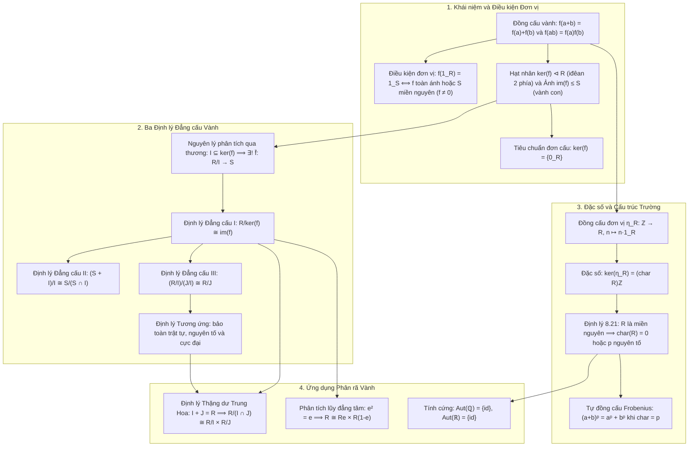

Chương 8 là đỉnh cao tích hợp của Phần II (Lý thuyết Vành) trong học phần Cấu trúc đại số. Bằng việc kết hợp điều kiện bảo toàn hai phép toán của **đồng cấu vành**, cấu trúc **vành thương** $R/I$ từ Chương 7, và bất biến **đặc số** $\operatorname{char}(R)$, chúng ta thu được bức tranh toàn cảnh về cách các vành tương tác, phân rã và đẳng cấu với nhau.

Bài học tổng kết này cung cấp sơ đồ tư duy hoàn chỉnh, bảng thuật ngữ song ngữ, các kết quả nâng cao chọn lọc (tính cứng của $\mathbb{R}$, Định lý Thặng dư Trung Hoa, phân tích lũy đẳng tâm) và hệ thống bài tập 4 phân lớp A–B–C–D bám sát các đề thi học phần chuẩn sư phạm.

---

## 1. Bản đồ tư duy hệ thống kiến thức Chương 8

Sơ đồ dưới đây xâu chuỗi toàn bộ các định lý và khái niệm trung tâm của Chương 8:

---

## 2. Bảng thuật ngữ song ngữ đối chiếu

Bảng dưới đây chuẩn hóa các thuật ngữ toán học trọng tâm của Chương 8 giữa tiếng Việt và tiếng Anh học thuật:

| Thuật ngữ tiếng Việt | Thuật ngữ tiếng Anh | Định nghĩa / Ký hiệu cốt lõi |
| :--- | :--- | :--- |
| **Đồng cấu vành** | *Ring homomorphism* | Ánh xạ bảo toàn hai phép toán: $f(a+b) = f(a)+f(b)$, $f(ab) = f(a)f(b)$ |
| **Đồng cấu bảo toàn đơn vị** | *Unital homomorphism* | Đồng cấu thỏa mãn thêm $f(1_R) = 1_S$ |
| **Đẳng cấu vành** | *Ring isomorphism* | Đồng cấu vành song ánh ($R \cong S$) |
| **Tự đẳng cấu vành** | *Ring automorphism* | Đẳng cấu từ một vành vào chính nó ($\operatorname{Aut}(R)$) |
| **Hạt nhân** | *Kernel* | $\ker f = \{x \in R \mid f(x) = 0_S\}$, luôn là iđêan hai phía của $R$ |
| **Ảnh** | *Image* | $\operatorname{im} f = \{f(x) \mid x \in R\}$, luôn là vành con của $S$ |
| **Định lý Đẳng cấu thứ nhất** | *First Isomorphism Theorem* | $R/\ker f \cong \operatorname{im} f$ |
| **Định lý Đẳng cấu thứ hai** | *Second Isomorphism Theorem* | $(S + I)/I \cong S/(S \cap I)$ |
| **Định lý Đẳng cấu thứ ba** | *Third Isomorphism Theorem* | $(R/I)/(J/I) \cong R/J$ |
| **Định lý tương ứng** | *Correspondence Theorem* | Song ánh bảo toàn thứ tự giữa các iđêan của $R/I$ và các iđêan chứa $I$ |
| **Đặc số của vành** | *Characteristic of a ring* | Số $n \ge 0$ nhỏ nhất sao cho $n \cdot 1_R = 0_R$, ký hiệu $\operatorname{char}(R)$ |
| **Đồng cấu Frobenius** | *Frobenius endomorphism* | Ánh xạ $\Phi(x) = x^p$ trong vành giao hoán đặc số nguyên tố $p$ |
| **Iđêan đồng nguyên tố** | *Comaximal ideals* | Hai iđêan thỏa mãn $I + J = R$ |
| **Phần tử lũy đẳng tâm** | *Central idempotent* | Phần tử $e \in Z(R)$ thỏa mãn $e^2 = e$ |

---

## 3. Các định lý nâng cao chọn lọc

<Theorem id="thm-c8-b4-tinh-cung-so-thuc">
### Định lý 8.23: Tính cứng của trường số thực (Rigidity of $\mathbb{R}$)
Nhóm các tự đẳng cấu vành của trường số thực $\mathbb{R}$ là nhóm tầm thường, nghĩa là tự đẳng cấu duy nhất của $\mathbb{R}$ là ánh xạ đồng nhất:
$$
\operatorname{Aut}(\mathbb{R}) = \{\operatorname{id}_{\mathbb{R}}\}.
$$
</Theorem>

<Proof>
Giả sử $\sigma: \mathbb{R} \to \mathbb{R}$ là một tự đẳng cấu vành. Ta thực hiện chứng minh qua 4 bước:

1. **Cố định trường số hữu tỉ $\mathbb{Q}$:**
   Theo Bài 8.1.D1, mọi đồng cấu bảo toàn đơn vị từ $\mathbb{Q}$ vào một trường đều cố định $\mathbb{Q}$. Vì $\mathbb{Q} \subseteq \mathbb{R}$, ta có $\sigma(q) = q$ với mọi $q \in \mathbb{Q}$.

2. **Bảo toàn tính dương:**
   Lấy bất kỳ số thực $x > 0$. Khi đó tồn tại $y \in \mathbb{R}, y \neq 0$ sao cho $x = y^2$.
   Tác động $\sigma$:
   $$
   \sigma(x) = \sigma(y^2) = [\sigma(y)]^2.
   $$
   Vì $\sigma$ là song ánh và $y \neq 0$, ta có $\sigma(y) \neq 0$. Trong trường $\mathbb{R}$, bình phương của một số thực khác không luôn luôn dương.
   Do đó $\sigma(x) > 0$.

3. **Bảo toàn quan hệ thứ tự trên $\mathbb{R}$:**
   Với mọi $x, y \in \mathbb{R}$ sao cho $x < y$, ta có $y - x > 0$.
   Theo bước 2: $\sigma(y - x) > 0 \iff \sigma(y) - \sigma(x) > 0 \iff \sigma(x) < \sigma(y)$.
   Vậy $\sigma$ là một ánh xạ đồng biến nghiêm ngặt (bảo toàn thứ tự).

4. **Trù mật của $\mathbb{Q}$ kéo theo $\sigma = \operatorname{id}_{\mathbb{R}}$:**
   Lấy bất kỳ $x \in \mathbb{R}$. Phản chứng: giả sử $\sigma(x) \neq x$.
   - Nếu $\sigma(x) < x$: Do tập số hữu tỉ $\mathbb{Q}$ trù mật trong $\mathbb{R}$, tồn tại số hữu tỉ $q \in \mathbb{Q}$ sao cho:
     $$
     \sigma(x) < q < x.
     $$
     Vì $\sigma$ bảo toàn thứ tự, từ $q < x$ suy ra $\sigma(q) < \sigma(x)$.
     Mặt khác $\sigma(q) = q$ (theo bước 1), dẫn tới $q < \sigma(x)$, mâu thuẫn với $\sigma(x) < q$!
   - Nếu $x < \sigma(x)$: Chứng minh tương tự chọn $q \in \mathbb{Q}$ thỏa mãn $x < q < \sigma(x)$ cũng dẫn đến mâu thuẫn.

Vậy ta bắt buộc phải có $\sigma(x) = x$ với mọi $x \in \mathbb{R}$, tức $\sigma = \operatorname{id}_{\mathbb{R}}$.
</Proof>

<Theorem id="thm-c8-b4-phan-tich-luy-dang-tam">
### Định lý 8.24: Phân tích tích trực tiếp qua phần tử lũy đẳng tâm
Cho $R$ là một vành có phần tử đơn vị $1$. Vành $R$ đẳng cấu với tích trực tiếp của hai vành $R_1 \times R_2$ khi và chỉ khi tồn tại một phần tử lũy đẳng tâm không tầm thường $e \in Z(R)$ ($e \neq 0, 1$, $e^2 = e$, $er = re \; \forall r \in R$) sao cho:
$$
R \cong Re \times R(1 - e).
$$
</Theorem>

<Proof>
- **Chiều thuận ($\impliedby$):** Nếu tồn tại $e \in Z(R)$ thỏa $e^2 = e$, đặt $I_1 = R(1 - e)$ và $I_2 = Re$. Vì $e$ nằm trong tâm $Z(R)$, $I_1$ và $I_2$ là các iđêan hai phía của $R$. Ta có:
  - $1 = e + (1 - e) \in I_2 + I_1 \implies I_1 + I_2 = R$.
  - Nếu $x \in I_1 \cap I_2$, thì $x = re$ và $x = s(1 - e)$. Nhân $e$ vào ta có $x = xe = re^2 = re = x$, đồng thời $xe = s(1 - e)e = 0$, suy ra $x = 0$. Vậy $I_1 \cap I_2 = \{0\}$.
  Theo Định lý Thặng dư Trung Hoa, $R \cong R/I_1 \times R/I_2 \cong Re \times R(1 - e)$.
- **Chiều đảo ($\implies$):** Giả sử $R \cong R_1 \times R_2$. Xét phần tử $e' = (1_{R_1}, 0) \in R_1 \times R_2$. Rõ ràng $(e')^2 = e'$ và $e'$ giao hoán với mọi phần tử của $R_1 \times R_2$. Qua đẳng cấu, phần tử tương ứng $e \in R$ chính là một phần tử lũy đẳng tâm của $R$.
</Proof>

---

## 4. Hệ thống bài tập 4 phân lớp kèm lời giải chi tiết

<Exercise id="ex-c8-b4-a1">
### Bài 8.4.A1 (Nhóm A - Bài tập 8.4: Đồng cấu vành từ $\mathbb{Z}$ vào $\mathbb{Z}/12\mathbb{Z}$)
Tìm tất cả các đồng cấu vành $f: \mathbb{Z} \to \mathbb{Z}/12\mathbb{Z}$.
1. Chỉ ra những đồng cấu nào bảo toàn phần tử đơn vị.
2. Với mỗi đồng cấu tìm được, hãy xác định hạt nhân $\ker f$ và ảnh $\operatorname{im} f$.

<Solution>
Một đồng cấu vành $f: \mathbb{Z} \to \mathbb{Z}/12\mathbb{Z}$ được xác định duy nhất bởi giá trị $e = f(1) \in \mathbb{Z}/12\mathbb{Z}$.
Phần tử $e$ phải thỏa mãn phương trình lũy đẳng trong $\mathbb{Z}/12\mathbb{Z}$:
$$
e^2 \equiv e \pmod{12} \iff e(e - 1) \equiv 0 \pmod{12}.
$$
Thử các giá trị $e \in \{0, 1, 2, \dots, 11\}$:
- $e = 0$: $0 \cdot (-1) = 0 \equiv 0 \pmod{12}$ (thỏa mãn).
- $e = 1$: $1 \cdot 0 = 0 \equiv 0 \pmod{12}$ (thỏa mãn).
- $e = 4$: $4 \cdot 3 = 12 \equiv 0 \pmod{12}$ (thỏa mãn).
- $e = 9$: $9 \cdot 8 = 72 \equiv 0 \pmod{12}$ (thỏa mãn).
Các giá trị khác không thỏa mãn modulo 12.

Như vậy, có đúng $4$ đồng cấu vành $f_e: \mathbb{Z} \to \mathbb{Z}/12\mathbb{Z}$ định bởi $f_e(x) = \overline{ex}$:

**1. Với $e = 0$ (Ánh xạ không)**

 - $f_0(x) = [0]$ với mọi $x \in \mathbb{Z}$. Không bảo toàn đơn vị.
   - $\ker f_0 = \mathbb{Z}$, $\operatorname{im} f_0 = \{[0]\}$.
**2. Với $e = 1$ (Phép chiếu chính tắc)**

 - $f_1(x) = \bar{x}$. Bảo toàn phần tử đơn vị vì $f_1(1) = [1]$.
   - $\ker f_1 = 12\mathbb{Z}$, $\operatorname{im} f_1 = \mathbb{Z}/12\mathbb{Z}$ (toàn ánh).
**3. Với $e = 4$**

 - $f_4(x) = \overline{4x}$. Không bảo toàn đơn vị vì $f_4(1) = [4] \neq [1]$.
   - Hạt nhân: $4x \equiv 0 \pmod{12} \iff 12 \mid 4x \iff 3 \mid x$. Vậy $\ker f_4 = 3\mathbb{Z}$.
   - Ảnh: $\operatorname{im} f_4 = \{[0], [4], [8]\} \cong \mathbb{Z}/3\mathbb{Z}$.
**4. Với $e = 9$**

 - $f_9(x) = \overline{9x}$. Không bảo toàn đơn vị.
   - Hạt nhân: $9x \equiv 0 \pmod{12} \iff 12 \mid 9x \iff 4 \mid x$. Vậy $\ker f_9 = 4\mathbb{Z}$.
   - Ảnh: $\operatorname{im} f_9 = \{[0], [3], [6], [9]\} \cong \mathbb{Z}/4\mathbb{Z}$.
</Solution>
</Exercise>

<Exercise id="ex-c8-b4-a2">
### Bài 8.4.A2 (Nhóm A - Bài tập 8.7: Tính toán đặc số của vành)
1. Xác định đặc số của vành tích $R = \mathbb{Z}/4\mathbb{Z} \times \mathbb{Z}/6\mathbb{Z} \times \mathbb{Z}/10\mathbb{Z}$.
2. Xác định đặc số của vành ma trận $S = M_2(\mathbb{F}_3)$.

<Solution>
**1. Xét $R = \mathbb{Z}/4\mathbb{Z} \times \mathbb{Z}/6\mathbb{Z} \times \mathbb{Z}/10\mathbb{Z}$**

Phần tử đơn vị của $R$ là $1_R = ([1], [1], [1])$.
   Ta tìm số nguyên dương $n$ nhỏ nhất sao cho:
   $$
   n \cdot ([1], [1], [1]) = ([0], [0], [0]) \iff 4 \mid n, \; 6 \mid n, \; 10 \mid n.
   $$
   Do đó $n = \operatorname{lcm}(4, 6, 10)$.
   Phân tích ra thừa số nguyên tố: $4 = 2^2$, $6 = 2 \times 3$, $10 = 2 \times 5$.
   Suy ra $\operatorname{lcm}(4, 6, 10) = 2^2 \times 3 \times 5 = 60$.
   Vậy $\operatorname{char}(R) = 60$.

**2. Xét $S = M_2(\mathbb{F}_3)$**

Phần tử đơn vị là ma trận đơn vị $I_2 = \begin{pmatrix} [1] & [0] \\ [0] & [1] \end{pmatrix}$.
   Ta có $n \cdot I_2 = \begin{pmatrix} n \cdot [1] & [0] \\ [0] & n \cdot [1] \end{pmatrix} = 0 \iff n \cdot [1] = [0] \text{ trong } \mathbb{F}_3 \iff 3 \mid n$.
   Số nguyên dương nhỏ nhất là $3$.
   Vậy $\operatorname{char}(M_2(\mathbb{F}_3)) = 3$.
</Solution>
</Exercise>

<Exercise id="ex-c8-b4-b1">
### Bài 8.4.B1 (Nhóm B - Bài tập 8.10: Ứng dụng Định lý đẳng cấu thứ nhất)
Sử dụng Định lý đẳng cấu thứ nhất cho vành để chứng minh các đẳng cấu sau:
1. $\mathbb{Z}[x]/(n, x) \cong \mathbb{Z}/n\mathbb{Z}$ với mọi số nguyên dương $n \ge 1$.
2. $\mathbb{R}[x]/(x^2 + 2) \cong \mathbb{C}$.

<Solution>
**1. Chứng minh $\mathbb{Z}[x]/(n, x) \cong \mathbb{Z}/n\mathbb{Z}$:**
Xét ánh xạ:
$$
f: \mathbb{Z}[x] \longrightarrow \mathbb{Z}/n\mathbb{Z}, \quad f(P(x)) = \overline{P(0)}.
$$
- $f$ là hợp của đồng cấu thế $\operatorname{ev}_0: \mathbb{Z}[x] \to \mathbb{Z}, P(x) \mapsto P(0)$ và phép chiếu chính tắc $\pi_n: \mathbb{Z} \to \mathbb{Z}/n\mathbb{Z}$. Vì hợp của hai đồng cấu vành là đồng cấu vành, $f$ là một đồng cấu vành.
- $f$ là toàn ánh vì với bất kỳ $\bar{a} \in \mathbb{Z}/n\mathbb{Z}$, đa thức hằng $P(x) = a$ thỏa mãn $f(a) = \bar{a}$.
- Xác định $\ker f$:
  Một đa thức $P(x) = \sum_{k=0}^m a_k x^k$ thỏa mãn:
  $$
  P(x) \in \ker f \iff f(P(x)) = [0] \iff \overline{a_0} = [0] \iff n \mid a_0 \iff a_0 \in n\mathbb{Z}.
  $$
  Mặt khác, ta viết:
  $$
  P(x) = a_0 + x(a_1 + a_2 x + \dots + a_m x^{m-1}) = a_0 + x Q(x).
  $$
  Vì $a_0 \in n\mathbb{Z} \subseteq (n, x)$ và $x Q(x) \in (x) \subseteq (n, x)$, ta suy ra $P(x) \in (n, x)$.
  Ngược lại, rõ ràng $n \in \ker f$ và $x \in \ker f$, nên $(n, x) \subseteq \ker f$.
  Vậy $\ker f = (n, x)$.

Áp dụng Định lý đẳng cấu thứ nhất:
$$
\mathbb{Z}[x]/\ker f \cong \operatorname{im} f \iff \mathbb{Z}[x]/(n, x) \cong \mathbb{Z}/n\mathbb{Z}.
$$

**2. Chứng minh $\mathbb{R}[x]/(x^2 + 2) \cong \mathbb{C}$:**
Xét ánh xạ tính giá trị tại $i\sqrt{2}$:
$$
g: \mathbb{R}[x] \longrightarrow \mathbb{C}, \quad g(P(x)) = P(i\sqrt{2}).
$$
- $g$ là một đồng cấu vành bảo toàn đơn vị.
- $g$ là toàn ánh vì với mọi $a + bi \in \mathbb{C}$ ($a, b \in \mathbb{R}$), xét đa thức $P(x) = \frac{b}{\sqrt{2}} x + a \in \mathbb{R}[x]$, ta có:
  $$
  g(P(x)) = \frac{b}{\sqrt{2}} (i\sqrt{2}) + a = a + bi.
  $$
- Hạt nhân $\ker g$: Vì $(i\sqrt{2})^2 + 2 = -2 + 2 = 0$, ta có $(x^2 + 2) \subseteq \ker g$.
  Đa thức $x^2 + 2$ bất khả quy trên $\mathbb{R}$ bậc hai, do đó iđêan $(x^2 + 2)$ là cực đại trong $\mathbb{R}[x]$. Vì $\ker g \neq \mathbb{R}[x]$, ta bắt buộc phải có $\ker g = (x^2 + 2)$.
Áp dụng Định lý đẳng cấu thứ nhất: $\mathbb{R}[x]/(x^2 + 2) \cong \mathbb{C}$.
</Solution>
</Exercise>

<Exercise id="ex-c8-b4-b2">
### Bài 8.4.B2 (Nhóm B - Bài tập 8.16: Tìm iđêan trong vành thương đa thức)
Cho $R = \mathbb{Q}[x]/(x^4 - 5x^2 + 6)$.
1. Phân tích đa thức mẫu thành nhân tử trên $\mathbb{Q}[x]$.
2. Sử dụng Định lý tương ứng để tìm tất cả các iđêan cực đại của $R$ và xác định các trường thương tương ứng.

<Solution>
**1. Phân tích đa thức mẫu**

Đặt $t = x^2$, ta có phương trình $t^2 - 5t + 6 = (t - 2)(t - 3)$. Do đó:
   $$
   f(x) = x^4 - 5x^2 + 6 = (x^2 - 2)(x^2 - 3).
   $$
   Vì $\sqrt{2}$ và $\sqrt{3}$ là các số vô tỉ, hai đa thức bậc hai $x^2 - 2$ và $x^2 - 3$ không có nghiệm trong $\mathbb{Q}$. Do đó chúng là các đa thức bất khả quy trong $\mathbb{Q}[x]$.

**2. Tìm các iđêan cực đại bằng Định lý tương ứng**

Đặt $I = (x^4 - 5x^2 + 6) \triangleleft \mathbb{Q}[x]$.
   Theo Định lý tương ứng (Định lý 8.18), các iđêan cực đại của $R = \mathbb{Q}[x]/I$ tương ứng $1-1$ với các iđêan cực đại của $\mathbb{Q}[x]$ chứa $I$.
   Vì $\mathbb{Q}[x]$ là PID, các iđêan cực đại chứa $I$ có dạng $(p(x))$ với $p(x)$ là đa thức monic bất khả quy chia hết $f(x)$.
   Các ước monic bất khả quy của $f(x)$ là $x^2 - 2$ và $x^2 - 3$.
   Do đó, $R$ có đúng hai iđêan cực đại:
   $$
   M_1 = (x^2 - 2)/I \quad \text{và} \quad M_2 = (x^2 - 3)/I.
   $$
   Theo Định lý đẳng cấu thứ ba:
   $$
   R/M_1 \cong \mathbb{Q}[x]/(x^2 - 2) \cong \mathbb{Q}(\sqrt{2}),
   $$
   $$
   R/M_2 \cong \mathbb{Q}[x]/(x^2 - 3) \cong \mathbb{Q}(\sqrt{3}).
   $$
   Cả hai trường thương này đều là các trường mở rộng bậc hai của $\mathbb{Q}$.
</Solution>
</Exercise>

<Exercise id="ex-c8-b4-c1">
### Bài 8.4.C1 (Nhóm C - Bất biến đẳng cấu và phân biệt các cặp vành)
Sử dụng các bất biến đại số (tính giao hoán, số phần tử khả nghịch, ước của không, đặc số, nghiệm của phương trình) để chứng minh các cặp vành sau không đẳng cấu:
1. $\mathbb{Z}/4\mathbb{Z}$ và $\mathbb{Z}/2\mathbb{Z} \times \mathbb{Z}/2\mathbb{Z}$.
2. $\mathbb{Q}(\sqrt{2})$ và $\mathbb{Q}(\sqrt{3})$.
3. $\mathbb{Z}[x]$ và $\mathbb{Q}[x]$.
</Exercise>

<Proof>
1. **Xét $\mathbb{Z}/4\mathbb{Z}$ và $\mathbb{Z}/2\mathbb{Z} \times \mathbb{Z}/2\mathbb{Z}$:**
   Cả hai vành đều có cùng số phần tử là $4$.
   Tuy nhiên:
   - Trong $\mathbb{Z}/4\mathbb{Z}$, phần tử $[2]$ thỏa mãn $[2] \neq [0]$ nhưng $[2]^2 = [4] = [0]$ (có phần tử lũy linh khác không). Ngoài ra $\operatorname{char}(\mathbb{Z}/4\mathbb{Z}) = 4$.
   - Trong $\mathbb{Z}/2\mathbb{Z} \times \mathbb{Z}/2\mathbb{Z}$, mọi phần tử $(a, b)$ đều thỏa $(a, b)^2 = (a^2, b^2) = (a, b)$ (mọi phần tử đều lũy đẳng). Do đó không có phần tử lũy linh khác không. Ngoài ra $\operatorname{char}(\mathbb{Z}/2\mathbb{Z} \times \mathbb{Z}/2\mathbb{Z}) = 2$.
   Vì đặc số là bất biến đẳng cấu và $4 \neq 2$, ta kết luận $\mathbb{Z}/4\mathbb{Z} \not\cong \mathbb{Z}/2\mathbb{Z} \times \mathbb{Z}/2\mathbb{Z}$.

2. **Xét $\mathbb{Q}(\sqrt{2})$ và $\mathbb{Q}(\sqrt{3})$:**
   Giả sử tồn tại một đẳng cấu vành $\phi: \mathbb{Q}(\sqrt{2}) \to \mathbb{Q}(\sqrt{3})$.
   Theo tính chất của đồng cấu trường, $\phi$ cố định mọi số hữu tỉ: $\phi(q) = q$ với mọi $q \in \mathbb{Q}$.
   Trong trường $\mathbb{Q}(\sqrt{2})$, phần tử $\sqrt{2}$ thỏa mãn phương trình $x^2 - 2 = 0$. Tác động $\phi$:
   $$
   \phi(\sqrt{2})^2 - 2 = 0 \iff [\phi(\sqrt{2})]^2 = 2.
   $$
   Đặt $\phi(\sqrt{2}) = a + b\sqrt{3} \in \mathbb{Q}(\sqrt{3})$ với $a, b \in \mathbb{Q}$. Khi đó:
   $$
   (a + b\sqrt{3})^2 = 2 \iff a^2 + 3b^2 + 2ab\sqrt{3} = 2.
   $$
   Vì $\sqrt{3}$ vô tỉ, ta phải có $2ab = 0 \implies a = 0$ hoặc $b = 0$.
   - Nếu $b = 0$: $a^2 = 2$, vô nghiệm vì $\sqrt{2} \notin \mathbb{Q}$.
   - Nếu $a = 0$: $3b^2 = 2 \iff b^2 = \frac{2}{3}$, vô nghiệm trong $\mathbb{Q}$ vì $\sqrt{2/3} \notin \mathbb{Q}$.
   Mâu thuẫn này chứng tỏ phương trình $x^2 = 2$ không có nghiệm trong $\mathbb{Q}(\sqrt{3})$.
   Vậy $\mathbb{Q}(\sqrt{2}) \not\cong \mathbb{Q}(\sqrt{3})$.

3. **Xét $\mathbb{Z}[x]$ và $\mathbb{Q}[x]$:**
   Giả sử tồn tại một đẳng cấu vành $\psi: \mathbb{Q}[x] \to \mathbb{Z}[x]$.
   Trong $\mathbb{Q}[x]$, phần tử $\frac{1}{2}$ là phần tử khả nghịch vì $\frac{1}{2} \cdot 2 = 1$.
   Do đẳng cấu bảo toàn phần tử khả nghịch, $\psi(2) = 2$ phải là một phần tử khả nghịch trong $\mathbb{Z}[x]$.
   Tuy nhiên, nhóm các phần tử khả nghịch của $\mathbb{Z}[x]$ là $\mathbb{Z}[x]^\times = \{\pm 1\}$. Số $2$ không có nghịch đảo nhân trong $\mathbb{Z}[x]$.
   Mâu thuẫn này chứng minh $\mathbb{Z}[x] \not\cong \mathbb{Q}[x]$. (Hơn nữa, $\mathbb{Q}[x]$ là PID trong khi $\mathbb{Z}[x]$ không phải là PID vì iđêan $(2, x)$ không là iđêan chính).
</Proof>

<Exercise id="ex-c8-b4-c2">
### Bài 8.4.C2 (Nhóm C - Bài tập 8.13: Cấu trúc thương của số nguyên Gauss)
1. Chứng minh rằng trong vành số nguyên Gauss $\mathbb{Z}[i]$, iđêan $(1 + i)$ là iđêan cực đại và $\mathbb{Z}[i]/(1 + i) \cong \mathbb{Z}/2\mathbb{Z}$.
2. Tổng quát: Cho $p$ là số nguyên tố trong $\mathbb{Z}$. Khi nào thì $p\mathbb{Z}[i]$ là iđêan nguyên tố trong $\mathbb{Z}[i]$?

<Solution>
**1. Xét vành thương $\mathbb{Z}[i]/(1 + i)$**

Ta có chuẩn $N(1 + i) = 1^2 + 1^2 = 2$.
   Trong vành thương modulo $1 + i$:
   $$
   1 + i \equiv 0 \implies i \equiv -1 \pmod{1 + i}.
   $$
   Do đó với mọi $a + bi \in \mathbb{Z}[i]$:
   $$
   a + bi \equiv a + b(-1) = a - b \pmod{1 + i}.
   $$
   Vì $a - b \in \mathbb{Z}$, mọi phần tử trong $\mathbb{Z}[i]/(1 + i)$ đều có đại diện là số nguyên thực.
   Hơn nữa:
   $$
   2 = (1 + i)(1 - i) \in (1 + i)\mathbb{Z}[i] \implies 2 \equiv 0 \pmod{1 + i}.
   $$
   Do đó $a - b \equiv (a - b) \bmod 2 \in \{0, 1\}$.
   Như vậy vành thương chỉ có tối đa 2 phần tử: $[0]$ và $[1]$.
   Vì $1 \notin (1 + i)$ (do $N(1) = 1 < N(1 + i) = 2$), ta có $[1] \neq [0]$.
   Vậy $\mathbb{Z}[i]/(1 + i)$ là một vành có đúng 2 phần tử, bắt buộc đẳng cấu với $\mathbb{Z}/2\mathbb{Z} = \mathbb{F}_2$.
   Vì $\mathbb{F}_2$ là một trường, iđêan $(1 + i)$ là một **iđêan cực đại**.

**2. Tính nguyên tố của $p\mathbb{Z}[i]$**

Áp dụng Định lý đẳng cấu thứ ba qua biểu diễn đa thức:
   $$
   \mathbb{Z}[i]/p\mathbb{Z}[i] \cong (\mathbb{Z}[x]/(x^2 + 1)) / (p) \cong (\mathbb{Z}[x]/(p)) / (x^2 + 1) \cong \mathbb{F}_p[x]/(x^2 + 1).
   $$
   Iđêan $p\mathbb{Z}[i]$ là nguyên tố $\iff \mathbb{Z}[i]/p\mathbb{Z}[i]$ là miền nguyên $\iff \mathbb{F}_p[x]/(x^2 + 1)$ là miền nguyên $\iff x^2 + 1$ bất khả quy trong $\mathbb{F}_p[x] \iff$ phương trình $x^2 \equiv -1 \pmod p$ không có nghiệm trong $\mathbb{F}_p$.
   Theo định lý Euler về thặng dư chính phương:
   - Nếu $p = 2$: $1^2 \equiv -1 \pmod 2$, có nghiệm nên $(2)$ không nguyên tố (phân rã thành $(1+i)^2$).
   - Nếu $p \equiv 1 \pmod 4$: $-1$ là số chính phương mod $p$, có nghiệm nên $(p)$ không nguyên tố.
   - Nếu $p \equiv 3 \pmod 4$: $-1$ không là số chính phương mod $p$, $x^2 + 1$ bất khả quy.
   Vậy $p\mathbb{Z}[i]$ là iđêan nguyên tố khi và chỉ khi $p$ là số nguyên tố có dạng $p \equiv 3 \pmod 4$ (chẳng hạn $p = 3, 7, 11, 19, \dots$).
</Solution>
</Exercise>

<Exercise id="ex-c8-b4-d1">
### Bài 8.4.D1 (Nhóm D - Bài tập 8.25: Định lý Thặng dư Trung Hoa cho iđêan)
Cho $R$ là một vành giao hoán có đơn vị và $I, J$ là hai iđêan của $R$ thỏa mãn $I + J = R$ (đồng nguyên tố).
1. Chứng minh rằng $I \cap J = IJ$.
2. Chứng minh rằng ánh xạ $\psi: R \to R/I \times R/J, a \mapsto (a + I, a + J)$ là một đẳng cấu cảm sinh:
$$
R/(I \cap J) \cong R/I \times R/J.
$$
3. Áp dụng phân tích vành thương $\mathbb{R}[x]/(x^2 - 1) \cong \mathbb{R} \times \mathbb{R}$ và giải thích ý nghĩa hình học đại số.
</Exercise>

<Proof>
1. **Chứng minh $I \cap J = IJ$:**
   Tích hai iđêan luôn chứa trong giao: $IJ \subseteq I \cap J$.
   Vì $I + J = R$ và $1 \in R$, tồn tại $u \in I, v \in J$ sao cho $u + v = 1$.
   Với mọi $x \in I \cap J$:
   $$
   x = x \cdot 1 = x(u + v) = xu + xv.
   $$
   Vì $x \in J$ và $u \in I$, $xu \in JI = IJ$ (do $R$ giao hoán).
   Vì $x \in I$ và $v \in J$, $xv \in IJ$.
   Do đó $x = xu + xv \in IJ$. Suy ra $I \cap J \subseteq IJ$. Vậy $I \cap J = IJ$.

2. **Chứng minh đẳng cấu:**
   Xét ánh xạ $\psi: R \to R/I \times R/J, \psi(a) = (a + I, a + J)$.
   - $\psi$ là một đồng cấu vành bảo toàn đơn vị.
   - $\ker\psi = \{a \in R \mid a \in I \text{ và } a \in J\} = I \cap J$.
   - Tính toàn ánh: Lấy bất kỳ $(a_1 + I, a_2 + J) \in R/I \times R/J$.
     Đặt $x = a_1 v + a_2 u \in R$ (với $u \in I, v \in J, u + v = 1$).
     Ta có:
     $$
     x \equiv a_1 v \equiv a_1(1 - u) \equiv a_1 \pmod I,
     $$
     $$
     x \equiv a_2 u \equiv a_2(1 - v) \equiv a_2 \pmod J.
     $$
     Do đó $\psi(x) = (a_1 + I, a_2 + J)$. Vậy $\psi$ là toàn ánh.
   Theo Định lý đẳng cấu thứ nhất: $R/(I \cap J) \cong R/I \times R/J$.

3. **Áp dụng cho $\mathbb{R}[x]/(x^2 - 1)$:**
   Đặt $I = (x - 1)$ và $J = (x + 1)$.
   Ta có đồng nhất thức Bézout: $\frac{1}{2}(x + 1) - \frac{1}{2}(x - 1) = 1 \in I + J \implies I + J = \mathbb{R}[x]$.
   Do đó:
   $$
   \mathbb{R}[x]/(x^2 - 1) = \mathbb{R}[x]/(I \cap J) \cong \mathbb{R}[x]/(x - 1) \times \mathbb{R}[x]/(x + 1) \cong \mathbb{R} \times \mathbb{R}.
   $$
   *Ý nghĩa hình học:* Vành thương $\mathbb{R}[x]/(x^2 - 1)$ tương ứng với không gian hàm trên tập hai điểm phân biệt $\{1, -1\}$ của đường thẳng thực. Mỗi hàm số trên tập hai điểm này được xác định độc lập bởi hai giá trị $(f(1), f(-1)) \in \mathbb{R} \times \mathbb{R}$.
</Proof>

<Exercise id="ex-c8-b4-d2">
### Bài 8.4.D2 (Nhóm D - Bài tập 8.32: Phân tích tích trực tiếp và lũy đẳng tâm)
Cho $R$ là một vành có phần tử đơn vị.
1. Giả sử $R = I_1 \oplus I_2$ là tổng trực tiếp của hai iđêan hai phía. Chứng minh rằng tồn tại duy nhất một phần tử lũy đẳng tâm $e \in Z(R)$ sao cho $I_1 = Re$ và $I_2 = R(1 - e)$.
2. Áp dụng tìm các phần tử lũy đẳng tâm của vành $\mathbb{Z}/30\mathbb{Z} \cong \mathbb{Z}/2\mathbb{Z} \times \mathbb{Z}/3\mathbb{Z} \times \mathbb{Z}/5\mathbb{Z}$.

<Solution>
**1. Chứng minh sự tồn tại của lũy đẳng tâm $e$:**
Vì $R = I_1 \oplus I_2$, mỗi phần tử $x \in R$ đều phân tích duy nhất thành:
$$
x = x_1 + x_2 \quad (x_1 \in I_1, x_2 \in I_2).
$$
Đặc biệt, phân tích phần tử đơn vị $1 \in R$:
$$
1 = e_1 + e_2 \quad (e_1 \in I_1, e_2 \in I_2).
$$
- *Tính lũy đẳng:* Nhân $e_1$ vào hai vế:
  $$
  e_1 = e_1 \cdot 1 = e_1(e_1 + e_2) = e_1^2 + e_1 e_2.
  $$
  Vì $e_1 \in I_1, e_2 \in I_2$ và $I_1, I_2$ là các iđêan hai phía, ta có $e_1 e_2 \in I_1 \cap I_2 = \{0\}$.
  Do đó $e_1 e_2 = 0$. Suy ra $e_1 = e_1^2$. Tương tự $e_2 = e_2^2$ và $e_2 = 1 - e_1$.
- *Thuộc tâm $Z(R)$:* Với mọi $r \in R$, ta có:
  $$
  r = r \cdot 1 = r e_1 + r e_2 \quad (r e_1 \in I_1, r e_2 \in I_2),
  $$
  $$
  r = 1 \cdot r = e_1 r + e_2 r \quad (e_1 r \in I_1, e_2 r \in I_2).
  $$
  Do tính duy nhất của phân tích trên tổng trực tiếp $I_1 \oplus I_2$, ta bắt buộc phải có:
  $$
  r e_1 = e_1 r \quad \forall r \in R.
  $$
  Vậy $e = e_1 \in Z(R)$.
- *Dạng của iđêan:* Với mọi $x \in I_1$, $x = x \cdot 1 = x e_1 + x e_2 = x e_1 + 0 = x e_1 \in Re_1$. Do đó $I_1 = Re_1$. Tương tự $I_2 = R(1 - e_1)$.

**2. Tìm các phần tử lũy đẳng trong $\mathbb{Z}/30\mathbb{Z}$:**
Theo Định lý Thặng dư Trung Hoa:
$$
\mathbb{Z}/30\mathbb{Z} \cong \mathbb{Z}/2\mathbb{Z} \times \mathbb{Z}/3\mathbb{Z} \times \mathbb{Z}/5\mathbb{Z}.
$$
Trong mỗi trường $\mathbb{Z}/p\mathbb{Z}$, các phần tử lũy đẳng duy nhất là $0$ và $1$.
Do đó trong vành tích $\mathbb{Z}/2\mathbb{Z} \times \mathbb{Z}/3\mathbb{Z} \times \mathbb{Z}/5\mathbb{Z}$, có đúng $2^3 = 8$ bộ lũy đẳng $(a, b, c) \in \{0, 1\}^3$.
Dùng hệ thức Bézout giải ngược về modulo 30:
- $(0, 0, 0) \leftrightarrow 0$.
- $(1, 1, 1) \leftrightarrow 1$.
- $(1, 0, 0)$: $\equiv 1 \pmod 2$, $\equiv 0 \pmod{15} \implies e = 15$.
- $(0, 1, 0)$: $\equiv 1 \pmod 3$, $\equiv 0 \pmod{10} \implies e = 10$.
- $(0, 0, 1)$: $\equiv 1 \pmod 5$, $\equiv 0 \pmod 6 \implies e = 6$.
- $(1, 1, 0) = 15 + 10 = 25$.
- $(1, 0, 1) = 15 + 6 = 21$.
- $(0, 1, 1) = 10 + 6 = 16$.
Vậy tập hợp $8$ phần tử lũy đẳng của $\mathbb{Z}/30\mathbb{Z}$ là:
$$
\{0, 1, 6, 10, 15, 16, 21, 25\}.
$$
Kiểm tra: $6^2 = 36 \equiv 6$, $10^2 = 100 \equiv 10$, $15^2 = 225 \equiv 15$, $16^2 = 256 \equiv 16$, $21^2 = 441 \equiv 21$, $25^2 = 625 \equiv 25 \pmod{30}$.
</Solution>
</Exercise>

---

## 5. Tổng kết toàn chương và chuẩn bị sang Chương 9

<KeyTakeaways>
- **Đồng cấu vành và hạt nhân:** Khái niệm đồng cấu vành bảo toàn đồng thời phép cộng và phép nhân. Hạt nhân $\ker f$ luôn là một iđêan hai phía; ảnh $\operatorname{im} f$ luôn là một vành con. Đơn cấu tương đương $\ker f = \{0\}$.
- **Định lý Đẳng cấu thứ nhất:** $R/\ker f \cong \operatorname{im} f$. Là chìa khóa giải quyết hầu hết các bài toán nhận diện vành thương, thay thế việc tính toán lớp kề trừu tượng bằng ảnh của các đồng cấu tính giá trị quen thuộc.
- **Định lý tương ứng:** Cung cấp cầu nối hoàn hảo giữa cấu trúc iđêan của vành thương $R/I$ và các iđêan chứa $I$ trong vành mẹ, bảo toàn tính chất nguyên tố và cực đại.
- **Đặc số $\operatorname{char}(R)$:** Là độ đo số học bên trong của mọi vành có đơn vị. Định lý 8.21 khẳng định đặc số của một miền nguyên hoặc trường bắt buộc phải là $0$ hoặc số nguyên tố $p$.
- **Bước đệm sang Chương 9:** Khi $\operatorname{char}(F)$ là $0$ hoặc $p$, trường $F$ chứa trường con nguyên tố tương ứng là $\mathbb{Q}$ hoặc $\mathbb{F}_p$. Đây chính là điểm tựa để nghiên cứu **Trường con và phép dựng Trường các thương** trong Chương 9 khép lại học phần.
</KeyTakeaways>
