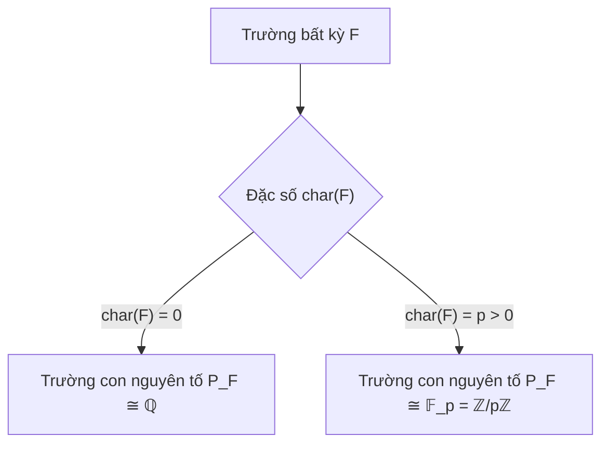

Trong toàn bộ Phần II, chúng ta đã đi từ vành tổng quát (chỉ có phép cộng và nhân), qua miền nguyên (nơi luật giản ước nhân được phục hồi), và dừng lại ở **trường** (field) — đỉnh cao của cấu trúc đại số, nơi mọi phần tử khác không đều có nghịch đảo nhân, tức là phép chia luôn luôn thực hiện được.

Chương 9 khép lại toàn bộ học phần Cấu trúc đại số bằng việc nghiên cứu sâu sắc về trường: nhận diện trường qua cấu trúc iđêan, phân loại "hạt nhân nguyên thủy" của mọi trường (**trường con nguyên tố**), và thiết lập phép dựng kỳ vĩ **trường các thương** $\operatorname{Frac}(R)$ biến mọi miền nguyên thành một trường.

---

## 1. Nhận diện trường qua iđêan và đồng cấu

Nhắc lại rằng một vành giao hoán có phần tử đơn vị $1 \neq 0$ được gọi là một **trường** nếu mọi phần tử khác không đều khả nghịch: $R^\times = R \setminus \{0\}$. Dưới góc nhìn hiện đại của lý thuyết iđêan và đồng cấu vành, trường có một đặc trưng tuyệt đẹp:

<Theorem id="thm-c9-b1-nhan-dien-truong">
### Định lý 9.1: Tiêu chuẩn nhận diện trường qua iđêan
Cho $R$ là một vành giao hoán có phần tử đơn vị $1 \neq 0$. Các mệnh đề sau là tương đương:
1. $R$ là một **trường**.
2. Các iđêan duy nhất của $R$ là iđêan tầm thường $\{0\}$ và chính $R$.
3. Mọi đồng cấu vành bảo toàn đơn vị $f: R \to S$ vào một vành tùy ý $S \neq \{0\}$ đều là một **đơn ánh**.
</Theorem>

<Proof>
Ta chứng minh tương đương theo chu trình: $(1) \implies (2) \implies (3) \implies (1)$.

- **$(1) \implies (2)$:** Giả sử $R$ là một trường. Lấy $I \triangleleft R$ là một iđêan bất kỳ sao cho $I \neq \{0\}$.
  Vì $I \neq \{0\}$, tồn tại phần tử $x \in I$ sao cho $x \neq 0$.
  Vì $R$ là một trường, $x$ có phần tử nghịch đảo $x^{-1} \in R$.
  Do điều kiện hấp thụ của iđêan ($rI \subseteq I$ với mọi $r \in R$):
  $$
  1 = x^{-1} \cdot x \in I.
  $$
  Một iđêan chứa phần tử đơn vị thì bắt buộc phải bằng toàn bộ vành: $I = R$.
  Do đó, $R$ chỉ có đúng hai iđêan là $\{0\}$ và $R$.

- **$(2) \implies (3)$:** Giả sử $R$ chỉ có hai iđêan $\{0\}$ và $R$. Cho $f: R \to S$ là một đồng cấu vành có $f(1_R) = 1_S \neq 0_S$.
  Theo Định lý 8.5, hạt nhân $\ker f$ là một iđêan của $R$. Do đó chỉ có hai khả năng:
  - Nếu $\ker f = R$, thì $f(1_R) = 0_S$, dẫn tới $1_S = 0_S \implies S = \{0\}$, mâu thuẫn với giả thiết $S \neq \{0\}$.
  - Vậy ta bắt buộc phải có $\ker f = \{0\}$.
  Theo tiêu chuẩn đơn cấu, $f$ là một đơn ánh.

- **$(3) \implies (1)$:** Ta chứng minh phản chứng: giả sử $R$ không phải là trường.
  Khi đó tồn tại phần tử $a \in R$ sao cho $a \neq 0$ nhưng $a$ không khả nghịch.
  Xét iđêan chính sinh bởi $a$: $I = (a) = Ra$.
  Vì $a$ không khả nghịch, $1 \notin I$, do đó $I \subsetneq R$ là một iđêan chân phương.
  Hơn nữa $a \in I$ và $a \neq 0$, nên $I \neq \{0\}$.
  Xét phép chiếu chính tắc $\pi_I: R \to R/I, x \mapsto x + I$.
  Vì $I \subsetneq R$, vành thương $S = R/I \neq \{0\}$, và $\pi_I(1) = 1 + I = 1_{R/I}$.
  Theo giả thiết (3), $\pi_I$ phải là một đơn ánh, suy ra $\ker\pi_I = \{0\}$.
  Nhưng ta biết $\ker\pi_I = I \neq \{0\}$, điều này hoàn toàn mâu thuẫn!
  Mâu thuẫn này chứng minh mọi $a \neq 0$ đều phải khả nghịch, tức $R$ là một trường.
</Proof>

---

## 2. Tiêu chuẩn trường con

<Definition id="def-c9-b1-truong-con">
### Định nghĩa 9.3: Trường con và Trường mở rộng
Cho $(F, +, \cdot)$ là một trường. Một tập con $K \subseteq F$ được gọi là một **trường con** (subfield) của $F$ nếu $K$ cùng với hai phép toán cộng và nhân thu hẹp từ $F$ lập thành một trường.
Khi đó, $F$ được gọi là một **trường mở rộng** (extension field) của $K$, ký hiệu là $F/K$.
</Definition>

<Theorem id="thm-c9-b1-tieu-chuan-truong-con">
### Mệnh đề 9.4: Tiêu chuẩn kiểm tra trường con
Cho $F$ là một trường và $K$ là một tập con của $F$ chứa ít nhất hai phần tử phân biệt (hoặc tương đương $1_F \in K$). Tập con $K$ là một trường con của $F$ khi và chỉ khi với mọi $a, b \in K$:
1. $a - b \in K$ (đóng với phép trừ nhóm cộng).
2. Nếu $b \neq 0$ thì $ab^{-1} \in K$ (đóng với phép chia nhóm nhân).
</Theorem>

<Proof>
- **Chiều thuận ($\implies$):** Nếu $K$ là trường con, $(K, +)$ là nhóm con của $(F, +)$ nên $a - b \in K$. Mặt khác $(K \setminus \{0\}, \cdot)$ là nhóm nhân nên $b \neq 0 \implies b^{-1} \in K \implies ab^{-1} \in K$.
- **Chiều đảo ($\impliedby$):**
  - Từ (1): $K$ là một nhóm con của $(F, +)$, giao hoán, có $0 \in K$ và $-a \in K$.
  - Lấy $b \in K, b \neq 0$. Theo (2), chọn $a = b$ ta có $1 = bb^{-1} \in K$. Chọn $a = 1$, ta có $b^{-1} \in K$.
  - Với mọi $a, c \in K$: nếu $c = 0$ thì $ac = 0 \in K$; nếu $c \neq 0$, đặt $b = c^{-1} \in K$, theo (2) ta có $ac = ab^{-1} \in K$. Vậy $K$ đóng với phép nhân.
  - Các tiên đề kết hợp, phân phối và giao hoán được kế thừa trực tiếp từ $F$.
  Vậy $K$ là một trường con của $F$.
</Proof>

<Example id="ex-c9-b1-q-can-2">
### Ví dụ: Trường con $\mathbb{Q}(\sqrt{2})$ của trường số thực $\mathbb{R}$
Xét tập con:
$$
\mathbb{Q}(\sqrt{2}) = \{a + b\sqrt{2} \mid a, b \in \mathbb{Q}\} \subseteq \mathbb{R}.
$$
1. Hiệu hai phần tử: $(a_1 + b_1\sqrt{2}) - (a_2 + b_2\sqrt{2}) = (a_1 - a_2) + (b_1 - b_2)\sqrt{2} \in \mathbb{Q}(\sqrt{2})$.
2. Tích với nghịch đảo: Lấy $a + b\sqrt{2} \neq 0$. Do $\sqrt{2} \notin \mathbb{Q}$, ta có $a^2 - 2b^2 \neq 0$. Bằng kỹ thuật trục căn thức ở mẫu:
$$
\frac{1}{a + b\sqrt{2}} = \frac{a - b\sqrt{2}}{(a + b\sqrt{2})(a - b\sqrt{2})} = \left( \frac{a}{a^2 - 2b^2} \right) + \left( \frac{-b}{a^2 - 2b^2} \right)\sqrt{2} \in \mathbb{Q}(\sqrt{2}).
$$
Nhân với phần tử $c + d\sqrt{2}$ bất kỳ vẫn cho kết quả thuộc $\mathbb{Q}(\sqrt{2})$.
Theo Mệnh đề 9.4, $\mathbb{Q}(\sqrt{2})$ là một trường con của $\mathbb{R}$.
</Example>

<Proposition id="prop-c9-b1-giao-cac-truong-con">
### Mệnh đề 9.5: Giao của một họ các trường con
Nếu $\{K_\alpha\}_{\alpha \in \Lambda}$ là một họ tùy ý các trường con của trường $F$, thì giao của chúng:
$$
K = \bigcap_{\alpha \in \Lambda} K_\alpha
$$
cũng là một trường con của $F$.
</Proposition>

<Proof>
Vì mỗi $K_\alpha$ là trường con của $F$, ta có $0, 1 \in K_\alpha$ với mọi $\alpha \in \Lambda$, suy ra $0, 1 \in K \neq \emptyset$.
Lấy $a, b \in K$. Khi đó $a, b \in K_\alpha$ với mọi $\alpha$.
Theo tiêu chuẩn trường con, $a - b \in K_\alpha$ và $ab^{-1} \in K_\alpha$ (nếu $b \neq 0$) với mọi $\alpha$.
Do đó $a - b \in K$ và $ab^{-1} \in K$. Vậy $K$ là một trường con của $F$.
</Proof>

---

## 3. Trường con nguyên tố $P_F$ và Phân loại theo Đặc số

Từ Mệnh đề 9.5, giao của tất cả các trường con của một trường $F$ là trường con nhỏ nhất của $F$. Trường con này chứa đựng cấu trúc số học cơ bản nhất và được quyết định hoàn toàn bởi **đặc số** của trường.

<Definition id="def-c9-b1-truong-con-nguyen-to">
### Định nghĩa 9.9: Trường con nguyên tố (Prime subfield)
Cho $F$ là một trường bất kỳ. **Trường con nguyên tố** của $F$, ký hiệu là $P_F$, là giao của tất cả các trường con của $F$:
$$
P_F = \bigcap \{K \subseteq F \mid K \text{ là trường con của } F\}.
$$
$P_F$ là trường con bé nhất của $F$ (theo quan hệ bao hàm) và bị chứa trong mọi trường con khác của $F$.
</Definition>

<Theorem id="thm-c9-b1-phan-loai-truong-con-nguyen-to">
### Định lý 9.10: Phân loại trường con nguyên tố theo đặc số
Cho $F$ là một trường có phần tử đơn vị $1_F$. Khi đó:
1. Nếu $\operatorname{char}(F) = 0$, thì trường con nguyên tố $P_F$ đẳng cấu với trường số hữu tỉ:
$$
P_F \cong \mathbb{Q}.
$$
2. Nếu $\operatorname{char}(F) = p > 0$ (với $p$ là số nguyên tố), thì trường con nguyên tố $P_F$ đẳng cấu với trường hữu hạn:
$$
P_F \cong \mathbb{F}_p = \mathbb{Z}/p\mathbb{Z}.
$$
</Theorem>

<Proof>
Xét đồng cấu đơn vị tự nhiên $\eta: \mathbb{Z} \to F, n \mapsto n \cdot 1_F$.
Vì $P_F$ là trường con chứa $1_F$, nó phải đóng đối với phép cộng và phép trừ, do đó $n \cdot 1_F \in P_F$ với mọi $n \in \mathbb{Z}$.

1. **Trường hợp $\operatorname{char}(F) = 0$:**
   Khi đó $\ker\eta = \{0\}$, nên $\eta$ là một đơn cấu. Vành con $\eta(\mathbb{Z}) = \{n \cdot 1_F \mid n \in \mathbb{Z}\} \cong \mathbb{Z}$ nằm trong $P_F$.
   Vì $P_F$ là một trường, với mọi số nguyên $m \neq 0$, phần tử $m \cdot 1_F \neq 0$ phải có nghịch đảo $(m \cdot 1_F)^{-1} \in P_F$.
   Do đó, $P_F$ phải chứa toàn bộ tập hợp:
   $$
   K = \left\{ \frac{n \cdot 1_F}{m \cdot 1_F} = (n \cdot 1_F)(m \cdot 1_F)^{-1} \;\middle|\; n, m \in \mathbb{Z}, m \neq 0 \right\}.
   $$
   Dễ thấy $K$ tự thân là một trường con của $F$. Vì $P_F$ là trường con nhỏ nhất của $F$, ta có $P_F = K$.
   Ánh xạ $\psi: \mathbb{Q} \to K, \frac{n}{m} \mapsto (n \cdot 1_F)(m \cdot 1_F)^{-1}$ là một đẳng cấu trường được xác định tốt. Vậy $P_F \cong \mathbb{Q}$.

2. **Trường hợp $\operatorname{char}(F) = p > 0$:**
   Theo Định lý 8.21, $p$ bắt buộc phải là một số nguyên tố.
   Khi đó $\ker\eta = p\mathbb{Z}$.
   Theo Định lý đẳng cấu thứ nhất:
   $$
   \operatorname{im}\eta \cong \mathbb{Z}/p\mathbb{Z} = \mathbb{F}_p.
   $$
   Vì $p$ là số nguyên tố, $\mathbb{Z}/p\mathbb{Z}$ là một trường.
   Do đó ảnh $\operatorname{im}\eta = \{0 \cdot 1_F, 1 \cdot 1_F, \dots, (p - 1) \cdot 1_F\}$ đã là một trường con của $F$.
   Vì bất kỳ trường con nào của $F$ cũng phải chứa $1_F$ nên phải chứa $\operatorname{im}\eta$.
   Do đó $P_F = \operatorname{im}\eta \cong \mathbb{F}_p$.
</Proof>

<Note>
**Ý nghĩa sâu sắc của Định lý 9.10:** Không có trường nào "lơ lửng ngoài vũ trụ đại số". Mọi trường trong toán học đều xuất phát từ đúng một trong hai nguồn gốc: hoặc chứa bên trong một bản sao của trường số hữu tỉ $\mathbb{Q}$ (nếu đặc số bằng $0$), hoặc chứa bên trong một bản sao của trường hữu hạn $\mathbb{F}_p$ (nếu đặc số bằng $p$).
</Note>

---

## 4. Hệ thống bài tập 4 phân lớp kèm lời giải chi tiết

<Exercise id="ex-c9-b1-a1">
### Bài 9.1.A1 (Nhóm A - Kiểm tra tiêu chuẩn trường con)
Xét các tập con sau của trường số thực $\mathbb{R}$:
1. $K_1 = \{a + b\sqrt{5} \mid a, b \in \mathbb{Q}\}$.
2. $K_2 = \{a + b\sqrt[3]{2} \mid a, b \in \mathbb{Q}\}$.
3. $K_3 = \{a + b\sqrt{2} \mid a, b \in \mathbb{Z}\}$.
Tập con nào là trường con của $\mathbb{R}$? Nếu không phải, hãy chỉ rõ điều kiện nào trong Mệnh đề 9.4 bị vi phạm.
</Exercise>

<Solution>
1. **Xét $K_1 = \{a + b\sqrt{5} \mid a, b \in \mathbb{Q}\}$:**
   - $K_1$ chứa $0 = 0 + 0\sqrt{5}$ và $1 = 1 + 0\sqrt{5}$.
   - Hiệu hai phần tử: $(a_1 + b_1\sqrt{5}) - (a_2 + b_2\sqrt{5}) = (a_1 - a_2) + (b_1 - b_2)\sqrt{5} \in K_1$.
   - Nghịch đảo của phần tử khác không $a + b\sqrt{5} \neq 0$: Vì $\sqrt{5}$ vô tỉ nên $a^2 - 5b^2 \neq 0$. Trục căn thức:
     $$
     \frac{1}{a + b\sqrt{5}} = \frac{a - b\sqrt{5}}{a^2 - 5b^2} = \left( \frac{a}{a^2 - 5b^2} \right) + \left( \frac{-b}{a^2 - 5b^2} \right)\sqrt{5} \in K_1.
     $$
   - Tích hai phần tử cũng thuộc $K_1$.
   Vậy $K_1 = \mathbb{Q}(\sqrt{5})$ là một **trường con** của $\mathbb{R}$.

2. **Xét $K_2 = \{a + b\sqrt[3]{2} \mid a, b \in \mathbb{Q}\}$:**
   - Xét phép nhân hai phần tử trong $K_2$: phần tử $\sqrt[3]{2} \in K_2$ (với $a = 0, b = 1$).
   - Bình phương của nó: $(\sqrt[3]{2})^2 = \sqrt[3]{4}$.
   - Nếu $\sqrt[3]{4} \in K_2$, tồn tại $a, b \in \mathbb{Q}$ sao cho $\sqrt[3]{4} = a + b\sqrt[3]{2}$.
     Nhân hai vế với $\sqrt[3]{2}$: $2 = a\sqrt[3]{2} + b\sqrt[3]{4} = a\sqrt[3]{2} + b(a + b\sqrt[3]{2}) = ab + (a + b^2)\sqrt[3]{2}$.
     Vì $\sqrt[3]{2}$ vô tỉ bậc ba, điều này đòi hỏi $a + b^2 = 0$ và $ab = 2$, dẫn tới $-b^3 = 2 \iff b^3 = -2$, vô nghiệm trong $\mathbb{Q}$.
   - Do đó $\sqrt[3]{4} \notin K_2$. Tập $K_2$ thậm chí không đóng với phép nhân!
   Vậy $K_2$ **không phải là trường con** (trường con sinh bởi $\sqrt[3]{2}$ phải có dạng $\{a + b\sqrt[3]{2} + c\sqrt[3]{4} \mid a, b, c \in \mathbb{Q}\}$).

3. **Xét $K_3 = \mathbb{Z}[\sqrt{2}] = \{a + b\sqrt{2} \mid a, b \in \mathbb{Z}\}$:**
   - $K_3$ là một vành con đóng với phép cộng và phép nhân.
   - Tuy nhiên, phần tử $2 = 2 + 0\sqrt{2} \in K_3$ có nghịch đảo trong $\mathbb{R}$ là $\frac{1}{2}$.
   - Rõ ràng $\frac{1}{2} \notin K_3$ vì các hệ số không phải là số nguyên.
   - Do đó $K_3$ không đóng đối với phép lấy nghịch đảo.
   Vậy $K_3$ **không phải là trường con** (nó là một miền nguyên, không phải trường).
</Solution>

<Exercise id="ex-c9-b1-a2">
### Bài 9.1.A2 (Nhóm A - Xác định trường con nguyên tố)
Tìm đặc số và mô tả tường minh trường con nguyên tố $P_F$ của các trường sau:
1. $F_1 = \mathbb{Q}(\sqrt{3}, \pi)$.
2. $F_2 = \mathbb{F}_3[x]/(x^2 + 1)$.
3. $F_3 = \mathbb{F}_p(t)$ (trường phân thức hữu tỉ trên $\mathbb{F}_p$).
</Exercise>

<Solution>
Theo Định lý 9.10, trường con nguyên tố được xác định duy nhất bởi đặc số của trường:

1. **Trường $F_1 = \mathbb{Q}(\sqrt{3}, \pi) \subseteq \mathbb{R}$:**
   Vì $F_1 \subseteq \mathbb{R}$, ta có $n \cdot 1 \neq 0$ với mọi $n \ge 1$. Do đó $\operatorname{char}(F_1) = 0$.
   Theo Định lý 9.10, trường con nguyên tố của $F_1$ là:
   $$
   P_{F_1} \cong \mathbb{Q} \quad (\text{chính là trường số hữu tỉ } \mathbb{Q} \subseteq F_1).
   $$

2. **Trường $F_2 = \mathbb{F}_3[x]/(x^2 + 1)$:**
   Trong vành thương này, $3 \cdot 1 = 0$, do đó $\operatorname{char}(F_2) = 3$.
   Đa thức $x^2 + 1$ không có nghiệm trong $\mathbb{F}_3$ nên bất khả quy, do đó $F_2 \cong \mathbb{F}_9$ là một trường hữu hạn gồm 9 phần tử.
   Theo Định lý 9.10, trường con nguyên tố của $F_2$ là:
   $$
   P_{F_2} \cong \mathbb{F}_3 = \{\bar{0}, \bar{1}, \bar{2}\}.
   $$

3. **Trường $F_3 = \mathbb{F}_p(t)$:**
   Các hệ số của phân thức nằm trong $\mathbb{F}_p$, do đó $p \cdot 1 = 0$, suy ra $\operatorname{char}(F_3) = p$.
   Mặc dù $F_3$ là một trường vô hạn (chứa vô số phân thức biến $t$), trường con nguyên tố của nó chỉ gồm các phân thức hằng:
   $$
   P_{F_3} = \mathbb{F}_p \cong \mathbb{Z}/p\mathbb{Z}.
   $$
</Solution>

<Exercise id="ex-c9-b1-b1">
### Bài 9.1.B1 (Nhóm B - Trường mở rộng đơn và nghịch đảo đại số)
Cho trường mở rộng $K = \mathbb{Q}(\sqrt{2}, \sqrt{3})$.
1. Chứng minh rằng $K = \mathbb{Q}(\sqrt{2} + \sqrt{3})$.
2. Tìm phần tử nghịch đảo của $u = \sqrt{2} + \sqrt{3}$ trong $K$ dưới dạng tổ hợp tuyến tính của $\{1, \sqrt{2}, \sqrt{3}, \sqrt{6}\}$.
</Exercise>

<Solution>
**1. Chứng minh $K = \mathbb{Q}(\sqrt{2} + \sqrt{3})$:**
Đặt $\alpha = \sqrt{2} + \sqrt{3}$. Rõ ràng $\alpha \in \mathbb{Q}(\sqrt{2}, \sqrt{3})$, do đó $\mathbb{Q}(\alpha) \subseteq \mathbb{Q}(\sqrt{2}, \sqrt{3})$.
Ta cần chứng minh chiều ngược lại: $\sqrt{2} \in \mathbb{Q}(\alpha)$ và $\sqrt{3} \in \mathbb{Q}(\alpha)$.
Tính nghịch đảo của $\alpha$ bằng trục căn thức:
$$
\frac{1}{\alpha} = \frac{1}{\sqrt{3} + \sqrt{2}} = \sqrt{3} - \sqrt{2}.
$$
Vì $\mathbb{Q}(\alpha)$ là một trường và $\alpha \in \mathbb{Q}(\alpha)$, ta có $\frac{1}{\alpha} \in \mathbb{Q}(\alpha)$.
Do đó:
$$
\sqrt{3} = \frac{1}{2} \left( \alpha + \frac{1}{\alpha} \right) \in \mathbb{Q}(\alpha),
$$
$$
\sqrt{2} = \frac{1}{2} \left( \alpha - \frac{1}{\alpha} \right) \in \mathbb{Q}(\alpha).
$$
Vì cả $\sqrt{2}$ và $\sqrt{3}$ đều thuộc $\mathbb{Q}(\alpha)$, ta suy ra $\mathbb{Q}(\sqrt{2}, \sqrt{3}) \subseteq \mathbb{Q}(\alpha)$.
Vậy $\mathbb{Q}(\sqrt{2}, \sqrt{3}) = \mathbb{Q}(\sqrt{2} + \sqrt{3})$.

**2. Biểu diễn nghịch đảo:**
Từ tính toán ở trên:
$$
u^{-1} = \frac{1}{\sqrt{2} + \sqrt{3}} = -\sqrt{2} + \sqrt{3} = 0 \cdot 1 - 1 \cdot \sqrt{2} + 1 \cdot \sqrt{3} + 0 \cdot \sqrt{6}.
$$
Kiểm tra lại: $(\sqrt{3} + \sqrt{2})(\sqrt{3} - \sqrt{2}) = 3 - 2 = 1$. Kết quả hoàn toàn chính xác.
</Solution>

<Exercise id="ex-c9-b1-b2">
### Bài 9.1.B2 (Nhóm B - Hợp của hai trường con)
Cho $K_1$ và $K_2$ là hai trường con của một trường $F$.
Chứng minh rằng $K_1 \cup K_2$ là một trường con của $F$ khi và chỉ khi $K_1 \subseteq K_2$ hoặc $K_2 \subseteq K_1$.
</Exercise>

<Proof>
- **Chiều thuận ($\impliedby$):** Nếu $K_1 \subseteq K_2$ thì $K_1 \cup K_2 = K_2$ là trường con. Tương tự nếu $K_2 \subseteq K_1$ thì $K_1 \cup K_2 = K_1$ là trường con.
- **Chiều đảo ($\implies$):** Giả sử $K_1 \cup K_2$ là một trường con của $F$.
  Khi đó $(K_1 \cup K_2, +)$ là một nhóm con của nhóm cộng $(F, +)$.
  Theo định lý cơ bản về nhóm (hợp của hai nhóm con là nhóm con khi và chỉ khi một nhóm con chứa nhóm con kia), ta có:
  $$
  K_1 \subseteq K_2 \quad \text{hoặc} \quad K_2 \subseteq K_1.
  $$
  (Chứng minh trực tiếp bằng phản chứng: Nếu $K_1 \not\subseteq K_2$ và $K_2 \not\subseteq K_1$, tồn tại $x \in K_1 \setminus K_2$ và $y \in K_2 \setminus K_1$. Xét tổng $x + y$. Do $K_1 \cup K_2$ là trường con, $x + y \in K_1 \cup K_2$. Nếu $x + y \in K_1$, thì $y = (x + y) - x \in K_1$, mâu thuẫn. Nếu $x + y \in K_2$, thì $x = (x + y) - y \in K_2$, mâu thuẫn. Do đó điều giả sử là sai).
Vậy $K_1 \subseteq K_2$ hoặc $K_2 \subseteq K_1$.
</Proof>

<Exercise id="ex-c9-b1-c1">
### Bài 9.1.C1 (Nhóm C - Vành con của trường hữu hạn là trường con)
Cho $F$ là một trường hữu hạn. Chứng minh rằng mọi vành con $R$ của $F$ chứa phần tử đơn vị $1_F$ đều là một **trường con** của $F$. Chỉ ra phản ví dụ khi $F$ là trường vô hạn.
</Exercise>

<Proof>
1. **Chứng minh với $F$ hữu hạn:**
   Giả sử $R$ là vành con của $F$ chứa $1_F$.
   Vì $R \subseteq F$ và $F$ là trường, $R$ không có ước của không khác không (nếu $ab = 0$ trong $R$ thì $ab = 0$ trong $F$, suy ra $a = 0$ hoặc $b = 0$). Do đó $R$ là một **miền nguyên**.
   Mặt khác, vì $F$ là tập hữu hạn, vành con $R$ cũng là một tập hữu hạn.
   Theo Định lý 6.12 (mọi miền nguyên hữu hạn đều là một trường):
   Với mọi $a \in R, a \neq 0$, ánh xạ nhân $L_a: R \to R, x \mapsto ax$ là một đơn ánh. Do $R$ hữu hạn, $L_a$ là toàn ánh.
   Do đó tồn tại $b \in R$ sao cho $L_a(b) = ab = 1_F$.
   Vì $F$ giao hoán, $ba = ab = 1_F$, nghĩa là $a^{-1} = b \in R$.
   Vì mọi phần tử khác không trong $R$ đều có nghịch đảo nhân trong $R$, $R$ là một **trường con** của $F$.

2. **Phản ví dụ khi $F$ vô hạn:**
   Xét trường số thực vô hạn $F = \mathbb{R}$.
   Tập hợp các số nguyên $R = \mathbb{Z}$ là một vành con chứa đơn vị $1 \in \mathbb{R}$.
   Tuy nhiên $\mathbb{Z}$ không phải là trường con của $\mathbb{R}$ vì phần tử $2 \in \mathbb{Z}$ không có nghịch đảo trong $\mathbb{Z}$ (nghịch đảo của nó là $\frac{1}{2} \notin \mathbb{Z}$).
</Proof>

<Exercise id="ex-c9-b1-c2">
### Bài 9.1.C2 (Nhóm C - Trường các lũy thừa bậc $p$)
Cho $F$ là một trường có đặc số $p > 0$. Đặt:
$$
F^p = \{x^p \mid x \in F\}.
$$
1. Chứng minh rằng $F^p$ là một trường con của $F$.
2. Chứng minh rằng $F$ là trường hữu hạn khi và chỉ khi $F^p = F$.
</Exercise>

<Proof>
1. **$F^p$ là trường con:**
   - $0 = 0^p \in F^p$ và $1 = 1^p \in F^p$.
   - Với mọi $a^p, b^p \in F^p$:
     Theo Định lý Frobenius (Định lý 8.22), vì $\operatorname{char}(F) = p$, ta có:
     $$
     a^p - b^p = (a - b)^p \in F^p.
     $$
   - Nếu $b^p \neq 0$ (suy ra $b \neq 0$ do $F$ là trường):
     $$
     a^p (b^p)^{-1} = a^p (b^{-1})^p = (ab^{-1})^p \in F^p.
     $$
   Theo Mệnh đề 9.4, $F^p$ là một trường con của $F$.

2. **Đẳng thức $F^p = F$:**
   Tập $F^p$ chính là ảnh của tự đồng cấu Frobenius $\Phi: F \to F, x \mapsto x^p$.
   - Vì $F$ là trường, $\Phi$ luôn là một đơn cấu ($\ker\Phi = \{0\}$).
   - Nếu $F$ hữu hạn, mọi đơn ánh từ $F$ vào $F$ đều là toàn ánh, do đó $\operatorname{im}\Phi = F^p = F$.
   - Ngược lại, nếu $F = \mathbb{F}_p(t)$ (vô hạn), ta đã chứng minh ở Bài 8.3.C2 rằng $t \notin F^p$, suy ra $F^p \subsetneq F$.
</Proof>

<Exercise id="ex-c9-b1-d1">
### Bài 9.1.D1 (Nhóm D - Định lý cấp của trường hữu hạn $|F| = p^n$)
Sử dụng cấu trúc không gian vectơ trên trường con nguyên tố để chứng minh rằng: Nếu $F$ là một trường hữu hạn có đặc số $p$, thì số phần tử của $F$ bắt buộc phải có dạng:
$$
|F| = p^n \quad \text{với } n \ge 1 \text{ là một số nguyên dương.}
$$
</Exercise>

<Proof>
Giả sử $F$ là trường hữu hạn có đặc số $p$.
1. Theo Định lý 8.21, $p$ bắt buộc là số nguyên tố.
2. Theo Định lý 9.10, trường con nguyên tố của $F$ là $P_F \cong \mathbb{F}_p = \mathbb{Z}/p\mathbb{Z}$, có đúng $p$ phần tử.
3. Ta xem xét cấu trúc của $F$ đối với trường con $P_F$:
   - Nhóm cộng $(F, +)$ là một nhóm abel.
   - Phép nhân vô hướng: Với mỗi vô hướng $c \in P_F$ và véctơ $v \in F$, tích $c \cdot v$ trong trường $F$ thỏa mãn đầy đủ các tiên đề của phép nhân vô hướng của một không gian vectơ:
     - $c(u + v) = cu + cv$,
     - $(c + d)u = cu + du$,
     - $(cd)u = c(du)$,
     - $1_{P_F} \cdot u = 1_F \cdot u = u$.
   Do đó, $F$ là một **không gian vectơ** trên trường cơ sở $P_F \cong \mathbb{F}_p$.
4. Vì $F$ là một tập hợp hữu hạn, số chiều của không gian vectơ $F$ trên $\mathbb{F}_p$ phải là một số nguyên dương hữu hạn, đặt $\dim_{\mathbb{F}_p}(F) = n \ge 1$.
5. Khi đó tồn tại một cơ sở gồm $n$ phần tử $\{e_1, e_2, \dots, e_n\} \subset F$.
   Mỗi phần tử $x \in F$ đều biểu diễn duy nhất dưới dạng:
   $$
   x = c_1 e_1 + c_2 e_2 + \dots + c_n e_n \quad \text{với } c_i \in \mathbb{F}_p.
   $$
6. Vì mỗi hệ số $c_i$ có đúng $p$ cách chọn độc lập trong $\mathbb{F}_p$, tổng số phần tử của $F$ là:
   $$
   |F| = \underbrace{p \times p \times \dots \times p}_{n \text{ lần}} = p^n.
   $$
Chứng minh hoàn tất.
</Proof>

<Exercise id="ex-c9-b1-d2">
### Bài 9.1.D2 (Nhóm D - Sự không tồn tại của các trường cấp 6 và cấp 10)
Chứng minh rằng không tồn tại bất kỳ trường nào có đúng 6 phần tử hoặc đúng 10 phần tử.
</Exercise>

<Proof>
Theo Định lý 9.1.D1 vừa chứng minh, lực lượng (số phần tử) của một trường hữu hạn bất kỳ bắt buộc phải là lũy thừa của một số nguyên tố:
$$
|F| = p^n \quad (p \text{ nguyên tố}, n \in \mathbb{Z}^+).
$$
1. **Xét cấp bằng 6:**
   Phân tích thừa số nguyên tố: $6 = 2 \times 3$.
   Số $6$ không thể viết dưới dạng $p^n$ của bất kỳ số nguyên tố nào (vì $2^1 = 2 < 6 < 2^3 = 8$, và $3^1 = 3 < 6 < 3^2 = 9$).
   Do đó, không tồn tại trường nào có đúng 6 phần tử.
   *(Giải thích theo cấu trúc: Nếu $R$ có 6 phần tử, đặc số của nó phải chia hết 6. Nếu $\operatorname{char}=6$ thì có ước của không $2 \cdot 3 = 0$, không là trường. Nếu $\operatorname{char}=2$ thì $|R|$ phải là lũy thừa của 2, mâu thuẫn; nếu $\operatorname{char}=3$ thì $|R|$ phải là lũy thừa của 3, mâu thuẫn).*

2. **Xét cấp bằng 10:**
   Phân tích thừa số nguyên tố: $10 = 2 \times 5$.
   Số $10$ không phải là lũy thừa của một số nguyên tố nào.
   Do đó không tồn tại trường nào có đúng 10 phần tử.
</Proof>

---

## 5. Tóm tắt trọng tâm bài học

<KeyTakeaways>
- **Tiêu chuẩn nhận diện trường:** Một vành giao hoán có đơn vị $1 \neq 0$ là trường khi và chỉ khi nó chỉ có hai iđêan $\{0\}$ và chính nó; hoặc tương đương mọi đồng cấu vành bảo toàn đơn vị xuất phát từ nó đều là đơn ánh.
- **Tiêu chuẩn trường con:** Tập con $K \subseteq F$ là trường con $\iff a - b \in K$ và $ab^{-1} \in K$ với mọi $b \neq 0$. Giao của một họ trường con luôn là trường con.
- **Trường con nguyên tố $P_F$:** Là trường con nhỏ nhất chứa $1_F$. Nếu $\operatorname{char}(F) = 0$ thì $P_F \cong \mathbb{Q}$; nếu $\operatorname{char}(F) = p > 0$ thì $P_F \cong \mathbb{F}_p$.
- **Cấp của trường hữu hạn:** Mọi trường hữu hạn $F$ đều là không gian vectơ trên trường con nguyên tố $\mathbb{F}_p$, do đó số phần tử bắt buộc phải có dạng $|F| = p^n$.
</KeyTakeaways>
