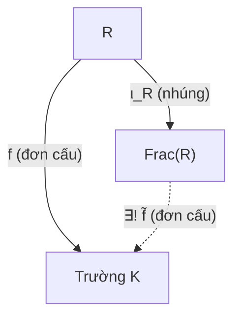

Trong toán học hiện đại, một cấu trúc đại số trừu tượng thường được đặc trưng không chỉ bởi các chi tiết kỹ thuật bên trong, mà bởi **vị trí và vai trò phổ dụng** của nó trong toàn bộ hệ thống các ánh xạ. Trường các thương $\operatorname{Frac}(R)$ không phải là một phép dựng ngẫu nhiên: nó là "chiếc trường nhỏ nhất và tiết kiệm nhất" có thể chứa đựng miền nguyên $R$.

Bài học này thiết lập **tính chất phổ dụng** của trường các thương, chứng minh tính duy nhất sai khác đẳng cấu, và phân tích sâu sắc bảng đối chiếu toàn diện giữa hai phép dựng nền tảng của đại số trừu tượng: **Vành thương** $R/I$ (ép các phần tử về $0$) và **Trường các thương** $\operatorname{Frac}(R)$ (bổ sung nghịch đảo nhân).

---

## 1. Tính chất phổ dụng của Trường các thương

Giả sử $R$ là một miền nguyên và ta muốn "nhúng" $R$ vào một trường $K$ nào đó thông qua một đơn cấu $f: R \hookrightarrow K$. Vì $K$ là một trường, mọi phần tử khác không $f(b) \in K$ ($b \neq 0$) đều phải có phần tử nghịch đảo $[f(b)]^{-1} \in K$. Do đó $K$ bắt buộc phải chứa các tích $f(a)[f(b)]^{-1}$. 

Định lý sau khẳng định rằng $\operatorname{Frac}(R)$ chính là mô hình chuẩn mực và phổ dụng nhất cho mọi sự nhúng như vậy:

<Theorem id="thm-c9-b3-tinh-chat-pho-dung">
### Định lý 9.18: Tính chất phổ dụng của Trường các thương
Cho $R$ là một miền nguyên và $\iota_R: R \to \operatorname{Frac}(R), a \mapsto \frac{a}{1}$ là đơn cấu nhúng chính tắc.
Với bất kỳ trường $K$ nào và bất kỳ đơn cấu vành bảo toàn đơn vị $f: R \to K$, tồn tại **duy nhất** một đồng cấu trường $\tilde{f}: \operatorname{Frac}(R) \to K$ làm cho sơ đồ sau giao hoán:
$$
\tilde{f} \circ \iota_R = f.
$$
Cụ thể, $\tilde{f}$ được xác định bởi công thức:
$$
\tilde{f}\left(\frac{a}{b}\right) = f(a) \cdot [f(b)]^{-1} \quad \forall a \in R, b \in R \setminus \{0\}.
$$
Hơn nữa, $\tilde{f}$ tự động là một **đơn cấu**.
</Theorem>

<Proof>
Ta chia chứng minh thành bốn bước:

1. **Tính bắt buộc của công thức (Tính duy nhất):**
   Giả sử tồn tại một đồng cấu trường $\tilde{f}: \operatorname{Frac}(R) \to K$ thỏa mãn $\tilde{f} \circ \iota_R = f$.
   Khi đó với mọi $a \in R$, ta có $\tilde{f}\left(\frac{a}{1}\right) = f(a)$.
   Với mọi phân số $\frac{a}{b} \in \operatorname{Frac}(R)$ ($b \neq 0$), ta viết:
   $$
   \frac{a}{b} = \frac{a}{1} \cdot \left(\frac{b}{1}\right)^{-1}.
   $$
   Vì $\tilde{f}$ là đồng cấu trường, nó bảo toàn phép nhân và phép nghịch đảo:
   $$
   \tilde{f}\left(\frac{a}{b}\right) = \tilde{f}\left(\frac{a}{1}\right) \cdot \left[\tilde{f}\left(\frac{b}{1}\right)\right]^{-1} = f(a) \cdot [f(b)]^{-1}.
   $$
   Đẳng thức này xác định giá trị của $\tilde{f}$ một cách tường minh và duy nhất trên mọi phần tử của $\operatorname{Frac}(R)$.

2. **Tính xác định tốt (Well-definedness) của $\tilde{f}$:**
   Giả sử $\frac{a}{b} = \frac{c}{d}$ trong $\operatorname{Frac}(R)$, nghĩa là $ad = bc$ trong $R$.
   Tác động đơn cấu $f$ lên hai vế:
   $$
   f(ad) = f(bc) \iff f(a) f(d) = f(b) f(c) \quad \text{trong trường } K.
   $$
   Vì $b, d \neq 0$ và $f$ là đơn cấu, ta có $f(b) \neq 0$ và $f(d) \neq 0$ trong trường $K$.
   Nhân cả hai vế với $[f(b)]^{-1} [f(d)]^{-1}$:
   $$
   f(a) [f(b)]^{-1} = f(c) [f(d)]^{-1} \iff \tilde{f}\left(\frac{a}{b}\right) = \tilde{f}\left(\frac{c}{d}\right).
   $$
   Vậy ánh xạ $\tilde{f}$ hoàn toàn xác định tốt và không phụ thuộc vào việc chọn đại diện phân số.

3. **$\tilde{f}$ là đồng cấu vành:**
   - Bảo toàn phép cộng:
     $$
     \tilde{f}\left(\frac{a}{b} + \frac{c}{d}\right) = \tilde{f}\left(\frac{ad + bc}{bd}\right) = f(ad + bc) [f(bd)]^{-1} = (f(a)f(d) + f(b)f(c)) [f(b)]^{-1} [f(d)]^{-1}
     $$
     $$
     = f(a)[f(b)]^{-1} + f(c)[f(d)]^{-1} = \tilde{f}\left(\frac{a}{b}\right) + \tilde{f}\left(\frac{c}{d}\right).
     $$
   - Bảo toàn phép nhân:
     $$
     \tilde{f}\left(\frac{a}{b} \cdot \frac{c}{d}\right) = \tilde{f}\left(\frac{ac}{bd}\right) = f(ac) [f(bd)]^{-1} = (f(a)f(c)) ([f(b)]^{-1}[f(d)]^{-1}) = \tilde{f}\left(\frac{a}{b}\right) \tilde{f}\left(\frac{c}{d}\right).
     $$
   - Bảo toàn đơn vị: $\tilde{f}\left(\frac{1}{1}\right) = f(1)[f(1)]^{-1} = 1_K \cdot 1_K^{-1} = 1_K$.

4. **$\tilde{f}$ là đơn cấu:**
   Vì $\operatorname{Frac}(R)$ là một trường và $K \neq \{0\}$, theo Định lý 9.1, mọi đồng cấu bảo toàn đơn vị từ một trường đều là đơn ánh. Do đó $\ker\tilde{f} = \{0\}$, tức $\tilde{f}$ là một đơn cấu.
</Proof>

---

## 2. Tính duy nhất sai khác đẳng cấu của $\operatorname{Frac}(R)$

Một hệ quả trực tiếp và mạnh mẽ của tính chất phổ dụng là: **Bất kỳ trường nào thỏa mãn tính chất phổ dụng của trường các thương đều phải đẳng cấu duy nhất với $\operatorname{Frac}(R)$**.

<Theorem id="thm-c9-b3-tinh-duy-nhat">
### Mệnh đề 9.19: Tính duy nhất sai khác đẳng cấu
Cho $R$ là một miền nguyên. Giả sử $F$ là một trường và $j: R \to F$ là một đơn cấu vành thỏa mãn:
1. Mọi phần tử của $F$ đều có dạng $j(a)[j(b)]^{-1}$ với $a \in R, b \in R \setminus \{0\}$.
Khi đó tồn tại một đẳng cấu trường duy nhất $\theta: \operatorname{Frac}(R) \to F$ sao cho sơ đồ giao hoán: $\theta \circ \iota_R = j$.
</Theorem>

<Proof>
- Áp dụng Định lý 9.18 cho đơn cấu $j: R \to F$, tồn tại duy nhất một đơn cấu trường $\theta: \operatorname{Frac}(R) \to F$ định bởi:
  $$
  \theta\left(\frac{a}{b}\right) = j(a)[j(b)]^{-1}.
  $$
- Theo giả thiết (1), mọi phần tử của $F$ đều có dạng $j(a)[j(b)]^{-1}$, do đó $\theta$ là một toàn ánh.
- Vì $\theta$ vừa là đơn ánh vừa là toàn ánh, $\theta$ là một đẳng cấu trường.
</Proof>

<Note>
**Ứng dụng thực hành:** Khi cần chứng minh một trường cụ thể $F$ là trường các thương của $R$ (chẳng hạn $\operatorname{Frac}(\mathbb{Z}[\sqrt{2}]) \cong \mathbb{Q}(\sqrt{2})$ hay $\operatorname{Frac}(F[x]) \cong F(x)$), ta **không cần lặp lại việc kiểm tra các lớp tương đương**, mà chỉ cần chỉ ra:
1. $F$ là một trường chứa $R$, và
2. Mọi phần tử của $F$ đều viết được dưới dạng thương $ab^{-1}$ của hai phần tử thuộc $R$.
</Note>

---

## 3. Bảng đối chiếu toàn diện: Vành thương $R/I$ và Trường các thương $\operatorname{Frac}(R)$

Đây là một trong những bảng tổng hợp mang tính triết học toán học sâu sắc nhất của toàn bộ giáo trình (*Mục 9.11, tr. 157*), đối chiếu hai con đường mở rộng và thu gọn cấu trúc:

| Tiêu chí so sánh | Vành thương $R/I$ (Chương 7 & 8) | Trường các thương $\operatorname{Frac}(R)$ (Chương 9) |
| :--- | :--- | :--- |
| **Mục đích toán học** | **Đồng nhất về 0:** Ép mọi phần tử trong tập con $I$ phải bằng $0$. | **Bổ sung nghịch đảo:** Ép mọi phần tử khác không phải khả nghịch. |
| **Điều kiện trên vành mẹ $R$** | Vành tùy ý (chỉ cần có hai phép toán). | Bắt buộc phải là **miền nguyên** (giao hoán, có $1$, không có ước của không). |
| **Đối tượng điều khiển** | Một **iđêan hai phía** $I \triangleleft R$. | Tập hợp các phần tử khác không $R \setminus \{0\}$. |
| **Quan hệ tương đương** | $a \sim_I b \iff a - b \in I$. | $(a, b) \sim (c, d) \iff ad = bc$. |
| **Cấu trúc nhận được** | Một **vành** (chưa chắc là miền nguyên hay trường). | Luôn luôn là một **trường**. |
| **Khi nào tạo ra một trường?** | Khi và chỉ khi $I$ là một **iđêan cực đại** ($M$). | **Luôn luôn là trường** (nếu $R$ là miền nguyên). |
| **Ánh xạ chính tắc từ $R$** | Phép chiếu chính tắc $\pi_I: R \to R/I$, luôn là **toàn ánh**. | Phép nhúng chính tắc $\iota_R: R \hookrightarrow \operatorname{Frac}(R)$, luôn là **đơn ánh**. |
| **Hạt nhân ánh xạ chính tắc** | $\ker\pi_I = I$ (có thể rất lớn). | $\ker\iota_R = \{0\}$ (luôn tầm thường). |
| **Tính chất phổ dụng** | Phân tích qua thương: Mọi $f$ triệt tiêu trên $I$ đều phân tích qua $\pi_I$. | Mọi đơn cấu vào một trường $K$ đều mở rộng duy nhất qua $\iota_R$. |
| **Ví dụ kinh điển** | $\mathbb{Z} \to \mathbb{Z}/p\mathbb{Z} = \mathbb{F}_p$; $\mathbb{R}[x] \to \mathbb{R}[x]/(x^2+1) \cong \mathbb{C}$. | $\mathbb{Z} \hookrightarrow \mathbb{Q}$; $F[x] \hookrightarrow F(x)$; $\mathbb{Z}[i] \hookrightarrow \mathbb{Q}(i)$. |

---

## 4. Hệ thống bài tập 4 phân lớp kèm lời giải chi tiết

<Exercise id="ex-c9-b3-a1">
### Bài 9.3.A1 (Nhóm A - Vận dụng Tính chất phổ dụng nhận diện trường thương)
Sử dụng Tính chất phổ dụng của trường các thương để chứng minh rằng:
$$
\operatorname{Frac}(\mathbb{Z}[\sqrt{3}]) \cong \mathbb{Q}(\sqrt{3}).
$$
</Exercise>

<Solution>
Ta kiểm tra hai điều kiện của Mệnh đề 9.19 đối với trường $F = \mathbb{Q}(\sqrt{3})$ và miền nguyên $R = \mathbb{Z}[\sqrt{3}]$:
1. **$F$ là một trường chứa $R$:**
   Ta có $\mathbb{Z}[\sqrt{3}] \subset \mathbb{Q}(\sqrt{3})$, và $\mathbb{Q}(\sqrt{3})$ là một trường số bậc hai. Ánh xạ nhúng $j: \mathbb{Z}[\sqrt{3}] \hookrightarrow \mathbb{Q}(\sqrt{3})$ là một đơn cấu vành bảo toàn đơn vị.
2. **Mọi phần tử của $F$ đều có dạng thương:**
   Lấy bất kỳ $\alpha = u + v\sqrt{3} \in \mathbb{Q}(\sqrt{3})$ với $u, v \in \mathbb{Q}$.
   Viết $u = \frac{p}{q}$ và $v = \frac{r}{s}$ với $p, q, r, s \in \mathbb{Z}$ ($q, s > 0$).
   Quy đồng mẫu số chung $m = qs \in \mathbb{Z}^+$:
   $$
   \alpha = \frac{ps + rq\sqrt{3}}{qs} = \frac{a + b\sqrt{3}}{m} \quad (a = ps \in \mathbb{Z}, b = rq \in \mathbb{Z}, m \in \mathbb{Z}^+).
   $$
   Rõ ràng $a + b\sqrt{3} \in \mathbb{Z}[\sqrt{3}]$ và $m \in \mathbb{Z}[\sqrt{3}] \setminus \{0\}$.
   Do đó:
   $$
   \alpha = j(a + b\sqrt{3}) \cdot [j(m)]^{-1}.
   $$

Theo Mệnh đề 9.19, tồn tại duy nhất một đẳng cấu trường $\theta: \operatorname{Frac}(\mathbb{Z}[\sqrt{3}]) \to \mathbb{Q}(\sqrt{3})$.
Chứng minh hoàn tất mà không cần xây dựng lại quan hệ phân số.
</Solution>

<Exercise id="ex-c9-b3-a2">
### Bài 9.3.A2 (Nhóm A - Sự mở rộng đồng cấu qua tính chất phổ dụng)
Cho đồng cấu tính giá trị $f: \mathbb{Q}[x] \to \mathbb{R}$ định bởi $f(P(x)) = P(\pi)$.
Hỏi $f$ có thể mở rộng thành một đồng cấu từ trường phân thức $\mathbb{Q}(x) = \operatorname{Frac}(\mathbb{Q}[x])$ vào trường số thực $\mathbb{R}$ được không? Hãy giải thích rõ vì sao.
</Exercise>

<Solution>
Theo Định lý 9.18 (Tính chất phổ dụng của trường các thương), đồng cấu $f: R \to K$ mở rộng được thành đồng cấu từ $\operatorname{Frac}(R)$ vào $K$ khi và chỉ khi $f$ là một **đơn ánh** (tức $f(b) \neq 0$ với mọi $b \in R \setminus \{0\}$).

Ta kiểm tra tính đơn ánh của $f$:
$$
P(x) \in \ker f \iff f(P(x)) = 0 \iff P(\pi) = 0.
$$
Theo một định lý nổi tiếng của Lindemann (1882), $\pi$ là một **số siêu việt** (transcendental number), nghĩa là không tồn tại bất kỳ đa thức khác không nào với hệ số hữu tỉ nhận $\pi$ làm nghiệm:
$$
P(x) \in \mathbb{Q}[x], \; P(\pi) = 0 \implies P(x) = 0.
$$
Do đó $\ker f = \{0\}$, chứng tỏ $f$ là một **đơn cấu**.

Vì $f$ là đơn cấu vành vào trường $\mathbb{R}$, theo Định lý 9.18, $f$ **mở rộng được duy nhất** thành một đồng cấu trường:
$$
\tilde{f}: \mathbb{Q}(x) \longrightarrow \mathbb{R}, \quad \tilde{f}\left(\frac{P(x)}{Q(x)}\right) = \frac{P(\pi)}{Q(\pi)}.
$$
Đồng cấu này hoàn toàn xác định tốt vì $Q(\pi) \neq 0$ với mọi đa thức $Q(x) \neq 0$.
</Solution>

<Exercise id="ex-c9-b3-b1">
### Bài 9.3.B1 (Nhóm B - Mở rộng tự đẳng cấu lên trường các thương)
Cho $R$ là một miền nguyên và $\sigma \in \operatorname{Aut}(R)$ là một tự đẳng cấu vành của $R$.
Chứng minh rằng tồn tại duy nhất một tự đẳng cấu trường $\tilde{\sigma} \in \operatorname{Aut}(\operatorname{Frac}(R))$ mở rộng $\sigma$.
</Exercise>

<Solution>
Xét hợp thành của $\sigma$ với phép nhúng chính tắc $\iota_R$:
$$
f = \iota_R \circ \sigma: R \longrightarrow \operatorname{Frac}(R), \quad f(a) = \frac{\sigma(a)}{1}.
$$
- Vì $\sigma$ là đẳng cấu và $\iota_R$ là đơn cấu, $f$ là một đơn cấu vành bảo toàn đơn vị từ $R$ vào trường $\operatorname{Frac}(R)$.
- Áp dụng Định lý 9.18 (Tính chất phổ dụng), tồn tại duy nhất một đồng cấu trường $\tilde{\sigma}: \operatorname{Frac}(R) \to \operatorname{Frac}(R)$ thỏa mãn:
  $$
  \tilde{\sigma}\left(\frac{a}{b}\right) = f(a)[f(b)]^{-1} = \frac{\sigma(a)}{1} \cdot \left(\frac{\sigma(b)}{1}\right)^{-1} = \frac{\sigma(a)}{\sigma(b)}.
  $$
- Ta chứng minh $\tilde{\sigma}$ là một toàn ánh: Lấy bất kỳ $\frac{u}{v} \in \operatorname{Frac}(R)$. Vì $\sigma$ là toàn ánh trên $R$, tồn tại $a, b \in R$ ($b \neq 0$) sao cho $\sigma(a) = u$ và $\sigma(b) = v$. Khi đó $\tilde{\sigma}\left(\frac{a}{b}\right) = \frac{u}{v}$.
- Vì $\tilde{\sigma}$ là đồng cấu trường (tự động là đơn ánh) và toàn ánh, $\tilde{\sigma}$ là một **tự đẳng cấu** của $\operatorname{Frac}(R)$.
Tính duy nhất suy ra trực tiếp từ tính duy nhất của ánh xạ trong Tính chất phổ dụng.
</Solution>

<Exercise id="ex-c9-b3-b2">
### Bài 9.3.B2 (Nhóm B - Đối chiếu Vành thương và Trường phân thức trên $\mathbb{R}[x]$)
Cho vành đa thức $R = \mathbb{R}[x]$ và xét đa thức $f(x) = x^2 + 1$.
1. Khảo sát cấu trúc của vành thương $K_1 = R/(x^2 + 1)$.
2. Khảo sát cấu trúc của trường các thương $K_2 = \operatorname{Frac}(R)$.
3. So sánh bậc mở rộng, số chiều trên $\mathbb{R}$, và giải thích sự khác biệt giữa hai phép dựng.
</Exercise>

<Solution>
1. **Cấu trúc của vành thương $K_1 = \mathbb{R}[x]/(x^2 + 1)$:**
   - Đa thức $x^2 + 1$ bất khả quy trên $\mathbb{R}$ nên iđêan $(x^2 + 1)$ là iđêan cực đại.
   - Do đó $K_1$ là một trường.
   - Theo Định lý đẳng cấu thứ nhất: $K_1 \cong \mathbb{C}$ (trường số phức).
   - Số chiều trên $\mathbb{R}$: $\dim_{\mathbb{R}}(K_1) = \deg(x^2 + 1) = 2$ (hữu hạn chiều, cơ sở $\{1, \bar{x}\}$ với $\bar{x}^2 = -1$).
   - Phép dựng này **thu gọn** vành đa thức vô hạn chiều về trường số phức 2 chiều bằng cách đồng nhất $x^2 + 1 \equiv 0$.

2. **Cấu trúc của trường các thương $K_2 = \operatorname{Frac}(\mathbb{R}[x]) = \mathbb{R}(x)$:**
   - $K_2$ là trường các phân thức hữu tỉ $\frac{P(x)}{Q(x)}$ với $Q(x) \neq 0$.
   - Trong $K_2$, phần tử $x^2 + 1 \neq 0$ có nghịch đảo $\frac{1}{x^2 + 1}$.
   - Số chiều trên $\mathbb{R}$: $\dim_{\mathbb{R}}(K_2) = \infty$ (vô hạn chiều, chứa các phần tử độc lập tuyến tính $1, x, x^2, \dots, \frac{1}{x}, \frac{1}{x^2+1}, \dots$).
   - Phép dựng này **mở rộng** vành đa thức lên một trường vô hạn chiều bằng cách giữ nguyên mọi đa thức và bổ sung nghịch đảo cho tất cả các đa thức khác không.

3. **Bản chất đối ngẫu:**
   - $K_1$ là kết quả của phép **chiếu toàn ánh** $\pi: \mathbb{R}[x] \to \mathbb{C}$ với hạt nhân cực đại.
   - $K_2$ là kết quả của phép **nhúng đơn ánh** $\iota: \mathbb{R}[x] \hookrightarrow \mathbb{R}(x)$ với hạt nhân tầm thường.
</Solution>

<Exercise id="ex-c9-b3-c1">
### Bài 9.3.C1 (Nhóm C - Điều kiện cần và đủ để mở rộng đồng cấu vành)
Cho $R$ là một miền nguyên và $f: R \to K$ là một đồng cấu vành bảo toàn đơn vị vào một trường $K$.
Chứng minh rằng: Tồn tại một đồng cấu trường $\tilde{f}: \operatorname{Frac}(R) \to K$ thỏa mãn $\tilde{f} \circ \iota_R = f$ khi và chỉ khi $f$ là một **đơn ánh**.
</Exercise>

<Proof>
Ta chứng minh hai chiều:

- **Chiều thuận ($\implies$):** Giả sử tồn tại đồng cấu trường $\tilde{f}: \operatorname{Frac}(R) \to K$ sao cho $\tilde{f} \circ \iota_R = f$.
  Vì $\operatorname{Frac}(R)$ là một trường và $K \neq \{0\}$, theo Định lý 9.1, mọi đồng cấu bảo toàn đơn vị xuất phát từ trường đều là một **đơn ánh**, do đó $\tilde{f}$ là đơn ánh.
  Mặt khác, $\iota_R: R \hookrightarrow \operatorname{Frac}(R)$ là đơn cấu nhúng chính tắc.
  Vì hợp của hai đơn ánh là một đơn ánh:
  $$
  f = \tilde{f} \circ \iota_R \quad \text{là một đơn ánh.}
  $$

- **Chiều đảo ($\impliedby$):** Giả sử $f$ là một đơn ánh.
  Theo Định lý 9.18 (Tính chất phổ dụng của trường các thương), điều kiện duy nhất để tồn tại duy nhất đồng cấu $\tilde{f}: \operatorname{Frac}(R) \to K$ mở rộng $f$ chính là $f$ là một đơn cấu.
  Khẳng định được chứng minh đầy đủ.
</Proof>

<Exercise id="ex-c9-b3-c2">
### Bài 9.3.C2 (Nhóm C - Đối chiếu trường thặng dư và trường các thương tại iđêan nguyên tố)
Cho $R$ là một miền nguyên và $P$ là một iđêan nguyên tố của $R$.
1. Xét vành thương $R/P$. Chứng minh $R/P$ là miền nguyên và xét trường các thương $\operatorname{Frac}(R/P)$.
2. Xét vành địa phương hóa $R_P = S^{-1}R$ với $S = R \setminus P$. Chứng minh $P R_P$ là iđêan cực đại duy nhất của $R_P$.
3. Chứng minh rằng hai trường sau đẳng cấu tự nhiên:
$$
\operatorname{Frac}(R/P) \cong R_P / P R_P \quad (\text{Trường thặng dư tại } P).
$$
</Exercise>

<Proof>
1. Vì $P$ là iđêan nguyên tố của miền nguyên $R$, theo Định lý 7.17, vành thương $R/P$ là một miền nguyên. Do đó trường các thương $\operatorname{Frac}(R/P)$ được xác định tốt. Mỗi phần tử có dạng $\frac{\bar{a}}{\bar{b}}$ với $a \in R, b \in R \setminus P$.

2. Theo Bài 9.2.D2, vì $P$ nguyên tố, tập $S = R \setminus P$ là tập con nhân đóng chứa $1$. Vành địa phương hóa là $R_P = \left\{ \frac{a}{s} \in \operatorname{Frac}(R) \mid a \in R, s \in S \right\}$.
Iđêan $M = P R_P = \left\{ \frac{p}{s} \mid p \in P, s \in S \right\}$ gồm mọi phần tử không khả nghịch của $R_P$. Bổ sung của $M$ là tập các phần tử khả nghịch, do đó $M$ là iđêan cực đại duy nhất của $R_P$.

3. Xét ánh xạ:
$$
\phi: R_P \longrightarrow \operatorname{Frac}(R/P), \quad \phi\left(\frac{a}{s}\right) = \frac{a + P}{s + P} = \frac{\bar{a}}{\bar{s}}.
$$
- Vì $s \in S = R \setminus P$, ta có $s \notin P$, tức $\bar{s} \neq \bar{0}$ trong $R/P$. Do đó mẫu số khác không trong miền nguyên $R/P$, phân số xác định tốt trong $\operatorname{Frac}(R/P)$.
- Dễ dàng kiểm tra $\phi$ là một đồng cấu vành toàn ánh.
- Hạt nhân: $\frac{a}{s} \in \ker\phi \iff \frac{\bar{a}}{\bar{s}} = 0 \iff \bar{a} = \bar{0} \iff a \in P \iff \frac{a}{s} \in P R_P$.
  Vậy $\ker\phi = P R_P$.
Áp dụng Định lý đẳng cấu thứ nhất cho $\phi$:
$$
R_P / P R_P \cong \operatorname{Frac}(R/P).
$$
Đẳng cấu này kết hợp hoàn hảo cả hai phép dựng: địa phương hóa (thu hẹp mẫu) và phân tích qua thương (tiêu diệt $P$).
</Proof>

<Exercise id="ex-c9-b3-d1">
### Bài 9.3.D1 (Nhóm D - Trường hàm hữu tỉ trên đường tròn đơn vị)
Xét miền nguyên $R = \mathbb{R}[x, y]/(x^2 + y^2 - 1)$ (vành các hàm đa thức trên đường tròn đơn vị $\mathbb{S}^1$).
1. Chứng minh rằng $R$ là một miền nguyên (gợi ý: chứng minh $x^2 + y^2 - 1$ bất khả quy trong $\mathbb{R}[x, y]$).
2. Mô tả trường các thương $\operatorname{Frac}(R)$ (gọi là trường hàm số đại số của đường tròn).
3. Chứng minh rằng $\operatorname{Frac}(R) \cong \mathbb{R}(t)$ (trường phân thức hữu tỉ một biến) thông qua phép đổi biến tọa độ tham số hóa hữu tỉ của đường tròn (công thức Weierstrass $t = \frac{y}{x + 1}$).
</Exercise>

<Proof>
1. **$R$ là miền nguyên:**
   Xem $f(x, y) = x^2 + y^2 - 1$ như đa thức theo biến $y$ trên vành $\mathbb{R}[x]$:
   $$
   f(y) = y^2 + (x^2 - 1) = y^2 + (x - 1)(x + 1).
   $$
   Đa thức bậc hai theo $y$ này có hệ số tự do $(x - 1)(x + 1)$ chia hết cho phần tử nguyên tố $x - 1$ nhưng không chia hết cho $(x - 1)^2$. Theo tiêu chuẩn Eisenstein trên miền nguyên chính $\mathbb{R}[x]$, đa thức $f$ bất khả quy trong $(\mathbb{R}(x))[y]$ và do đó bất khả quy trong $\mathbb{R}[x, y]$.
   Vì $\mathbb{R}[x, y]$ là vành nhân tử hóa duy nhất (UFD), phần tử bất khả quy sinh ra một iđêan nguyên tố.
   Theo Định lý 7.17, vành thương $R = \mathbb{R}[x, y]/(x^2 + y^2 - 1)$ là một **miền nguyên**.

2. **Trường các thương $\operatorname{Frac}(R)$:**
   Ký hiệu $\bar{x}, \bar{y}$ là ảnh của $x, y$ trong $R$, thỏa $\bar{x}^2 + \bar{y}^2 = 1$.
   Trường các thương là:
   $$
   \operatorname{Frac}(R) = \mathbb{R}(\bar{x}, \bar{y}) = \left\{ \frac{P(\bar{x}, \bar{y})}{Q(\bar{x}, \bar{y})} \;\middle|\; Q \not\equiv 0 \pmod{x^2 + y^2 - 1} \right\}.
   $$

3. **Đẳng cấu với $\mathbb{R}(t)$ qua tham số hóa Weierstrass:**
   Xét phép đặt tham số hóa góc lượng giác nửa cung $t = \tan(\theta/2) = \frac{\bar{y}}{\bar{x} + 1} \in \operatorname{Frac}(R)$.
   Theo công thức tham số hóa kinh điển của đường tròn:
   $$
   \bar{x} = \frac{1 - t^2}{1 + t^2}, \quad \bar{y} = \frac{2t}{1 + t^2}.
   $$
   Vì $\bar{x}$ và $\bar{y}$ đều biểu diễn được dưới dạng phân thức hữu tỉ của $t$, trường $\operatorname{Frac}(R) = \mathbb{R}(\bar{x}, \bar{y})$ chứa và bị chứa trong trường $\mathbb{R}(t)$.
   Do đó ánh xạ $\theta: \mathbb{R}(t) \to \operatorname{Frac}(R), t \mapsto \frac{\bar{y}}{\bar{x} + 1}$ là một đẳng cấu trường.
   Điều này chứng minh đường tròn đơn vị là một đường cong đại số hữu tỉ (rational curve).
</Proof>

<Exercise id="ex-c9-b3-d2">
### Bài 9.3.D2 (Nhóm D - Tính chất phổ dụng tổng quát của Địa phương hóa $S^{-1}R$)
Phát biểu và chứng minh Tính chất phổ dụng của vành các phân số $S^{-1}R$ đối với một miền nguyên $R$ và tập con nhân đóng $S \subseteq R \setminus \{0\}$.
</Exercise>

<Proof>
**Phát biểu tính chất phổ dụng của $S^{-1}R$:**
Cho $R$ là miền nguyên, $S \subseteq R \setminus \{0\}$ là tập con nhân đóng chứa $1$, và $\iota_S: R \to S^{-1}R, a \mapsto \frac{a}{1}$ là đơn cấu nhúng.
Khi đó:
1. Với mọi $s \in S$, $\iota_S(s) = \frac{s}{1}$ là phần tử khả nghịch trong $S^{-1}R$ (với nghịch đảo là $\frac{1}{s}$).
2. Nếu $B$ là một vành có đơn vị bất kỳ và $g: R \to B$ là một đồng cấu vành sao cho $g(s) \in B^\times$ với mọi $s \in S$, thì **tồn tại duy nhất** một đồng cấu vành $\tilde{g}: S^{-1}R \to B$ thỏa mãn sơ đồ giao hoán:
$$
\tilde{g} \circ \iota_S = g.
$$

**Chứng minh:**
- *Tính duy nhất:* Với mọi $\frac{a}{s} \in S^{-1}R$, ta có $\frac{a}{s} = \frac{a}{1} \cdot \left(\frac{s}{1}\right)^{-1} = \iota_S(a) [\iota_S(s)]^{-1}$.
  Bắt buộc phải có: $\tilde{g}\left(\frac{a}{s}\right) = g(a) [g(s)]^{-1}$. Điều này chứng minh tính duy nhất.
- *Tính xác định tốt:* Nếu $\frac{a}{s} = \frac{a'}{s'}$, thì $a s' = a' s$. Tác động $g$ lên hai vế:
  $$
  g(a) g(s') = g(a') g(s).
  $$
  Vì $g(s), g(s') \in B^\times$, nhân hai vế với $[g(s)]^{-1} [g(s')]^{-1}$ cho ta:
  $$
  g(a)[g(s)]^{-1} = g(a')[g(s')]^{-1}.
  $$
  Vậy $\tilde{g}$ xác định tốt.
- *Kiểm tra đồng cấu:* Tương tự chứng minh của Định lý 9.18.
Tính chất phổ dụng được chứng minh hoàn toàn.
</Proof>

---

## 5. Tóm tắt trọng tâm bài học

<KeyTakeaways>
- **Tính chất phổ dụng của $\operatorname{Frac}(R)$:** Mọi đơn cấu vành $f: R \hookrightarrow K$ vào một trường $K$ đều mở rộng duy nhất thành một đơn cấu trường $\tilde{f}: \operatorname{Frac}(R) \to K$ định bởi $\tilde{f}(\frac{a}{b}) = f(a)[f(b)]^{-1}$.
- **Tính duy nhất sai khác đẳng cấu:** Bất kỳ trường nào chứa $R$ và mỗi phần tử đều là thương của hai phần tử trong $R$ thì đều đẳng cấu tự nhiên với $\operatorname{Frac}(R)$.
- **Mối quan hệ đối ngẫu:**
  - $R/I$ là phép **thu gọn cấu trúc**: ép $I \equiv 0$ bằng toàn ánh chiếu $\pi$.
  - $\operatorname{Frac}(R)$ là phép **mở rộng cấu trúc**: ép mọi phần tử khác $0$ thành khả nghịch bằng đơn ánh nhúng $\iota$.
- **Trường thặng dư:** Tại mỗi iđêan nguyên tố $P$, hai phép dựng gặp nhau tại đẳng cấu tuyệt đẹp: $\operatorname{Frac}(R/P) \cong R_P / P R_P$.
</KeyTakeaways>
