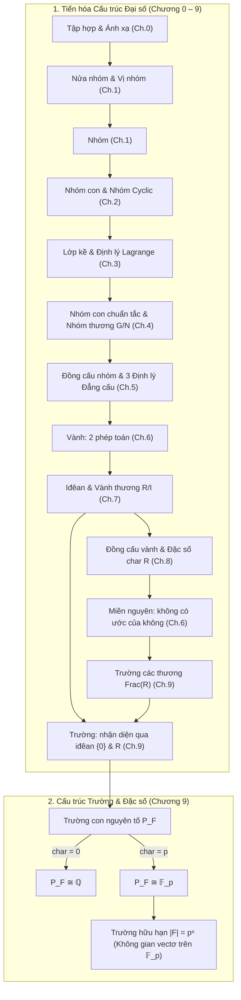

Bài học này khép lại **Chương 9** và hoàn thành toàn bộ chương trình **Cấu trúc đại số** (10 chương, từ Chương 0 đến Chương 9). Tại đây, chúng ta nhìn lại chặng đường tiến hóa của các cấu trúc đại số: từ tập hợp thô sơ với các phép toán hai ngôi, qua cấu trúc Nhóm (bảo toàn một phép toán), Vành (hai phép toán kết nối bởi luật phân phối), Miền nguyên (giản ước nhân), và đạt tới Trường (nơi mọi phép toán số học đều tự do và khả nghịch).

---

## 1. Bản đồ tư duy hệ thống Chương 9 và Toàn bộ Học phần

---

## 2. Bảng thuật ngữ song ngữ đối chiếu

Bảng dưới đây chuẩn hóa các thuật ngữ toán học trọng tâm của Chương 9 và phần kết học phần:

| Thuật ngữ tiếng Việt | Thuật ngữ tiếng Anh | Định nghĩa / Ký hiệu cốt lõi |
| :--- | :--- | :--- |
| **Trường** | *Field* | Vành giao hoán có đơn vị $1 \neq 0$ mà mọi $x \neq 0$ đều khả nghịch |
| **Trường con** | *Subfield* | Tập con $K \subseteq F$ đóng với phép trừ ($a - b$) và phép chia ($ab^{-1}$) |
| **Trường mở rộng** | *Extension field* | Trường $F$ chứa trường con $K$, ký hiệu $F/K$ |
| **Trường con nguyên tố** | *Prime subfield* | Trường con nhỏ nhất $P_F = \bigcap K$, đẳng cấu với $\mathbb{Q}$ hoặc $\mathbb{F}_p$ |
| **Trường các thương** | *Field of fractions* | $\operatorname{Frac}(R) = \mathcal{P}_R / \sim = \left\{ \frac{a}{b} \mid a \in R, b \in R \setminus \{0\} \right\}$ |
| **Đơn cấu nhúng chính tắc** | *Canonical embedding* | $\iota_R: R \hookrightarrow \operatorname{Frac}(R), a \mapsto \frac{a}{1}$ |
| **Tính chất phổ dụng** | *Universal property* | Mọi đơn cấu $f: R \hookrightarrow K$ đều mở rộng duy nhất thành $\tilde{f}: \operatorname{Frac}(R) \to K$ |
| **Địa phương hóa** | *Localization* | $S^{-1}R = \left\{ \frac{a}{s} \mid a \in R, s \in S \right\}$ với $S$ là tập nhân đóng |
| **Trường hữu hạn** | *Finite field / Galois field* | Trường có số phần tử hữu hạn $|F| = p^n$, ký hiệu $\mathbb{F}_{p^n}$ |
| **Trường thặng dư** | *Residue field* | Vành thương của vành địa phương theo iđêan cực đại: $R_P / P R_P \cong \operatorname{Frac}(R/P)$ |

---

## 3. Toàn cảnh 10 chương học phần Cấu trúc Đại số

| Chương | Tên chương | Cấu trúc trung tâm | Định lý vương miện (Crown Theorem) | Ý nghĩa sư phạm & Cầu nối |
| :---: | :--- | :--- | :--- | :--- |
| **0** | Ngôn ngữ & Công cụ đại số | Ánh xạ, đồng dư, thớ, tính xác định tốt | **Định lý 0.14:** Tiêu chuẩn xác định tốt trên tập thương | Nền tảng ngôn ngữ chung cho cả học phần |
| **1** | Nhóm & Các ví dụ cơ bản | Tiên đề nhóm, luật giản ước, lũy thừa | **Định lý 1.8:** Tính duy nhất của đơn vị và phần tử nghịch đảo | Rèn luyện tư duy tiên đề từ các họ nhóm cụ thể |
| **2** | Nhóm con & Nhóm cyclic | Nhóm con $\le$, nhóm cyclic $\langle a \rangle$, cấp | **Định lý 2.12:** Phân loại toàn bộ các nhóm cyclic ($\mathbb{Z}$ và $\mathbb{Z}/n\mathbb{Z}$) | Mẫu hình nhóm đơn giản và hoàn hảo nhất |
| **3** | Lớp kề & Định lý Lagrange | Phân hoạch lớp kề $aH$, chỉ số $[G:H]$ | **Định lý Lagrange (ĐL 3.5):** $|G| = [G:H]|H|$ | Định lý số học vĩ đại nhất của lý thuyết nhóm hữu hạn |
| **4** | Nhóm con chuẩn tắc & Nhóm thương | Nhóm chuẩn tắc $N \trianglelefteq G$, nhóm thương $G/N$ | **Định lý 4.8:** Phép nhân lớp kề xác định tốt $\iff N$ chuẩn tắc | Khởi đầu tư duy "chia để trị" và xây dựng cấu trúc thương |
| **5** | Đồng cấu nhóm & Định lý đẳng cấu | Hạt nhân $\ker\phi$, ảnh $\operatorname{im}\phi$, 3 định lý đẳng cấu | **Định lý Đẳng cấu thứ nhất (ĐL 5.8):** $G/\ker\phi \cong \operatorname{im}\phi$ | Đồng nhất hạt nhân với nhóm chuẩn tắc; phân loại nhóm |
| **6** | Vành & Các cấu trúc liên quan | Hai phép toán, ước của không, miền nguyên | **Định lý 6.12:** Mọi miền nguyên hữu hạn đều là một trường | Bước chuyển tiếp từ 1 phép toán sang 2 phép toán |
| **7** | Iđêan & Vành thương | Iđêan hai phía $I \triangleleft R$, thương $R/I$, đa thức | **Định lý 7.17:** $P$ nguyên tố $\iff R/P$ miền nguyên; $M$ cực đại $\iff R/M$ trường | Tái hiện tư duy nhóm thương ở cấp độ vành; hạt nhân là iđêan |
| **8** | Đồng cấu vành & Định lý đẳng cấu | Đồng cấu vành, điều kiện đơn vị, đặc số $\operatorname{char} R$ | **Định lý 8.21:** Đặc số miền nguyên/trường chỉ bằng $0$ hoặc $p$ | Hoàn thiện công cụ phân tích vành; đồng cấu Frobenius |
| **9** | Trường con & Trường các thương | Trường con nguyên tố $P_F$, phép dựng $\operatorname{Frac}(R)$ | **Định lý 9.18:** Tính chất phổ dụng của trường các thương | Đỉnh cao hoàn thiện hệ thống số và cấu trúc đại số |

---

## 4. Các định lý nâng cao chọn lọc

<Theorem id="thm-c9-b4-truong-huu-han-tuan-hoan" title="Tính cyclic của nhóm nhân trường hữu hạn" original="Định lý 9.20" source="gt-ctds-hvk-2026">
Cho $F$ là một trường hữu hạn bất kỳ gồm $q = p^n$ phần tử. Khi đó nhóm nhân các phần tử khác không:
$$
(F^\times, \cdot) = (F \setminus \{0\}, \cdot)
$$
là một **nhóm cyclic** cấp $q - 1$.
Do đó, tồn tại một phần tử $\alpha \in F^\times$ (gọi là phần tử sinh nguyên thủy) sao cho:
$$
F^\times = \langle \alpha \rangle = \{1, \alpha, \alpha^2, \dots, \alpha^{q-2}\}.
$$
</Theorem>

<Proof>
Nhóm $G = F^\times$ là nhóm giao hoán hữu hạn cấp $N = q - 1$.
Theo định lý cấu trúc nhóm abel hữu hạn, cấp của mọi phần tử đều chia hết ước số lớn nhất (exponent) $m$ của nhóm, với $m \le N$.
Nếu $m < N$, thì mọi phần tử $x \in F^\times$ đều thỏa mãn phương trình:
$$
x^m - 1 = 0.
$$
Tuy nhiên, $x^m - 1$ là một đa thức bậc $m$ trên trường $F$, do đó nó có tối đa $m$ nghiệm trong $F$.
Vì mọi phần tử của $F^\times$ đều là nghiệm, số nghiệm là $N$. Suy ra $N \le m$.
Kết hợp với $m \le N$, ta có $m = N = q - 1$.
Vì tồn tại phần tử có cấp đúng bằng exponent $m = N$, nhóm $F^\times$ có một phần tử cấp $q - 1$.
Vậy $F^\times$ là một nhóm cyclic.
</Proof>

---

## 5. Hệ thống bài tập 4 phân lớp kèm lời giải chi tiết

<Exercise id="ex-c9-b4-a1" title="Trường con nguyên tố của trường cụ thể" group="Nhóm A">
Tìm đặc số và mô tả tường minh trường con nguyên tố $P_F$ của các trường sau:
1. $F_1 = \mathbb{Q}(\sqrt{2}, i)$.
2. $F_2 = \mathbb{F}_2[x]/(x^3 + x + 1)$.

<Solution>
**1. Xét $F_1 = \mathbb{Q}(\sqrt{2}, i) \subseteq \mathbb{C}$**

Vì $F_1$ là trường con của trường số phức $\mathbb{C}$, ta có $n \cdot 1 \neq 0$ với mọi $n \ge 1$. Do đó $\operatorname{char}(F_1) = 0$.
   Theo Định lý 9.10, trường con nguyên tố của $F_1$ là:
   $$
   P_{F_1} \cong \mathbb{Q}.
   $$
   Cụ thể $P_{F_1} = \mathbb{Q} \subset \mathbb{Q}(\sqrt{2}, i)$.

**2. Xét $F_2 = \mathbb{F}_2[x]/(x^3 + x + 1)$**

Trong vành này, $2 \cdot 1 = 0$, do đó $\operatorname{char}(F_2) = 2$.
   Đa thức $x^3 + x + 1$ là đa thức bậc 3 trên $\mathbb{F}_2$. Ta kiểm tra nghiệm:
   - $0^3 + 0 + 1 = 1 \neq 0$.
   - $1^3 + 1 + 1 = 3 \equiv 1 \neq 0$.
   Vì không có nghiệm trong $\mathbb{F}_2$, đa thức này bất khả quy trên $\mathbb{F}_2$.
   Do đó $F_2 \cong \mathbb{F}_{2^3} = \mathbb{F}_8$ là một trường gồm 8 phần tử.
   Theo Định lý 9.10, trường con nguyên tố của $F_2$ là:
   $$
   P_{F_2} \cong \mathbb{F}_2 = \{[0], [1]\}.
   $$
</Solution>
</Exercise>

<Exercise id="ex-c9-b4-a2" title="Rút gọn phân số trong Frac(Z[i])" group="Nhóm A">
Trong trường số hữu tỉ Gauss $\mathbb{Q}(i) = \operatorname{Frac}(\mathbb{Z}[i])$, thực hiện các phép tính:
1. $X = \frac{3 + 2i}{1 + i} + \frac{2 - i}{2 + i}$.
2. Tìm nghịch đảo nhân của $X$ dưới dạng chuẩn $u + vi$ với $u, v \in \mathbb{Q}$.

<Solution>
**1. Rút gọn từng phân số**

 - Phân số thứ nhất:
     $$
     \frac{3 + 2i}{1 + i} = \frac{(3 + 2i)(1 - i)}{(1 + i)(1 - i)} = \frac{3 - 3i + 2i - 2i^2}{1^2 + 1^2} = \frac{5 - i}{2} = \frac{5}{2} - \frac{1}{2}i.
     $$
   - Phân số thứ hai:
     $$
     \frac{2 - i}{2 + i} = \frac{(2 - i)^2}{2^2 + 1^2} = \frac{4 - 4i + i^2}{5} = \frac{3 - 4i}{5} = \frac{3}{5} - \frac{4}{5}i.
     $$
   - Tổng $X$:
     $$
     X = \left(\frac{5}{2} + \frac{3}{5}\right) + \left(-\frac{1}{2} - \frac{4}{5}\right)i = \frac{25 + 6}{10} - \frac{5 + 8}{10}i = \frac{31}{10} - \frac{13}{10}i = \frac{31 - 13i}{10}.
     $$

**2. Tìm nghịch đảo của $X$**

 $$
   X^{-1} = \frac{10}{31 - 13i} = \frac{10(31 + 13i)}{31^2 + 13^2} = \frac{10(31 + 13i)}{961 + 169} = \frac{10(31 + 13i)}{1130} = \frac{31 + 13i}{113} = \frac{31}{113} + \frac{13}{113}i.
   $$
</Solution>
</Exercise>

<Exercise id="ex-c9-b4-b1" title="Tính chất phổ dụng cho Z[x]" group="Nhóm B">
Áp dụng Tính chất phổ dụng của trường các thương để chứng minh rằng:
$$
\operatorname{Frac}(\mathbb{Z}[x]) \cong \mathbb{Q}(x).
$$

<Solution>
Ta kiểm tra các điều kiện của Mệnh đề 9.19 đối với miền nguyên $R = \mathbb{Z}[x]$ và trường $F = \mathbb{Q}(x)$:
**1. $F$ là một trường chứa $R$**

Ta có $\mathbb{Z}[x] \subset \mathbb{Q}[x] \subset \mathbb{Q}(x)$. Ánh xạ nhúng $j: \mathbb{Z}[x] \hookrightarrow \mathbb{Q}(x)$ là một đơn cấu vành bảo toàn đơn vị.
**2. Mọi phần tử của $\mathbb{Q}(x)$ đều là thương của hai đa thức hệ số nguyên**

Lấy bất kỳ phân thức $f \in \mathbb{Q}(x)$, ta có $f = \frac{P(x)}{Q(x)}$ với $P(x), Q(x) \in \mathbb{Q}[x]$ và $Q(x) \neq 0$.
   Gọi $m_1 \in \mathbb{Z}^+$ là bội chung nhỏ nhất của các mẫu số của các hệ số trong $P(x)$, khi đó $m_1 P(x) = A(x) \in \mathbb{Z}[x]$.
   Gọi $m_2 \in \mathbb{Z}^+$ là bội chung nhỏ nhất của các mẫu số của các hệ số trong $Q(x)$, khi đó $m_2 Q(x) = B(x) \in \mathbb{Z}[x]$ với $B(x) \neq 0$.
   Do đó:
   $$
   f = \frac{P(x)}{Q(x)} = \frac{\frac{A(x)}{m_1}}{\frac{B(x)}{m_2}} = \frac{m_2 A(x)}{m_1 B(x)}.
   $$
   Đặt $P_0(x) = m_2 A(x) \in \mathbb{Z}[x]$ và $Q_0(x) = m_1 B(x) \in \mathbb{Z}[x] \setminus \{0\}$.
   Ta có $f = \frac{P_0(x)}{Q_0(x)} = j(P_0(x)) \cdot [j(Q_0(x))]^{-1}$.

Theo Mệnh đề 9.19, tồn tại duy nhất một đẳng cấu trường $\theta: \operatorname{Frac}(\mathbb{Z}[x]) \to \mathbb{Q}(x)$.
</Solution>
</Exercise>

<Exercise id="ex-c9-b4-b2" title="Đẳng cấu miền nguyên và trường các thương" group="Nhóm B">
1. Chứng minh rằng nếu hai miền nguyên $R$ và $S$ đẳng cấu với nhau thì hai trường các thương $\operatorname{Frac}(R)$ và $\operatorname{Frac}(S)$ đẳng cấu với nhau.
2. Chỉ ra phản ví dụ chứng minh chiều ngược lại là sai: Tồn tại hai miền nguyên $R \not\cong S$ nhưng $\operatorname{Frac}(R) \cong \operatorname{Frac}(S)$.

<Solution>
**1. Chiều thuận ($R \cong S \implies \operatorname{Frac}(R) \cong \operatorname{Frac}(S)$)**

Giả sử $\phi: R \to S$ là một đẳng cấu vành. Vì $\phi$ là đơn ánh và $\phi(0_R) = 0_S$, với mọi $b \in R \setminus \{0_R\}$ ta luôn có $\phi(b) \in S \setminus \{0_S\}$.
Xét ánh xạ cảm sinh $\tilde{\phi}: \operatorname{Frac}(R) \to \operatorname{Frac}(S)$ cho bởi:
$$
\tilde{\phi}\left(\frac{a}{b}\right) = \frac{\phi(a)}{\phi(b)}.
$$
- *Tính xác định tốt:* Nếu $\frac{a}{b} = \frac{a'}{b'}$ trong $\operatorname{Frac}(R)$, thì $ab' = a'b$ trong $R$. Tác động đồng cấu $\phi$ lên hai vế:
  $$
  \phi(a)\phi(b') = \phi(ab') = \phi(a'b) = \phi(a')\phi(b) \implies \frac{\phi(a)}{\phi(b)} = \frac{\phi(a')}{\phi(b')} \quad \text{trong } \operatorname{Frac}(S).
  $$
- *Bảo toàn phép cộng và phép nhân:* Với mọi $\frac{a}{b}, \frac{c}{d} \in \operatorname{Frac}(R)$:
  $$
  \tilde{\phi}\left(\frac{a}{b} + \frac{c}{d}\right) = \tilde{\phi}\left(\frac{ad + bc}{bd}\right) = \frac{\phi(ad + bc)}{\phi(bd)} = \frac{\phi(a)\phi(d) + \phi(b)\phi(c)}{\phi(b)\phi(d)} = \tilde{\phi}\left(\frac{a}{b}\right) + \tilde{\phi}\left(\frac{c}{d}\right),
  $$
  $$
  \tilde{\phi}\left(\frac{a}{b} \cdot \frac{c}{d}\right) = \tilde{\phi}\left(\frac{ac}{bd}\right) = \frac{\phi(a)\phi(c)}{\phi(b)\phi(d)} = \tilde{\phi}\left(\frac{a}{b}\right) \cdot \tilde{\phi}\left(\frac{c}{d}\right).
  $$
- *Tính song ánh:* Ánh xạ $\widetilde{\phi^{-1}}: \operatorname{Frac}(S) \to \operatorname{Frac}(R), \frac{u}{v} \mapsto \frac{\phi^{-1}(u)}{\phi^{-1}(v)}$ là ánh xạ ngược hai phía của $\tilde{\phi}$. Vậy $\operatorname{Frac}(R) \cong \operatorname{Frac}(S)$.

**2. Chiều đảo sai**

 - Xét $R = \mathbb{Z}$ và $S = \mathbb{Q}$.
   - Cả hai đều là miền nguyên, và $\operatorname{Frac}(\mathbb{Z}) = \mathbb{Q}$, $\operatorname{Frac}(\mathbb{Q}) \cong \mathbb{Q}$. Do đó $\operatorname{Frac}(R) \cong \operatorname{Frac}(S)$.
   - Tuy nhiên $\mathbb{Z} \not\cong \mathbb{Q}$ vì $\mathbb{Q}$ là trường còn $\mathbb{Z}$ không phải là trường (phần tử $2 \in \mathbb{Z}$ không khả nghịch trong $\mathbb{Z}$).
   - Một phản ví dụ khác mà cả hai vành đều không phải là trường: $R = \mathbb{Z}[2x]$ và $S = \mathbb{Z}[x]$.
     Cả hai đều có trường các thương là $\mathbb{Q}(x)$, nhưng $R \not\cong S$ vì $S$ có phần tử $x$ chia hết cho $2$ trong trường thương trong khi mọi phần tử bậc 1 của $R$ đều có hệ số chẵn.
</Solution>
</Exercise>

<Exercise id="ex-c9-b4-c1" title="Vành con của trường hữu hạn" group="Nhóm C">
Cho $F$ là một trường hữu hạn và $R$ là một vành con của $F$ thỏa mãn $1_F \in R$.
1. Chứng minh rằng $R$ là một trường con của $F$.
2. Từ đó kết luận rằng $\operatorname{Frac}(R) = R$.

<Solution>
**1. $R$ là trường con**

   - Vì $R \subseteq F$ và $F$ là trường, $R$ không có ước của không khác không, nên $R$ là miền nguyên.
   - Vì $F$ hữu hạn, vành con $R$ là một tập hợp hữu hạn.
   - Với mọi $a \in R, a \neq 0$, xét ánh xạ nhân $L_a: R \to R, x \mapsto ax$.
   - $L_a$ là đơn ánh vì $ax = ay \implies a(x - y) = 0 \implies x = y$ (do $R$ không có ước của không).
   - Vì $R$ hữu hạn, mọi đơn ánh từ $R$ vào chính nó đều là toàn ánh.
   - Do đó tồn tại $b \in R$ sao cho $L_a(b) = ab = 1_F$.
   - Do $F$ giao hoán, $ba = ab = 1_F$, nghĩa là $a^{-1} = b \in R$.
   - Vì mọi phần tử khác không trong $R$ đều có nghịch đảo trong $R$, $R$ là một trường.
   Theo Mệnh đề 9.4, $R$ là một trường con của $F$.

**2. $\operatorname{Frac}(R) = R$**

   Theo Bài 9.2.B1, trường các thương của một trường luôn đẳng cấu tự nhiên với chính nó. Do đó $\operatorname{Frac}(R) \cong R$, và khi đồng nhất qua phép nhúng $\iota_R$, ta có $\operatorname{Frac}(R) = R$.
</Solution>
</Exercise>

<Exercise id="ex-c9-b4-c2" title="Cấp của trường hữu hạn và tính cyclic" group="Nhóm C">
Cho $F$ là một trường hữu hạn.
1. Chứng minh rằng số phần tử của $F$ là $p^n$ với $p$ là số nguyên tố và $n \ge 1$.
2. Chứng minh rằng nhóm nhân $F^\times$ là nhóm cyclic cấp $p^n - 1$.
3. Tìm phần tử sinh của nhóm nhân của trường $\mathbb{F}_7$.

<Solution>
**1. Số phần tử $|F| = p^n$**

Vì $F$ là một trường hữu hạn, đặc số $\operatorname{char}(F)$ không thể bằng $0$ (nếu bằng $0$ thì $F$ chứa $\mathbb{Q}$ vô hạn). Do $F$ là miền nguyên, $\operatorname{char}(F) = p$ là một số nguyên tố, và trường con nguyên tố của $F$ là $P_F \cong \mathbb{F}_p = \mathbb{Z}/p\mathbb{Z}$.
   Xem $F$ như một không gian vectơ trên trường nền $P_F \cong \mathbb{F}_p$. Vì $F$ hữu hạn nên $\dim_{\mathbb{F}_p}(F) = n < \infty$ ($n \ge 1$).
   Gọi $\{e_1, e_2, \dots, e_n\}$ là một cơ sở của $F$ trên $\mathbb{F}_p$. Khi đó mọi phần tử $x \in F$ đều biểu diễn duy nhất dưới dạng:
   $$
   x = c_1 e_1 + c_2 e_2 + \dots + c_n e_n, \quad c_i \in \mathbb{F}_p.
   $$
   Vì mỗi hệ số $c_i$ có đúng $p$ cách chọn độc lập trong $\mathbb{F}_p$, số phần tử của $F$ là $|F| = p^n$.

**2. Nhóm nhân $F^\times$ là cyclic**

Đặt $G = F^\times$ là nhóm nhân Abel hữu hạn cấp $N = p^n - 1$. Gọi $m = \operatorname{lcm}\{\operatorname{ord}(a) \mid a \in G\}$ là số mũ (exponent) của nhóm Abel $G$.
   - Theo tính chất của nhóm Abel hữu hạn, tồn tại một phần tử $g \in G$ có cấp đúng bằng $\operatorname{ord}(g) = m$, và mọi ước của cấp nhóm đều chia hết cho $m$, nên $m \le N$.
   - Mặt khác, với mọi $a \in G$, vì $\operatorname{ord}(a) \mid m$, ta có $a^m = 1$, nghĩa là mọi phần tử của $G$ đều là nghiệm của đa thức $P(x) = x^m - 1 \in F[x]$.
   - Vì đa thức bậc $m$ trên trường $F$ có tối đa $m$ nghiệm trong $F$, mà $P(x)$ có ít nhất $|G| = N$ nghiệm phân biệt trong $F$, ta suy ra $N \le m$.
   - Kết hợp $m \le N$ và $N \le m$, ta được $m = N = |F^\times|$. Vậy phần tử $g$ có cấp $\operatorname{ord}(g) = |F^\times|$, nghĩa là $F^\times = \langle g \rangle$ là nhóm cyclic cấp $p^n - 1$.

**3. Phần tử sinh của $\mathbb{F}_7^\times$**

Cấp của nhóm nhân là $|\mathbb{F}_7^\times| = 7 - 1 = 6$. Nhóm này cyclic cấp 6.
   Các ước của 6 là $1, 2, 3, 6$.
   Thử các phần tử trong $\mathbb{F}_7 = \{[1], [2], [3], [4], [5], [6]\}$:
   - Thử $[2]$: $[2]^1 = [2]$, $[2]^2 = [4]$, $[2]^3 = [8] \equiv [1]$. Cấp của $[2]$ là $3 \neq 6$.
   - Thử $[3]$:
     $$
     [3]^1 = [3], \quad [3]^2 = [9] \equiv [2], \quad [3]^3 = [6],
     $$
     $$
     [3]^4 = [18] \equiv [4], \quad [3]^5 = [12] \equiv [5], \quad [3]^6 = [15] \equiv [1].
     $$
   Lũy thừa của $[3]$ quét qua toàn bộ 6 phần tử khác không của $\mathbb{F}_7$.
   Do đó $[3]$ là một phần tử sinh nguyên thủy của $\mathbb{F}_7^\times$.
   (Phần tử sinh còn lại là $[3]^{-1} = [5]$).
</Solution>
</Exercise>

<Exercise id="ex-c9-b4-d1" title="Vành địa phương Z_(p) là một PID" group="Nhóm D">
Cho $p$ là số nguyên tố. Xét vành địa phương:
$$
\mathbb{Z}_{(p)} = \left\{ \frac{a}{b} \in \mathbb{Q} \;\middle|\; a, b \in \mathbb{Z}, \gcd(a, b) = 1, p \nmid b \right\}.
$$
1. Chứng minh rằng mọi phần tử khác không $x \in \mathbb{Z}_{(p)}$ đều viết được duy nhất dưới dạng:
$$
x = p^k \cdot u \quad \text{với } k \ge 0 \text{ và } u \in (\mathbb{Z}_{(p)})^\times.
$$
2. Chứng minh rằng mọi iđêan của $\mathbb{Z}_{(p)}$ đều có dạng $(p^k)$ với $k \ge 0$. Từ đó suy ra $\mathbb{Z}_{(p)}$ là một miền iđêan chính (PID) có duy nhất một iđêan cực đại là $(p)$.

<Solution>
**1. Biểu diễn $x = p^k \cdot u$**

   Lấy $x = \frac{a}{b} \in \mathbb{Z}_{(p)} \setminus \{0\}$ với $\gcd(a, b) = 1$ và $p \nmid b$.
   Phân tích $a = p^k \cdot a'$ với $k \ge 0$ và $p \nmid a'$. Khi đó:
   $$
   x = p^k \cdot \left(\frac{a'}{b}\right).
   $$
   Đặt $u = \frac{a'}{b}$. Vì $p \nmid a'$ và $p \nmid b$, theo Bài 9.2.D2, phần tử nghịch đảo $u^{-1} = \frac{b}{a'}$ cũng có mẫu số không chia hết cho $p$, nên $u \in (\mathbb{Z}_{(p)})^\times$.
   Tính duy nhất của $k$ suy ra từ định lý phân tích thừa số nguyên tố duy nhất trong $\mathbb{Z}$.

**2. Cấu trúc iđêan của $\mathbb{Z}_{(p)}$**

   Lấy $I$ là một iđêan bất kỳ của $\mathbb{Z}_{(p)}$.
   Nếu $I = \{0\}$, thì $I = (0)$ là iđêan chính.
   Nếu $I \neq \{0\}$, xét tập hợp các số mũ:
   $$
   \mathcal{K} = \{k \ge 0 \mid \exists u \in (\mathbb{Z}_{(p)})^\times: p^k u \in I\}.
   $$
   Vì $I \neq \{0\}$, $\mathcal{K} \neq \emptyset$. Theo nguyên lý cực tiểu trong $\mathbb{N}$, $\mathcal{K}$ có phần tử nhỏ nhất, gọi là $m = \min\mathcal{K}$.
   Tồn tại $u_0 \in (\mathbb{Z}_{(p)})^\times$ sao cho $p^m u_0 \in I$.
   Vì $u_0$ khả nghịch, $p^m = u_0^{-1}(p^m u_0) \in I$. Do đó $(p^m) \subseteq I$.
   Ngược lại, lấy phần tử bất kỳ $y \in I \setminus \{0\}$. Theo câu 1, $y = p^k v$ với $k \ge m$ và $v \in (\mathbb{Z}_{(p)})^\times$.
   Khi đó $y = p^m (p^{k - m} v) \in (p^m)$ vì $k - m \ge 0$. Suy ra $I \subseteq (p^m)$.
   Vậy $I = (p^m)$.
   Mọi iđêan của $\mathbb{Z}_{(p)}$ đều là iđêan chính sinh bởi một lũy thừa của $p$:
   $$
   \mathbb{Z}_{(p)} = (1) \supset (p) \supset (p^2) \supset (p^3) \supset \dots \supset \{0\}.
   $$
   Do đó $\mathbb{Z}_{(p)}$ là một miền iđêan chính (PID). Iđêan chân phương lớn nhất duy nhất là $(p)$, nên nó là iđêan cực đại duy nhất.
</Solution>
</Exercise>

<Exercise id="ex-c9-b4-d2" title="Phép dựng kết hợp Trường hàm của đường cong suy biến" group="Nhóm D">
Trong vành đa thức hai biến $\mathbb{C}[x, y]$, xét đa thức $f(x, y) = y^2 - x^3$.
1. Chứng minh rằng $P = (y^2 - x^3)$ là một iđêan nguyên tố của $\mathbb{C}[x, y]$ và do đó $R = \mathbb{C}[x, y]/P$ là một miền nguyên.
2. Mô tả trường các thương $K = \operatorname{Frac}(R)$.
3. Đặt $t = \frac{\bar{y}}{\bar{x}} \in K$. Chứng minh rằng $K \cong \mathbb{C}(t)$ (trường phân thức hữu tỉ một biến) và tìm biểu diễn của $\bar{x}, \bar{y}$ theo $t$.

<Solution>
**1. $P$ là iđêan nguyên tố**

   Đa thức $y^2 - x^3$ xem như đa thức bậc hai theo $y$ với hệ số tự do là $-x^3 \in \mathbb{C}[x]$.
   Phần tử nguyên tố $x$ chia hết $-x^3$ nhưng $x^2 \nmid -x^3$ (chỉ chia hết $x^2$, nhưng đối với tính nguyên tố trong $\mathbb{C}[x]$, $x$ là nguyên tố và tiêu chuẩn Eisenstein áp dụng với lũy thừa bậc 1 nếu xét hệ số nguyên tố). Hoặc đơn giản hơn: $y^2 - x^3$ không thể phân tích thành tích của hai đa thức bậc nhất theo $y$ trong $(\mathbb{C}[x])[y]$ vì $\sqrt{x^3} = x\sqrt{x} \notin \mathbb{C}[x]$.
   Do đó $y^2 - x^3$ bất khả quy trong $\mathbb{C}[x, y]$.
   Vì $\mathbb{C}[x, y]$ là vành UFD, phần tử bất khả quy sinh ra một iđêan nguyên tố.
   Theo Định lý 7.17, $R = \mathbb{C}[x, y]/(y^2 - x^3)$ là một miền nguyên.

**2. Trường các thương $K = \operatorname{Frac}(R)$**

   Ký hiệu $\bar{x}, \bar{y}$ là ảnh của $x, y$ trong $R$, thỏa mãn hệ thức:
   $$
   \bar{y}^2 = \bar{x}^3.
   $$
   Trường các thương là:
   $$
   K = \mathbb{C}(\bar{x}, \bar{y}) = \left\{ \frac{A(\bar{x}, \bar{y})}{B(\bar{x}, \bar{y})} \;\middle|\; B \not\equiv 0 \pmod{y^2 - x^3} \right\}.
   $$

**3. Đẳng cấu với $\mathbb{C}(t)$**

   Đặt $t = \frac{\bar{y}}{\bar{x}} \in K$ (với $\bar{x} \neq 0$). Ta có:
   $$
   t^2 = \frac{\bar{y}^2}{\bar{x}^2} = \frac{\bar{x}^3}{\bar{x}^2} = \bar{x}.
   $$
   Do đó:
   $$
   \bar{x} = t^2.
   $$
   Từ $t = \frac{\bar{y}}{\bar{x}}$, ta có:
   $$
   \bar{y} = t \cdot \bar{x} = t \cdot t^2 = t^3.
   $$
   Vì cả $\bar{x} = t^2$ và $\bar{y} = t^3$ đều thuộc $\mathbb{C}(t)$, ta có $\mathbb{C}(\bar{x}, \bar{y}) \subseteq \mathbb{C}(t)$.
   Ngược lại, vì $t = \frac{\bar{y}}{\bar{x}} \in \mathbb{C}(\bar{x}, \bar{y})$, ta có $\mathbb{C}(t) \subseteq \mathbb{C}(\bar{x}, \bar{y})$.
   Do đó:
   $$
   K = \mathbb{C}(\bar{x}, \bar{y}) = \mathbb{C}(t).
   $$
   Vậy trường các thương của vành tọa độ đường cong cuspidal cubic $y^2 = x^3$ đẳng cấu hoàn toàn với trường phân thức một biến $\mathbb{C}(t)$.
   Đây là đỉnh cao kết nối giữa đại số trừu tượng và hình học đại số!
</Solution>
</Exercise>

---

## 6. Lời kết học phần Cấu trúc Đại số

<KeyTakeaways>
- **Trường là cấu trúc hoàn hảo:** Một trường giao hoán là cấu trúc đại số nơi mọi phần tử khác không đều có nghịch đảo. Đặc trưng bởi tính chất chỉ có đúng hai iđêan $\{0\}$ và chính nó.
- **Trường con nguyên tố:** Là nền móng của mọi trường: $\mathbb{Q}$ khi đặc số bằng $0$, và $\mathbb{F}_p$ khi đặc số bằng $p$. Cấp của trường hữu hạn luôn có dạng $p^n$ và nhóm nhân luôn là cyclic cấp $p^n - 1$.
- **Trường các thương $\operatorname{Frac}(R)$:** Là chiếc trường nhỏ nhất và duy nhất sai khác đẳng cấu chứa miền nguyên $R$. Thỏa mãn tính chất phổ dụng: mọi đơn cấu vào trường đều mở rộng duy nhất lên $\operatorname{Frac}(R)$.
- **Bức tranh toàn cảnh:** Học phần Cấu trúc đại số hoàn thành sứ mệnh cung cấp cho sinh viên Sư phạm Toán học hệ thống ngôn ngữ, công cụ và tư duy cấu trúc hiện đại: từ Nhóm, Vành, Iđêan đến Trường, mở đường cho các môn học tiếp theo như Hình học đại số, Lý thuyết Galois và Số học cao cấp.
</KeyTakeaways>
