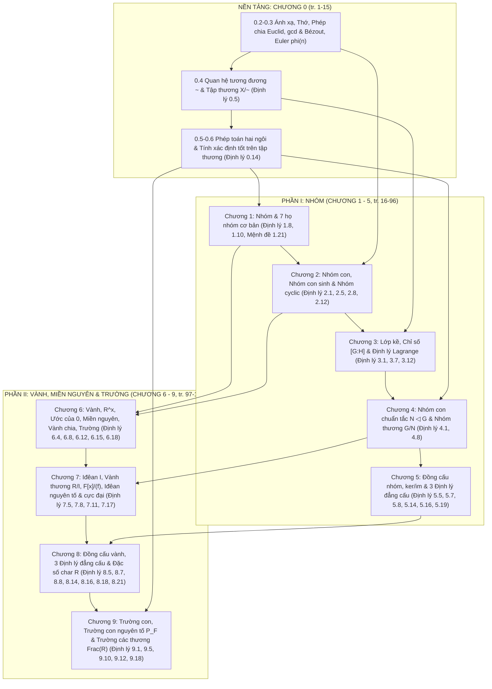

# Bản đồ Kiến thức & Danh mục Kết quả Học thuật — Môn Cấu trúc Đại số

> **Nguồn chuẩn:** _Giáo trình Cấu trúc Đại số: Nhóm • Vành • Trường_ — TS. Huỳnh Việt Khánh (`Giao_trinh_Cau_truc_dai_so.pdf`, bản ngày `10/10/2026`).  
> **Tuân thủ `academic-integrity`:** Toàn bộ số hiệu gốc (`Định lý`, `Mệnh đề`, `Hệ quả`, `Định nghĩa`, `Phản ví dụ`) và số trang (`tr.`) dưới đây được trích xuất chính xác 100% từ văn bản gốc của giáo trình.

---

## 1. Sơ đồ phụ thuộc kiến thức tổng thể (Prerequisite Graph)

---

## 2. Mối liên hệ học thuật và đối chiếu cấu trúc xuyên suốt

### 2.1. Ba phép dựng tập thương trung tâm của giáo trình

Giáo trình kết nối toàn bộ 10 chương bằng cơ chế **đồng nhất theo quan hệ tương đương và kiểm tra tính xác định tốt** (`Định lý 0.14, tr. 8`):

1. **Nhóm thương $G/N$ (`Chương 4, tr. 75`):**
   - Quan hệ tương đương trên nhóm $G$: $x \sim_N y \iff x^{-1}y \in N$ (`Định lý 3.1`).
   - Điều kiện cần và đủ để phép nhân $(aN)(bN) = abN$ xác định tốt trên tập thương là $N$ phải là **nhóm con chuẩn tắc** ($N \trianglelefteq G$, tức $gNg^{-1} = N$, `Định lý 4.8`).
2. **Vành thương $R/I$ (`Chương 7, tr. 118`):**
   - Quan hệ tương đương trên nhóm cộng abel $(R,+)$: $a \sim_I b \iff a - b \in I$. Phép cộng lớp kề tự động xác định tốt vì $(R,+)$ giao hoán.
   - Điều kiện cần và đủ để phép nhân $(a+I)(b+I) = ab+I$ xác định tốt là $I$ phải thỏa mãn **điều kiện hấp thụ hai phía** ($rI \subseteq I$ và $Ir \subseteq I$), tức $I$ là **iđêan hai phía** (`Định lý 7.11`).
3. **Trường các thương $\operatorname{Frac}(R)$ (`Chương 9, tr. 149–152`):**
   - Quan hệ tương đương trên tập cặp $\mathcal{P}_R = R \times (R \setminus \{0\})$: $(a,b) \sim (c,d) \iff ad = bc$.
   - Tính bắc cầu của $\sim$ và tính xác định tốt của phép cộng/nhân phân số $a/b$ đòi hỏi **luật giản ước nhân**, tức $R$ phải là **miền nguyên** (`Mệnh đề 9.11` & `Định lý 9.12`).

### 2.2. Bảng đối chiếu song song Nhóm và Vành (`tr. 139`)

| Khái niệm trong Nhóm (Phần I)                                      | Khái niệm tương ứng trong Vành (Phần II)                          | Điểm giống và khác biệt cốt lõi cần lưu ý                                                                                |
| :----------------------------------------------------------------- | :---------------------------------------------------------------- | :----------------------------------------------------------------------------------------------------------------------- |
| Nhóm $G$ (1 phép toán $*$)                                         | Vành $R$ (2 phép toán $+$ và $\cdot$)                             | $(R,+)$ luôn là nhóm abel; phép nhân chỉ cần kết hợp và phân phối đối với phép cộng.                                     |
| Nhóm con $H \le G$                                                 | Vành con $S \subseteq R$                                          | Ảnh của đồng cấu nhóm là nhóm con; ảnh của đồng cấu vành là vành con.                                                    |
| Nhóm con chuẩn tắc $N \trianglelefteq G$ ($gNg^{-1} \subseteq N$)  | Iđêan hai phía $I \subseteq R$ ($rI \subseteq I, Ir \subseteq I$) | Hạt nhân $\ker\varphi$ của đồng cấu nhóm là nhóm con chuẩn tắc; hạt nhân $\ker f$ của đồng cấu vành là iđêan hai phía.   |
| Nhóm thương $G/N$                                                  | Vành thương $R/I$                                                 | Cả hai đều được dựng từ lớp kề cùng phép chiếu chính tắc $\pi$.                                                          |
| Định lý đẳng cấu I: $G/\ker\varphi \cong \operatorname{im}\varphi$ | Định lý đẳng cấu I: $R/\ker f \cong \operatorname{im} f$          | Hoàn toàn tương tự qua nguyên lý phân tích qua thương (`Định lý 5.7` và `Định lý 8.7`).                                  |
| Định lý đẳng cấu II: $H/(H \cap N) \cong HN/N$                     | Định lý đẳng cấu II: $I/(I \cap J) \cong (I+J)/J$                 | Trong nhóm: $H \le G, N \trianglelefteq G$. Trong vành: $I$ chỉ cần là vành con, $J$ là iđêan hai phía (`Định lý 8.14`). |
| Định lý đẳng cấu III: $(G/N)/(H/N) \cong G/H$                      | Định lý đẳng cấu III: $(R/I)/(J/I) \cong R/J$                     | Rút gọn hai tầng cấu trúc thương lồng nhau (`Định lý 5.16` và `Định lý 8.16`).                                           |

### 2.3. Bảng đối chiếu hai phép dựng từ vành sang trường: $R/I$ và $\operatorname{Frac}(R)$ (`tr. 157`)

| Tiêu chí                     | Vành thương $R/I$ (Chương 7 & 8)                                                  | Trường các thương $\operatorname{Frac}(R)$ (Chương 9)                                                                                        |
| :--------------------------- | :-------------------------------------------------------------------------------- | :------------------------------------------------------------------------------------------------------------------------------------------- |
| **Dữ liệu đầu vào**          | Vành $R$ và iđêan hai phía $I \subseteq R$                                        | Miền nguyên $R$                                                                                                                              |
| **Bản chất tác động**        | **Đồng nhất phần tử:** Gộp các phần tử của $I$ về $0_{R/I}$                       | **Mở rộng phép chia:** Bổ sung nghịch đảo cho mọi $b \in R \setminus \{0\}$                                                                  |
| **Ánh xạ chính tắc**         | Toàn cấu chiếu $\pi_I: R \to R/I$ (thường không đơn ánh)                          | Đơn cấu nhúng $\iota_R: R \to \operatorname{Frac}(R), a \mapsto a/1$                                                                         |
| **Khi nào thu được trường?** | Khi $R$ giao hoán có đơn vị và $I = M$ là **iđêan cực đại** (`Định lý 7.17`)      | **Luôn luôn** là trường nhỏ nhất chứa $R$ (`Định lý 9.12` & `9.18`)                                                                          |
| **Ví dụ mẫu mực**            | $\mathbb{Z}/p\mathbb{Z} = \mathbb{F}_p$, $\mathbb{R}[x]/(x^2+1) \cong \mathbb{C}$ | $\operatorname{Frac}(\mathbb{Z}) = \mathbb{Q}$, $\operatorname{Frac}(F[x]) = F(x)$, $\operatorname{Frac}(\mathbb{Z}[i]) \cong \mathbb{Q}(i)$ |

---

## 3. Danh mục đầy đủ Định nghĩa, Định lý, Mệnh đề, Hệ quả & Phản ví dụ theo Giáo trình

> **Quy tắc sử dụng khi biên soạn MDX:** Khi đưa bất kỳ kết quả nào dưới đây vào bài học MDX, thuộc tính `original` và `pages` trong prop `source` phải khớp chính xác với bảng tra cứu này.

### Chương 0: Ngôn ngữ và công cụ đại số (`tr. 1–15`, PDF `9–23`)

| Số hiệu gốc (`original`)   | Tên / Nội dung kết quả trong giáo trình                                                                                                                                                         | Trang sách | Trang PDF |
| :------------------------- | :---------------------------------------------------------------------------------------------------------------------------------------------------------------------------------------------- | :--------: | :-------: |
| **Ví dụ 0.1 – 0.2**        | Ảnh, nghịch ảnh của $f(x)=x^2$; kiểm tra đơn ánh/toàn ánh phụ thuộc tập nguồn và tập đích                                                                                                       |   `2–3`    |  `10–11`  |
| **Ví dụ 0.3 – 0.4**        | Thuật toán Euclid và biểu diễn Bézout cho $\gcd(252,198)=18$; tính $\varphi(12)=4, \varphi(p)=p-1$                                                                                              |    `4`     |   `12`    |
| **Định lý 0.5**            | **Quan hệ tương đương và phân hoạch:** Mọi quan hệ tương đương $\sim$ trên $X$ sinh ra phân hoạch $X/\sim$, và ngược lại mọi phân hoạch $\mathcal{P}$ xác định duy nhất một quan hệ tương đương |    `5`     |   `13`    |
| **Ví dụ 0.6 – 0.8**        | Đồng dư môđulô $n$ trên $\mathbb{Z}$; các lớp tương đương của $\sim_f$ là các thớ $f^{-1}(\{b\})$; hai điểm có cùng khoảng cách đến gốc trên $\mathbb{R}^2$                                     |    `6`     |   `14`    |
| **Phản ví dụ 0.9**         | **Phản xạ và đối xứng chưa đủ:** Quan hệ $\|x-y\| \le 1$ trên $\mathbb{R}$ có tính phản xạ và đối xứng nhưng không bắc cầu                                                                      |    `7`     |   `15`    |
| **Ví dụ 0.10 & 0.13**      | Phép toán có đơn vị và nghịch đảo; phép toán $x*y = x+y+xy$ trên $\mathbb{R}$ có đơn vị $0$ và nghịch đảo của $x \neq -1$                                                                       |   `7–8`    |  `15–16`  |
| **Phản ví dụ 0.11 – 0.12** | Phép trừ trên $\mathbb{Z}$ không kết hợp; phép nhân ma trận $M_2(\mathbb{R})$ kết hợp nhưng không giao hoán                                                                                     |   `7–8`    |  `15–16`  |
| **Định lý 0.14**           | **Tiêu chuẩn xác định tốt cho phép toán trên tập thương:** Điều kiện $[x]*[y] := [x \star y]$ xác định tốt $\iff [x \star y] = [x' \star y']$ với mọi $x \sim x', y \sim y'$                    |    `8`     |   `16`    |
| **Ví dụ 0.15**             | Tính xác định tốt của phép cộng và phép nhân trên $\mathbb{Z}/n\mathbb{Z}$                                                                                                                      |    `9`     |   `17`    |
| **Phản ví dụ 0.16**        | **Một quy tắc phụ thuộc đại diện:** Ánh xạ $[x]_4 \mapsto [x]_3$ từ $\mathbb{Z}/4\mathbb{Z} \to \mathbb{Z}/3\mathbb{Z}$ không xác định tốt                                                      |    `9`     |   `17`    |
| **Ví dụ 0.17 – 0.18**      | Đổi đồng thời hai phân số đại diện trên $P/\sim$; song ánh $\bar{f}: X/\sim_f \to \operatorname{im} f$                                                                                          |    `10`    |   `18`    |

### Chương 1: Nhóm và các ví dụ cơ bản (`tr. 17–36`, PDF `25–44`)

| Số hiệu gốc (`original`) | Tên / Nội dung kết quả trong giáo trình                                                                                                                                                                                                                                | Trang sách | Trang PDF |
| :----------------------- | :--------------------------------------------------------------------------------------------------------------------------------------------------------------------------------------------------------------------------------------------------------------------- | :--------: | :-------: |
| **Ví dụ 1.1 – 1.2**      | Phân biệt $(\mathbb{N},+)$ (vị nhóm), $(\mathbb{Z}_{>0},+)$ (nửa nhóm), $(\mathbb{Z},+)$ (nhóm abel); nhóm $(\mathbb{R}\setminus\{-1\}, *)$ với $x*y=x+y+xy$                                                                                                           |    `19`    |   `27`    |
| **Phản ví dụ 1.3 – 1.6** | Không đóng (số lẻ với phép cộng); không kết hợp ($(\mathbb{Z},-)$); thiếu đơn vị ($(\mathbb{Z}_{>0},+)$); thiếu nghịch đảo ($(\mathbb{Z},\cdot)$ và $M_2(\mathbb{R})$)                                                                                                 |    `19`    |   `27`    |
| **Ví dụ 1.7**            | Nhóm ma trận tam giác trên dạng $\begin{pmatrix} 1 & t \\ 0 & 1 \end{pmatrix}$ đẳng cấu hành vi với $(\mathbb{R},+)$                                                                                                                                                   |    `20`    |   `28`    |
| **Định lý 1.8**          | **Các tính chất cơ bản trong một nhóm:** Duy nhất phần tử đơn vị $e$; duy nhất nghịch đảo $a^{-1}$; luật giản ước trái và phải; phương trình $ax=b$ có nghiệm duy nhất $x=a^{-1}b$, $ya=b$ có nghiệm duy nhất $y=ba^{-1}$; $(a^{-1})^{-1}=a$; $(ab)^{-1}=b^{-1}a^{-1}$ |    `20`    |   `28`    |
| **Ví dụ 1.9**            | Kiểm tra trực tiếp $(AB)^{-1} = B^{-1}A^{-1} \neq A^{-1}B^{-1}$ trong $\operatorname{GL}_2(\mathbb{R})$                                                                                                                                                                |    `21`    |   `29`    |
| **Định lý 1.10**         | **Quy tắc lũy thừa trong nhóm:** $a^m a^n = a^{m+n}$, $(a^m)^n = a^{mn}$ ($\forall m,n \in \mathbb{Z}$); nếu $ab=ba$ thì $(ab)^n = a^n b^n$                                                                                                                            |    `23`    |   `31`    |
| **Ví dụ 1.11 – 1.12**    | Phản ví dụ $(ab)^2 \neq a^2 b^2$ trong $S_3$; bảng Cayley của $(\mathbb{Z}/4\mathbb{Z},+)$ và bảng có hàng/cột là hoán vị nhưng không kết hợp trên $\mathbb{Z}/3\mathbb{Z}$                                                                                            |  `23–24`   |  `31–32`  |
| **Ví dụ 1.13 – 1.15**    | Tính trong $\mathbb{Z}/12\mathbb{Z}$; bảng nhân nhóm khả nghịch $U(10)=\{1,3,7,9\}$; so sánh $U(8)$ (mọi $x^2=1$) và $U(10)$ (có phần tử bậc 4)                                                                                                                        |  `24–25`   |  `32–33`  |
| **Ví dụ 1.16 – 1.19**    | Nhóm đối xứng $S_3$ (cấp 6, không giao hoán); nhóm nhị diện $D_8$ của hình vuông (cấp 8, $sr=r^3s$); nhóm ma trận khả nghịch $\operatorname{GL}_2(\mathbb{R})$                                                                                                         |  `26–28`   |  `34–36`  |
| **Định nghĩa 1.20**      | **Nhóm affine của đường thẳng thực:** $\operatorname{Aff}(\mathbb{R}) = \{T_{a,b}: \mathbb{R} \to \mathbb{R}, x \mapsto ax+b \mid a \in \mathbb{R}^\times, b \in \mathbb{R}\}$                                                                                         |    `28`    |   `36`    |
| **Mệnh đề 1.21**         | **Cấu trúc nhóm của $\operatorname{Aff}(\mathbb{R})$:** $T_{a,b} \circ T_{c,d} = T_{ac, ad+b}$, đơn vị $T_{1,0}$, nghịch đảo $T_{a,b}^{-1} = T_{a^{-1}, -a^{-1}b}$                                                                                                     |    `29`    |   `37`    |
| **Ví dụ 1.22**           | Tính hợp thành không giao hoán của $T_{2,1}$ và $T_{1,-3}$ trong $\operatorname{Aff}(\mathbb{R})$                                                                                                                                                                      |    `29`    |   `37`    |

### Chương 2: Nhóm con và nhóm cyclic (`tr. 37–54`, PDF `45–62`)

| Số hiệu gốc (`original`) | Tên / Nội dung kết quả trong giáo trình                                                                                                                                                                                                                                                                                                                            | Trang sách | Trang PDF |
| :----------------------- | :----------------------------------------------------------------------------------------------------------------------------------------------------------------------------------------------------------------------------------------------------------------------------------------------------------------------------------------------------------------- | :--------: | :-------: |
| **Định lý 2.1**          | **Tiêu chuẩn nhóm con:** $H \subseteq G$ là nhóm con ($H \le G$) $\iff (H \neq \varnothing, xy \in H, x^{-1} \in H) \iff (H \neq \varnothing \text{ và } xy^{-1} \in H, \forall x,y \in H)$                                                                                                                                                                        |    `38`    |   `46`    |
| **Ví dụ 2.2 – 2.3**      | Các nhóm con $d\mathbb{Z} \le \mathbb{Z}$; nhóm con các ma trận đường chéo khả nghịch trong $\operatorname{GL}_2(\mathbb{R})$                                                                                                                                                                                                                                      |  `38–39`   |  `46–47`  |
| **Phản ví dụ 2.4**       | Tập đóng với phép toán nhưng không là nhóm con: $\mathbb{N} \subseteq (\mathbb{Z},+)$                                                                                                                                                                                                                                                                              |    `39`    |   `47`    |
| **Định lý 2.5**          | **Mô tả nhóm con sinh bằng các từ hữu hạn:** $\langle S \rangle = \{s_1^{\varepsilon_1} s_2^{\varepsilon_2} \cdots s_k^{\varepsilon_k} \mid k \ge 0, s_i \in S, \varepsilon_i \in \{1,-1\}\}$                                                                                                                                                                      |    `40`    |   `48`    |
| **Ví dụ 2.6 – 2.7**      | $\langle (12), (23) \rangle = S_3$; nhóm con sinh bởi ma trận $\begin{pmatrix} 1 & 1 \\ 0 & 1 \end{pmatrix}$ và trường hợp $\langle 18, 30 \rangle = 6\mathbb{Z}$                                                                                                                                                                                                  |  `40–41`   |  `48–49`  |
| **Định lý 2.8**          | **Lũy thừa của một phần tử và hai mô hình cyclic chuẩn:** (a) $\operatorname{ord}(a)=\infty \implies \langle a \rangle \cong \mathbb{Z}$; (b) $\operatorname{ord}(a)=n < \infty \implies a^k=e \iff n \mid k$ và $\langle a \rangle \cong \mathbb{Z}/n\mathbb{Z}$                                                                                                  |    `42`    |   `50`    |
| **Ví dụ 2.9 – 2.11**     | Cấp của một chu trình độ dài $m$ trong $S_n$ bằng $m$; nhóm con các phép quay $R = \langle r \rangle \le D_{2n}$; nhóm các căn bậc $n$ của đơn vị $\mu_n = \langle \zeta_n \rangle \le \mathbb{C}^\times$                                                                                                                                                          |    `43`    |   `51`    |
| **Định lý 2.12**         | **Cấu trúc nhóm con của nhóm cyclic:** (a) Mọi nhóm con của nhóm cyclic đều là cyclic; (b) Trong $\langle a \rangle$ cấp $n$: $\operatorname{ord}(a^k) = \frac{n}{\gcd(n,k)}$, $\langle a^k \rangle = \langle a^{\gcd(n,k)} \rangle$; (c) Với mỗi $d \mid n$, có duy nhất một nhóm con cấp $d$ là $\langle a^{n/d} \rangle$; (d) Có đúng $\varphi(n)$ phần tử sinh |  `44–45`   |  `52–53`  |
| **Ví dụ 2.13**           | Phân loại đầy đủ 6 nhóm con của $\mathbb{Z}/12\mathbb{Z}$ theo các ước $d \in \{1,2,3,4,6,12\}$ và sơ đồ bao hàm                                                                                                                                                                                                                                                   |    `46`    |   `54`    |

### Chương 3: Lớp kề và định lý Lagrange (`tr. 55–70`, PDF `63–78`)

| Số hiệu gốc (`original`) | Tên / Nội dung kết quả trong giáo trình                                                                                                                                                                                               | Trang sách | Trang PDF |
| :----------------------- | :------------------------------------------------------------------------------------------------------------------------------------------------------------------------------------------------------------------------------------ | :--------: | :-------: |
| **Định lý 3.1**          | **Cấu trúc các lớp kề:** Quan hệ $x \sim_H y \iff x^{-1}y \in H$ là quan hệ tương đương; lớp của $g$ là $gH$; $gH=kH \iff g^{-1}k \in H$; các lớp kề trái phân hoạch $G$; $\lambda_g: H \to gH$ là song ánh nên $\|gH\|=\|H\|=\|Hg\|$ |  `56–57`   |  `64–65`  |
| **Ví dụ 3.2 – 3.4**      | Các lớp kề của $3\mathbb{Z}$ trong $\mathbb{Z}$; lớp kề của $\langle [4]_{12} \rangle$ trong $\mathbb{Z}/12\mathbb{Z}$; lớp kề trái $\neq$ lớp kề phải của $H=\{e,(12)\}$ trong $S_3$                                                 |    `58`    |   `66`    |
| **Ví dụ 3.5 – 3.6**      | Chỉ số $[D_{2n}:R] = 2$; chứng minh mọi nhóm con chỉ số $2$ đều thỏa mãn $gH = Hg$ ($\forall g \in G$)                                                                                                                                |    `59`    |   `67`    |
| **Định lý 3.7**          | **Định lý Lagrange:** Nếu $G$ là nhóm hữu hạn và $H \le G$ thì $\|G\| = [G:H]\|H\|$, do đó $\|H\| \mid \|G\|$ và $[G:H] \mid \|G\|$                                                                                                   |    `59`    |   `67`    |
| **Ví dụ 3.8**            | Mọi nhóm con thực sự không tầm thường của một nhóm cấp $15$ chỉ có thể có cấp $3$ hoặc $5$                                                                                                                                            |    `60`    |   `68`    |
| **Hệ quả 3.9**           | Trong nhóm hữu hạn $G$: (a) $\operatorname{ord}(a) \mid \|G\|$; (b) $a^{\|G\|} = e$; (c) Nếu $\|G\| = p$ là số nguyên tố thì $G$ là nhóm cyclic và mọi phần tử $a \neq e$ đều là phần tử sinh                                         |    `60`    |   `68`    |
| **Ví dụ 3.10 – 3.11**    | Mọi nhóm cấp $7$ đều cyclic; kiểm tra ứng viên cấp phần tử trong $U(15)$ (cấp $\varphi(15)=8$)                                                                                                                                        |  `60–61`   |  `68–69`  |
| **Định lý 3.12**         | **Định lý Euler và Định lý Fermat nhỏ:** $\gcd(a,n)=1 \implies a^{\varphi(n)} \equiv 1 \pmod n$; với $p$ nguyên tố và $p \nmid a$ thì $a^{p-1} \equiv 1 \pmod p$                                                                      |    `61`    |   `69`    |
| **Ví dụ 3.13 – 3.14**    | Rút gọn số mũ lớn $7^{222} \bmod 10$ và $3^{100} \bmod 13$ bằng Định lý Euler và Fermat                                                                                                                                               |  `61–62`   |  `69–70`  |
| **Ví dụ 3.15**           | Nhóm thay phiên $A_4$ có cấp $12$ gồm $e$, $3$ phần tử dạng $(ab)(cd)$ cấp $2$ và $8$ chu trình độ dài $3$ cấp $3$                                                                                                                    |    `62`    |   `70`    |
| **Phản ví dụ 3.16**      | **Một ước của $\|G\|$ nhưng không có phần tử cấp đó:** Nhóm bốn Klein $V_4$ cấp $4$ không có phần tử nào cấp $4$                                                                                                                      |    `63`    |   `71`    |
| **Phản ví dụ 3.17**      | **$A_4$ không có nhóm con cấp $6$:** Bác bỏ mệnh đề đảo của Định lý Lagrange (dù $6 \mid 12$)                                                                                                                                         |  `63–64`   |  `71–72`  |
| **Ví dụ 3.18**           | Khai thác cấu trúc $V_4 \le A_4$ và các lớp kề của $V_4$ trong $A_4$                                                                                                                                                                  |    `64`    |   `72`    |

### Chương 4: Nhóm con chuẩn tắc và nhóm thương (`tr. 71–82`, PDF `79–90`)

| Số hiệu gốc (`original`) | Tên / Nội dung kết quả trong giáo trình                                                                                                                                                                               | Trang sách | Trang PDF |
| :----------------------- | :-------------------------------------------------------------------------------------------------------------------------------------------------------------------------------------------------------------------- | :--------: | :-------: |
| **Định lý 4.1**          | **Các tiêu chuẩn tương đương của tính chuẩn tắc:** Với $N \le G$, ba điều kiện sau tương đương: (a) $gNg^{-1} = N$, (b) $gNg^{-1} \subseteq N$, (c) $gN = Ng$ ($\forall g \in G$)                                     |    `72`    |   `80`    |
| **Ví dụ 4.2**            | Tâm $Z(G) \trianglelefteq G$; tính trực tiếp tâm của nhóm nhị diện $Z(D_8) = \{e, r^2\}$                                                                                                                              |    `73`    |   `81`    |
| **Hệ quả 4.3**           | Nếu $H \le G$ và $[G:H] = 2$ thì $H \trianglelefteq G$                                                                                                                                                                |    `74`    |   `82`    |
| **Ví dụ 4.4 – 4.5**      | Nhóm thay phiên $A_3 \trianglelefteq S_3$ và nhóm con các phép quay $R \trianglelefteq D_{2n}$ (đều có chỉ số $2$)                                                                                                    |    `74`    |   `82`    |
| **Phản ví dụ 4.6**       | Nhóm con $H = \{e, (12)\}$ không chuẩn tắc trong $S_3$ vì $(13)(12)(13)^{-1} = (23) \notin H$                                                                                                                         |    `74`    |   `82`    |
| **Ví dụ 4.7**            | **Tính chuẩn tắc không có tính bắc cầu:** Trong $D_8$, $K = \{e,s\} \trianglelefteq H = \{e,r^2,s,sr^2\} \trianglelefteq D_8$ nhưng $K \not\trianglelefteq D_8$                                                       |    `74`    |   `82`    |
| **Định lý 4.8**          | **Phép nhân lớp kề và cấu trúc nhóm thương:** Phép toán $(aN)(bN)=abN$ trên $G/N$ xác định tốt $\iff N \trianglelefteq G$. Khi đó $G/N$ là nhóm với đơn vị $eN=N$, nghịch đảo $(aN)^{-1}=a^{-1}N$, và $\|G/N\|=[G:N]$ |  `75–76`   |  `83–84`  |
| **Phản ví dụ 4.9**       | Phép nhân lớp kề thất bại trên $S_3/H$ với $H = \{e, (12)\}$ vì kết quả phụ thuộc cách chọn đại diện                                                                                                                  |    `76`    |   `84`    |
| **Ví dụ 4.10 – 4.13**    | Tính toán trong các nhóm thương $\mathbb{Z}/n\mathbb{Z}$, $S_3/A_3$, $D_{2n}/R$ và $(\mathbb{Z}/12\mathbb{Z})/\langle [4]_{12} \rangle$                                                                               |  `76–77`   |  `84–85`  |

### Chương 5: Đồng cấu nhóm và các định lý đẳng cấu (`tr. 83–96`, PDF `91–104`)

| Số hiệu gốc (`original`) | Tên / Nội dung kết quả trong giáo trình                                                                                                                                                                                                                                 | Trang sách | Trang PDF |
| :----------------------- | :---------------------------------------------------------------------------------------------------------------------------------------------------------------------------------------------------------------------------------------------------------------------- | :--------: | :-------: |
| **Định nghĩa 5.1**       | Đồng cấu nhóm ($\varphi(xy)=\varphi(x)\varphi(y)$), đơn cấu, toàn cấu, đẳng cấu ($\cong$), tự đẳng cấu                                                                                                                                                                  |    `84`    |   `92`    |
| **Mệnh đề 5.2**          | **Tính chất cơ bản của đồng cấu nhóm:** $\varphi(e_G)=e_K$, $\varphi(x^{-1})=\varphi(x)^{-1}$, $\varphi(x^m)=\varphi(x)^m$ ($\forall m \in \mathbb{Z}$)                                                                                                                 |    `85`    |   `93`    |
| **Mệnh đề 5.3**          | **Đồng cấu từ nhóm cyclic:** Hoàn toàn được xác định bởi ảnh của phần tử sinh $\varphi(a)$; nếu $\operatorname{ord}(a)=n < \infty$ thì $\operatorname{ord}(\varphi(a)) \mid n$                                                                                          |    `85`    |   `93`    |
| **Định nghĩa 5.4**       | Hạt nhân $\ker\varphi = \{g \in G \mid \varphi(g)=e_K\}$ và ảnh $\operatorname{im}\varphi = \varphi(G)$                                                                                                                                                                 |    `85`    |   `93`    |
| **Định lý 5.5**          | **Hạt nhân, ảnh và tiêu chuẩn đơn ánh:** $\operatorname{im}\varphi \le K$; $\ker\varphi \trianglelefteq G$; thớ qua $\varphi(g)$ là lớp kề $g\ker\varphi$; $\varphi$ đơn ánh $\iff \ker\varphi = \{e_G\}$                                                               |    `86`    |   `94`    |
| **Mệnh đề 5.6**          | **Ảnh và nghịch ảnh của nhóm con:** $H \le G \implies \varphi(H) \le K$; $L \le K \implies \varphi^{-1}(L) \le G$; $M \trianglelefteq K \implies \varphi^{-1}(M) \trianglelefteq G$; nếu $\varphi$ toàn ánh và $N \trianglelefteq G$ thì $\varphi(N) \trianglelefteq K$ |    `86`    |   `94`    |
| **Định lý 5.7**          | **Nguyên lý phân tích qua nhóm thương:** Với $N \trianglelefteq G$, tồn tại $\overline{\varphi}: G/N \to K$ sao cho $\varphi = \overline{\varphi} \circ \pi_N \iff N \subseteq \ker\varphi$. Hơn nữa $\overline{\varphi}$ đơn ánh $\iff N = \ker\varphi$                |    `87`    |   `95`    |
| **Định lý 5.8**          | **Định lý đẳng cấu thứ nhất cho nhóm:** $\overline{\varphi}: G/\ker\varphi \to \operatorname{im}\varphi, g\ker\varphi \mapsto \varphi(g)$ là đẳng cấu nhóm ($G/\ker\varphi \cong \operatorname{im}\varphi$)                                                             |    `88`    |   `96`    |
| **Ví dụ 5.9 – 5.13**     | Ứng dụng Định lý đẳng cấu I: $\mathbb{Z}/n\mathbb{Z}$, $S_n/A_n \cong \{1,-1\}$, $\operatorname{GL}_n(\mathbb{R})/\operatorname{SL}_n(\mathbb{R}) \cong \mathbb{R}^\times$, $(G \times H)/(G \times \{e_H\}) \cong H$, $\mathbb{R}/\mathbb{Z} \cong \mathbb{S}^1$       |  `88–89`   |  `96–97`  |
| **Định lý 5.14**         | **Định lý đẳng cấu thứ hai cho nhóm:** Với $H \le G$ và $N \trianglelefteq G$: $HN \le G$, $H \cap N \trianglelefteq H$, và $H/(H \cap N) \cong HN/N$                                                                                                                   |    `89`    |   `97`    |
| **Ví dụ 5.15**           | Tính $4\mathbb{Z}/12\mathbb{Z} \cong 2\mathbb{Z}/6\mathbb{Z}$ bằng Định lý đẳng cấu thứ hai                                                                                                                                                                             |  `89–90`   |  `97–98`  |
| **Định lý 5.16**         | **Định lý đẳng cấu thứ ba cho nhóm:** Với $N \trianglelefteq G, H \trianglelefteq G$ và $N \subseteq H$: $H/N \trianglelefteq G/N$ và $(G/N)/(H/N) \cong G/H$                                                                                                           |    `90`    |   `98`    |
| **Ví dụ 5.17**           | Rút gọn $(\mathbb{Z}/12\mathbb{Z})/(4\mathbb{Z}/12\mathbb{Z}) \cong \mathbb{Z}/4\mathbb{Z}$ bằng Định lý đẳng cấu thứ ba                                                                                                                                                |    `90`    |   `98`    |
| **Mệnh đề 5.18**         | **Một số bất biến đẳng cấu:** Cấp của nhóm, tính abel, tính cyclic, số phần tử có một cấp cho trước, tâm $Z(G)$                                                                                                                                                         |    `90`    |   `98`    |
| **Định lý 5.19**         | **Định lý tương ứng cho nhóm:** Ánh xạ $H \mapsto H/N$ là song ánh bảo toàn bao hàm, chỉ số và tính chuẩn tắc giữa các nhóm con của $G$ chứa $N$ và các nhóm con của $G/N$                                                                                              |    `91`    |   `99`    |
| **Ví dụ 5.20**           | Xác định mọi nhóm con của $\mathbb{Z}/12\mathbb{Z}$ từ các nhóm con $d\mathbb{Z}$ chứa $12\mathbb{Z}$                                                                                                                                                                   |    `92`    |   `100`   |

### Chương 6: Vành và các cấu trúc liên quan (`tr. 98–112`, PDF `106–120`)

| Số hiệu gốc (`original`)           | Tên / Nội dung kết quả trong giáo trình                                                                                                                                                              | Trang sách | Trang PDF |
| :--------------------------------- | :--------------------------------------------------------------------------------------------------------------------------------------------------------------------------------------------------- | :--------: | :-------: |
| **Định nghĩa 6.1**                 | Vành $(R, +, \cdot)$, vành giao hoán, vành có đơn vị $1_R$                                                                                                                                           |    `99`    |   `107`   |
| **Ví dụ 6.2 – 6.3**                | Các vành giao hoán có đơn vị ($\mathbb{Z}, \mathbb{Q}, \mathbb{R}, \mathbb{C}, \mathbb{Z}/n\mathbb{Z}$), vành chẵn $2\mathbb{Z}$ (không có đơn vị), vành ma trận $M_2(\mathbb{R})$ (không giao hoán) |    `99`    |   `107`   |
| **Định lý 6.4**                    | **Các quy tắc tính toán cơ bản trong vành:** $a0=0a=0$; $(-a)b=a(-b)=-(ab)$; $(-a)(-b)=ab$; $a(b-c)=ab-ac$; nếu có $1_R$ thì $(-1_R)a=-a$                                                            |   `100`    |   `108`   |
| **Ví dụ 6.5**                      | Khai triển $(a+b)^2 = a^2 + ab + ba + b^2$ trong vành bất kỳ (chỉ bằng $a^2+2ab+b^2$ khi $ab=ba$)                                                                                                    |   `100`    |   `108`   |
| **Mệnh đề 6.6**                    | **Nhóm các phần tử khả nghịch:** Trong vành có đơn vị $R$, tập $R^\times$ các phần tử khả nghịch lập thành một nhóm đối với phép nhân                                                                |   `101`    |   `109`   |
| **Ví dụ 6.7**                      | $\mathbb{Z}^\times = \{1,-1\}$, $(\mathbb{Z}/n\mathbb{Z})^\times = U(n)$, $M_n(F)^\times = \operatorname{GL}_n(F)$                                                                                   |   `101`    |   `109`   |
| **Định lý 6.8**                    | **Ước của không và luật giản ước:** Với $a \neq 0$ trong $R$: $a$ không là ước của không trái $\iff L_a$ đơn ánh $\iff$ luật giản ước trái cho $a$ (tương tự cho bên phải)                           |   `102`    |   `110`   |
| **Ví dụ 6.9**                      | Phân loại phần tử khả nghịch và ước của không trong $\mathbb{Z}/6\mathbb{Z}$ và $M_2(\mathbb{R})$; khẳng định $R^\times$ và tập các ước của không luôn rời nhau                                      | `102–103`  | `110–111` |
| **Định nghĩa 6.10**                | **Miền nguyên** (vành giao hoán có đơn vị $1 \neq 0$ không có ước của không), **Vành chia** (vành có đơn vị $1 \neq 0$ mà $D^\times = D \setminus \{0\}$), **Trường** (vành chia giao hoán)          |   `103`    |   `111`   |
| **Ví dụ 6.11**                     | Vành các số nguyên Gauss $\mathbb{Z}[i] = \{a+bi \mid a,b \in \mathbb{Z}\}$ là miền nguyên với $(\mathbb{Z}[i])^\times = \{1,-1,i,-i\}$                                                              |   `103`    |   `111`   |
| **Định lý 6.12**                   | **Mọi miền nguyên hữu hạn đều là một trường** (chứng minh qua tính đơn ánh $\implies$ toàn ánh của $L_a$ trên tập hữu hạn)                                                                           |   `104`    |   `112`   |
| **Hệ quả 6.13**                    | Với $n \ge 2$: $\mathbb{Z}/n\mathbb{Z}$ là trường $\iff \mathbb{Z}/n\mathbb{Z}$ là miền nguyên $\iff n$ là số nguyên tố                                                                              |   `104`    |   `112`   |
| **Ví dụ 6.14**                     | Vành tích $R \times S$ (luôn có ước của không $(1_R,0_S)(0_R,1_S)=(0_R,0_S)$ khi $R,S \neq \{0\}$) và vành hàm $R^X$                                                                                 |   `105`    |   `113`   |
| **Định lý 6.15**                   | **Vành đa thức trên miền nguyên:** Nếu $R$ là miền nguyên thì với $f,g \in R[x]\setminus\{0\}$: $\deg(fg) = \deg f + \deg g$, $R[x]$ là miền nguyên và $(R[x])^\times = R^\times$                    |   `105`    |   `113`   |
| **Ví dụ 6.16**                     | Sự sụp đổ công thức bậc trong $(\mathbb{Z}/6\mathbb{Z})[x]$: $([2]x+[1])([3]x+[1]) = [5]x+[1]$ và $[1]+[2]x$ khả nghịch trong $(\mathbb{Z}/4\mathbb{Z})[x]$                                          | `105–106`  | `113–114` |
| **Định nghĩa 6.17 & Định lý 6.18** | **Vành con và tiêu chuẩn vành con:** $S \subseteq R$ là vành con $\iff (S \neq \varnothing, a-b \in S, ab \in S, \forall a,b \in S)$                                                                 |   `106`    |   `114`   |
| **Ví dụ 6.19 – 6.20**              | Vành con $n\mathbb{Z} \subseteq \mathbb{Z}$; vành con $R \times \{0\} \subseteq R \times S$ và $\mathbb{R}E_{11} \subseteq M_2(\mathbb{R})$ có đơn vị riêng khác đơn vị của vành mẹ                  |   `107`    |   `115`   |

### Chương 7: Iđêan và vành thương (`tr. 113–128`, PDF `121–136`)

| Số hiệu gốc (`original`)         | Tên / Nội dung kết quả trong giáo trình                                                                                                                                                                                                       | Trang sách | Trang PDF |
| :------------------------------- | :-------------------------------------------------------------------------------------------------------------------------------------------------------------------------------------------------------------------------------------------- | :--------: | :-------: |
| **Định nghĩa 7.1**               | Iđêan trái ($rI \subseteq I$), iđêan phải ($Ir \subseteq I$) và iđêan hai phía (iđêan)                                                                                                                                                        |   `114`    |   `122`   |
| **Ví dụ 7.2 – 7.3**              | Mọi iđêan của $\mathbb{Z}$ đều có dạng $n\mathbb{Z}$; iđêan trái $RE_{11}$ nhưng không là iđêan phải, và iđêan phải $E_{11}R$ nhưng không là iđêan trái trong $M_2(F)$                                                                        | `114–115`  | `122–123` |
| **Phản ví dụ 7.4**               | **Vành con chưa chắc là iđêan:** $\mathbb{Z}$ là vành con của $\mathbb{Q}$ nhưng không là iđêan của $\mathbb{Q}$                                                                                                                              |   `115`    |   `123`   |
| **Định lý 7.5**                  | **Tiêu chuẩn iđêan:** $I \neq \varnothing$, $a-b \in I$ ($\forall a,b \in I$) và điều kiện hấp thụ nhân tương ứng; nếu $1_R \in I$ thì $I = R$; nếu $I$ chứa phần tử khả nghịch $u \in R^\times$ thì $I = R$                                  |   `115`    |   `123`   |
| **Ví dụ 7.6**                    | Các iđêan của $\mathbb{Z}/12\mathbb{Z}$ và nhận xét $\langle [5]_{12} \rangle = \mathbb{Z}/12\mathbb{Z}$ vì $[5]_{12}$ khả nghịch                                                                                                             |   `116`    |   `124`   |
| **Định nghĩa 7.7 & Định lý 7.8** | **Iđêan sinh bởi tập hợp $X$:** Mô tả tổng hữu hạn $\langle X \rangle_L, \langle X \rangle_R, \langle X \rangle$; khi $R$ giao hoán có đơn vị thì $(a) = Ra = aR$ là iđêan chính sinh bởi $a$                                                 |   `117`    |   `125`   |
| **Ví dụ 7.9 – 7.10**             | Trong vành không có đơn vị $R=2\mathbb{Z}$, $\langle 2 \rangle = 2\mathbb{Z}$ nhưng $R2 = 4\mathbb{Z}$; trong $\mathbb{Z}[x]$, iđêan $(2,x)$ gồm các đa thức có hệ số tự do chẵn                                                              |   `118`    |   `126`   |
| **Định lý 7.11**                 | **Phép dựng vành thương:** Phép cộng và nhân trên $R/I$ xác định tốt $\iff I$ là iđêan hai phía. Khi đó $R/I$ là một vành (giao hoán nếu $R$ giao hoán; có đơn vị $1_R+I$ nếu $R$ có đơn vị)                                                  | `118–119`  | `126–127` |
| **Mệnh đề 7.12**                 | **Đại diện chuẩn trong thương đa thức $F[x]/(f)$:** Với $F$ là trường và $\deg f = d \ge 1$, mỗi lớp $g+(f) \in F[x]/(f)$ có duy nhất một đại diện $r$ với $r=0$ hoặc $\deg r < d$                                                            |   `121`    |   `129`   |
| **Ví dụ 7.13 – 7.15**            | Ba mô hình thương đa thức: $F[x]/(x^2)$ ($\varepsilon^2=0$, lũy linh); $\mathbb{R}[x]/(x^2-1)$ ($(u-1)(u+1)=0$, ước của không); $\mathbb{R}[x]/(x^2+1)$ ($i^2=-1$, trường số phức $\mathbb{C}$)                                               |   `122`    |   `130`   |
| **Định nghĩa 7.16**              | **Iđêan nguyên tố $P$** ($ab \in P \implies a \in P$ hoặc $b \in P$) và **iđêan cực đại $M$** trong vành giao hoán có đơn vị                                                                                                                  |   `123`    |   `131`   |
| **Định lý 7.17**                 | **Đặc trưng iđêan nguyên tố và cực đại qua vành thương:** Với $R$ giao hoán có đơn vị: (a) $P$ là iđêan nguyên tố $\iff R/P$ là miền nguyên; (b) $M$ là iđêan cực đại $\iff R/M$ là trường; đặc biệt mọi iđêan cực đại đều là iđêan nguyên tố |   `123`    |   `131`   |

### Chương 8: Đồng cấu vành và các định lý đẳng cấu (`tr. 129–144`, PDF `137–152`)

| Số hiệu gốc (`original`)         | Tên / Nội dung kết quả trong giáo trình                                                                                                                                                                                                       | Trang sách | Trang PDF |
| :------------------------------- | :-------------------------------------------------------------------------------------------------------------------------------------------------------------------------------------------------------------------------------------------- | :--------: | :-------: |
| **Định nghĩa 8.1**               | Đồng cấu vành ($f(a+b)=f(a)+f(b), f(ab)=f(a)f(b)$), đồng cấu vành bảo toàn đơn vị ($f(1_R)=1_S$), đơn cấu, toàn cấu, đẳng cấu vành ($\cong$)                                                                                                  |   `130`    |   `138`   |
| **Mệnh đề 8.2 & Nhận xét 8.3**   | $f(0_R)=0_S, f(-a)=-f(a), f(a-b)=f(a)-f(b)$; $f(1_R)$ là phần tử lũy đẳng trong $S$; nếu $S$ là miền nguyên và $f \neq 0$ hoặc $f$ toàn ánh thì $f(1_R)=1_S$                                                                                  |   `131`    |   `139`   |
| **Định nghĩa 8.4 & Định lý 8.5** | **Hạt nhân và ảnh của đồng cấu vành:** $\operatorname{im} f$ là vành con của $S$; $\ker f$ là iđêan hai phía của $R$; thớ qua $f(a)$ là $a+\ker f$; $f$ đơn ánh $\iff \ker f = \{0_R\}$                                                       | `131–132`  | `139–140` |
| **Phản ví dụ 8.6**               | **Ảnh của iđêan qua đồng cấu không toàn ánh:** Qua phép nhúng $i: \mathbb{Z} \hookrightarrow \mathbb{Q}$, $2\mathbb{Z}$ là iđêan của $\mathbb{Z}$ nhưng $i(2\mathbb{Z})=2\mathbb{Z}$ không là iđêan của $\mathbb{Q}$                          |   `132`    |   `140`   |
| **Định lý 8.7**                  | **Nguyên lý phân tích qua vành thương:** Với iđêan $I \subseteq R$, tồn tại đồng cấu vành duy nhất $\overline{f}: R/I \to S$ sao cho $f = \overline{f} \circ \pi_I \iff I \subseteq \ker f$. Hơn nữa $\overline{f}$ đơn ánh $\iff I = \ker f$ |   `133`    |   `141`   |
| **Định lý 8.8**                  | **Định lý đẳng cấu thứ nhất cho vành:** $\overline{f}: R/\ker f \to \operatorname{im} f, a+\ker f \mapsto f(a)$ là đẳng cấu vành ($R/\ker f \cong \operatorname{im} f$)                                                                       |   `134`    |   `142`   |
| **Ví dụ 8.9 – 8.13**             | Ứng dụng Định lý đẳng cấu I: $\mathbb{Z}/n\mathbb{Z}$, $F[x]/(x-a) \cong F$, $\mathbb{Z}[x]/n\mathbb{Z}[x] \cong (\mathbb{Z}/n\mathbb{Z})[x]$, $\mathbb{R}[x]/(x^2+1) \cong \mathbb{C}$, $\mathbb{Z}[i]/(1+i) \cong \mathbb{Z}/2\mathbb{Z}$   | `134–135`  | `142–143` |
| **Định lý 8.14 & Ví dụ 8.15**    | **Định lý đẳng cấu thứ hai cho vành:** Với $I$ là vành con và $J$ là iđêan của $R$: $I+J$ là vành con, $I \cap J$ là iđêan của $I$, và $I/(I \cap J) \cong (I+J)/J$                                                                           | `135–136`  | `143–144` |
| **Định lý 8.16 & Ví dụ 8.17**    | **Định lý đẳng cấu thứ ba cho vành:** Với hai iđêan $I \subseteq J \subseteq R$: $J/I$ là iđêan của $R/I$ và $(R/I)/(J/I) \cong R/J$; ứng dụng $(\mathbb{Z}[x]/(2,x) \cong \mathbb{Z}/2\mathbb{Z})$                                           | `136–137`  | `144–145` |
| **Định lý 8.18 & Ví dụ 8.19**    | **Định lý tương ứng cho vành:** Tương ứng 1-1 giữa các iđêan của $R$ chứa $I$ và các iđêan của $R/I$; khi $R$ giao hoán có đơn vị, tương ứng này bảo toàn iđêan nguyên tố và iđêan cực đại                                                    |   `137`    |   `145`   |
| **Định nghĩa 8.20**              | **Đặc số của vành $\operatorname{char} R$:** Số nguyên không âm $c \ge 0$ duy nhất sao cho $A_R = \{n \in \mathbb{Z} \mid nr = 0_R, \forall r \in R\} = c\mathbb{Z}$                                                                          |   `138`    |   `146`   |
| **Định lý 8.21**                 | **Đặc số của miền nguyên và trường:** Nếu $R$ là miền nguyên (đặc biệt, là trường) thì $\operatorname{char} R = 0$ hoặc $\operatorname{char} R = p$ là một số nguyên tố                                                                       |   `139`    |   `147`   |

### Chương 9: Trường con và trường các thương (`tr. 145–162`, PDF `153–170`)

| Số hiệu gốc (`original`)           | Tên / Nội dung kết quả trong giáo trình                                                                                                                                                                                                                                                                               | Trang sách | Trang PDF |
| :--------------------------------- | :-------------------------------------------------------------------------------------------------------------------------------------------------------------------------------------------------------------------------------------------------------------------------------------------------------------------- | :--------: | :-------: |
| **Định lý 9.1 & Ví dụ 9.2**        | **Nhận diện trường qua iđêan:** Vành giao hoán có đơn vị $R \neq \{0\}$ là trường $\iff R$ chỉ có đúng hai iđêan là $\{0\}$ và $R \iff$ mọi đồng cấu bảo toàn đơn vị từ $R$ vào vành $S \neq \{0\}$ đều là đơn ánh                                                                                                    |   `146`    |   `154`   |
| **Định nghĩa 9.3 & Mệnh đề 9.4**   | **Trường con $E \subseteq K$:** Luôn có cùng phần tử không ($0_E=0_K$), cùng phần tử đơn vị ($1_E=1_K$), cùng phần tử đối và cùng phần tử nghịch đảo với trường mẹ $K$                                                                                                                                                | `146–147`  | `154–155` |
| **Định lý 9.5**                    | **Tiêu chuẩn trường con:** $E \subseteq K$ là trường con $\iff (\|E\| \ge 2, a-b \in E \text{ và } ab^{-1} \in E, \forall a \in E, b \in E \setminus \{0\})$                                                                                                                                                          |   `147`    |   `155`   |
| **Ví dụ 9.6 – 9.8**                | Chuỗi trường con $\mathbb{Q} \subseteq \mathbb{R} \subseteq \mathbb{C}$; trường con $\mathbb{Q}(\sqrt{2}) = \{a+b\sqrt{2} \mid a,b \in \mathbb{Q}\} \subseteq \mathbb{R}$; $\mathbb{Z}$ là vành con nhưng không là trường con của $\mathbb{Q}$                                                                        | `147–148`  | `155–156` |
| **Định nghĩa 9.9 & Định lý 9.10**  | **Trường con nguyên tố $P_F$:** Là trường con nhỏ nhất của $F$ (giao của mọi trường con của $F$). Nếu $\operatorname{char} F = 0$ thì $P_F \cong \mathbb{Q}$; nếu $\operatorname{char} F = p > 0$ thì $P_F \cong \mathbb{F}_p = \mathbb{Z}/p\mathbb{Z}$                                                               | `148–149`  | `156–157` |
| **Mệnh đề 9.11**                   | **Quan hệ tương đương phân số:** Trên $\mathcal{P}_R = R \times (R \setminus \{0\})$ của miền nguyên $R$, quan hệ $(a,b) \sim (c,d) \iff ad=bc$ là một quan hệ tương đương                                                                                                                                            |   `149`    |   `157`   |
| **Định lý 9.12 & Định nghĩa 9.13** | **Phép dựng trường các thương $\operatorname{Frac}(R)$:** Với phép cộng $\frac{a}{b}+\frac{c}{d}=\frac{ad+bc}{bd}$ và phép nhân $\frac{a}{b}\cdot\frac{c}{d}=\frac{ac}{bd}$, $\operatorname{Frac}(R)$ là một trường và $\iota_R: R \to \operatorname{Frac}(R), a \mapsto \frac{a}{1}$ là đơn cấu vành bảo toàn đơn vị | `150–152`  | `158–160` |
| **Ví dụ 9.14 – 9.17**              | Rút gọn phân số trong $\operatorname{Frac}(R)$; ba trường các thương mẫu mực: $\operatorname{Frac}(\mathbb{Z}) = \mathbb{Q}$, trường hàm hữu tỉ $\operatorname{Frac}(F[x]) = F(x)$, và $\operatorname{Frac}(\mathbb{Z}[i]) \cong \mathbb{Q}(i)$                                                                       | `153–154`  | `161–162` |
| **Định lý 9.18**                   | **Tính chất phổ dụng của trường các thương:** Mọi đơn cấu vành bảo toàn đơn vị $i: R \to K$ từ miền nguyên $R$ vào trường $K$ đều mở rộng duy nhất thành đơn cấu trường $\tilde{i}: \operatorname{Frac}(R) \to K$ với $\tilde{i}(a/b) = i(a)i(b)^{-1}$                                                                | `154–155`  | `162–163` |
| **Ví dụ 9.19 – 9.20**              | Suy ra ngay $\operatorname{Frac}(\mathbb{Z}[i]) \cong \mathbb{Q}(i)$ và xác định trường con sinh bởi ảnh của $R$ trong $K$ bằng tính chất phổ dụng                                                                                                                                                                    | `155–156`  | `163–164` |

---

## 4. Đề xuất Hình minh họa và Mô phỏng Tương tác theo từng Chương

Dựa trên nội dung của giáo trình chính và các công cụ thực hành trong `CTĐS`, dưới đây là danh mục các hình minh họa / mô phỏng trực quan cần tích hợp khi biên soạn bài học MDX:

|    Chương    | Nội dung cần trực quan hóa                                                                                                                                                                                                                                                                                                                             | Loại biểu diễn đề xuất                                                                                                                                                                                                                                            | Mục tiêu sư phạm                                                                                                                                                                                                                                                           |
| :----------: | :----------------------------------------------------------------------------------------------------------------------------------------------------------------------------------------------------------------------------------------------------------------------------------------------------------------------------------------------------- | :---------------------------------------------------------------------------------------------------------------------------------------------------------------------------------------------------------------------------------------------------------------- | :------------------------------------------------------------------------------------------------------------------------------------------------------------------------------------------------------------------------------------------------------------------------- |
| **Chương 0** | Phân hoạch tập hợp $X$ thành các thớ $f^{-1}(\{b\})$ và sơ đồ đi qua tập thương $X/\sim_f \to \operatorname{im} f$ (`Ví dụ 0.7 & 0.18, tr. 6, 10`)                                                                                                                                                                                                     | Sơ đồ SVG / Biểu đồ giao hoán                                                                                                                                                                                                                                     | Giúp sinh viên thấy trực quan mỗi lớp tương đương là một "hộp" chứa các phần tử có cùng ảnh.                                                                                                                                                                               |
| **Chương 1** | 1. Đối xứng hình học của $n$-giác đều trong nhóm nhị diện $D_{2n}$ ($D_6$ tam giác đều, $D_8$ hình vuông, `Mục 1.6.4, tr. 26–27`). 2. Nhóm biến đổi affine $\operatorname{Aff}(\mathbb{R}): x \mapsto ax+b$ trên trục số (`Mục 1.6.6, tr. 28–29`). 3. Bảng Cayley tương tác của $\mathbb{Z}/4\mathbb{Z}, U(8), U(10), S_3, D_8$ (`Mục 1.5–1.6`). | 1. Hình tương tác 2D (Mafs): Phép quay $r$ và phép đối xứng trục $s$ trên đa giác đều. 2. Hình tương tác Mafs: Tác động co giãn $a$ và tịnh tiến $b$ trên $\mathbb{R}$. 3. Bảng Cayley có tô màu phần tử đơn vị, nghịch đảo và đối xứng qua đường chéo.     | 1. Giải thích trực quan vì sao $sr = r^{-1}s \neq rs$. 2. Kết nối trực tiếp môn Cấu trúc đại số với môn Hình học Affine. 3. Nhận diện nhanh tính giao hoán và tính hoán vị trên từng hàng/cột.                                                                       |
| **Chương 2** | 1. Các căn bậc $n$ của đơn vị $\mu_n = \{\zeta_n^k\}$ chia đều đường tròn đơn vị trong $\mathbb{C}$ (`Ví dụ 2.11, tr. 43`). 2. Sơ đồ lưới (Hasse diagram) các nhóm con của $\mathbb{Z}/12\mathbb{Z}$ ứng với lưới ước dương của $12$ (`Ví dụ 2.13, tr. 46`).                                                                                        | 1. Hình tương tác 2D (Mafs): Đường tròn đơn vị với các vectơ $\zeta_n^k = e^{2\pi i k/n}$, tô nổi các phần tử sinh khi $\gcd(k,n)=1$. 2. Sơ đồ lưới Hasse (Mermaid / SVG).                                                                                     | 1. Thấy rõ ý nghĩa hình học của công thức $\operatorname{ord}(\zeta_n^k) = \frac{n}{\gcd(n,k)}$ và số phần tử sinh $\varphi(n)$. 2. Đối chiếu trực quan quan hệ chia hết $d_1 \mid d_2$ và bao hàm ngược $\langle [12/d_1] \rangle \subseteq \langle [12/d_2] \rangle$. |
| **Chương 3** | Phân hoạch nhóm $G$ thành các lớp kề trái $gH$ có cùng lực lượng $\|H\|$ thông qua song ánh tịnh tiến $\lambda_g: H \to gH$ (`Định lý 3.1 & 3.7, tr. 56–59`).                                                                                                                                                                                          | Sơ đồ khối phân hoạch (SVG) + Bảng đối chiếu lớp kề trái $gH$ và lớp kề phải $Hg$ của $H=\{e,(12)\}$ trong $S_3$.                                                                                                                                                 | Thấy ngay vì sao $\|G\| = [G:H]\|H\|$ và vì sao $gH$ có thể khác $Hg$ khi $H$ không chuẩn tắc.                                                                                                                                                                             |
| **Chương 4** | Phép nhân hai lớp kề $aN$ và $bN$: khi $N \trianglelefteq G$ thì mọi tích $xy$ ($x \in aN, y \in bN$) đều rơi vào cùng một lớp $abN$; khi $H \not\trianglelefteq G$ thì tích bị "xé lẻ" sang nhiều lớp khác nhau (`Định lý 4.8 & Phản ví dụ 4.9, tr. 75–76`).                                                                                          | Sơ đồ ánh xạ giữa các ô phân hoạch + Bảng Cayley thương thu gọn theo khối (block matrix).                                                                                                                                                                         | Khắc sâu bản chất của tính chuẩn tắc $gNg^{-1}=N$ như điều kiện bảo toàn phân hoạch dưới phép nhân.                                                                                                                                                                        |
| **Chương 5** | Biểu đồ giao hoán của Nguyên lý phân tích qua thương ($\varphi = \overline{\varphi} \circ \pi_N$) và Định lý đẳng cấu thứ nhất $G/\ker\varphi \cong \operatorname{im}\varphi$; hình ảnh cuộn trục thực $\mathbb{R}$ thành đường tròn đơn vị $\mathbb{S}^1$ qua $\mathbb{R}/\mathbb{Z} \cong \mathbb{S}^1$ (`Mục 5.4–5.5, tr. 87–89`).                  | Biểu đồ giao hoán chuẩn + Hình Mafs minh họa ánh xạ $t \mapsto (\cos 2\pi t, \sin 2\pi t)$ từ $\mathbb{R}$ lên đường tròn đơn vị $\mathbb{S}^1$.                                                                                                                  | Kết nối sơ đồ đại số trừu tượng với hình ảnh hình học trực quan của thớ $t + \mathbb{Z}$.                                                                                                                                                                                  |
| **Chương 6** | 1. Sơ đồ phân cấp bao hàm các cấu trúc: Vành $\supset$ Vành có đơn vị $\supset$ Vành giao hoán có đơn vị $\supset$ Miền nguyên $\supset$ Trường (và nhánh Vành chia, `Mục 6.5, tr. 103`). 2. Lưới các số nguyên Gauss $\mathbb{Z}[i]$ trên mặt phẳng phức (`Ví dụ 6.11, tr. 103`).                                                                  | 1. Sơ đồ phân cấp kèm ví dụ phân tách từng lớp ($2\mathbb{Z}, M_2(\mathbb{R}), \mathbb{Z}/6\mathbb{Z}, \mathbb{Z}, \mathbb{H}, \mathbb{Q}$). 2. Hình Mafs: Lưới điểm nguyên $\mathbb{Z}[i]$ và 4 phần tử khả nghịch $\{\pm 1, \pm i\}$ trên đường tròn đơn vị. | Giúp sinh viên không bao giờ nhầm lẫn chiều bao hàm và nhớ ngay phản ví dụ cho từng chiều ngược.                                                                                                                                                                           |
| **Chương 7** | So sánh ba vành thương đa thức bậc hai: $F[x]/(x^2)$ (tiếp tuyến kép / lũy linh), $\mathbb{R}[x]/(x^2-1) \cong \mathbb{R} \times \mathbb{R}$ (hai nghiệm thực / ước của không), $\mathbb{R}[x]/(x^2+1) \cong \mathbb{C}$ (vô nghiệm thực / trường) (`Ví dụ 7.13–7.15, tr. 122`).                                                                       | Bảng đối chiếu 3 cột + Đồ thị Mafs của ba parabol $y=x^2$, $y=x^2-1$, $y=x^2+1$ cắt trục hoành tại $1, 2, 0$ điểm thực.                                                                                                                                           | Tạo trực giác hình học sâu sắc về mối liên hệ giữa nghiệm của đa thức $f(x)$ và cấu trúc đại số của vành thương $\mathbb{R}[x]/(f)$.                                                                                                                                       |
| **Chương 8** | Biểu đồ giao hoán của đồng cấu đặc số $\eta_R: \mathbb{Z} \to R$ đi qua $\mathbb{Z}/(\operatorname{char} R)\mathbb{Z} \hookrightarrow R$ (`Mục 8.7, tr. 138–139`).                                                                                                                                                                                     | Biểu đồ giao hoán + Sơ đồ tương ứng iđêan giữa $R$ và $R/I$.                                                                                                                                                                                                      | Giải thích gọn gàng vì sao đặc số của miền nguyên phải là $0$ hoặc số nguyên tố $p$.                                                                                                                                                                                       |
| **Chương 9** | Biểu đồ giao hoán của Tính chất phổ dụng của trường các thương $\operatorname{Frac}(R)$ (`Định lý 9.18, tr. 154`) và sơ đồ cấu trúc trường con nguyên tố $P_F$ (`Định lý 9.10, tr. 148`).                                                                                                                                                              | Biểu đồ giao hoán phổ dụng ($R \xrightarrow{\iota_R} \operatorname{Frac}(R) \xrightarrow{\exists! \tilde{i}} K$).                                                                                                                                                 | Khép lại học phần bằng tư duy hiện đại của đại số trừu tượng: định nghĩa đối tượng thông qua tính chất phổ dụng.                                                                                                                                                           |
