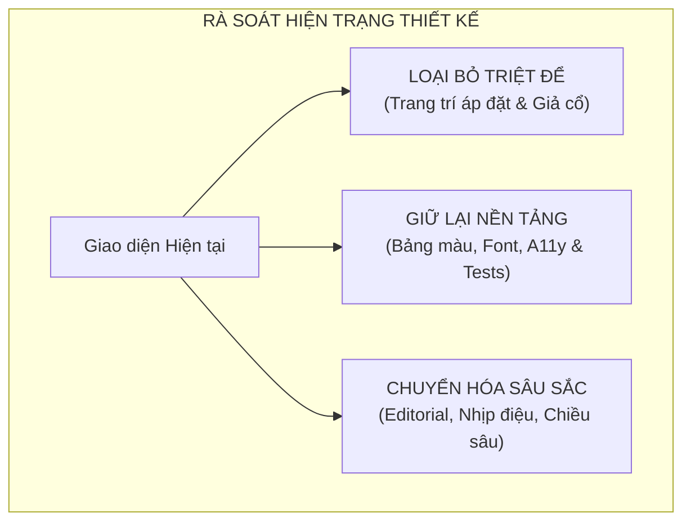
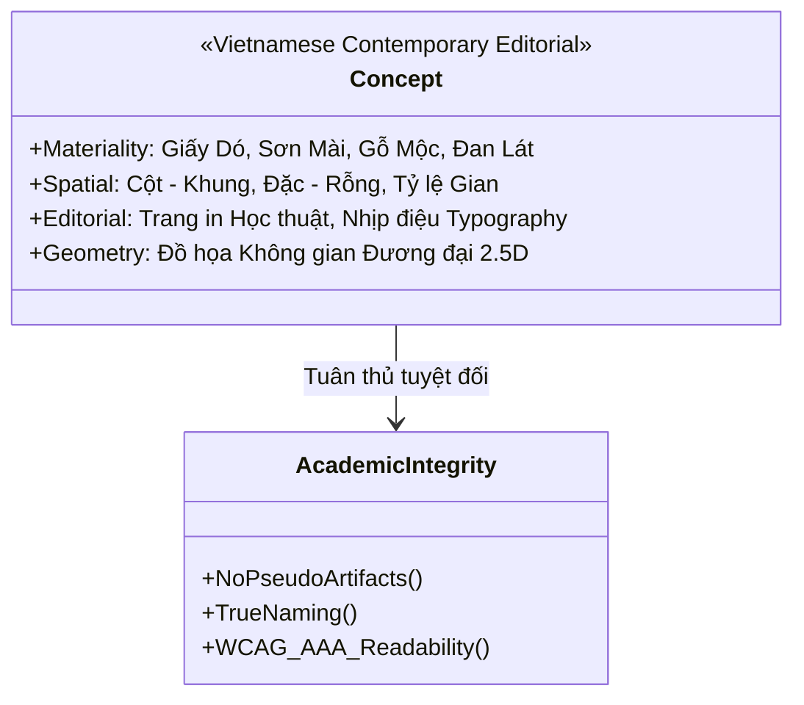
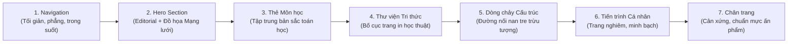

# BÁO CÁO THIẾT LẬP LẠI ĐỊNH HƯỚNG THIẾT KẾ (DESIGN DIRECTION RESET)

## Concept: Vietnamese Contemporary Editorial – A Universe of Knowledge

**Dự án:** Learning Universe — Nền tảng học tập Toán học đại học  
**Thời điểm lập:** 02/11/2026  
**Vị trí tài liệu:** `docs/design/VISUAL_DIRECTION_RESET.md`  
**Trạng thái:** Đề xuất kế hoạch chuyển đổi (Chờ phê duyệt — Chưa can thiệp mã nguồn)

---

## LỜI MỞ ĐẦU & NHẬN ĐỊNH CỦA ĐỘI NGŨ THIẾT KẾ

Chúng tôi hoàn toàn nhất trí và tiếp thu sâu sắc đánh giá thẳng thắn từ Chủ dự án:

> _"Văn hóa Việt Nam đang được thể hiện theo cách minh họa trực tiếp thay vì trở thành một ngôn ngữ thẩm mỹ xuyên suốt... Không đưa các biểu tượng văn hóa Việt Nam vào website chỉ để trang trí... Thiết kế cần thể hiện được tinh thần Việt Nam một cách tự nhiên, tinh tế, có chiều sâu nhưng vẫn là một nền tảng học tập hiện đại."_

Phiên bản trang chủ vừa qua đã mắc phải lỗi tư duy cơ bản: **sử dụng hoa văn như vật trang trí áp đặt (literal decoration)** thay vì nghiên cứu chuyển hóa văn hóa thành **ngôn ngữ thẩm mỹ nội tại (intrinsic aesthetic language)**. Việc tự vẽ lại họa tiết trống đồng bằng SVG code tay vừa không thể hiện được tính chính xác của hiện vật lịch sử, vừa khiến đồ họa trông giống một hoa văn Mandala trang trí chung chung; đồng thời, việc đóng khung thành chiếc huy hiệu ở góc phải Hero đã biến không gian học thuật thành một dạng trưng bày lưu niệm.

Báo cáo này xác lập lại toàn bộ tư duy thiết kế, chuyển dịch dứt khoát sang concept:  
**VIETNAMESE CONTEMPORARY EDITORIAL – A UNIVERSE OF KNOWLEDGE**.

---

## PHẦN I. ĐÁNH GIÁ HIỆN TRẠNG & BẢNG PHÂN LOẠI CHI TIẾT (BƯỚC 1)

Nhằm đảm bảo tính liên tục và không phá vỡ những nền tảng kỹ thuật vững chắc đã xây dựng, chúng tôi tiến hành rà soát toàn diện giao diện trang chủ theo 3 nhóm: **Loại bỏ**, **Giữ lại**, và **Chuyển hóa**.



### 1. Những yếu tố CẦN LOẠI BỎ HOẶC ĐÁNH GIÁ LẠI (Purge / Discard)

1. **Khung huy hiệu và Trống đồng vẽ tay ở Hero:**
   - _Lý do:_ Tạo cảm giác như một chiếc logo / con tem trang trí rời rạc; đồ họa vector tự vẽ tạo ra ấn tượng Mandala lai tạp, không có giá trị học thuật hay độ xác thực lịch sử.
   - _Hành động:_ Xóa bỏ hoàn toàn khối Card huy hiệu văn hóa bên phải Hero.
2. **Họa tiết chim Lạc, nan nón lá, hoa sen, mộng gỗ góc thẻ dùng làm icon/viền:**
   - _Lý do:_ Đây là cách biểu đạt "minh họa sáo rỗng" (cultural clichés). Việc gắn `WoodblockCornerMotif` lên 4 góc của mọi thẻ bài học và thẻ trụ cột biến giao diện thành sản phẩm giả cổ rẻ tiền.
   - _Hành động:_ Gỡ bỏ toàn bộ các icon minh họa văn hóa tùy tiện khỏi `SubjectCard`, `HomePage` và hệ thống UI dùng chung.
3. **Dải hoa văn hồi văn / răng lược tuần hoàn (`TraditionalMeanderBorder`):**
   - _Lý do:_ Bị lạm dụng ở chân Header, đáy thẻ Hero và đỉnh Bản đồ tri thức gây đứt gãy thị giác, tạo cảm giác phân chia cơ học thay vì hòa sắc không gian.
   - _Hành động:_ Gỡ bỏ khỏi chân Navbar và các khối giao diện.
4. **Hoa văn tự sáng tác nhưng dán nhãn di sản:**
   - _Lý do:_ Vi phạm nghiêm trọng Quy tắc Liêm chính Học thuật (`academic-integrity`) và Quy tắc Xác thực Văn hóa.
   - _Hành động:_ Chấm dứt hoàn toàn việc tự vẽ hoa văn rồi đặt tên là "họa tiết truyền thống Ngọc Lũ / Hoàng Hạ".

### 2. Những yếu tố CẦN GIỮ LẠI (Retain / Preserve)

1. **Bảng màu Di sản Việt Nam nền tảng:**
   - Nền Trắng ngà Giấy Dó (`#F7F4EC` / `--color-vn-bg`): Êm dịu cho mắt, giảm thiểu tối đa hiện tượng chói sáng (glare) của màn hình số khi đọc tài liệu toán lâu dài.
   - Bề mặt Trắng ấm Giấy Dó xén (`#FCFBF7` / `--color-vn-surface-card`): Phân tầng thẻ nội dung sạch sẽ.
   - Màu Mực Nho / Mực Tàu (`#292824` / `--color-vn-text`): Độ tương phản đạt chuẩn WCAG AAA trên nền giấy Dó, cho cảm giác chữ in sắc bén, trang nhã.
   - Màu Xanh Ngọc Trầm / Chàm Thảo Mộc (`#173E35` / `--color-vn-primary`): Điềm tĩnh, đại diện cho chiều sâu học vấn và bản sắc Việt đương đại.
   - Màu Son Chu Sa (`#8B302D` / `--color-vn-secondary`): Dùng với liều lượng cực kỳ tiết chế cho điểm nhấn mục lục, đánh dấu trọng tâm.
2. **Hệ thống Typography:**
   - Font chữ `Be Vietnam Pro`: Kiểu chữ sans-serif hiện đại, tối ưu hoàn hảo cho dấu thanh tiếng Việt (không bị lỗi vỡ dấu hay lệch khoảng cách ký tự).
   - Font chữ `JetBrains Mono`: Dành cho biểu thức toán học, nhãn mã nguồn và đánh số kỹ thuật.
3. **Cấu trúc 7 Phân khu Chức năng của Trang chủ:**
   - Cấu trúc thông tin logic: Header -> Hero Chào đón -> Không gian Khám phá Môn học -> Thư viện Tri thức -> Bản đồ Khái niệm -> Tiến trình Cá nhân -> Footer.
4. **Nền tảng Kỹ thuật & Kiểm thử (100% Zero-Regression):**
   - Giữ nguyên toàn bộ logic React 19, Zustand store (`useLearningStore`), cơ chế Guest / Learner mode, Instant SearchBar, bộ khớp đường dẫn URL (`kebab-case`), và toàn bộ 47/47 ca kiểm thử Vitest hiện hành.

### 3. Những yếu tố CẦN CHUYỂN HÓA & NÂNG CẤP (Transform / Evolve)

1. **Chuyển hóa từ "Hình vẽ Trống đồng" sang "Mạng lưới Tri thức Đồ họa Đương đại":**
   - Vùng bên phải của Hero sẽ trở thành một tác phẩm đồ họa hình học hiện đại (Modern Geometric Knowledge Network) lấy cảm hứng từ sự giao thoa không gian và liên kết toán học.
2. **Chuyển hóa Thư viện Tri thức sang Bố cục Trang in Học thuật (Academic Editorial):**
   - Biến 6 trụ cột học thuật từ dạng "card trang trí" thành các trang tài liệu nghiên cứu sắc nét, sử dụng số thứ tự in hoa thanh mảnh (`01` đến `06`), phân cấp khoảng trắng (white space) thoáng đãng, nhấn mạnh tính chuẩn mực của định nghĩa và chứng minh.
3. **Cân chỉnh ngắt dòng Tiêu đề Hero (Desktop Typography):**
   - Khắc phục lỗi tiêu đề bị bẻ gãy vụn vặt thành 3-4 dòng ngắn trên màn hình lớn. Bố cục lại thành nhịp đọc 2 dòng uyển chuyển, mạnh mẽ.

---

## PHẦN II. ĐỀ XUẤT ART DIRECTION MỚI: VIETNAMESE CONTEMPORARY EDITORIAL (BƯỚC 2)



### 1. Bốn Nguồn Cảm hứng Thẩm mỹ & Phương thức Chuyển hóa

#### A. Chất liệu Việt Nam (Materiality without Skeuomorphism)

- **Giấy Dó (Dó Paper Spirit):**
  - _Bản chất vật lý:_ Bền bỉ hàng trăm năm, sợi vỏ cây dó tự nhiên đan xen xốp nhẹ, bắt mực nhưng không nhòe, màu trắng ngà ấm áp.
  - _Chuyển hóa số:_ Thiết lập hệ màu nền dịu mắt (`#F7F4EC`), không dùng hiệu ứng giả lập sợi xơ nhân tạo nặng nề; thay vào đó là bề mặt phẳng lì tuyệt đối với sắc độ ấm (warm optical surface), mang lại cảm giác thân thuộc như đang mở một trang sách quý.
- **Sơn Mài (Lacquer Depth):**
  - _Bản chất vật lý:_ Nghệ thuật sơn mài truyền thống là kỹ thuật chồng nhiều lớp then, cánh gián, son, rồi mài phẳng để ánh lên chiều sâu hun hút từ bên dưới mặt phẳng bóng mờ.
  - _Chuyển hóa số:_ Áp dụng triết lý "layering" (đa tầng thị giác phẳng): Sử dụng các dải gradient mờ tinh tế (`radial-gradient`), lớp đổ bóng cực nhẹ phân tầng (`backdrop-blur-xs`, `shadow-2xs`), tạo cảm giác không gian có chiều sâu quang học mà không hề thô ráp.
- **Gỗ Mộc & Đan Lát (Timber Framing & Weaving):**
  - _Bản chất vật lý:_ Sự kết hợp giữa bộ khung cột gỗ vững chãi và các vách nan tre đan cài linh hoạt.
  - _Chuyển hóa số:_ Chuyển hóa thành hệ lưới bố cục (Grid System) cân đối: Khung viền thanh mảnh (1px hairline border `#DDD5C3`), nhịp điệu phân cách đều đặn, đường gióng chính xác, mang lại cảm giác vững chãi và kỷ cương học thuật.

#### B. Kiến trúc Truyền thống (Spatial Balance: Solid & Void)

- **Tỷ lệ Gian và Chái:**
  - Không gian kiến trúc Việt Nam không đồ sộ áp chế như kiến trúc cung điện phương Bắc, mà khiêm nhường, thanh thoát, chan hòa với thiên nhiên.
  - _Ứng dụng giao diện:_ Tránh tình trạng nhồi nhét đặc kín các phần tử; thiết lập hệ thống khoảng đệm (padding, margin, gap) rộng rãi.
- **Sự cân bằng giữa Đặc và Rỗng (Solid and Void):**
  - Khoảng trống trên trang web không phải là khoảng thừa, mà là **"Khoảng thở tri thức" (The Academic White Space)**. Nó cho phép tâm trí sinh viên lắng lại sau khi tiếp nhận một mệnh đề đại số trừu tượng.

#### C. Nghệ thuật Trình bày & Tư liệu Học thuật (Academic Editorial Design)

- **Bố cục Trang in Sách (Scholarly Book Page):**
  - Mỗi phần nội dung được tổ chức như một trang tài liệu học thuật kinh điển: Có phần tiêu đề trên (Folio / Running Header), tiêu đề chính gãy gọn, phân đoạn mạch lạc, chú thích lề trang nhã.
- **Cách đánh số và Phân cấp:**
  - Đánh số La Mã hoặc số thập phân thanh mảnh có số 0 đứng trước (`01`, `02`, `03`...) bằng font monospaced hoặc serif-like proportions, tạo nhịp điệu nghiêm túc của một công trình nghiên cứu.
- **Tuyệt đối không dùng hoa văn dưới nội dung học thuật:**
  - Định lý, bổ đề, chứng minh, công thức KaTeX hoàn toàn nằm trên nền phẳng tinh khiết để đạt độ tập trung nhận thức tối đa.

#### D. Hình học & Đồ họa Đương đại (Contemporary Abstract Geometry)

- **Mạng lưới Tri thức Đa chiều (Multi-dimensional Knowledge Graph):**
  - Lấy cảm hứng từ sự giao nhau của các không gian vector, các lớp kề của nhóm thương và lưới tọa độ affine.
  - Đồ họa SVG sử dụng các đường nét mảnh (stroke-width: 1px - 1.5px), các cung tròn đồng quy, các trục tọa độ trực giao và các nút giao điểm phát sáng tinh tế.
- **Tính Trung thực về Nguồn gốc:**
  - Định danh chính xác trong mã nguồn và tài liệu: _"Đồ họa không gian tri thức đương đại"_ — Không gán ghép hay giả xưng là hiện vật văn hóa cổ.

---

### 2. Thiết kế lại Hero Section (Hero Redesign Blueprint)

#### A. Bố cục Màn hình Lớn (Desktop $\ge 1024\text{px}$)

Cấu trúc Hero chia làm 2 cột theo tỷ lệ vàng đương đại:

```
+-----------------------------------------------------------------------------------+
|  EYEBROW: KHÔNG GIAN TRI THỨC ĐƯƠNG ĐẠI · HỌC PHẦN TOÁN HỌC ĐẠI HỌC               |
|                                                                                   |
|  [ CỘT TRÁI - 58% CHIỀU RỘNG ]                  [ CỘT PHẢI - 42% CHIỀU RỘNG ]     |
|                                                                                   |
|  H1: KHAI MỞ TRI THỨC                           ĐỒ HỌA TRỰC QUAN MẠNG LƯỚI       |
|      KẾT NỐI TƯƠNG LAI                          TRI THỨC ĐA CHIỀU (2.5D)          |
|                                                                                   |
|  Đoạn văn dẫn nhập trang nhã, nhịp nhàng...     (Các mặt phẳng tọa độ giao thoa,  |
|                                                  các nút cấu trúc Đại số & Affine |
|  [ Khám phá môn học -> ]  [ Bắt đầu học ]       liên kết bằng các đường mảnh,     |
|                                                  ánh sáng lan tỏa kiểu sơn mài)   |
|  [ Ô tìm kiếm tức thời SearchBar ____________ ]                                   |
+-----------------------------------------------------------------------------------+
```

1. **Tinh chỉnh Ngắt dòng Tiêu đề H1:**
   - Hiện trạng: Bị bẻ thành quá nhiều dòng ngắn vụn vặt.
   - Giải pháp mới:
     ```html
     <!-- Dòng phân loại chuẩn kiểm thử App.test.tsx -->
     <p class="text-vn-accent text-xs font-semibold tracking-widest uppercase">
       Không gian học tập Toán học đại học
     </p>
     <!-- Tiêu đề lớn cô đọng 2 dòng tự nhiên -->
     <h1 class="text-vn-text text-3xl font-extrabold tracking-tight sm:text-5xl lg:text-6xl">
       Khai mở Tri thức, <br class="hidden sm:inline" />
       <span class="text-vn-primary">Kết nối Tương lai</span>
     </h1>
     ```
2. **Khu vực Đồ họa Trực quan bên phải (The Contemporary Knowledge Universe Visual):**
   - Không sử dụng thẻ viền logo hay huy hiệu trống đồng.
   - Xây dựng một không gian đồ họa mở (open composition) tương tác nhẹ với chuột:
     - **Mặt phẳng cơ sở (Affine Coordinate Plane):** Lưới hình học phối cảnh trục đoaxonometric nghiêng 30 độ thanh thoát.
     - **Các Nút cấu trúc Đại số (Algebraic Nodes):** Các điểm hội tụ hình học biểu thị cho Nhóm ($G$), Vành ($R$), Trường ($F$) và Không gian Affine ($\mathbb{A}$).
     - **Đường liên kết hữu cơ (Topological Threads):** Các đường cong Bezier mảnh kết nối giữa các nút, minh họa cho sự chuyển giao tri thức từ tiên đề trừu tượng đến hình học cụ thể.
     - **Ánh sắc Sơn Mài:** Hiệu ứng điểm xuyết màu chu sa mờ và vàng kim đồng thau ở các điểm giao thoa quan trọng.

#### B. Bố cục Màn hình Nhỏ (Tablet & Mobile $< 1024\text{px}$)

- Đồ họa mạng lưới tri thức được tối giản thành một lớp nền hình học thanh nhã phía sau, không gây vướng mắt hoặc làm chậm thiết bị di động.
- Văn bản và các nút bấm hành động hiển thị mạch lạc, các ngón tay dễ dàng chạm và thao tác tìm kiếm.

---

### 3. Định hướng cho Toàn bộ các Phân vùng khác trên Website



| Khu vực                             | Hướng tiếp cận hiện tại                         | Hướng tiếp cận mới (Contemporary Editorial)                                                                                                                                              |
| :---------------------------------- | :---------------------------------------------- | :--------------------------------------------------------------------------------------------------------------------------------------------------------------------------------------- |
| **Thanh Điều hướng (Navbar)**       | Có dải viền hồi văn răng lược chạy dài bên dưới | **Tối giản hoàn toàn:** Đường viền phân cách siêu mảnh (`border-b border-vn-border/70`), nền giấy Dó mờ (`bg-vn-bg/90 backdrop-blur-md`), tập trung vào logo và các liên kết điều hướng. |
| **Thẻ Môn học (SubjectCard)**       | Có 2 mộng gỗ ở góc và watermark góc card        | **Đặc trưng môn học:** Gỡ bỏ các mộng gỗ trang trí. Nhấn mạnh vào tên môn, mô tả học thuật, thanh tiến độ trang nhã và biểu tượng hình học đại diện cho môn (Symmetry & Affine Grid).    |
| **Thư viện Tri thức (6 Trụ cột)**   | Mỗi card có một mộng gỗ góc giả cổ              | **Bố cục Trang in (Editorial Book Card):** Đánh số thứ tự to bản sắc nét (`01` đến `06`), typography phân cấp rõ ràng, biểu tượng trực quan logic tối giản, khoảng trắng rộng rãi.       |
| **Bản đồ Tri thức (Dòng chảy)**     | Khung viền gắn dải hồi văn trang trí            | **Mạng lưới Khái niệm Kỷ hà:** Sử dụng các đường liên kết thanh mảnh gợi nhớ đến nan tre đan lát trừu tượng, dẫn hướng trực quan giữa các chương bài.                                    |
| **Nội dung Bài học (MDX / Reader)** | Tuyệt đối không trang trí dưới bài              | **Giữ nguyên sự nghiêm cẩn:** 100% văn bản học thuật, công thức KaTeX, khối định lý/chứng minh không bị bất kỳ họa tiết nào làm phân tâm.                                                |
| **Chân trang (Footer)**             | Dải Kagome Weave lớn ngăn cách                  | **Cân xứng ấn bản sách in:** Sử dụng đường hairline tinh gọn, thông tin bản quyền và sứ mệnh giáo dục sư phạm được căn lề chuẩn mực.                                                     |

---

## PHẦN III. BẢNG THAM CHIẾU HỆ THỐNG MÃ THIẾT KẾ (DESIGN TOKENS)

### 1. Bảng màu Chuẩn mực (Calibrated Palette)

Hệ thống token màu sắc được tinh chỉnh để tôn vinh chất liệu và khả năng đọc:

```css
:root {
  /* Nền tảng: Chất liệu Giấy Dó & Bề mặt trang in */
  --color-vn-bg: #f7f4ec; /* Trắng ngà Giấy Dó nguyên bản */
  --color-vn-surface: #efe7d6; /* Sắc Giấy Dó đậm vùng đệm */
  --color-vn-surface-card: #fcfbf7; /* Trắng ấm trang sách tinh khiết */

  /* Màu Mực & Chữ (Mực Tàu / Ink on Paper) */
  --color-vn-text: #292824; /* Mực than tự nhiên, tương phản cao, êm dịu */
  --color-vn-muted: #68645c; /* Mực xám nhạt cho phụ đề và chú thích */

  /* Màu Bản sắc (Thảo mộc & Sơn Mài) */
  --color-vn-primary: #173e35; /* Xanh Chàm / Ngọc trầm trang trọng */
  --color-vn-primary-hover: #1f5045; /* Sắc chuyển khi tương tác */
  --color-vn-secondary: #8b302d; /* Son Chu Sa (dùng làm điểm nhấn nhỏ) */
  --color-vn-accent: #b89555; /* Hoàng thổ / Vàng kim đồng cổ */

  /* Đường phân cách mộc mạc (Hairline Architectural Borders) */
  --color-vn-border: #ddd5c3; /* Nét kẻ mực nhạt thanh mảnh */
  --color-vn-border-soft: #eae3d4; /* Phân cách nhẹ bên trong khối */
}
```

### 2. Nguyên tắc Typography & Cân chỉnh Khoảng trắng (Spacing & Ratios)

- **Tỷ lệ đề mục:** Đảm bảo tỉ lệ bước nhảy kiểu chữ (Type Scale) dạng _Major Third (1.250)_ hoặc _Perfect Fourth (1.333)_ để giữ nhịp điệu học thuật cân xứng.
- **Khoảng cách đệm (Whitespace Padding):**
  - Card chính: Tối thiểu `padding: 1.5rem` (24px) đến `2rem` (32px).
  - Khoảng cách giữa các phần (Section Spacing): `space-y-16` đến `space-y-20` (64px - 80px), tạo nhịp thở trang nghiêm như lật từng chương sách lớn.

---

## PHẦN IV. KẾ HOẠCH TRIỂN KHAI KHI ĐƯỢC PHÊ DUYỆT

Ngay sau khi Chủ dự án phê duyệt bản đề xuất này, các bước chuyển đổi kỹ thuật sẽ được tiến hành thận trọng theo trình tự:

1. **Làm sạch hệ thống UI Motifs (`src/shared/ui/HeritageMotifs.tsx` & `src/shared/ui/index.ts`):**
   - Loại bỏ `DongSonDrumVisual`, `TraditionalMeanderBorder`, `WoodblockCornerMotif`.
   - Xây dựng component mới: `KnowledgeNetworkVisual` (Đồ họa trực quan mạng lưới tri thức 2.5D thanh lịch, trung thực, nhẹ nhàng).
2. **Tinh chỉnh Header và Footer (`src/layouts/RootLayout.tsx`):**
   - Gỡ bỏ dải hồi văn dưới Header; đưa Header về phong cách tối giản thanh lịch.
3. **Cải tạo Hero Section (`src/pages/home/HomePage.tsx`):**
   - Cân chỉnh lại ngắt dòng tiêu đề H1 thành 2 dòng tự nhiên trên Desktop.
   - Thay thế toàn bộ cụm huy hiệu bên phải bằng `KnowledgeNetworkVisual`.
4. **Chuẩn hóa Editorial cho Thư viện Tri thức & Card Môn học:**
   - Đưa phong cách typography đánh số `01` - `06` vào 6 trụ cột học thuật; gỡ bỏ mộng gỗ trang trí góc.
   - Tối giản thẻ môn học, tập trung vào cấu trúc học phần và tiến độ thực tế.
5. **Kiểm định Toàn diện (Validation Pipeline):**
   - Chạy `npm.cmd run check` (Prettier, ESLint, TypeScript `strict`, Content Validator, Vitest 47/47 tests).
   - Chạy `npm.cmd run build` đóng gói bản sản xuất.

---

## PHẦN V. KẾT LUẬN & ĐỀ NGHỊ

Định hướng mới **Vietnamese Contemporary Editorial – A Universe of Knowledge** trả văn hóa Việt Nam về đúng vị thế cao quý của nó: **Một linh hồn thẩm mỹ ẩn hiện trong tỷ lệ, màu sắc, nhịp điệu và không gian**, thay vì chỉ là những chiếc huy hiệu hoặc hoa văn minh họa dán ngoài bề mặt.

Giao diện mới sẽ giữ trọn sự tôn nghiêm của toán học đại học, vẻ đẹp tinh tế của chất liệu sách in truyền thống và sự tiện nghi của một nền tảng công nghệ số đương đại.

> **Trạng thái hiện tại:** Đã hoàn thành Bước 1 và Bước 2. Chưa thay đổi bất kỳ dòng mã nguồn nào trong `src/`.  
> Kính mời Chủ dự án xem xét và cho ý kiến chỉ đạo đối với bản báo cáo thiết kế này trước khi chúng tôi bắt đầu triển khai code!
